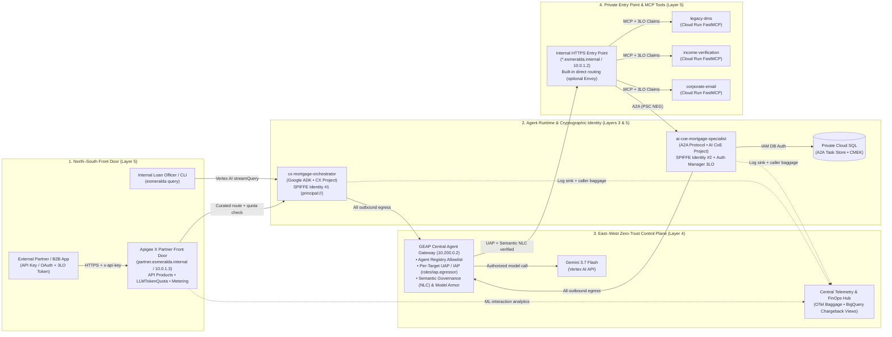

<div align="center">
  
  <h1><code>esmeralda</code></h1>
  <p>An opinionated, commercial-grade reference blueprint for taking autonomous AI Agents and MCP tool servers from prototype to zero-trust production on Google Cloud.</p>

  <p>
    <a href="#the-challenge">Why Esmeralda</a> &nbsp;&nbsp;|&nbsp;&nbsp;
    <a href="#architecture">Architecture</a> &nbsp;&nbsp;|&nbsp;&nbsp;
    <a href="#capabilities">Capabilities</a> &nbsp;&nbsp;|&nbsp;&nbsp;
    <a href="#quick-start">Quick Start</a> &nbsp;&nbsp;|&nbsp;&nbsp;
    <a href="#docs">Documentation</a>
  </p>

  <p>
    <a href="LICENSE"></a>
    <a href="https://cloud.google.com/"></a>
    <a href="https://www.terraform.io/"></a>
    <a href="https://cloud.google.com/vertex-ai"></a>
  </p>
</div>

---

<a id="the-challenge"></a>
### Why Esmeralda: From Laptop Prototype to Multi-Team Production

Building an AI agent prototype on a laptop takes an afternoon. Taking that same agent into enterprise production—where it must verify customer identities, query sensitive document systems, collaborate with specialist agents across departments, and pass security and FinOps audits—is where most initiatives stall.

When architecture is tightly coupled, every change turns into a cross-team bottleneck: an AI engineer changing a prompt waits on a networking ticket, a backend team updating a tool forces an agent redeploy, and SecOps has to audit custom glue code for every new service.

**Esmeralda** solves this with a **Decoupled Layered Architecture that enables Multi-Track Parallelism**. By separating the platform into six composable layers (`L0 CI/CD` through `L5 Workloads`) joined by four stable contracts—private DNS (`*.esmeralda.internal`), the central `Agent Registry`, the declarative `env.yaml` service catalog, and `agent.yaml` runtime specs—seven distinct engineering tracks can build, test, and ship in parallel without blocking one another:

| Track / Team | What They Own | Contract Boundary | Example in Esmeralda |
| :--- | :--- | :--- | :--- |
| **CX Product Team** | Customer-facing **orchestrator** agents (Google ADK) | Calls specialists via `https://<agent>.esmeralda.internal` (A2A) | `cx-mortgage-orchestrator` (`esm-<env>-cx-agents-<sfx>`) |
| **AI CoE Team** | Reusable **specialist** agents published over **A2A** | Publishes an Agent Card in `Agent Registry`; calls tools via MCP | `ai-coe-mortgage-specialist` (`esm-<env>-ai-coe-agents-<sfx>`) |
| **Backend / MCP Teams** | Standalone **Model Context Protocol (MCP)** microservices | Exposes JSON-RPC tools at `https://<svc>.esmeralda.internal/mcp` (`tools.json`) | `legacy-dms`, `income-verification`, `corporate-email` (`esm-<env>-mcps-<sfx>`) |
| **Gateway / Partner API Team** | Private front door (`entrypoint`) and optional L7 adapters | Routes `catalog` hosts via built-in `direct` routing or `envoy` / `apigee` | `entrypoint`, `gateways/direct`, `gateways/envoy` (`esm-<env>-gateway-<sfx>`) |
| **Governance & FinOps Team** | Outbound policy enforcement, guardrails, and chargeback | Governs egress via **Central Agent Gateway**, `Agent Registry` & BigQuery views | `layer-4-governance` (`esm-<env>-governance-<sfx>`) |
| **SecOps & Identity Team** | Zero-trust identity, encryption, and private PKI | Provisions SPIFFE Agent Identities, KMS CMEK, and the internal Root CA | `layer-3-security` |
| **Cloud Networking Team** | Private network fabric and DNS | Owns Shared VPC, PSC attachments, and the `*.esmeralda.internal` DNS zone | `layer-1-projects`, `layer-2-networking` (`esm-<env>-net-host-<sfx>`) |

---

### End-to-End Scenario: Julian Sterling's Mortgage Application

Throughout the repository and documentation, we follow a single end-to-end scenario: a loan officer asks Esmeralda, ***"Can you verify Julian Sterling's income?"***

1. **Customer Experience (`cx-mortgage-orchestrator`):** Receives the question on Vertex AI Agent Runtime, reasons with Gemini, and discovers that mortgage underwriting belongs to the AI Center of Excellence's specialist agent.
2. **Governed Delegation (`Central Agent Gateway` → `Entry Point`):** The orchestrator sends an A2A task to `https://ai-coe-mortgage-specialist.esmeralda.internal`. The **Central Agent Gateway** verifies the orchestrator's SPIFFE Agent Identity and confirms the destination is allowlisted in the **Agent Registry**, then forwards the call privately to the internal HTTPS load balancer (**entry point**), which routes it straight to the specialist engine (`direct` backend).
3. **Private Tool Execution (`ai-coe-mortgage-specialist` → `MCP Servers`):** The specialist calls `income-verification`, `legacy-dms`, and `corporate-email` over MCP (`https://<svc>.esmeralda.internal/mcp`)—again governed by the Central Agent Gateway and routed directly to private Cloud Run services with the caller's own identity token.
4. **Full Attribution (`FinOps & Telemetry`):** Every model token, tool call, and latency span is streamed to central BigQuery chargeback views so business leaders see the exact cost and performance of each department's agent.

---

<a id="architecture"></a>
### Architecture at a Glance



#### How the Security, Identity, and Gateway Planes Fit Together

| Plane | Component | Direction | What It Governs |
| :--- | :--- | :--- | :--- |
| **External / Partner API Plane** | **Apigee X** (`partner.esmeralda.internal` / `10.0.1.3`) | **North–South** | Authenticates external B2B partners (`VerifyAPIKey` / OAuth), curates exposed agents (`partner-agents`) and MCP tools (`partner-mcp`), enforces commercial `<LLMTokenQuota>` (`429`), and meters per-consumer token usage. |
| **Workload & User Identity Plane** | **GEAP Agent Identity & Auth Manager** (`agents.global.org-<ORG>.system.id.goog`) | **End-to-End Identity** | Provisions a non-impersonatable X.509 **SPIFFE ID (`principal://`)** per Reasoning Engine and brokers **3-Legged OAuth (3LO)** end-user tokens (`X-Esmeralda-User-Token`) so tools can verify both *which agent* and *which human* initiated the action. |
| **Internal Agent Egress Plane** | **GEAP Central Agent Gateway** (`10.200.0.2`) | **East–West** | Intercepts every outbound call an agent makes, enforcing **Agent Registry** allowlists, per-target **Unified Access Policies (UAP / IAP)**, **Semantic Governance (Natural Language Constraints, NLC)** against Confused Deputy tool calls, and **Model Armor** inspection. |
| **Private Service Routing Plane** | **Internal HTTPS Entry Point** (`*.esmeralda.internal` / `10.0.1.2`) | **Private VPC Fabric** | Terminates internal TLS signed by the Layer 3 Root CA and routes each `*.esmeralda.internal` host directly to its Cloud Run serverless NEG or Agent Runtime PSC NEG (`direct` backend by default, or optional `envoy` / `apigee` adapters). |

---

<a id="capabilities"></a>
### Key Capabilities & Enterprise Highlights

| Pillar | Capability | Description |
| :--- | :--- | :--- |
| **Multi-Track Parallelism** | **Decoupled 6-Layer Architecture** | Modular Terragrunt progression—Shared CI/CD (`L0`), Projects (`L1`), Networking (`L2`), Security & PKI (`L3`), Governance (`L4`), and Workloads (`L5`)—allowing platform, security, tool, AI, and partner API teams to ship independently. |
| **Cryptographic Identity** | **GEAP SPIFFE Identity & Auth Manager (3LO)** | Every Reasoning Engine runs with an attested SPIFFE identity (`principal://`) bound per target on the Central Agent Gateway (zero shared service accounts or org-wide wildcards), paired with Auth Manager 3LO user delegation and zero-latency MCP claims verification (`esmeralda.mcp_authz`). |
| **Zero-Trust Governance** | **Central Agent Gateway, UAPs & Semantic NLC** | Google-managed egress control plane enforcing **Agent Registry** discovery, per-target **Unified Access Policies (UAPs)**, runtime **Semantic Governance (Natural Language Constraints)** to block Confused Deputy / SSN exfiltration attacks, and **Model Armor**. |
| **Partner Monetization** | **Removable Apigee X Capability Modules** | Optional Layer 5 capability bundles (`partner-agents`, `partner-mcp`, `token-quota`, `usage-metering`, `cross-cloud`) and tiered API Products (`bronze`, `silver`, `gold`) toggled declaratively via `governance.capabilities` in `env.yaml`. |
| **Multi-Agent & MCP Ecosystem** | **A2A Protocol & Serverless FastMCP** | The CX orchestrator (Google ADK) delegates underwriting over **A2A** to the AI CoE specialist, which invokes private Cloud Run **FastMCP** servers (`legacy-dms`, `income-verification`, `corporate-email`) at `https://<svc>.esmeralda.internal/mcp`. |
| **Observability & FinOps** | **OpenTelemetry Baggage & BigQuery Chargeback** | Cross-project W3C baggage propagation (`BaggageSpanProcessor`), structured token telemetry, hub-and-spoke log sinks, automated BigQuery chargeback SQL views (`vw_monthly_agent_chargeback`), and Cloud Monitoring Golden Signals. |
| **Unified Developer CLI** | **`esmeralda` CLI & MCP Server** | First-class CLI (`uv run esmeralda ...`, published as `esmeralda-platform`) and read-only MCP server (`uv run esmeralda mcp`) for local development, guarded Terraform plans/applies, live partner & internal verification (`esmeralda verify --partner`), and AI-assisted operations. |

---

<a id="quick-start"></a>
### Quick Start

Requires `gcloud`, `terraform`, `terragrunt`, and [`uv`](https://docs.astral.sh/uv/). Export your billing account (`ESMERALDA_BILLING_ACCOUNT`, and optionally `ESMERALDA_ORG_ID`) and review `infrastructure/live/<env>/env.yaml`.

#### 1. Using the `esmeralda` CLI (Recommended)

The `esmeralda` CLI inspects your environment, validates contracts, runs local or remote agent queries, plans and applies infrastructure units with destroy-guard protection, and verifies every route end to end:

```bash
uv run esmeralda doctor --env dev          # preflight checks (tools, auth, env.yaml)
uv run esmeralda status --env dev          # live status of layers, catalog hosts & gateways
uv run esmeralda contracts                 # inspect gateway & catalog architectural contracts
uv run esmeralda guard --all               # run security & hygiene guards across the repo

# Local development: run an agent + local MCP servers in one command
uv run esmeralda query apps/agents/cx-mortgage-orchestrator \
  -q "Can you verify Julian Sterling's income?"

# Infrastructure lifecycle & end-to-end verification
uv run esmeralda units --env dev           # list all deployable Terragrunt units
uv run esmeralda plan <unit> --env dev     # plan a unit
uv run esmeralda apply <unit> --env dev    # apply a unit (enforces destroy guard)
uv run esmeralda verify --env dev          # probe every catalog route + live orchestrator query
uv run esmeralda logs cx-mortgage-orchestrator --env dev
```

Coding agents can also inspect the workspace directly via the read-only MCP server:

```bash
uv run esmeralda mcp
```

#### 2. Using `make` Targets (Full-Stack Automation)

The root `Makefile` wraps full-environment bootstrap, testing, image builds, and multi-layer deployments:

```bash
make bootstrap                 # preflight checks + uv workspace sync
make test-all                  # Python unit tests + Terraform validation + gateway harness
make deploy-all ENV=dev        # Layer 0 -> 1-3 -> 4 -> build images -> 5
make test-e2e ENV=dev          # specialist, then orchestrator -> specialist through the gateway
make test-gateway ENV=dev      # probe every *.esmeralda.internal route + live query
```

Run `uv run esmeralda --help` or `make help` for the complete command reference.

---

<a id="docs"></a>
### Documentation

**Read the full documentation online: <https://google.github.io/esmeralda/>**. The source pages live in [`docs/src/`](docs/src/index.md):

* **[Overview: Architecture & Documentation](docs/src/index.md)** — Why enterprise agents stall, how Esmeralda's decoupled layers enable multi-track parallelism, and Julian Sterling's end-to-end request tour.
* **[1. Workloads, Catalog & Gateways (Layer 5)](docs/src/2-workloads-and-catalog/index.md)**
  * [1.1 Two Teams, Two Agents — Orchestration vs. Specialization (ADK & A2A)](docs/src/2-workloads-and-catalog/03-ai-agents-and-database.md)
  * [1.2 Wrapping Enterprise Systems as MCP Tool Servers](docs/src/2-workloads-and-catalog/02-mcp-tool-servers.md)
  * [1.3 The Private Front Door & Pluggable Gateways](docs/src/2-workloads-and-catalog/01-ingress-gateways.md)
  * [1.4 Partner API Management & Token Monetization with Apigee X](docs/src/2-workloads-and-catalog/04-apigee-partner-gateway.md)
* **[2. Governance, Identity & AgentOps (Layer 4)](docs/src/3-agentops-and-lifecycle/index.md)**
  * [2.1 Central Agent Gateway & Private PKI](docs/src/3-agentops-and-lifecycle/01-central-agent-gateway.md)
  * [2.2 Capability-Based & Semantic Governance](docs/src/3-agentops-and-lifecycle/04-capability-based-governance.md)
  * [2.3 FinOps, Telemetry & Cross-Team Chargeback](docs/src/3-agentops-and-lifecycle/03-centralized-monitoring-and-dashboards.md)
  * [2.4 Day-2 Operations with the `esmeralda` CLI & MCP Server](docs/src/3-agentops-and-lifecycle/04-operating-with-agents.md)
* **[3. Platform Foundations (Layers 1–3)](docs/src/1-platform-foundations/index.md)**
  * [3.1 Projects, APIs & FinOps Isolation (Layer 1)](docs/src/1-platform-foundations/01-projects-and-finops.md)
  * [3.2 Private Networking, Shared VPC & DNS (Layer 2)](docs/src/1-platform-foundations/02-private-networking.md)
  * [3.3 Security, SPIFFE Identity, CMEK & Internal PKI (Layer 3)](docs/src/1-platform-foundations/03-security-iam-and-telemetry.md)
* **[4. Esmeralda Library & CLI](docs/src/4-esmeralda-library/index.md)**
  * [4.1 Developer Usage Guide](docs/src/4-esmeralda-library/guide.md) & [4.2 Package & CLI Reference](docs/src/4-esmeralda-library/reference.md)
* **[5. Reference & Contributing](docs/src/contributing.md)** — [5.1 Make Targets](docs/src/reference/make-targets.md), [5.2 Contributing Guide](docs/src/contributing.md), [AGENTS.md](AGENTS.md), [`llms.txt`](docs/src/llms.txt), and [5.3 Code of Conduct](docs/src/code-of-conduct.md).
