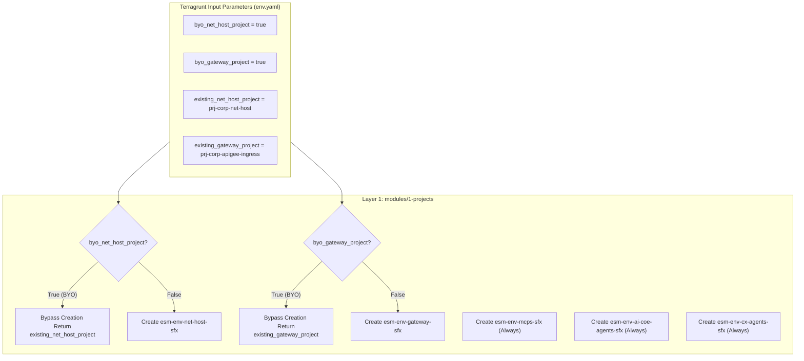
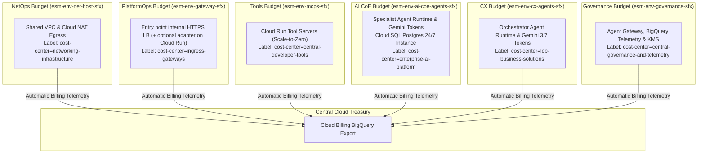

# 3.1 Project Isolation, Blast Radius & FinOps (Layer 1)

## 1. Why One Project Is Never Enough

When **Julian Sterling** submits his mortgage application, a single user interaction triggers work across multiple distinct organizational teams. The **Customer Experience (CX) team** runs `cx-mortgage-orchestrator`, which greets Julian and coordinates the conversation. Behind the scenes, that orchestrator delegates the heavy underwriting analysis to `ai-coe-mortgage-specialist`—built and maintained by the **AI Center of Excellence (AI CoE) team**—which in turn calls three internal **Model Context Protocol (MCP) tool servers** (`legacy-dms`, `income-verification`, and `corporate-email`) maintained by the **AppDev Tools team**. Meanwhile, **NetOps** operates the private network, **PlatformOps** runs the ingress load balancer, and **SecOps** guards the encryption keys and audit logs.

What happens if a bank deploys all of those teams into a single Google Cloud project? Three production failures inevitably follow:

1. **The FinOps Attribution Blackout:** Every Gemini token consumed by the CX orchestrator and the AI CoE specialist—along with the 24/7 Cloud SQL database and scale-to-zero Cloud Run MCP tools—lands on one undifferentiated invoice. The CFO cannot tell whether consumer chat traffic or deep document underwriting is driving the monthly AI bill.
2. **IAM Boundary Bleeding:** A tool developer granted permissions to debug an MCP server in a shared project can accidentally gain visibility into central KMS encryption keys, platform secrets, or another team's agent configurations.
3. **API Quota Starvation:** In Google Cloud, Vertex AI and Cloud Run quotas are enforced per project. If an experimental agent enters a runaway retry loop in a shared project, it exhausts the Vertex AI token-per-minute quota and brings down every enterprise agent simultaneously.

**Layer 1 solves all three problems before a single line of agent code is deployed.** It provisions **six isolated Google Cloud projects per environment** (plus the shared Layer 0 CI/CD project), links each to the corporate billing account with explicit `cost-center`, `team`, and `env` labels, activates only the exact APIs each domain needs, and pre-creates Google-managed service identities so downstream layers never hit IAM race conditions.

* **Module:** [`infrastructure/modules/1-projects/`](../../../infrastructure/modules/1-projects/main.tf)
* **Live config:** `infrastructure/live/<env>/layer-1-projects/` (inputs from `infrastructure/live/<env>/env.yaml`)
* **Deploy:** `uv run esmeralda apply layer-1-projects --env <env>` (or `make deploy-projects ENV=<env>`)

> [!NOTE]
> The CI/CD project is **not** part of Layer 1. It is created once, for all environments, by Layer 0 (`uv run esmeralda apply layer-0-cicd` / `make deploy-cicd`, module [`0-cicd`](../../../infrastructure/modules/0-cicd/main.tf)) as `esm-cicd-<sfx>`. It holds the mutable dev image repository (`esmeralda-containers`), the immutable release repository (`esmeralda-containers-release`), and the `sa-esmeralda-builder` / `sa-esmeralda-promoter` service accounts.

---

## 2. Key Decisions & Project Inventory

| Decision | Alternative Considered | Why We Chose This |
| :--- | :--- | :--- |
| **6 Per-Environment Projects + 1 Shared CI/CD Project** | Single monolithic GCP project per environment | Gives every team (`netops`, `platformops`, `appdev-tools`, `ai-coe`, `cx`, `security-and-platformops`) its own IAM perimeter, independent Vertex AI quota pool, and automatic Cloud Billing chargeback label. |
| **Separate Projects for CX Orchestrators (`cx-agents`) and AI CoE Specialists (`ai-coe-agents`)** | One combined `agents` project for all AI workloads | Consumer-facing orchestrators and reusable domain specialists ship on different cadences, pay from different departmental budgets, and require distinct Agent Identity `principalSet` trust boundaries (see [3.3 Security, SPIFFE Identity & PKI](./03-security-iam-and-telemetry.md)). |
| **Per-Project `byo_*` Brownfield Toggles in `env.yaml`** | Requiring greenfield project creation for every deployment | Enterprise landing zones often mandate pre-existing `net-host`, `gateway`, or `governance` projects. Flipping `byo_*_project = true` lets Layer 1 adopt existing corporate projects while still creating the workload projects (`mcps`, `ai-coe-agents`, `cx-agents`). |
| **Eager Service Identity Bootstrapping (`google_project_service_identity`)** | Relying on lazy Google service agent creation on first resource deploy | Google normally creates `service-<NUMBER>@gcp-sa-aiplatform.iam.gserviceaccount.com` lazily when the first agent is deployed. Bootstrapping all 8 service agents in Layer 1 prevents `400 Bad Request: Principal does not exist` race conditions when Layers 2 and 3 bind subnet and KMS IAM roles. |

### The 7 Specialized GCP Projects

Each per-environment project is named `<project_prefix>-<name>-<sfx>` (`project_prefix` is `esm-dev` / `esm-prd`; `<sfx>` is a random 4-hex suffix shared by all projects of the environment), plus one shared CI/CD project:

| # | Project | Owner (`team` label) | Purpose |
| :- | :--- | :--- | :--- |
| 1 | `esm-<env>-net-host-<sfx>` | **NetOps** (`netops`) | Shared VPC, routing, Cloud NAT and the private DNS zone `esmeralda.internal.` |
| 2 | `esm-<env>-gateway-<sfx>` | **PlatformOps** (`platformops`) | API ingress: the entry point (internal HTTPS load balancer) with its built-in `direct` backend, plus optional adapters such as Envoy on Cloud Run and Apigee X partner capability modules (`partner-agents`, `partner-mcp`, `token-quota`, `usage-metering`) |
| 3 | `esm-<env>-mcps-<sfx>` | **AppDev Tools** (`appdev-tools`) | Reusable serverless Model Context Protocol (MCP) tool servers (`legacy-dms`, `income-verification`, `corporate-email`) |
| 4 | `esm-<env>-ai-coe-agents-<sfx>` | **AI CoE team** (`ai-coe`) | Reusable A2A specialist agents (`ai-coe-mortgage-specialist`) and their private Cloud SQL task store |
| 5 | `esm-<env>-cx-agents-<sfx>` | **CX team** (`cx`) | User-facing orchestrator agents (`cx-mortgage-orchestrator`), which consume the AI CoE agents; also hosts the test VM |
| 6 | `esm-<env>-governance-<sfx>` | **Security & PlatformOps** (`security-and-platformops`) | Agent Gateway, Agent Registry, KMS keys, secrets, telemetry sinks, alerts and FinOps views |
| 7 | `esm-cicd-<sfx>` (shared, Layer 0) | **Platform Engineering** (`platform-engineering`) | Cloud Build and the dev/release Artifact Registry repositories |

### Brownfield Fallback (`byo_*` Toggles)

If `byo_net_host_project`, `byo_gateway_project`, or `byo_governance_project` is `true` in `env.yaml`, Layer 1 skips project creation and API enablement for that project and returns `existing_*_project` to downstream layers (`byo_networking` in Layer 2 and `byo_security` in Layer 3 follow the same pattern):



---

## 3. Persona & Role Breakdown: Who Owns Layer 1?

| Engineering Persona | Role & Daily Responsibilities | What They Own | What They NEVER Touch |
| :--- | :--- | :--- | :--- |
| **FinOps / Cloud Treasury** | Enforcing budget thresholds, monitoring token cost-centers, auditing monthly agent chargebacks. | Project labels (`cost-center`, `team`, `env`), Cloud Billing exports, BigQuery billing datasets. | Agent prompts, Python code, MCP tool endpoints. |
| **Platform / Landing Zone Lead** | Maintaining organizational compliance, project factories, and API activation policies. | `infrastructure/modules/1-projects/`, Terraform project resources, service agent lifecycle. | Application business logic, database SQL schemas. |
| **AI Application Developer** (CX or AI CoE team) | Writing prompt graphs and building agent reasoning capabilities. | Python logic in `apps/agents/<agent>/`. | Project creation, billing linkages, or GCP service API enablements. |

---

## 4. FinOps Cost Attribution Architecture

Because every team has its own project, and every project carries `cost-center`, `team` and `env` labels, costs can be attributed in the Cloud Billing BigQuery export without guesswork:



> [!NOTE]
> The Cloud Billing export itself is a billing-account setting managed by your billing administrators; Esmeralda does not create it. Esmeralda adds a **token-level** chargeback on top (BigQuery view `vw_monthly_agent_chargeback`, built in Layer 4). See [Centralized Monitoring & FinOps](../3-agentops-and-lifecycle/03-centralized-monitoring-and-dashboards.md).

### Key FinOps Guarantees:
1. **Serverless vs. Persistent Segregation:** The continuous 24/7 cost of Cloud SQL is isolated inside the AI CoE budget (`esm-<env>-ai-coe-agents-<sfx>`), while serverless MCP tools (`esm-<env>-mcps-<sfx>`) scale to zero when idle.
2. **Consumer vs. Provider Segregation:** When the CX orchestrator calls the AI CoE specialist, each agent's model tokens land on its own team's project, so a reusable agent's cost is visible separately from the agents that consume it.
3. **Private Service-to-Service Traffic:** Agent-to-tool and agent-to-agent traffic reaches the entry point over private IPs inside the Shared VPC in `us-central1`, not over the public internet.

---

## 5. Technical Architecture & In Practice (`modules/1-projects/`)

### 1. Service API Enablement Matrix (`google_project_service`)
Each project receives the list of Google APIs required for its operational domain. Layer 1 first enables `serviceusage` and `cloudresourcemanager` on every new project with `gcloud` (a bootstrap step), then enables the rest declaratively:

| Project | Enabled Google Cloud Service APIs |
| :--- | :--- |
| **`net_host`** | `compute`, `dns`, `servicenetworking`, `networksecurity`, `networkservices`, `certificatemanager`, `logging`, `cloudresourcemanager` |
| **`gateway`** | `compute`, `apigee`, `certificatemanager`, `logging`, `secretmanager`, `run`, `iam`, `cloudresourcemanager` |
| **`mcps`** | `compute`, `run`, `artifactregistry`, `secretmanager`, `logging`, `cloudbuild`, `agentregistry`, `cloudresourcemanager` |
| **`ai_coe_agents`** and **`cx_agents`** (identical lists) | Runtime: `aiplatform`, `run`, `compute`, `storage`, `sqladmin`, `servicenetworking`, `artifactregistry`, `secretmanager`. Agent Gateway & identity: `agentregistry`, `agentidentity`, `iap`, `iam`, `iamcredentials`, `networkservices`, `networksecurity`, `modelarmor`. Telemetry: `logging`, `monitoring`, `cloudtrace`, `telemetry`, `observability`, `bigquerystorage`. Plus `cloudresourcemanager`, `apphub`, `apptopology`, `cloudapiregistry`, `dataform`, `notebooks`, `appengine`, `securitycenter`, `texttospeech`, `saasservicemgmt`. |
| **`governance`** | `bigquery`, `logging`, `clouderrorreporting`, `cloudtrace`, `monitoring`, `cloudkms`, `secretmanager`, `dlp`, `pubsub`, `looker`, `modelarmor`, `networkservices`, `networksecurity`, `agentregistry`, `iap`, `compute`, `aiplatform`, `cloudresourcemanager` (Layer 4 additionally enables `certificatemanager` for the Agent Gateway TrustConfig) |
| **`cicd`** (Layer 0) | `artifactregistry`, `cloudbuild`, `storage`, `logging`, `iam`, `serviceusage`, `cloudresourcemanager` |

*(All entries are `<name>.googleapis.com`.)*

---

### 2. Service Identity Bootstrapping (`google_project_service_identity`)
**What it is:** a *service agent* is a Google-managed service account (for example `service-<PROJECT_NUMBER>@gcp-sa-aiplatform.iam.gserviceaccount.com`) that a Google service uses to act inside your project. Google normally creates it lazily, the first time the service is used.

**In Esmeralda:** later layers grant roles to these service agents (network access in Layer 2, KMS and Artifact Registry access in Layer 3). To prevent IAM race conditions where a grant targets a service agent that does not exist yet, Layer 1 explicitly bootstraps **eight** of them:

1. `mcps_run`: Cloud Run service agent in `esm-<env>-mcps-<sfx>`
2. `gateway_run`: Cloud Run service agent in `esm-<env>-gateway-<sfx>`
3. `ai_coe_agents_run`: Cloud Run service agent in `esm-<env>-ai-coe-agents-<sfx>`
4. `ai_coe_agents_vertex`: Vertex AI service agent in `esm-<env>-ai-coe-agents-<sfx>`
5. `ai_coe_agents_sql`: Cloud SQL service agent in `esm-<env>-ai-coe-agents-<sfx>`
6. `cx_agents_vertex`: Vertex AI service agent in `esm-<env>-cx-agents-<sfx>`
7. `cx_agents_run`: Cloud Run service agent in `esm-<env>-cx-agents-<sfx>`
8. `governance_secrets`: Secret Manager service agent in `esm-<env>-governance-<sfx>` (skipped when `byo_governance_project = true`)

The Cloud Build service agent of the shared CI/CD project is bootstrapped by Layer 0.

---

## 6. Verification & Runbook

### Inspect Layer 1 Outputs via the `esmeralda` CLI
```bash
# View deployed project IDs and unit state via the esmeralda CLI
uv run esmeralda status --env dev --unit layer-1-projects

# Plan Layer 1 changes safely (read-only)
uv run esmeralda plan layer-1-projects --env dev
```

### Inspect Provisioned Projects via `gcloud`
```bash
# List all Esmeralda projects in the dev environment
gcloud projects list --filter="name:esm-dev-*" --format="table(projectId, projectNumber, labels.team, labels.cost-center)"
```

### Validate Billing Linkage & Cost Labels
```bash
# Inspect billing linkage of the AI CoE agents project
gcloud beta billing projects describe $(cd infrastructure/live/dev/layer-1-projects && terragrunt output -raw ai_coe_agents_project_id)
```
