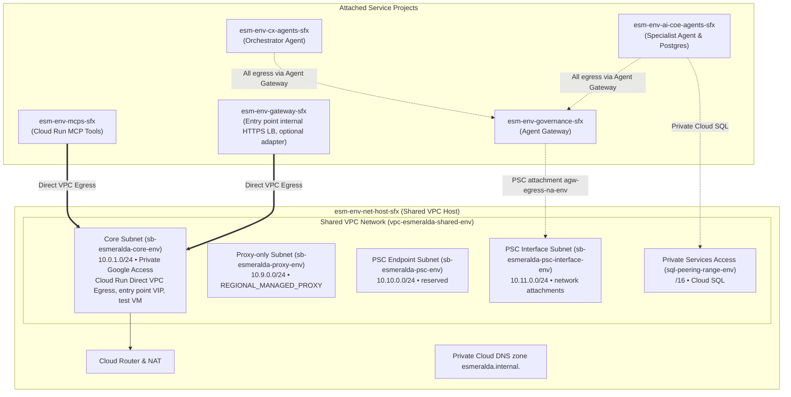

# Chapter 9: Private Networking, Shared VPC & Private DNS (Layer 2)

## 1. The Story & Business Why: How Tenant-Hosted Agents Reach Private Bank Services with Zero Public IPs

Consider what happens the moment `ai-coe-mortgage-specialist` begins verifying **Julian Sterling's** mortgage application. To inspect Julian's uploaded W-2s and paystubs, the specialist agent must call `https://legacy-dms.esmeralda.internal/mcp` and `https://income-verification.esmeralda.internal/mcp`, and persist its A2A task state in a private Cloud SQL PostgreSQL database.

Here is the architectural puzzle every enterprise faces when adopting managed AI runtimes: **agents deployed on Vertex AI Agent Engine (Agent Runtime) execute inside Google-managed tenant networks, not inside your corporate VPC.** How does an agent running in Google's tenant network reach an internal bank service (`*.esmeralda.internal`) without exposing database or tool ports to the public internet?

Historically, teams tried two flawed workarounds:
1. **Exposing public endpoints with IP allowlists or IAM checks:** A non-starter for regulated financial institutions where internal underwriting APIs and document stores must never have public IP addresses.
2. **Sprawling VPC Peering meshes and Serverless VPC Access Connectors:** VPC Peering is non-transitive (Spoke A cannot reach Spoke B through a hub) and rapidly exhausts enterprise RFC 1918 IP ranges, while legacy Serverless VPC Access Connectors run fixed-size VMs in `/28` subnets that become bottlenecks during bursty agent calls.

**Layer 2 solves this cleanly with three building blocks owned by NetOps in `esm-<env>-net-host-<sfx>`:**
* **One Shared VPC (`vpc-esmeralda-shared-<env>`):** Every workload project (`mcps`, `gateway`, `ai-coe-agents`, `cx-agents`, `governance`) attaches to this single network as a Service Project. Cloud Run MCP servers join the `core` subnet (`10.0.1.0/24`) directly via **Direct VPC Egress**—zero connector VMs required.
* **Private Service Connect (PSC) Network Attachments (`10.11.0.0/24`):** In Layer 4, the Central Agent Gateway plugs a virtual network interface (`agw-egress-na-<env>`) into Layer 2's `psc-interface` subnet, creating a single, governed private bridge from Google's managed agent runtime into the Shared VPC.
* **Private Cloud DNS (`esmeralda.internal.`) & Reserved Entry Point VIP (`10.0.1.2`):** Layer 2 reserves the internal load balancer IP (`ilb-esmeralda-vip-<env>`) and maps `*.esmeralda.internal` to it. When an agent calls `https://legacy-dms.esmeralda.internal/mcp`, DNS peering resolves that hostname to `10.0.1.2`, and traffic flows entirely over private internal IPs.

* **Module:** [`infrastructure/modules/2-networking/`](../../../infrastructure/modules/2-networking/main.tf)
* **Live config:** `infrastructure/live/<env>/layer-2-networking/`
* **Deploy:** `uv run esmeralda apply layer-2-networking --env <env>` (or `make deploy-networking ENV=<env>`)

---

## 2. Why We Built It This Way (Key Decisions & Rationale)

| Decision | Alternative Considered | Why We Chose This |
| :--- | :--- | :--- |
| **Single Shared VPC in `net-host` + Attached Service Projects** | Multi-VPC Peering mesh across 6 projects | Centralizes CIDR planning, firewall rules, and Cloud NAT under NetOps (`esm-<env>-net-host-<sfx>`) while letting spoke projects run Cloud Run and load balancers on shared subnets via `roles/compute.networkUser`. |
| **PSC Network Attachment (`psc-interface` subnet) for Agent Egress** | Public HTTPS endpoints or per-engine VPC peering | Gives the Layer 4 Central Agent Gateway a single, auditable private entry point (`10.11.0.0/24`) into the Shared VPC so tenant-hosted agents reach `*.esmeralda.internal` with zero public IPs. |
| **Cloud Run Direct VPC Egress (`core` subnet)** | Legacy Serverless VPC Access Connector VMs | Eliminates hourly VM connector charges and `/28` throughput bottlenecks; Cloud Run instances draw IPs directly from `sb-esmeralda-core-<env>` (`10.0.1.0/24`). |
| **Layer 2 Owns the Entry Point VIP (`10.0.1.2`) and `*.esmeralda.internal` DNS** | Creating the IP and DNS records inside Layer 5 gateway modules | Decouples the stable internal address (`*.esmeralda.internal` → `10.0.1.2`) from the Layer 5 ingress implementation, so switching or upgrading gateway backends never changes DNS or IP addresses. |

---

## 3. Persona & Role Breakdown: Who Owns Layer 2?

| Engineering Persona | Role & Daily Responsibilities | What They Own | What They NEVER Touch |
| :--- | :--- | :--- | :--- |
| **Network Operations (NetOps)** | Managing CIDR allocations, routing tables, Cloud NAT, firewall ingress rules, and DNS resolution. | `infrastructure/modules/2-networking/`, Shared VPC host, subnets, firewall rules, Cloud Router. | Application Python code, agent prompt graphs, SQL schemas. |
| **Platform / SecOps Engineer** | Auditing private egress paths and ensuring zero-trust traffic segmentation. | Subnet IAM bindings (`roles/compute.networkUser`), PSC attachments. | Direct database query tuning or tool implementations. |
| **AI Application Developer** (CX or AI CoE team) | Consuming internal private domain names (`*.esmeralda.internal`). | Agent tool client configurations (e.g. `https://legacy-dms.esmeralda.internal/mcp`, `https://ai-coe-mortgage-specialist.esmeralda.internal`). | Subnet IP math, VPC peering, firewall configurations. |

---

## 4. Architecture Decision Records (ADRs): The "Why"

### ADR-02.1: Shared VPC Hub-and-Spoke vs. VPC Peering Mesh
* **Context:** Interconnecting the workload projects via standard VPC Peering requires many bilateral peering links, cannot route transitively, and risks overlapping IP space.
* **Decision:** Provision a single, authoritative **Shared VPC** (`vpc-esmeralda-shared-<env>`) in `esm-<env>-net-host-<sfx>` and attach the `mcps`, `ai-coe-agents`, `cx-agents`, `gateway` and `governance` projects as **Service Projects** via `google_compute_shared_vpc_service_project`.
* **Benefit:** Centralizes firewall and routing policies under NetOps while allowing workload runtimes in spoke projects to bind to host subnets via `roles/compute.networkUser`.

---

### ADR-02.2: Direct VPC Egress & PSC Network Attachments vs. Serverless VPC Access Connector
* **Context:** Traditional Serverless VPC Access Connectors require dedicated `/28` subnets with underlying VM instances that incur fixed hourly costs and have scaling bottlenecks during bursty agent traffic.
* **Decision:**
  * **Cloud Run** services that need private egress (the `income-verification` and `corporate-email` MCP servers, the optional Envoy adapter, and the specialist's Cloud SQL bootstrap job) use **Direct VPC Egress**: their instances get an IP straight from the `core` subnet.
  * Google-managed services that can't join the VPC use a **PSC network attachment**. *What it is:* a resource in a VPC subnet that lets a managed service plug a network interface into that subnet (PSC-Interface). *In Esmeralda:* the Agent Gateway's attachment `agw-egress-na-<env>` (created in Layer 4 in the governance project) uses the dedicated `psc-interface` subnet created here.
* **Benefit:** No connector VMs to run, and a single, auditable private entry point into the VPC for all agent egress.

---

## 5. Shared VPC Network Topology



---

## 6. Technical Architecture & In Practice (`modules/2-networking/`)

### 1. Subnet Classifications & CIDR Allocations

| Subnet Identifier | CIDR Block | Purpose & Role | Connected Workloads |
| :--- | :--- | :--- | :--- |
| **`sb-esmeralda-core-<env>`** | `10.0.1.0/24` | Primary backend subnet with Private Google Access enabled. | Cloud Run Direct VPC Egress (MCP tools, optional Envoy adapter), the entry point reserved IP `ilb-esmeralda-vip-<env>` (internal HTTPS LB forwarding rule), test VM. |
| **`sb-esmeralda-proxy-<env>`** | `10.9.0.0/24` | `REGIONAL_MANAGED_PROXY` (Active): the Envoy proxies Google runs for regional managed load balancers. | The entry point's regional internal HTTPS load balancer. |
| **`sb-esmeralda-psc-<env>`** | `10.10.0.0/24` | Range reserved for PSC consumer endpoints. | No endpoint is deployed in it today. |
| **`sb-esmeralda-psc-interface-<env>`** | `10.11.0.0/24` | Subnet for PSC network attachments (Private Google Access on). | The Agent Gateway attachment `agw-egress-na-<env>` (Layer 4). |
| **`sql-peering-range-<env>`** | `/16` (Google-allocated) | Private Services Access (PSA) range peered with `servicenetworking.googleapis.com`. | Private Cloud SQL PostgreSQL instance in `esm-<env>-ai-coe-agents-<sfx>`. |

Also created: Cloud Router `cr-esmeralda-nat-<env>` with Cloud NAT `nat-esmeralda-outbound-<env>` (all subnets), and firewall rules `allow-iap-ssh-<env>` (IAP range `35.235.240.0/20` → TCP 22) and `allow-psc-interface-ingress-<env>` (from `10.11.0.0/24`).

---

### 2. Private DNS Zone (`esmeralda.internal.`)

**What it is:** a Cloud DNS *private zone* answers queries only for the VPC networks it is bound to; it is invisible from the internet.

**In Esmeralda:** Layer 2 creates the zone `esmeralda-private-dns-<env>` for `esmeralda.internal.`, bound to the Shared VPC. Layer 2 also reserves the internal entry point IP `ilb-esmeralda-vip-<env>` (gateway project, `core` subnet) and writes the `esmeralda.internal` and `*.esmeralda.internal` A records (TTL 300) pointing at it ([`main.tf`](../../../infrastructure/modules/2-networking/main.tf) §7). In Layer 5, the [entry point](../../../infrastructure/modules/5-workloads/entrypoint/main.tf) listens on that IP and routes each host by `Host` header, by default straight to its Cloud Run service or Agent Runtime engine (the built-in `direct` backend), so every private service (`legacy-dms`, `income-verification`, `corporate-email`, `ai-coe-mortgage-specialist`, ...) is reached through the entry point. Because the IP and records live in Layer 2, they outlive any gateway backend. See [Entry point and gateways](../2-workloads-and-catalog/01-ingress-gateways.md). The Agent Gateway resolves these names by DNS-peering this zone (never `googleapis.com.`); see the [Agent Gateway guide](../3-agentops-and-lifecycle/01-central-agent-gateway.md#37-agent-connectivity-template-act).

> [!NOTE]
> `.internal` can't get a public certificate, which is why the entry point's `*.esmeralda.internal` certificate is signed by the internal Root CA from [Layer 3](./03-security-iam-and-telemetry.md). See [TLS and certificates](../3-agentops-and-lifecycle/01-central-agent-gateway.md#5-tls-and-certificates-why-we-need-self-signed-cas).

---

### 3. Network Attachments: Who Uses the PSC Interface Subnet

| Attachment | Project | Created by | Used? |
| :--- | :--- | :--- | :--- |
| `agw-egress-na-<env>` | governance | Layer 4 ([6_agent_gateway](../../../infrastructure/modules/4-governance/modules/6_agent_gateway/main.tf)) | **Yes**: all agent egress to `*.esmeralda.internal` enters the VPC here. |
| `gateway-psc-interface-attachment-<env>` | net-host | Layer 2 | Created (`enable_psc_interface = true`) but not referenced by any later layer. |
| `<agent>-psc-attachment-<env>` | each agent project | Layer 5 agent modules (`enable_psc_network = true`) | Only used as the engine's `psc_interface_config` when the agent is **not** bound to an Agent Gateway; in dev/prd agents are bound, so it is unused. |

---

### 4. Subnet IAM Network User Permissions (`roles/compute.networkUser`)
To permit serverless runtimes in spoke projects to consume host subnets, Layer 2 grants `roles/compute.networkUser` on the `core` and `psc-interface` subnets to seven Google-managed service agents:
* `service-{mcps_number}@serverless-robot-prod.iam.gserviceaccount.com`
* `service-{gateway_number}@serverless-robot-prod.iam.gserviceaccount.com`
* `service-{ai_coe_agents_number}@serverless-robot-prod.iam.gserviceaccount.com`
* `service-{ai_coe_agents_number}@gcp-sa-aiplatform.iam.gserviceaccount.com`
* `service-{ai_coe_agents_number}@gcp-sa-aiplatform-re.iam.gserviceaccount.com`
* `service-{cx_agents_number}@gcp-sa-aiplatform.iam.gserviceaccount.com`
* `service-{cx_agents_number}@gcp-sa-aiplatform-re.iam.gserviceaccount.com`

When `enable_psc_interface = true` (the default), the same identities also get `roles/compute.networkUser`, `roles/compute.networkAdmin` and `roles/dns.peer` at the **host project** level. The Agent Gateway's own service agent receives `compute.networkUser` and `dns.peer` on the host project in Layer 4.

---

### 5. Optional & Legacy Resources
* **Secure Web Proxy (SWP):** the module can deploy an SWP at `10.0.1.100` (`enable_secure_web_proxy`), but dev and prd set it to `false`. Agent egress control is done by the Agent Gateway instead.
* **`internal.gateway.` zone:** a second private zone with placeholder records (`*` → `10.0.1.200`, `swp` → `10.0.1.100`) is still created when `enable_psc_interface = true`. Current services use `*.esmeralda.internal`.
* **Brownfield:** with `byo_networking = true`, the VPC, subnets, NAT and firewall rules are skipped, and `existing_vpc_id` / `existing_subnet_id` from `env.yaml` are used instead.

---

## 7. Verification & Runbook

### Inspect Layer 2 State & Verify Private Routing via the `esmeralda` CLI
```bash
# Inspect Layer 2 networking outputs (VPC ID, subnet IDs, entrypoint_address)
uv run esmeralda status --env dev --unit layer-2-networking

# Run end-to-end gateway conformance probes + live orchestrator query across the private VPC
uv run esmeralda verify --env dev
```

### Test Private DNS Resolution from the Test VM
```bash
# SSH into the test VM (it lives in the CX agents project) via IAP tunnel
gcloud compute ssh test-vm-dev --zone=us-central1-f --project=$(cd infrastructure/live/dev/layer-1-projects && terragrunt output -raw cx_agents_project_id) --tunnel-through-iap

# Inside VM: verify internal DNS resolves to the entry point VIP
dig +short ai-coe-mortgage-specialist.esmeralda.internal
# Output: the entry point IP (layer-2 output entrypoint_address)
```

### Inspect the Agent Gateway Network Attachment
```bash
gcloud compute network-attachments describe agw-egress-na-dev \
    --region=us-central1 \
    --project=$(cd infrastructure/live/dev/layer-1-projects && terragrunt output -raw governance_project_id)
```
