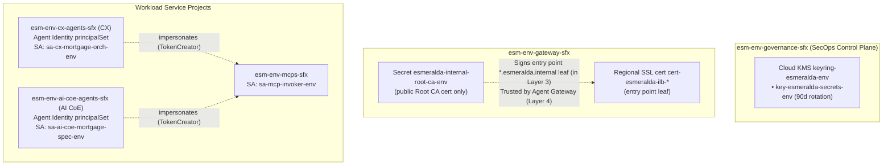

# 3.3 Cryptographic Trust — SPIFFE Agent Identity, CMEK & Internal PKI (Layer 3)

## 1. Proving Who Is Calling Whom—Without Shared Secrets

Follow a single question from a loan officer reviewing **Julian Sterling's** mortgage file: *"Verify Julian Sterling's income and check whether his W-2 matches his application."*

In a naive agent deployment, `cx-mortgage-orchestrator` and `ai-coe-mortgage-specialist` run under a shared Google Cloud service account (or worse, hold static API keys in environment variables), and talk to internal tools over plain HTTP or `verify=False` TLS. That creates three unacceptable enterprise risks:
1. **The Confused-Deputy Problem:** If every agent shares a single identity or an organization-wide wildcard grant, nothing stops a general-purpose consumer chatbot from bypassing the mortgage specialist and querying `legacy-dms` or `income-verification` directly—or impersonating a human user.
2. **Uncontrolled Key & Secret Sprawl:** When developers create KMS keys or database secrets inside their own application projects, a compromised workload can modify its own security controls or read secrets it has no business touching.
3. **Unverifiable Internal TLS:** Because `.internal` domain names (`*.esmeralda.internal`) do not exist on the public internet, Let's Encrypt and public Certificate Authorities cannot issue certificates for them. Teams often disable TLS verification (`verify=False`), blinding the network to man-in-the-middle attacks.

**Layer 3 establishes cryptographic trust across all three fronts before any agent or gateway starts:**
* **Three-Identity Delegation & GEAP SPIFFE Agent Identity:** Every Reasoning Engine receives its own Google-attested SPIFFE identity (`spiffe://` / `principal://...`), backed by auto-rotated 24-hour X.509 certificates. Across every request, Esmeralda cleanly separates **User Identity** (the human end user's OAuth 2.0 token), **Agent Identity** (the specific engine's cryptographic SPIFFE ID), and **Delegated Identity** (3LO/2LO credentials brokered via Agent Identity Auth Manager). At the Central Agent Gateway, per-target `roles/iap.egressor` policies on the Agent Registry entries decide which agent identities may call each agent and MCP server: the specialist's entry lists the CX orchestrator, and the MCP server entries list the specialist. The registry-wide grant is scoped to system Google API endpoints with an IAM condition (see [section 4](#4-three-identity-delegation-per-target-spiffe-governance) for what this does and doesn't cover yet).
* **Centralized CMEK & Secrets in `governance`:** Cloud KMS Customer-Managed Encryption Keys (90-day rotation) and platform secrets live exclusively inside `esm-<env>-governance-<sfx>` under SecOps control.
* **Internal Root CA & Entry Point Leaf Certificate (`*.esmeralda.internal`):** Layer 3 mints a 10-year private Root CA and signs the 1-year leaf certificate for `*.esmeralda.internal`. Every TLS handshake—from the agent container (`esmeralda run`) through the Central Agent Gateway to the internal HTTPS load balancer—is cryptographically verified end-to-end.

* **Module:** [`infrastructure/modules/3-security/`](../../../infrastructure/modules/3-security/main.tf) (`main.tf`, [`agent_identity.tf`](../../../infrastructure/modules/3-security/agent_identity.tf), [`pki.tf`](../../../infrastructure/modules/3-security/pki.tf))
* **Live config:** `infrastructure/live/<env>/layer-3-security/`
* **Deploy:** `uv run esmeralda apply layer-3-security --env <env>` (or `make deploy-security ENV=<env>`)

> [!NOTE]
> **Telemetry lives in Layer 4.** Log sinks, the BigQuery telemetry dataset, DLP, alerts, dashboards, FinOps views and Model Armor templates are created by the governance layer (`modules/4-governance`). See [Centralized Monitoring & FinOps](../3-agentops-and-lifecycle/03-centralized-monitoring-and-dashboards.md) and the [Central Agent Gateway](../3-agentops-and-lifecycle/01-central-agent-gateway.md).

---

## 2. Why We Built It This Way (Key Decisions & Rationale)

| Decision | Alternative Considered | Why We Chose This |
| :--- | :--- | :--- |
| **Native GEAP SPIFFE Agent Identity (`principal://...`) + Three-Identity Delegation** | Shared service accounts, static JSON keys, or service-account impersonation chains | Gives every Reasoning Engine a unique, hardware-backed X.509/SPIFFE identity (`spiffe_id` / `agent_identity_principal`) with zero rotatable keys, while preserving end-user attribution via `User-Auth-Token` and Auth Manager 3LO delegation. |
| **Per-Target IAP Egress Policies (`roles/iap.egressor` per Agent Registry target) + an endpoints-only registry-wide grant** | Org-wide wildcard (`system.id.goog/*`), an unconditioned registry-wide grant, or flat project-level invoker grants | Narrows the **Confused-Deputy bypass** at the gateway: only the identities listed on the `ai-coe-mortgage-specialist` entry (the CX orchestrator) and on the `corporate-email`, `income-verification` and `legacy-dms` entries (the specialist) pass IAP for those targets. A grant on the registry itself is inherited by every entry, so it carries an IAM condition that limits it to system Google API endpoints. |
| **Centralized KMS Key Ring & Secrets in `esm-<env>-governance-<sfx>`** | Per-project KMS keys created by application teams | Enforces strict Separation of Duties (SoD): SecOps owns key rotation (90 days) and secret access logs in one project, while workload identities receive only `cryptoKeyEncrypterDecrypter` or `secretAccessor`. |
| **Terraform-Managed Internal Root CA (`*.esmeralda.internal`)** | Disabling TLS verification (`verify=False`) or baking certs into Docker images | Public CAs cannot sign `.internal` domains. Generating the Root CA and entry point leaf in Layer 3—and injecting the public CA bundle at deploy time via `AGENT_GATEWAY_ROOT_CERTIFICATES`—gives full TLS verification while keeping container images environment-agnostic. |

---

## 3. Persona & Role Breakdown: Who Owns Security & IAM?

| Engineering Persona | Role & Daily Responsibilities | What They Own | What They NEVER Touch |
| :--- | :--- | :--- | :--- |
| **SecOps / Security Lead** | Managing CMEK key rotation policies (90 days), Secret Manager access policies, and the internal Root CA. | `infrastructure/modules/3-security/`, KMS key ring, secrets, Root CA. | Application prompt graphs, tool Python code. |
| **Platform / Identity Engineer** | Provisioning workload Service Accounts, Agent Identity grants and cross-project IAM bindings. | Service Account definitions (`sa-ai-coe-mortgage-spec-<env>`, `sa-cx-mortgage-orch-<env>`, `sa-esmeralda-mcps-<env>`, `sa-mcp-invoker-<env>`, ...). | Direct database SQL schemas or prompt tuning. |
| **AI Application Developer** (CX or AI CoE team) | Consuming IAM-authenticated identities to call private APIs without hardcoded tokens. | Minting Google ID tokens (via `sa-mcp-invoker-<env>`) programmatically. | KMS key policies, root passwords, or IAM role definitions. |

---

## 4. Three-Identity Delegation & Per-Target SPIFFE Governance

* **What GEAP Agent Identity is:** a Google-issued, cryptographically attested [SPIFFE](https://spiffe.io/) identity given to each Agent Runtime (Vertex AI Reasoning Engine) deployed with `identity_type = AGENT_IDENTITY`, backed by auto-rotated 24-hour X.509 certificates, mTLS, and DPoP token binding:
  * **Per-engine SPIFFE URI (`spiffe_id` output):**
    `spiffe://agents.global.org-<ORG_ID>.system.id.goog/resources/aiplatform/projects/<PROJECT_NUMBER>/locations/<REGION>/reasoningEngines/<ENGINE_ID>`
  * **Per-engine IAM Principal (`agent_identity_principal` output):**
    `principal://agents.global.org-<ORG_ID>.system.id.goog/resources/aiplatform/projects/<PROJECT_NUMBER>/locations/<REGION>/reasoningEngines/<ENGINE_ID>`
  * **Project-scoped PrincipalSet (never org-wide `system.id.goog/*`):**
    `principalSet://agents.global.org-<ORG_ID>.system.id.goog/attribute.platformContainer/aiplatform/projects/<PROJECT_NUMBER>`
* **Three-Identity Delegation Architecture:** Following the Gemini Enterprise Agent Platform (GEAP) security model, Esmeralda separates and coordinates three distinct identity contexts across every request:
  1. **User Identity:** The initiating human end user's identity, authenticated via OAuth 2.0 / OIDC (`user_auth_token`).
  2. **Agent Identity (`spiffe://` / `principal://`):** Each Reasoning Engine's unique, cryptographically attested workload identity (`adk-agent` and `a2a-agent` export both `spiffe_id` and `agent_identity_principal`, and bind atomic BigQuery datasets and GCS buckets directly to `local.agent_identity_principal`). When `enable_native_spiffe_auth = true`, `SERVICE_ACCOUNT_EMAIL` is omitted so the runtime authenticates directly with its native SPIFFE identity rather than impersonating a shared service account.
  3. **Delegated Identity:** Scoped 3-legged OAuth (3LO) or brokered tool credentials managed by Agent Identity Auth Manager (`agentidentitycredentials.googleapis.com`), attributing every downstream tool invocation to both the initiating end user and the calling agent's SPIFFE ID.
* **Delegated user credential rules:** the user's credential (Auth Manager 3LO token when configured, else the user's own token) is forwarded only to targets that opted in (`ESMERALDA_USER_CREDENTIAL_TARGETS`, generated from the catalog's `user_credential` block), in their configured header (default `X-User-Token`), and never enters baggage, spans, logs, usage records or persisted session state. See [Delegated user credential](../4-esmeralda-library/guide.md#delegated-user-credential).
* **Per-Target Agent Gateway IAP Policies (Narrowing the Confused-Deputy Bypass):**
  * Instead of granting an organization-wide wildcard (`principalSet://.../org-*/*`) or applying a single flat member list across every Agent Registry entry, [`grant_iap_egress.sh`](../../../infrastructure/modules/_shared/scripts/grant_iap_egress.sh) (run by Layer 4 and again by the Layer 5 [`iap-egress`](../../../infrastructure/modules/5-workloads/iap-egress/main.tf) unit) writes **per-target `roles/iap.egressor` policies** (`IAP_TARGET_POLICIES_JSON` / `var.target_iap_members`):
    * **On `--agent=ai-coe-mortgage-specialist`:** `cx-mortgage-orchestrator`'s attested `agent_identity_principal` (plus its fallback SA and the test VM SA).
    * **On `--mcp-server={corporate-email,income-verification,legacy-dms}`:** `ai-coe-mortgage-specialist`'s attested `agent_identity_principal` (plus its fallback SA, `sa-mcp-invoker-<env>`, and the test VM SA). The CX orchestrator is not listed, so the gateway denies its calls to the MCP servers.
  * **Registry-wide grant, endpoints only:** the agents also need the Google APIs registered as system endpoints (Vertex AI, logging, telemetry, ...). That grant is written on the Agent Registry itself, and a registry-level grant is inherited by every entry (agents and MCP servers included). IAM allow policies only add, so a per-target policy can't take that access away. The script therefore writes the registry-wide binding with an IAM condition (`resource.name.startsWith("projects/<GOVERNANCE_PROJECT_NUMBER>/locations/<REGION>/iap_web/agentRegistry/endpoints/")`, policy version 3) so it only applies to system endpoints, and refuses to write it without one. Its members are the agent projects' `principalSet`s and the Vertex AI / Agent Runtime service agents, not the workload service accounts.

> [!WARNING]
> **Known gap (follow-up):** the per-target policies only cover calls that reach a target through its own registry entry. An agent that can use the generic Vertex AI (`aiplatform`) system endpoint can call an Agent Runtime engine's A2A API directly through that endpoint, which skips the agent entry. When agents impersonate the shared `sa-mcp-invoker-<env>` to mint their outbound tokens (`enable_native_spiffe_auth = false`), the callee's own IAM check can't tell callers apart either. Restricting "only the orchestrator may call the specialist" end to end also needs per-agent outbound identities (instead of the shared invoker SA) and per-engine `aiplatform` IAM on the callee.
* **Supporting Service Accounts:** Provision isolated service accounts per workload for MCP execution, ingress gateways, and fallback execution when `enable_agent_identity = false`:
  1. `sa-esmeralda-mcps-<env>`: Cloud Run MCP tool execution.
  2. `sa-mcp-invoker-<env>`: backward-compatible OIDC/OAuth invoker SA when `enable_native_spiffe_auth = false`. Agents impersonate it to mint Google ID tokens for Cloud Run MCP calls (and access tokens for A2A calls to agent hosts served by the built-in `direct` backend).
  3. `sa-ai-coe-mortgage-spec-<env>`: AI CoE specialist fallback runtime identity if Agent Identity is disabled.
  4. `sa-cx-mortgage-orch-<env>`: CX orchestrator fallback runtime identity if Agent Identity is disabled.
  5. `sa-esmeralda-envoy-<env>`: Envoy adapter runtime (used when `envoy` is in `gateways.enabled`). The former Kong service account (`sa-esmeralda-kong-<env>`) is gone with Kong; the default `direct` backend has no runtime identity.
  6. `sa-esmeralda-test-vm-<env>`: Private test VM identity with scoped invoker permissions.

  The CI/CD identities `sa-esmeralda-builder` and `sa-esmeralda-promoter` are created in the shared Layer 0 project, not here.

---

## 5. Security, IAM & PKI Topology



---

## 6. Technical Architecture & In Practice (`modules/3-security/`)

### 1. Cloud KMS CMEK Keys (`google_kms_crypto_key`)
**What it is:** a Customer-Managed Encryption Key (CMEK) is a Cloud KMS key you own and control that a Google service uses to encrypt your data at rest; disabling it makes the data unreadable.

**In Esmeralda** (key ring `keyring-esmeralda-<env>` in the governance project):
* **Secrets Key (`key-esmeralda-secrets-<env>`)**: 90-day automatic rotation (`7776000s`). Grants `roles/cloudkms.cryptoKeyEncrypterDecrypter` to the governance Secret Manager service agent for CMEK-encrypted secrets.
* **Brownfield:** with `byo_security = true`, the key ring and key are skipped and `existing_secrets_key_id` is used instead.

---

### 2. Workload Service Accounts & Permissions

| Service Account | Hosted Project | Granted IAM Roles | Purpose |
| :--- | :--- | :--- | :--- |
| **`sa-<service>-<env>`** | `esm-<env>-mcps-<sfx>` | `logging.logWriter`, `monitoring.metricWriter`, `cloudtrace.agent`, `telemetry.writer`; `compute.networkUser` on the core subnet | Per-service Cloud Run MCP server execution & telemetry. |
| **`sa-mcp-invoker-<env>`** | `esm-<env>-mcps-<sfx>` | `run.invoker` on the MCPs project. Both agent `principalSet`s hold `iam.serviceAccountTokenCreator` on it | Identity agents impersonate to call MCP tools. |
| **`sa-ai-coe-mortgage-spec-<env>`** | `esm-<env>-ai-coe-agents-<sfx>` | `logging.logWriter` (plus fallback runtime roles when `enable_agent_identity = false`); `compute.networkUser` on the core subnet | AI CoE specialist fallback runtime identity. |
| **`sa-cx-mortgage-orch-<env>`** | `esm-<env>-cx-agents-<sfx>` | `aiplatform.user`, `storage.objectAdmin`, `telemetry.writer`, logging/monitoring/trace writers; `compute.networkUser` on the core subnet; `iam.serviceAccountTokenCreator` on the specialist SA | CX orchestrator (fallback runtime identity). |
| **`sa-esmeralda-envoy-<env>`** | `esm-<env>-gateway-<sfx>` | `aiplatform.user`, `run.invoker`, logging/monitoring/trace writers; when `envoy` is enabled, Layer 5 adds it as invoker of the MCP services and the specialist, and grants it `aiplatform.user` in the CX agents project | Envoy on Cloud Run. |
| **`sa-esmeralda-test-vm-<env>`** | `esm-<env>-cx-agents-<sfx>` | `run.invoker` (on the MCPs & AI CoE projects), `aiplatform.user`, logging/monitoring/trace writers, `iam.serviceAccountTokenCreator` (on self) | Private test VM debugging & testing. |

Invoke rights on individual MCP services and agents also come from the `callers` list of each [service catalog](../2-workloads-and-catalog/01-ingress-gateways.md#1-the-service-catalog) entry, granted in Layer 5. When the callers include an agent, the unit also adds `sa-mcp-invoker-<env>` to the target's invokers: `roles/run.invoker` on an MCP service, and `roles/aiplatform.user` on the callee agent's project (granted by the a2a-agent module through `invoker_service_accounts`) for A2A over `direct`.

---

### 3. Agent Identity Grants ([`agent_identity.tf`](../../../infrastructure/modules/3-security/agent_identity.tf)) & Per-Target IAP Egress ([`grant_iap_egress.sh`](../../../infrastructure/modules/_shared/scripts/grant_iap_egress.sh))

| Identity (`principal://` / `principalSet://`) | Roles in its own project & atomic resources | Project-level `roles/iap.egressor` & `roles/run.invoker` | Agent Registry IAP Egress (`iap-egress`) |
| :--- | :--- | :--- | :--- |
| **CX orchestrator** (`cx-mortgage-orchestrator`) | `aiplatform.user`, `storage.objectAdmin`, `bigquery.dataEditor`, `bigquery.jobUser`, `telemetry.writer`, logging/monitoring/trace writers; direct `principal://` bindings on its atomic BigQuery dataset and GCS buckets | `roles/iap.egressor` **only** on `ai-coe-agents` (never on `mcps`) | Listed on `--agent=ai-coe-mortgage-specialist`; system Google API endpoints through the conditional registry-wide grant; not listed on any MCP server entry |
| **AI CoE specialist** (`ai-coe-mortgage-specialist`) | the above plus `dlp.user`; direct `principal://` bindings on its atomic BigQuery dataset and GCS buckets | `roles/iap.egressor` and `roles/run.invoker` on the `mcps` project | Listed on `--mcp-server=corporate-email`, `--mcp-server=income-verification`, `--mcp-server=legacy-dms`; system Google API endpoints through the conditional registry-wide grant |

This separates the two agents at the GCP project layer and at the Central Agent Gateway: the gateway lets the **CX** orchestrator through to the **AI CoE** specialist's entry only, and the **AI CoE** specialist through to the MCP tool server entries. The gap described in the [warning above](#4-three-identity-delegation-per-target-spiffe-governance) (A2A calls through the generic Vertex AI endpoint, shared outbound identity) still applies.

---

### 4. Platform Service-Agent Grants
* **Artifact Registry reader:** the Vertex AI, Reasoning Engine and Cloud Run service agents of the agent, MCPs and gateway projects get `roles/artifactregistry.reader` on **this environment's repository only** in the shared CI/CD project (dev → `esmeralda-containers`, prd → `esmeralda-containers-release`), so BYOC images can be pulled.
* **Agent Gateway binding:** the Vertex AI service agents of both agent projects get `roles/networkservices.viewer` on the governance project, so their engines can bind to the central Agent Gateway.
* **Network:** the same service agents get `roles/compute.networkUser` on the net-host project.

---

### 5. Internal Root CA ([`pki.tf`](../../../infrastructure/modules/3-security/pki.tf))
**What it is:** a self-signed root certificate authority that only clients which explicitly install it will trust. Esmeralda needs one because no public CA issues certificates for the private `esmeralda.internal` zone.

**In Esmeralda:**
* `tls_private_key.internal_ca` + `tls_self_signed_cert.internal_ca` ("Esmeralda Internal Root CA", RSA 2048, 10 years), generated by the Terraform `tls` provider.
* The **public** certificate (never the key) is stored in Secret Manager as `esmeralda-internal-root-ca-<env>` in the gateway project, for operators and test clients.
* Layer 3 also signs the **entry point leaf** itself (`tls_locally_signed_cert.entrypoint`, SANs `esmeralda.internal` and `*.esmeralda.internal` only, 1 year) and stores it with the CA chain as the regional SSL certificate `cert-esmeralda-ilb-*` in the gateway project (output `entrypoint_ssl_certificate_id`), which the Layer 5 entry point HTTPS proxy presents. The CA private key never leaves Layer 3: it is not exposed as an output.
* Layer 4 puts the Root CA into the Agent Gateway TrustConfig and the agent trust bundle. Nothing is baked into images: certificates reach the agents at deploy time via `AGENT_GATEWAY_ROOT_CERTIFICATES`. Full walkthrough: [TLS and certificates](../3-agentops-and-lifecycle/01-central-agent-gateway.md#5-tls-and-certificates-why-we-need-self-signed-cas) and [BYOC](../3-agentops-and-lifecycle/01-central-agent-gateway.md#6-bring-your-own-container-byoc).

> [!CAUTION]
> The Root CA private key is stored in Terraform state. Treat the state backend as secret material.

---

## 7. Verification & Runbook

### Inspect Layer 3 Security Outputs via the `esmeralda` CLI
```bash
# Inspect Layer 3 outputs (service account emails, KMS key IDs, SSL certificate ID)
uv run esmeralda status --env dev --unit layer-3-security

# Plan Layer 3 changes (read-only)
uv run esmeralda plan layer-3-security --env dev
```

### Verify Secret Manager KMS Access
```bash
# Verify the Secret Manager service agent has Encrypter/Decrypter on the secrets CMEK key
gcloud kms keys get-iam-policy key-esmeralda-secrets-dev \
    --keyring=keyring-esmeralda-dev \
    --location=us-central1 \
    --project=$(cd infrastructure/live/dev/layer-1-projects && terragrunt output -raw governance_project_id)
```

### Read the Internal Root CA Certificate
```bash
gcloud secrets versions access latest --secret=esmeralda-internal-root-ca-dev \
    --project=$(cd infrastructure/live/dev/layer-1-projects && terragrunt output -raw gateway_project_id) \
  | openssl x509 -noout -subject -enddate
```
