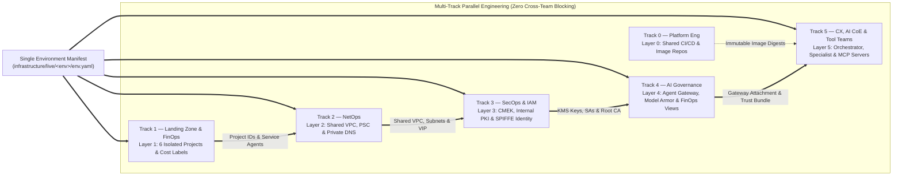
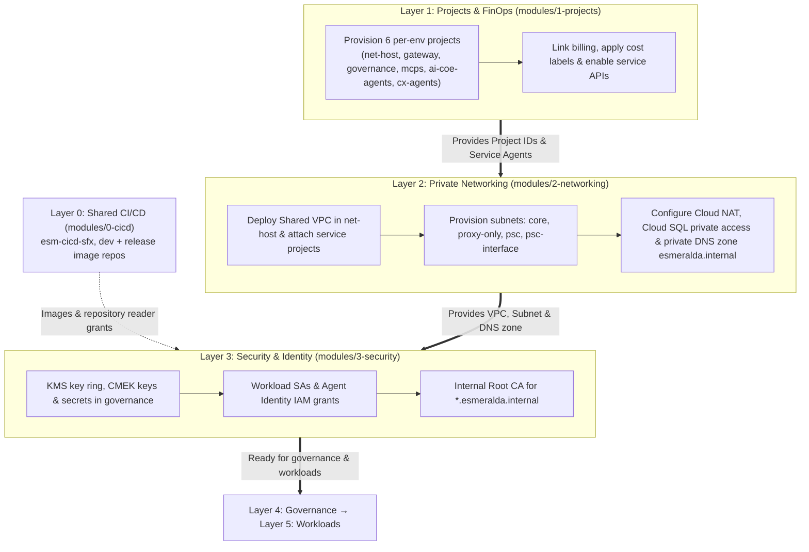

# 3.0 Platform Foundations — Overview (Layers 1, 2, and 3)

## 1. How Layered Contracts Unlock Parallel Teams

Imagine a bank preparing to launch its AI-assisted mortgage underwriting assistant for applicants like **Julian Sterling**. Before the Customer Experience (CX) team's orchestrator agent can answer a single question—or delegate a task to the AI Center of Excellence (AI CoE) specialist agent to inspect Julian's W-2s and tax returns—dozens of foundational questions must be answered:

* *Which department pays for the Gemini tokens consumed during Julian's underwriting check?*
* *How does an AI agent running inside Google's managed runtime reach the bank's private document management system (`legacy-dms.esmeralda.internal`) without exposing a single public IP address to the internet?*
* *Who holds the encryption keys and TLS certificates, and how do we guarantee that an application developer can never accidentally weaken a firewall rule or read another team's secrets?*

In many organizations, answering these questions turns into a months-long serialization bottleneck: the AI developers wait on the Security team, the Security team waits on Network Operations, and Network Operations waits on Cloud Landing Zone engineers.

**Esmeralda eliminates that bottleneck through Multi-Track Layered Parallelism.** Instead of lumping projects, networks, encryption keys, governance policies, and AI agents into a single monolithic Terraform state, Esmeralda organizes the platform into **six numbered layers (`L0` through `L5`)** where dependencies flow strictly upward and every layer communicates with the next through an explicit, versioned contract (`terragrunt output` + `env.yaml`).



Because each layer exposes a stable contract:
* **Network Engineers (Layer 2)** can evolve CIDR allocations, NAT gateways, and routing policies without touching agent prompts or Python code.
* **Security Engineers (Layer 3)** can rotate KMS encryption keys, manage the internal Certificate Authority, and audit SPIFFE Agent Identities in a dedicated governance boundary.
* **AI Governance Teams (Layer 4)** can tune Model Armor guardrails, central Agent Gateway egress policies, and BigQuery FinOps dashboards independently.
* **Multiple Agent & Tool Teams (Layer 5)**—such as the CX team, the AI CoE team, and the AppDev Tools team—can build, test, and ship agents and MCP servers in parallel without ever waiting for infrastructure tickets.

> [!NOTE]
> Layer 0 (`infrastructure/live/shared/layer-0-cicd`) is a single CI/CD project shared across every environment. Layers 1–5 are instantiated once per environment (`dev`, `prd`) from `infrastructure/live/<env>/layer-N-*`, driven entirely by a single declarative manifest: `infrastructure/live/<env>/env.yaml`. Section 3 covers **Layers 1, 2, and 3**—the cloud landing zone beneath the governance plane and workloads.

---

## 2. Key Architectural Decisions & Rationale

| Decision | Alternative Considered | Why We Chose This |
| :--- | :--- | :--- |
| **6-Layer Upward-Only DAG (`L0`–`L5`)** | Single monolithic Terraform root module | Prevents blast-radius coupling; lets NetOps (`L2`), SecOps (`L3`), Governance (`L4`), and Agent teams (`L5`) plan and apply their own units in parallel (`uv run esmeralda plan <unit> --env <env>`). |
| **7 Isolated GCP Projects (6 per env + 1 shared CI/CD)** | Single shared GCP project per environment | Eliminates **FinOps attribution blackouts** (mixing CX and AI CoE token bills), **IAM privilege bleeding** (developers accessing KMS keys), and **API quota starvation** (one runaway agent loop exhausting project-wide Vertex AI quota). |
| **Centralized Shared VPC + PSC Network Attachment** | Mesh of bilateral VPC Peerings or public endpoints | VPC Peering is non-transitive and exhausts enterprise CIDR blocks. A single Shared VPC in `net-host` paired with Private Service Connect (PSC) gives Google-hosted agents private egress into `*.esmeralda.internal` with zero public IPs. |
| **Centralized CMEK Keys & Secrets in `governance`** | Creating KMS keys and secrets inside workload projects | Enforces Separation of Duties (SoD) between SecOps and AppDev, with a single project (`esm-<env>-governance-<sfx>`) to audit key rotation and secret access. |
| **Single `env.yaml` with `byo_*` Brownfield Toggles** | Hardcoded variables scattered across `.tfvars` files | Gives operators one file per environment (`infrastructure/live/<env>/env.yaml`) to configure project prefixes, service catalogs, gateway routing, and greenfield vs. brownfield (`byo_net_host_project`, `byo_networking`, `byo_security`) adoption. |

---

## 3. Who Builds What: The Team Model

The foundational layers exist to give each team its own secure boundary while sharing a common private network and governance plane. Two distinct application teams build agents on top of the foundation:

| Team | Builds | Lives in | Example |
| :--- | :--- | :--- | :--- |
| **CX team** | User-facing **orchestrator** agents (ADK). They *consume* reusable agents and tools; they don't re-implement them. | `esm-<env>-cx-agents-<sfx>` | `cx-mortgage-orchestrator` |
| **AI CoE team** | **Reusable A2A specialist** agents that any team can call over the [A2A protocol](https://a2a-protocol.org/) through the Agent Gateway and the private entry point. | `esm-<env>-ai-coe-agents-<sfx>` | `ai-coe-mortgage-specialist` |

Platform teams own the shared foundational projects around them: NetOps (`net-host`), PlatformOps (`gateway`), AppDev Tools (`mcps`), Security & PlatformOps (`governance`), and Platform Engineering (shared `cicd`).

---

## 4. How `env.yaml` Drives an Environment (Greenfield & Brownfield)

Every unit across Layers 1–5 reads `infrastructure/live/<env>/env.yaml` through the root Terragrunt configuration (`infrastructure/live/root.hcl`). This single file defines the contract for an environment:

* **Identity & Location:** `environment` (`dev` or `prd`), `project_prefix` (`esm-dev` or `esm-prd`), `region` (`us-central1`), `billing_account`, `org_id`, and `folder_id`.
* **Bring-Your-Own-Infrastructure (`byo_*`) Toggles:** Enterprises rarely start from an empty Google Cloud organization in production. When `byo_net_host_project`, `byo_gateway_project`, `byo_governance_project`, `byo_networking`, or `byo_security` are flipped to `true` alongside their `existing_*` IDs, Layers 1–3 seamlessly skip resource creation and wire existing corporate VPCs, projects, and KMS keys into downstream outputs.
* **Container Promotion Policy:** `image_repository` (`dev` vs. `release`) and `container_tag`, ensuring `dev` pulls mutable `:dev-latest` builds while `prd` pulls immutable `:vX.Y.Z` release images from Layer 0.
* **Service Catalog & Ingress Routing:** The declarative `catalog` and `gateways` blocks that wire Layer 2 DNS, Layer 3 IAM invokers, and Layer 5 load-balancer routing together.

---

## 5. Foundations 3-Layer Progression Pipeline



---

## 6. Operating Foundations in Practice (`esmeralda` CLI)

You can inspect, plan, and apply the foundational layers using the `esmeralda` CLI (or the `make` wrappers):

```bash
# 1. Run preflight checks and inspect Layer 1–3 unit states
uv run esmeralda doctor --env dev
uv run esmeralda units --env dev --layer 1
uv run esmeralda units --env dev --layer 2
uv run esmeralda units --env dev --layer 3

# 2. Plan or apply an individual foundational layer (with automatic destroy protection)
uv run esmeralda plan layer-1-projects --env dev
uv run esmeralda apply layer-1-projects --env dev

# Or deploy Layers 1–3 together via Make:
make deploy-foundations ENV=dev
```

---

## 7. Subsections in Section 3

1. **[3.1 Projects & FinOps Isolation (Layer 1)](./01-projects-and-finops.md)**
   * Project Isolation, Blast Radius & FinOps Attribution Deep-Dive
   * Technical Specifications (`modules/1-projects/`)
2. **[3.2 Private Networking, PSC & DNS (Layer 2)](./02-private-networking.md)**
   * Zero-Public-IP Connectivity & Shared VPC Topology
   * Technical Specifications (`modules/2-networking/`)
3. **[3.3 Security, SPIFFE Identity & PKI (Layer 3)](./03-security-iam-and-telemetry.md)**
   * Three-Identity Delegation Architecture (`User`, `Agent SPIFFE`, `Delegated`), CMEK, and Internal PKI
   * Technical Specifications (`modules/3-security/`)

**Next:** **[3.1 Project Isolation, Blast Radius & FinOps (Layer 1)](./01-projects-and-finops.md)**.
