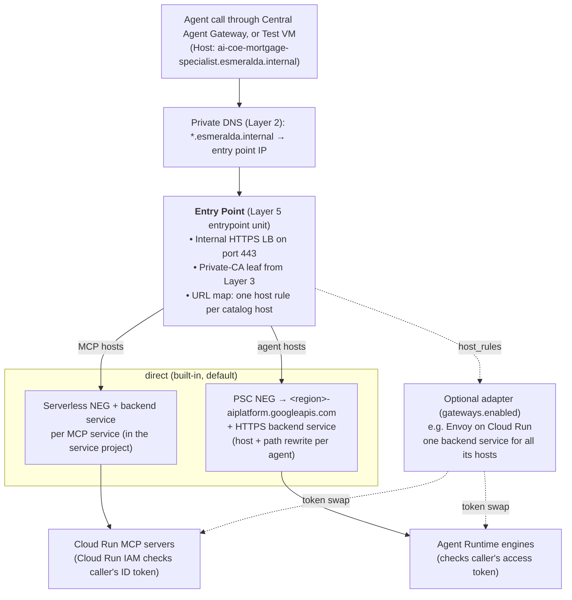

# 1.3 The Private Front Door & Pluggable Gateways

In [1.1 Two Teams, Two Agents](./03-ai-agents-and-database.md) and [1.2 MCP Tool Servers](./02-mcp-tool-servers.md), we saw how Julian Sterling's mortgage verification flows from `cx-mortgage-orchestrator` to `ai-coe-mortgage-specialist` and then to three MCP tool servers (`legacy-dms`, `income-verification`, `corporate-email`).

Notice how clean the URLs were in every step:

* `https://ai-coe-mortgage-specialist.esmeralda.internal`
* `https://legacy-dms.esmeralda.internal/mcp`
* `https://income-verification.esmeralda.internal/mcp`

Under the hood, however, Cloud Run services live on generated `*.run.app` domains, and Vertex AI Reasoning Engines live at deeply nested `https://<region>-aiplatform.googleapis.com/v1beta1/projects/<p>/locations/<r>/reasoningEngines/<id>` resource paths. If an agent engine is recreated, its numeric `<id>` changes.

How does Esmeralda give every agent and tool a permanent, friendly `*.esmeralda.internal` address—without running a fleet of expensive proxy VMs, and while still letting enterprise API teams plug in **Envoy** or **Apigee X** whenever they want? Meet the **Layer 5 Entry Point**.

---

## 1. One Front Door, Zero Unnecessary Proxies

Every private hostname under `*.esmeralda.internal` resolves to a single internal Application Load Balancer—the **entry point**. The entry point terminates TLS (using a certificate signed by Esmeralda's internal Root CA) and routes each request by its `Host` header.

* **Zero-Proxy Default (`direct`):** By default, every host in `env.yaml` is served by the built-in **`direct`** backend. The Google Cloud load balancer routes MCP requests straight to their Cloud Run serverless Network Endpoint Groups (NEGs) and agent requests straight to Vertex AI Agent Runtime via a Private Service Connect (PSC) NEG with automatic host and path rewriting. There is **no proxy container in between**, and callers present their own Google credential so the destination verifies the real caller's identity.
* **Pluggable Adapters (`envoy`, `apigee`):** When an enterprise track needs an L7 proxy—for example, per-key rate limiting, header transformation, or token swapping—they can enable an adapter in `env.yaml` (`gateways.enabled = ["envoy"]`) and move hosts to it **one at a time** (`host_rules`) without changing a single line of agent code, DNS record, or TLS certificate.

> [!NOTE]
> **Entry Point (Inbound) vs. Central Agent Gateway (Outbound):**
> The **entry point** (Layer 5, gateway project) is the private *front door* where calls to `*.esmeralda.internal` arrive. The **[Central Agent Gateway](../3-agentops-and-lifecycle/01-central-agent-gateway.md)** (Layer 4, governance project) is the Google-managed *outbound proxy* that governs where agents are allowed to go. Every internal agent call flows:
> `Caller Agent → Central Agent Gateway (egress check) → Entry Point (internal HTTPS LB) → Target Agent or MCP Server`.
> Because the Central Agent Gateway passes the caller's `Authorization` header through unchanged, end-to-end per-caller credentials work seamlessly.

> [!TIP]
> For which gateway handles every hop (ingress, agent egress, models, partners, other clouds) and when to choose an alternative, see **[1.5 One Gateway per Hop](./05-gateway-per-hop.md)**.

### How the Entry Point Spans Layers 2, 3, and 5

Because the IP address, DNS zone, and TLS certificate live in lower foundational layers, the `*.esmeralda.internal` hostnames outlive any workload or gateway change:

| Piece | What It Is | Where It Lives | Changes When |
| :--- | :--- | :--- | :--- |
| **Entry Point: IP + DNS** | Reserved internal IP `ilb-esmeralda-vip-<env>` (gateway project, shared core subnet) and the `esmeralda.internal` / `*.esmeralda.internal` A records (TTL 300) pointing at it. | **Layer 2:** [`2-networking/main.tf`](../../../infrastructure/modules/2-networking/main.tf) §7 (outputs `entrypoint_address_id`, `entrypoint_address`, `entrypoint_domain`; optional `entrypoint_ip_address` to pin the IP). | Almost never. |
| **Entry Point: Certificate** | Leaf certificate for `esmeralda.internal` + `*.esmeralda.internal` (only those two SANs), signed by the internal Root CA, stored as regional SSL certificate `cert-esmeralda-ilb-*` in the gateway project. | **Layer 3:** [`3-security/pki.tf`](../../../infrastructure/modules/3-security/pki.tf) (output `entrypoint_ssl_certificate_id`). The CA private key never leaves Layer 3. | When the leaf is re-issued. |
| **Service Catalog** | One entry per MCP service or agent: hostname, kind, deploying unit, token kind, probe, and authorized callers. | **Environment Config:** `catalog` in `infrastructure/live/<env>/env.yaml`. | A service or agent is added or removed. |
| **Entry Point: Routing** | URL map `ilb-esmeralda-url-map-<env>`, target HTTPS proxy `ilb-esmeralda-https-proxy-<env>`, forwarding rule `ilb-esmeralda-rule-<env>` on port **443** of the reserved IP. | **Layer 5:** [`5-workloads/entrypoint`](../../../infrastructure/modules/5-workloads/entrypoint/main.tf), live unit `layer-5-workloads/entrypoint`. | The catalog changes, or a host moves between backends. |
| **`direct` Backend** | Built-in, always deployed: per-host backend services (serverless NEGs for MCP services, one PSC NEG for Agent Runtime). | **Layer 5:** `modules/5-workloads/gateways/direct`, live unit `layer-5-workloads/gateways/direct`. | The catalog changes or an agent engine is recreated. |
| **Adapters** (optional) | Bring-your-own proxies (Envoy, Apigee, ...). Each adapter exposes one regional backend service. | **Layer 5:** `modules/5-workloads/gateways/<name>`, live units `layer-5-workloads/gateways/<name>`. | Routes or the adapter product change. |

### Request Path Diagram



---

## 2. Why We Designed It This Way: Key Decisions & Trade-offs

| Decision | Why We Made It | What We Avoided |
| :--- | :--- | :--- |
| **ADR-04.1: Callers Present Their Own Credentials (`direct` Default)** | Maps each `*.esmeralda.internal` host natively in the Google Cloud load balancer (serverless NEG for Cloud Run, PSC NEG + URL rewrite for Agent Runtime) so callers send their own token and backends authorize the real caller identity (`callers` in `env.yaml`). | Running a mandatory identity-injecting reverse proxy (such as our earlier Kong prototype, now removed) that added an extra network hop, required container patching, and hid the caller's identity behind the proxy's own service account. |
| **ADR-04.2: Separate Entry Point in Front of Pluggable Backends** | Places the IP/DNS in Layer 2, the TLS certificate in Layer 3, and the URL map in a dedicated `entrypoint` unit in Layer 5, while backends (`direct`, `envoy`, `apigee`) only output `backend_service_id` / `hosts`. | Tying the load balancer and DNS records to a single gateway product, which previously made it impossible to run two gateways side-by-side or migrate routes without downtime. |
| **Host-by-Host Migration via `gateways.host_rules` (`env.yaml`)** | Allows PlatformOps to route a single host (e.g., `"legacy-dms" = "envoy"`) through an adapter while keeping all other hosts on `direct`, and automatically updates `ACCESS_TOKEN_HOSTS` on calling agents. | Big-bang gateway cutovers that risk breaking every agent and tool simultaneously. |

### Clear Team Boundaries

| Engineering Persona | Role & Daily Responsibilities | What They Own | What They NEVER Touch |
| :--- | :--- | :--- | :--- |
| **PlatformOps / Ingress Lead** | Managing the service catalog, the entry point routing, the `direct` backend, and any optional adapter. | `catalog` and `gateways` blocks in `env.yaml`, `infrastructure/modules/5-workloads/entrypoint/`, `gateways/direct/`, `gateways/envoy/` (and `apigee/platform/`), `apps/services/envoy/`. | Internal agent prompt graphs or Python business logic. |
| **NetOps Engineer** | Providing the Shared VPC subnets, private DNS zone, and reserved entry point address. | `sb-esmeralda-core-<env>` / `sb-esmeralda-proxy-<env>` subnets, the `esmeralda.internal.` zone, and the reserved entry point IP (Layer 2). | Route transformation policies. |
| **SecOps Engineer** | Owning the internal Root CA and the entry point leaf certificate. | `infrastructure/modules/3-security/pki.tf` (Layer 3). | URL map host rules. |
| **AI Application Developer** (CX and AI CoE Teams) | Calling targets via stable internal DNS hostnames. | Consuming `https://ai-coe-mortgage-specialist.esmeralda.internal` or `https://<svc>.esmeralda.internal/mcp`. | Entry point configuration or proxy infrastructure. |

---

## 3. How It Works & CLI in Practice

### 1. The service catalog

Every host the entry point serves is declared as an entry in `catalog` inside `infrastructure/live/<env>/env.yaml`. The key is the host label: entry `legacy-dms` is served at `legacy-dms.esmeralda.internal`.

| Field | Values | Meaning |
| :--- | :--- | :--- |
| `kind` | `mcp`, `a2a`, `adk` | `mcp`: Cloud Run MCP server. `a2a`: A2A specialist on Agent Runtime. `adk`: ADK orchestrator on Agent Runtime. |
| `unit` | `services/<x>`, `agents/<x>` | Layer 5 unit that deploys it; the `direct` and adapter units map it to that unit's outputs. |
| `token` | `id`, `access` | What callers send when the host is served by `direct`: `id` = Google ID token with audience `https://<name>.<domain>`, checked by Cloud Run IAM; `access` = OAuth2 access token, checked by Agent Runtime. |
| `probe` | `mcp`, `a2a`, `query`, `none` | How `uv run esmeralda verify` / `make test-gateway` checks the host (see [below](#test-every-route-make-test-gateway)). |
| `timeout` | seconds (optional) | Route timeout for agent hosts. Default `600`. |
| `callers` | list (optional) | Catalog agents (and `test-vm`) that receive invoke rights, each as its own identity (an agent as its Agent Identity principal): `roles/run.invoker` on an MCP service, `roles/aiplatform.user` on the agent project for an A2A agent. |

**How `callers` Becomes IAM:** An agent caller is granted as its Agent Identity principal, the identity it calls out as: the service unit maps it to the agent unit's `agent_identity_principal` output (`principal://…/reasoningEngines/<ENGINE_ID>`), and for an agent target the `iap-egress` unit grants it `roles/aiplatform.user` on the callee agent's project (it runs after every agent, so agents never depend on each other). Other callers map to their Layer 3 service account output (`<name_with_underscores>_sa_email`, e.g. `test_vm_sa_email`). The service account of each enabled adapter (`envoy`) is added automatically when enabled; `direct` adds none. With the deprecated `legacy_shared_invoker = true` fallback, agents mint their credentials as the shared `sa-mcp-invoker-<env>` (`SERVICE_ACCOUNT_EMAIL`) instead, and the MCP units add that account (alongside the agent principals, which stay granted, so the switch is additive; see [moving an existing environment](../1-platform-foundations/03-security-iam-and-telemetry.md#moving-an-existing-environment-off-the-shared-invoker-zero-downtime)).

The repository ships with these five catalog entries (`infrastructure/live/<env>/env.yaml`):

```hcl
catalog = {
  legacy-dms                 = { kind = "mcp", unit = "services/legacy-dms", token = "id", probe = "mcp", callers = ["ai-coe-mortgage-specialist", "cx-mortgage-orchestrator", "test-vm"] }
  income-verification        = { kind = "mcp", unit = "services/income-verification", token = "id", probe = "mcp", callers = ["ai-coe-mortgage-specialist", "cx-mortgage-orchestrator", "test-vm"] }
  corporate-email            = { kind = "mcp", unit = "services/corporate-email", token = "id", probe = "mcp", callers = ["ai-coe-mortgage-specialist", "cx-mortgage-orchestrator", "test-vm"] }
  ai-coe-mortgage-specialist = { kind = "a2a", unit = "agents/ai-coe-mortgage-specialist", token = "access", probe = "a2a", callers = ["cx-mortgage-orchestrator", "test-vm"] }
  cx-mortgage-orchestrator   = { kind = "adk", unit = "agents/cx-mortgage-orchestrator", token = "access", probe = "query", timeout = 600 }
}
```

### 2. The `gateways` block

```hcl
gateways = {
  default    = "direct" # serves every catalog host not listed in host_rules
  enabled    = []       # bring-your-own adapters only, e.g. ["envoy"]
  host_rules = {}       # optional: host label => "direct" or an enabled adapter
}
```

* `direct` is built in and always deployed; `enabled` lists **adapters only**, each corresponding to a unit under `layer-5-workloads/gateways/<name>`.
* A `host_rules` key is a catalog host label (`legacy-dms` routes `legacy-dms.esmeralda.internal`).
* Validation: `default` and every `host_rules` value must be `direct` or an enabled adapter, and `direct` cannot be listed in `enabled`.
* Both **`dev` and `prd` ship with `default = "direct"`, `enabled = []`**, and empty `host_rules`. Envoy is wired in (live unit + entrypoint dependency) and remains dormant until `"envoy"` is added to `enabled`.

### 3. The entry point (`entrypoint/`)

[`modules/5-workloads/entrypoint`](../../../infrastructure/modules/5-workloads/entrypoint/main.tf) provisions the regional internal Application Load Balancer in the gateway project:

* **URL map** `ilb-esmeralda-url-map-<env>`: one host rule + path matcher per catalog host. Hosts served by `direct` use the per-host backends (and host/path rewrites) from the `direct` unit's `hosts` output; hosts routed to an adapter use that adapter's single `backend_service_id`. Unrecognized hosts fall through to a default backend and receive HTTP 404.
* **Target HTTPS proxy** `ilb-esmeralda-https-proxy-<env>`, presenting the Layer 3 internal CA leaf certificate (`entrypoint_ssl_certificate_id`).
* **Forwarding rule** `ilb-esmeralda-rule-<env>`: listens on port **443** of the Layer 2 reserved IP (`entrypoint_address`), `INTERNAL_MANAGED`, backed by the region's proxy-only subnet.
* **Outputs:** `url_map_id`, `ip_address`, and **`routes`**—one entry per catalog host recording `host`, `probe`, `token` (the credential callers must send given its active backend), and `backend` (`direct` or the adapter name). Both `uv run esmeralda verify` and `make test-gateway` read this output directly.

**The Backend Contract (`uv run esmeralda contracts`):**

| Backend | Required Outputs | How the Entry Point Consumes Them |
| :--- | :--- | :--- |
| `direct` | `hosts`: per-host backend service ID, plus host/path rewrites and timeout for agent hosts. | Creates one host rule + path matcher per host. |
| Adapter (`envoy`, `apigee`) | `backend_service_id` (one regional `INTERNAL_MANAGED` backend service for all hosts routed to it) and `routes`. | Points every host routed to the adapter at that backend service. |

Why a private CA is required for `.internal` domains—and how the Central Agent Gateway trusts it—is covered in [2.1 Central Agent Gateway §5](../3-agentops-and-lifecycle/01-central-agent-gateway.md#5-tls-and-certificates-why-we-need-self-signed-cas).

### 4. The `direct` backend (`gateways/direct/`, default)

Module `infrastructure/modules/5-workloads/gateways/direct`, live unit `infrastructure/live/<env>/layer-5-workloads/gateways/direct`, always deployed. Requires zero proxy containers and zero service accounts.

* **MCP Services:** Creates one serverless NEG + regional `INTERNAL_MANAGED` HTTPS backend service per MCP service **inside the MCP service's own project** (because a serverless NEG must live in the same project as its Cloud Run service), referenced cross-project by the entry point URL map. Cloud Run IAM verifies the caller's Google OIDC ID token against the `https://<name>.esmeralda.internal` custom audience.
* **Agents (Vertex AI Agent Runtime):** One shared HTTPS backend service in the gateway project serves every agent host. Each agent host rule applies `hostRewrite = <region>-aiplatform.googleapis.com` and a `pathPrefixRewrite`:
    * **A2A:** `/v1/` → `/v1beta1/projects/<p>/locations/<r>/reasoningEngines/<id>/a2a/v1/`
    * **ADK:** `/api/stream_reasoning_engine` → `/v1beta1/projects/<p>/locations/<r>/reasoningEngines/<id>:streamQuery` (NDJSON stream)
* **Agent backend type** (`env.yaml` `gateways.agent_backend`):
    * `psc` (default): a regional Private Service Connect (PSC) NEG targeting `<region>-aiplatform.googleapis.com`. The backend service timeout of a PSC NEG targeting a Google API is fixed at 30 seconds and bounds the time to the **first response byte**, even with a longer route timeout. Streams pass (headers arrive at once), but a unary call that answers after 30 seconds, such as an A2A `message:send` to a slow agent, gets an HTTP 504.
    * `hybrid`: a hybrid NEG pointing at a Private Service Connect endpoint for Google APIs in the Shared VPC (layer 2, created when `gateways.hybrid_agent_backend = true`). Same private path to the aiplatform front end, but the backend service timeout is configurable, so it is set to the longest agent route timeout and long unary calls complete. Set `hybrid_agent_backend = true` first (creates the endpoint and backend without routing to it), apply layer 2 and `gateways/direct`, then set `agent_backend = "hybrid"` and apply `gateways/direct` and `entrypoint`. Roll back by setting `agent_backend = "psc"` and applying the same two units.
* **Route Timeout:** Each agent route configures its own route-level timeout (default `600` seconds from catalog `timeout`), which bounds the whole response, so multi-step reasoning streams complete cleanly.
* **Credentials:** Callers send their own token—an ID token for MCP hosts and an OAuth2 access token for agent hosts (Agent Runtime rejects ID tokens with HTTP 401). Nothing is swapped on the path.
* **Cross-Project Deployer Permission:** Because the entry point references backend services inside the MCPs project, the identity applying `entrypoint` needs `compute.backendServices.use` (`roles/compute.loadBalancerServiceUser` on the MCPs project).

> [!IMPORTANT]
> Agent routes embed the deployed agents' numeric **engine IDs**. Whenever an agent engine is recreated, re-apply `gateways/direct` (`make deploy-gateway ENV=<env>` or `uv run esmeralda apply layer-5-workloads/gateways/direct --env <env>`) and then `entrypoint` (`make deploy-entrypoint ENV=<env>`).

### 5. Token kinds and the client library

| Host Routed To | MCP Host | Agent Host |
| :--- | :--- | :--- |
| `direct` | ID token (audience `https://<name>.esmeralda.internal`) | OAuth2 access token |
| An adapter (`envoy`) | ID token | ID token (the adapter's front door is Cloud Run IAM; it swaps the token for the upstream credential) |

The `esmeralda` runtime library selects the right token automatically via `esmeralda.auth.token_kind(url)`: it returns `access` for hosts listed in the `ACCESS_TOKEN_HOSTS` environment variable (comma-separated, computed by Terraform from the catalog and active gateway routing) and for `*.googleapis.com`, and `id` otherwise. Both `esmeralda.a2a` and `esmeralda.mcp` use this helper transparently.

Agents mint outbound tokens as their own Agent Identity: each callee grants the calling agent's principal `roles/run.invoker` (MCP services) or `roles/aiplatform.user` (callee A2A agent projects). On Agent Runtime, ID tokens are requested unbound (`bind_id_token=False`), because certificate-bound ID tokens are rejected once the call crosses the Agent Gateway and the entry point (see [Outbound tokens and the Agent Gateway](../1-platform-foundations/03-security-iam-and-telemetry.md#outbound-tokens-and-the-agent-gateway)).

> [!WARNING]
> **Agent Card URL Pinning:** The A2A Agent Card's internal `url` field contains the engine's raw `aiplatform.googleapis.com` resource URL rather than `<name>.esmeralda.internal`. `esmeralda.a2a.remote_agent` overrides that URL and pins every RPC call to the configured `<name>.esmeralda.internal` base URL so traffic always traverses the Central Agent Gateway and entry point.

### 6. Envoy on Cloud Run (`gateways/envoy/`, optional adapter)

**What Envoy Is:** An open-source, high-performance CNCF L7 proxy. Its built-in [`gcp_authn`](https://www.envoyproxy.io/docs/envoy/latest/configuration/http/http_filters/gcp_authn_filter) filter fetches and caches Google tokens from the instance metadata server with zero custom plugin code.

**How Esmeralda Packages It:**

* **Pinned Distroless Image:** `apps/services/envoy/Dockerfile` uses upstream `envoyproxy/envoy:distroless-v1.40.2` **pinned by SHA-256 digest** (`make build-service-envoy`). It contains no hardcoded routes or certificates.
* **Pure-Terraform Bootstrap Config:** The provider-free [`config`](../../../infrastructure/modules/5-workloads/gateways/envoy/config/main.tf) submodule renders `envoy.yaml` from `agent_endpoints` (derived from `catalog`), stores it in Secret Manager (`envoy-config-<env>`), and mounts the exact secret version at `/etc/envoy/envoy.yaml` on Cloud Run (`envoy-gateway-<env>`, running as `sa-esmeralda-envoy-<env>`):
  * Creates host routes (`<name>.esmeralda.internal`), apex path routes (`/<name>/...`, `/agents/<name>/...`), and `GET /healthz`.
  * Rewrites `/api/stream_reasoning_engine` to `<engine>:streamQuery?alt=sse` with `streaming = true`.
  * Injects cached OAuth2 **access tokens** for `*.googleapis.com` (Agent Runtime) and OIDC **ID tokens** for Cloud Run upstreams.
  * Enforces path normalization, rejects encoded slashes, strips upstream timing headers, and applies a per-`X-API-Key` local rate limit (120 req/min per instance).
* **Offline & Sandbox Test Harnesses:** `make test-gateway-unit` renders the Terraform config and tests a real Envoy 1.40 binary against a mock metadata server and TLS upstreams ([`tests/gateway`](../../../tests/gateway)).

### 7. Apigee X (`apigee/platform/` & `apigee/capabilities/*`, optional partner front door)

When an environment needs to expose curated agents or MCP tools to **external B2B partners** with commercial API Products (`bronze`, `silver`, `gold`), developer app API keys/OAuth, per-partner `<LLMTokenQuota>` enforcement (`HTTP 429`), and token monetization analytics, Esmeralda provides a complete **Apigee X** integration:

* **Platform & PSC NEG Bridge ([`infrastructure/modules/5-workloads/apigee/platform/`](../../../infrastructure/modules/5-workloads/apigee/platform/main.tf)):** Provisions (or adopts via `byo = true`) the `google_apigee_organization`, regional `google_apigee_instance`, `esmeralda-<env>` environment (`BASE`, `INTERMEDIATE`, or `COMPREHENSIVE`), `envgroup-esmeralda-<env>` (`partner.esmeralda.internal`), southbound PSC endpoint attachment to `*.esmeralda.internal`, and a regional PSC NEG (`neg-apigee-psc-<env>`) + `INTERNAL_MANAGED` backend service (`backend-apigee-gateway-<env>`) consumed by `entrypoint` on the partner VIP (`10.0.1.3`).
* **Removable Capability Modules (`apigee/capabilities/*` & `apigee/products`):** Deploys the `partner-agents` and `partner-mcp` proxy bundles, `token-quota` (`<LLMTokenQuota>` `EnforceOnly` + SSE `EventFlow` `CountOnly`) and `usage-metering` (`DataCapture` + `PostClientFlow` `ML-interaction`) shared flows, and tiered API products whenever `governance.capabilities` in `env.yaml` selects `"apigee"`.

For the complete architecture, packet flow, XML/JavaScript policy mechanics, and live conformance probes (`uv run esmeralda verify --env dev --partner`), see **[1.4 Partner API Management & Token Monetization with Apigee X](./04-apigee-partner-gateway.md)**.

---

## Extending

### Adding a catalog entry

1. Add the new host entry to `catalog` in `infrastructure/live/<env>/env.yaml` (for both `dev` and `prd`).
2. Create the Layer 5 unit that deploys the workload (`services/<x>` or `agents/<x>`).
3. Add a dependency block in `layer-5-workloads/gateways/direct/terragrunt.hcl` (and `gateways/envoy/terragrunt.hcl`) mapping the entry's `unit` to its outputs.
4. Apply the workload unit, `gateways/direct`, and `entrypoint`, then verify with `uv run esmeralda verify --env dev`.

### Adding an adapter

1. Create a module under `infrastructure/modules/5-workloads/gateways/<name>/` outputting `backend_service_id` and `routes` (check `uv run esmeralda contracts`).
2. Add a live unit under `infrastructure/live/<env>/layer-5-workloads/gateways/<name>/` with an `exclude` block when `<name>` is not in `gateways.enabled`.
3. Add a conditional dependency block and `adapters` map entry in `layer-5-workloads/entrypoint/terragrunt.hcl`.

---

## Moving hosts between backends

Because the entry point serves `direct` and adapter hosts side-by-side, you can migrate a single host (for example, `legacy-dms`) to `envoy` and back with zero downtime and no hostname or certificate changes:

1. **Prepare the adapter:** Apply Layer 3 (to create `sa-esmeralda-envoy-<env>`) and build the image (`make build-service-envoy`).
2. **Enable the adapter for one host** in `env.yaml`:

   ```hcl
   gateways = {
     default    = "direct"
     enabled    = ["envoy"]
     host_rules = { "legacy-dms" = "envoy" }  # only legacy-dms.esmeralda.internal uses envoy
   }
   ```

3. **Apply the affected units** so IAM invokers, `ACCESS_TOKEN_HOSTS`, Envoy, and the entry point URL map update:

   ```bash
   uv run esmeralda apply layer-5-workloads/gateways/envoy --env dev
   uv run esmeralda apply layer-5-workloads/entrypoint --env dev
   ```

4. **Verify every route** with `uv run esmeralda verify --env dev` (or `make test-gateway ENV=dev`).

To roll back at any point, revert `env.yaml` and re-apply the agents and `entrypoint`.

---

## Apply order

For a greenfield environment: `L0` → `L1` → `L2` (entry point IP + DNS) → `L3` (entry point certificate) → `L4` → container images → `L5` services → agents → `gateways/direct` (and any enabled adapter) → `entrypoint` → `iap-egress` / `test-vm`. Both `make deploy-workloads` and `uv run esmeralda units --env dev` follow this dependency order automatically.

---

## Verification and runbook

### Verify with the `esmeralda` CLI (Recommended)

```bash
# Inspect gateway & catalog contracts and current routing
uv run esmeralda contracts
uv run esmeralda status --env dev

# Run all catalog route probes + a live end-to-end orchestrator query for Julian Sterling
uv run esmeralda verify --env dev
```

### Test every route: `make test-gateway`

```bash
make test-gateway ENV=dev
```

[`scripts/test_gateway.sh`](../../../scripts/test_gateway.sh) (also invoked by `uv run esmeralda verify`) reads the test VM details, the Layer 2 entry point IP, the Layer 3 internal Root CA certificate, and the entry point's `routes` output from Terragrunt. It connects to the test VM over IAP SSH and probes every catalog host with full TLS verification:

| Probe Kind | Request Sent | Pass Criteria |
| :--- | :--- | :--- |
| `mcp` | `POST /mcp` (MCP `initialize`) | HTTP 2xx |
| `a2a` | `GET /v1/card` (A2A Agent Card) | HTTP 2xx |
| `query` | `POST /api/stream_reasoning_engine` with prompt *"Can you verify Julian Sterling's income?"* (120 s timeout) | HTTP 200, non-empty model response, zero error events |
| `none` | `GET /` | TLS handshake + route exists |

> [!NOTE]
> The `query` probe executes a real end-to-end turn (`cx-mortgage-orchestrator` → `ai-coe-mortgage-specialist` → MCP tools) and consumes Gemini model tokens.

### Manual check via test VM

```bash
CX_PROJ=$(cd infrastructure/live/dev/layer-1-projects && terragrunt output -raw cx_agents_project_id)
GW_PROJ=$(cd infrastructure/live/dev/layer-1-projects && terragrunt output -raw gateway_project_id)

# Copy the internal Root CA public certificate to the test VM
gcloud secrets versions access latest --secret=esmeralda-internal-root-ca-dev --project=$GW_PROJ > /tmp/root-ca.pem
gcloud compute scp /tmp/root-ca.pem test-vm-dev:/tmp/root-ca.pem --zone=us-central1-f --project=$CX_PROJ --tunnel-through-iap
gcloud compute ssh test-vm-dev --zone=us-central1-f --project=$CX_PROJ --tunnel-through-iap

# Inside VM: 1) Fetch the A2A Agent Card (direct -> Agent Runtime uses an access token)
HOST=ai-coe-mortgage-specialist.esmeralda.internal
TOKEN=$(curl -s -H "Metadata-Flavor: Google" \
  "http://metadata.google.internal/computeMetadata/v1/instance/service-accounts/default/token" | jq -r .access_token)
curl -s --cacert /tmp/root-ca.pem -H "Authorization: Bearer ${TOKEN}" https://${HOST}/v1/card | jq .

# Inside VM: 2) Initialize an MCP session (MCP hosts on direct use an ID token with host audience)
HOST=legacy-dms.esmeralda.internal
TOKEN=$(curl -s -H "Metadata-Flavor: Google" \
  "http://metadata.google.internal/computeMetadata/v1/instance/service-accounts/default/identity?audience=https://${HOST}")
curl -s --cacert /tmp/root-ca.pem -H "Authorization: Bearer ${TOKEN}" -H "Content-Type: application/json" \
  -H "Accept: application/json, text/event-stream" \
  -d '{"jsonrpc":"2.0","id":1,"method":"initialize","params":{"protocolVersion":"2025-03-26","capabilities":{},"clientInfo":{"name":"curl","version":"0"}}}' \
  https://${HOST}/mcp
```

---

Next, let's see how external B2B partner portals and brokerage apps connect through Apigee X with commercial API Products and `<LLMTokenQuota>` enforcement in **[1.4 Partner API Management & Token Monetization with Apigee X](./04-apigee-partner-gateway.md)**, or jump to **[2.0 Governance, Identity & AgentOps](../3-agentops-and-lifecycle/index.md)** to explore the Layer 4 trust boundary.
