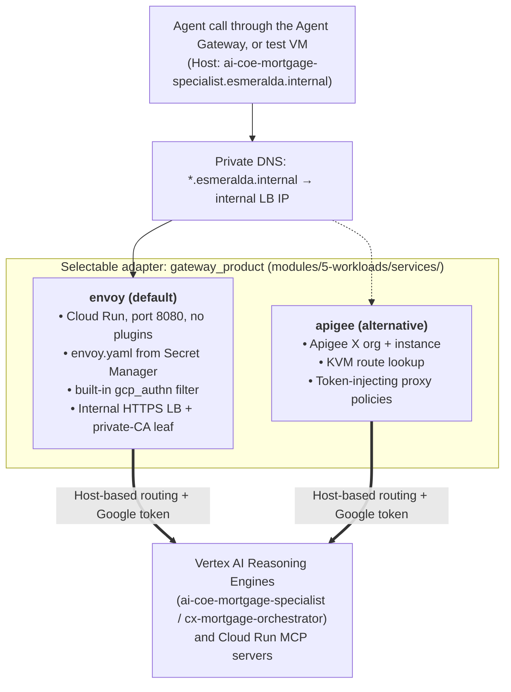

# Layer 5 Workloads: Swappable Ingress Gateways

Welcome to the technical deep-dive for **Layer 5 Ingress Gateways**.

**What an ingress gateway is:** an API gateway is a reverse proxy that sits in front of a set of backend services. It gives them one stable entry point and applies cross-cutting concerns (routing, authentication, rate limiting) so that each backend doesn't have to.

**How Esmeralda uses it:** every private hostname under `*.esmeralda.internal` (the A2A specialist, the orchestrator and the three MCP servers) resolves to a single internal load balancer in front of the gateway. The gateway routes each request by its `Host` header to the right Reasoning Engine or Cloud Run service and adds the Google credential that backend requires. This guide details the **Gateway Adapter Pattern** that keeps that contract stable regardless of which gateway product is behind it.

> [!NOTE]
> The ingress gateway is **not** the [Central Agent Gateway](../3-agentops-and-lifecycle/01-central-agent-gateway.md). The Agent Gateway (Layer 4, governance project) controls where agents may go *out* to; the ingress gateway (Layer 5, gateway project) is the private front door that those calls arrive *at*. A typical call goes agent → Agent Gateway → internal HTTPS LB → Envoy → target.

---

## The 60-Second Mental Model: Why Swappable Gateways?

In enterprise environments, different business units and IT organizations have divergent API gateway standards:
* **Large Financial Enterprises** mandate **Apigee X** for API product cataloging, rate limiting, and compliance auditing.
* **Agile Cloud-Native Teams** prefer **Envoy on Cloud Run** for a lightweight, low-cost serverless proxy with no database and no custom code.

**Esmeralda enforces an abstracted Gateway Adapter Pattern: downstream AI agents and MCP tools expose the exact same interface contract regardless of which gateway adapter is active.**

The adapter is chosen per environment with `gateway_product` in `infrastructure/live/<env>/env.yaml`. The `services/gateway` live stack sources `modules/5-workloads/services/${gateway_product}`. Both **dev and prd use `envoy`**. Until [#73](https://github.com/google/esmeralda/issues/73) this was Kong; Envoy replaced it with the same hostnames and caller contract.

---

## Persona & Role Breakdown: Who Owns Ingress Gateways?

| Engineering Persona | Role & Daily Responsibilities | What They Own | What They NEVER Touch |
| :--- | :--- | :--- | :--- |
| **PlatformOps / Ingress Lead** | Managing the internal LB certificate, ingress security policies, routes, and upstream token injection. | `infrastructure/modules/5-workloads/services/envoy/` (and `services/apigee/`), including the `config/` submodule that renders the Envoy bootstrap; `apps/services/envoy/` (image only); `tests/gateway/`. | Internal agent prompt graphs, Python business logic. |
| **NetOps Engineer** | Providing the Shared VPC subnets and the private DNS zone. | `sb-esmeralda-core-<env>` / `sb-esmeralda-proxy-<env>` subnets, the `esmeralda.internal.` zone (the `*.esmeralda.internal` A records are created by the Envoy module). | Ingress route transformation policies. |
| **AI Application Developer** (CX and AI CoE teams) | Calling targets via standard internal DNS hostnames. | Consuming `https://ai-coe-mortgage-specialist.esmeralda.internal` or `https://<svc>.esmeralda.internal/mcp`. | Gateway configuration, upstream token generation, or proxy infrastructure. |

---

## Architecture Decision Records (ADRs): The "Why"

### ADR-04.1: Gateway Adapter Contract & Upstream Token Injection
* **Context:** Private Vertex AI Reasoning Engines require a Google OAuth2 access token (`roles/aiplatform.user`), and Cloud Run MCP servers require a Google OIDC ID token for an identity holding `roles/run.invoker`. The engines are also only reachable through their `aiplatform.googleapis.com` resource URL, not a friendly hostname.
* **Decision:** The Ingress Gateway acts as an **Identity-Injecting Reverse Proxy**:
  1. Receives requests on `*.esmeralda.internal` (HTTPS, port 443) through the internal load balancer.
  2. Routes by `Host` header to the target URL that Terraform rendered into the gateway config (engine resource URL or Cloud Run URI).
  3. Fetches a short-lived Google token for the gateway's own service account (`sa-esmeralda-gateway-<env>`) from the metadata server.
  4. Replaces the `Authorization` header with that token before proxying the request to the backend.
* **Benefit:** Callers use one stable hostname per target. Backends only need to trust the gateway's service account, and engine IDs can change without touching callers (only the gateway config is re-rendered).

---

## The Gateway Options



---

## Technical Specifications & Blueprints

### 1. Envoy on Cloud Run (`services/envoy/`, default)

**What Envoy is:** an open-source edge and service proxy (a CNCF project). Its whole configuration is one YAML *bootstrap* file read at start-up, and routing, rate limiting and Google token injection are built-in filters, so there are no plugins or custom code to maintain.

**In Esmeralda:**
* **Image:** `apps/services/envoy/Dockerfile` is the official distroless `envoyproxy/envoy` image (1.40.2), pinned by digest, with no custom code and no plugins. It is built with `make build-service-gateway` (image `envoy-gateway`) and deployed by digest like every other image. The image holds no routes and no certificates.
* **Cloud Run service:** `envoy-gateway-<env>` in the gateway project (`esm-<env>-gateway-<sfx>`), port 8080, request timeout 3600 s (long enough for streams), running as `sa-esmeralda-gateway-<env>`. Ingress is `INGRESS_TRAFFIC_INTERNAL_LOAD_BALANCER`, so it is reachable only through the internal LB. Direct VPC egress on the Shared VPC core subnet.
* **Who may call the gateway:** `roles/run.invoker` (the module's `invoker_service_accounts`) for the test VM, specialist, orchestrator and `sa-mcp-invoker-<env>` service accounts. Callers send an ID token whose audience is the hostname they call: agents mint it by impersonating `sa-mcp-invoker-<env>` with audience `https://<host>.esmeralda.internal`, which Cloud Run accepts because the service lists every served hostname (`https://`, `http://` and bare forms) in its `custom_audiences`.
* **Config:** the pure Terraform submodule `services/envoy/config` renders the Envoy bootstrap from `agent_endpoints` (`logical_name`, `engine_id`, `endpoint_url`, `audience`, plus optional `path_map` and `streaming`). It is stored in Secret Manager (`envoy-config-<env>`) and mounted at `/etc/envoy/envoy.yaml`; every change rolls out a new revision. No admin API is exposed (Envoy's admin interface listens on `127.0.0.1` only). The config creates:
  * for each target, a **host route** (`<name>.esmeralda.internal`: path kept, upstream `Host` rewritten) and apex path routes (`https://esmeralda.internal/<name>/...` and `/agents/<name>/...`, prefix stripped). A target with a `path_map` serves only its mapped paths, on its host and under both apex prefixes;
  * the upstream URLs: `<engine endpoint>/a2a` for the specialist and the Cloud Run URI for each MCP server. The orchestrator host serves one path, `/api/stream_reasoning_engine` (the path `esmeralda serve` exposes locally; callers send `POST`), mapped to `<engine endpoint>:streamQuery?alt=sse` and streamed unbuffered. Other paths on that host return 404, and a query string on the mapped path returns 400 (Envoy would otherwise append it after `?alt=sse`);
  * `GET https://esmeralda.internal/healthz`, answered with 200 by Envoy itself (for operators inside the VPC; like every call, it needs an ID token). Unknown hosts get 404.
* **Paths:** Envoy resolves dot segments (`..`, `%2e%2e`) and repeated slashes before routing, so a request can't climb out of a target's base path, and rejects encoded slashes (`%2F`, `%5C`) with 400. A trailing dot or a port in `Host` routes like the bare name.
* **Token injection (built-in `gcp_authn` filter):** replaces the caller's `Authorization` header with a token for `sa-esmeralda-gateway-<env>`. For `*.googleapis.com` audiences (Reasoning Engines) it is an **OAuth2 access token**; for Cloud Run audiences it is an **OIDC ID token** for the service URI. Tokens come from the metadata server and are cached until they expire. Other caller headers (`X-API-Key`, `User-Auth-Token`, `traceparent`, ...) pass through unchanged. If a token can't be fetched, Envoy fails open, as Kong did: the request goes on with the caller's own `Authorization` (MCP calls then run as the caller, Vertex AI answers 401), Envoy logs `Failed to fetch token`, and the *Ingress Gateway Token Fetch Failures* alert fires. MCP services list `sa-esmeralda-gateway-<env>` as an invoker, and it holds `roles/aiplatform.user` on both agent projects. `gcp_authn` is marked alpha upstream, so the Envoy version is pinned and its behavior is covered by tests.
* **Upstream TLS:** verified against the system CA bundle; SNI and the certificate SAN must match the upstream hostname.
* **Rate limiting, timeouts and retries:** 120 requests per minute per `X-API-Key` value, per instance (up to 1,000 active keys per instance). Requests without the header share one default bucket; over the limit, Envoy answers HTTP 429 with `Retry-After`. Proxied routes time out after 120 s (Envoy's default would be 15 s); the streaming orchestrator route has no route timeout, only a 300 s idle timeout. Failed upstream connections are retried up to 5 times.
* **Logs:** JSON access logs on stdout, collected by Cloud Logging: the host and path the caller sent (not the upstream rewrite), method, status, `response_flags`, `upstream_cluster`, duration, `api_key` and `traceparent`. `request_id` is the caller's `x-request-id` when it sends one. Envoy's own messages (for example `Failed to fetch token`) go to stderr.
* **Internal HTTPS load balancer:** serverless NEG → regional backend service (`INTERNAL_MANAGED`, request logging on) → URL map → target HTTPS proxy → forwarding rule on port **443** with a static internal VIP in the core subnet (the LB's managed proxies run in the proxy-only subnet). The LB presents a `*.esmeralda.internal` leaf certificate signed by the Layer 3 **internal Root CA**, and the module writes the `esmeralda.internal` and `*.esmeralda.internal` A records into the private zone. Why a private CA is needed, and how the Agent Gateway trusts it, is explained in [Central Agent Gateway §5](../3-agentops-and-lifecycle/01-central-agent-gateway.md#5-tls-and-certificates-why-we-need-self-signed-cas).
* **Tests:** `make test-gateway` (part of `make test-all`) renders the config module and runs it in a real `envoy` binary against a fake metadata server and TLS mock upstreams ([`tests/gateway`](../../../tests/gateway)). The optional [`tests/gateway/sandbox`](../../../tests/gateway/sandbox/README.md) deploys the module in a throwaway GCP project, behind the internal LB, and checks it from a VM.

> [!IMPORTANT]
> Envoy routes use the agents' **engine IDs**. If an agent engine is recreated, run `make deploy-gateway ENV=<env>` to re-render the routes.

---

### 2. Apigee X (`services/apigee/`, alternative)

**What Apigee is:** Google Cloud's managed enterprise API management platform (proxies, products, quotas, analytics).

**In Esmeralda** (selected with `gateway_product = "apigee"`; not used by the current environments):
* **Organization & Environment:** Provisions `google_apigee_organization` with `authorized_network = var.vpc_id`, an environment (`var.environment`), and an environment group registering `*.esmeralda.internal`.
* **Runtime Plane:** Deploys `google_apigee_instance` with peering range `10.12.0.0/22`.
* **Dynamic Route KVM:** The `null_resource.populate_apigee_kvm` step iterates over `var.agent_endpoints`, populating the `agent-routes` Key-Value Map with logical-name → target URL entries.
* **Proxy Policies:** `KVM-Lookup.xml` extracts the subdomain and `Generate-Bearer-Token.xml` sets the `Authorization: Bearer` header.

> [!WARNING]
> The Apigee module does not create the internal HTTPS LB certificate or the `*.esmeralda.internal` DNS records that the Envoy module creates, and it has not been validated with the Agent Gateway path. Treat it as a starting point, not a drop-in replacement.

---

## Verification & Runbook

### Test Ingress Routing via Test VM
The test VM (`test-vm-<env>`) currently lives in the CX agents project. The internal LB only listens on HTTPS, so pass the internal Root CA public certificate (Secret Manager `esmeralda-internal-root-ca-<env>` in the gateway project) to `curl`.

```bash
CX_PROJ=$(cd infrastructure/live/dev/layer-1-projects && terragrunt output -raw cx_agents_project_id)
GW_PROJ=$(cd infrastructure/live/dev/layer-1-projects && terragrunt output -raw gateway_project_id)

# Copy the internal Root CA (public cert only) to the VM
gcloud secrets versions access latest --secret=esmeralda-internal-root-ca-dev --project=$GW_PROJ > /tmp/root-ca.pem
gcloud compute scp /tmp/root-ca.pem test-vm-dev:/tmp/root-ca.pem --zone=us-central1-f --project=$CX_PROJ --tunnel-through-iap

# SSH into the test VM
gcloud compute ssh test-vm-dev --zone=us-central1-f --project=$CX_PROJ --tunnel-through-iap

# Inside VM: fetch the AgentCard through Envoy
HOST=ai-coe-mortgage-specialist.esmeralda.internal
TOKEN=$(curl -s -H "Metadata-Flavor: Google" \
  "http://metadata.google.internal/computeMetadata/v1/instance/service-accounts/default/identity?audience=https://${HOST}")
curl -s --cacert /tmp/root-ca.pem -H "Authorization: Bearer ${TOKEN}" https://${HOST}/v1/card | jq .
```

### Query the orchestrator through the gateway
From the test VM, with the same Root CA and a token for the orchestrator's hostname. The events stream back as they are produced:

```bash
HOST=cx-mortgage-orchestrator.esmeralda.internal
TOKEN=$(curl -s -H "Metadata-Flavor: Google" \
  "http://metadata.google.internal/computeMetadata/v1/instance/service-accounts/default/identity?audience=https://${HOST}")
curl -sSN --cacert /tmp/root-ca.pem -H "Authorization: Bearer ${TOKEN}" -H "Content-Type: application/json" \
  -d '{"class_method": "async_stream_query", "input": {"message": "hello", "user_id": "e4-check"}}' \
  https://${HOST}/api/stream_reasoning_engine
```

From any machine in the VPC that trusts the internal Root CA, `make query AGENT=cx-mortgage-orchestrator TARGET=https://cx-mortgage-orchestrator.esmeralda.internal` does the same: `esmeralda query --url` sends the ID token itself.
