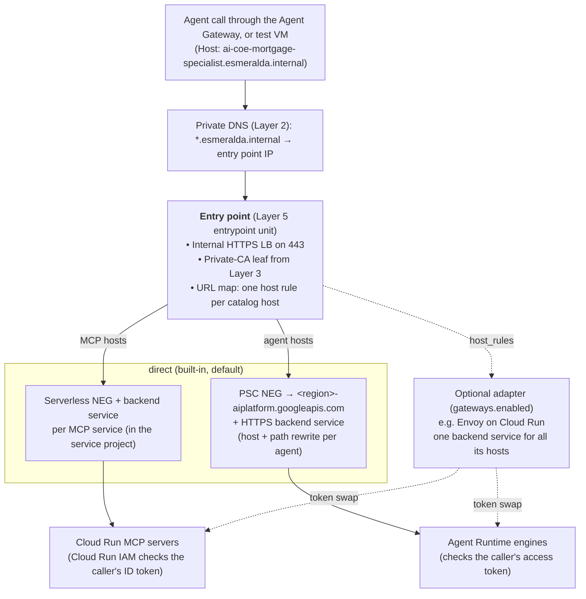

# Layer 5 workloads: entry point, service catalog and gateways

Welcome to the technical deep-dive for the **Layer 5 entry point**.

**What it is:** every private hostname under `*.esmeralda.internal` (the A2A specialist, the orchestrator and the three MCP servers) resolves to a single internal Application Load Balancer, the **entry point**. The entry point terminates TLS and routes each request by its `Host` header.

**How Esmeralda uses it:** the hosts it serves come from one **service catalog** in `env.yaml`. By default every host is served by the built-in **`direct`** backend: the load balancer sends MCP requests straight to the Cloud Run service and agent requests straight to Agent Runtime, with no proxy in between. Callers send their own Google credential, so the backend sees the real caller identity. A **bring-your-own adapter** (Envoy is the reference one, off by default) can take over some or all hosts when you need a proxy, for example for rate limits or token injection. Hosts move between `direct` and an adapter one at a time without touching callers.

> [!NOTE]
> The entry point is **not** the [Central Agent Gateway](../3-agentops-and-lifecycle/01-central-agent-gateway.md). The Agent Gateway (Layer 4, governance project) controls where agents may go *out* to; the entry point (Layer 5, gateway project) is the private front door those calls arrive *at*. A typical call goes agent → Agent Gateway → entry point (internal HTTPS LB) → target. The Agent Gateway passes the caller's `Authorization` header through unchanged, which is why per-caller credentials work end to end.

> [!NOTE]
> Kong was the original ingress gateway. It has been removed (module, live units, image, build target and its service account) and replaced by the built-in `direct` backend.

---

## The 60-second mental model

| Piece | What it is | Where it lives | Changes when |
| :--- | :--- | :--- | :--- |
| **Entry point: IP + DNS** | Reserved internal IP `ilb-esmeralda-vip-<env>` (gateway project, shared core subnet) and the `esmeralda.internal` / `*.esmeralda.internal` A records (TTL 300) pointing at it. | Layer 2: [`2-networking/main.tf`](../../../infrastructure/modules/2-networking/main.tf) §7 (outputs `entrypoint_address_id`, `entrypoint_address`, `entrypoint_domain`; optional `entrypoint_ip_address` to pin the IP). | Almost never. |
| **Entry point: certificate** | Leaf for `esmeralda.internal` + `*.esmeralda.internal` (only those two SANs), signed by the internal Root CA, stored as regional SSL certificate `cert-esmeralda-ilb-*` in the gateway project. | Layer 3: [`3-security/pki.tf`](../../../infrastructure/modules/3-security/pki.tf) (output `entrypoint_ssl_certificate_id`). The CA private key never leaves Layer 3. | When the leaf is re-issued. |
| **Service catalog** | One entry per MCP service or agent: host name, kind, deploying unit, token kind, probe, callers. | `catalog` in `infrastructure/live/<env>/env.yaml`. | A service or agent is added or removed. |
| **Entry point: routing** | URL map `ilb-esmeralda-url-map-<env>`, target HTTPS proxy `ilb-esmeralda-https-proxy-<env>`, forwarding rule `ilb-esmeralda-rule-<env>` on port **443** of the reserved IP. | Layer 5: [`5-workloads/entrypoint`](../../../infrastructure/modules/5-workloads/entrypoint/main.tf), live unit `layer-5-workloads/entrypoint`. | The catalog changes, or a host moves between backends. |
| **`direct` backend** | Built-in, always deployed: per-host backend services (serverless NEGs for MCP services, one PSC NEG for Agent Runtime). | Layer 5: `modules/5-workloads/gateways/direct`, live unit `layer-5-workloads/gateways/direct`. | The catalog changes or an agent engine is recreated. |
| **Adapters** (optional) | Bring-your-own proxies (Envoy, Apigee, ...). Each one ends in one regional backend service. | Layer 5: `modules/5-workloads/gateways/<name>`, live units `layer-5-workloads/gateways/<name>`. | Routes or the adapter product change. |

Because the IP, the DNS records and the certificate live in lower layers, the hostnames outlive any backend: adding or swapping an adapter never changes what `*.esmeralda.internal` resolves to or which certificate callers see.

---

## Persona and role breakdown

| Engineering persona | Role and daily responsibilities | What they own | What they never touch |
| :--- | :--- | :--- | :--- |
| **PlatformOps / ingress lead** | Managing the catalog, the entry point routing, the `direct` backend and any adapter. | The `catalog` and `gateways` blocks in `env.yaml`, `infrastructure/modules/5-workloads/entrypoint/`, `gateways/direct/`, `gateways/envoy/` (and `gateways/apigee/`), `apps/services/envoy/` (pinned upstream image). | Internal agent prompt graphs, Python business logic. |
| **NetOps engineer** | Providing the Shared VPC subnets, the private DNS zone and the entry point address. | `sb-esmeralda-core-<env>` / `sb-esmeralda-proxy-<env>` subnets, the `esmeralda.internal.` zone, the reserved entry point IP and its `esmeralda.internal` / `*.esmeralda.internal` A records (all Layer 2). | Route transformation policies. |
| **SecOps engineer** | Owning the internal Root CA and the entry point certificate. | `infrastructure/modules/3-security/pki.tf` (Layer 3). | Routes. |
| **AI application developer** (CX and AI CoE teams) | Calling targets via standard internal DNS hostnames. | Consuming `https://ai-coe-mortgage-specialist.esmeralda.internal` or `https://<svc>.esmeralda.internal/mcp`. | Entry point configuration, proxy infrastructure. |

---

## Architecture decision records (ADRs): the "why"

### ADR-04.1: Callers present their own credentials (`direct`)
* **Context:** Agent Runtime engines require a Google OAuth2 access token (`roles/aiplatform.user`), and Cloud Run MCP servers require a Google OIDC ID token for an identity holding `roles/run.invoker`. The engines are only reachable through their `aiplatform.googleapis.com` resource URL, not a friendly hostname.
* **History:** the first version used Kong as an **identity-injecting reverse proxy**: it routed by `Host` header, fetched a token for its own service account and replaced the caller's `Authorization` header with it. Backends only saw Kong's identity, and every request went through an extra Cloud Run hop.
* **Decision:** Kong was replaced by the built-in **`direct`** backend. The load balancer itself maps each host to its backend (serverless NEG for Cloud Run, PSC NEG + URL rewrite for Agent Runtime), and callers send their own token. No token is swapped.
* **Benefit:** the MCP server and the engine see the real caller identity and authorize it themselves (`callers` in the catalog), there is no proxy to build, patch or scale, and friendly hostnames still hide the engine IDs from callers. Teams that need a proxy can still route hosts to an adapter.

### ADR-04.2: Separate entry point in front of the backends
* **Context:** when the gateway module owned the load balancer, the certificate and the DNS records, replacing the gateway meant destroying the front door, and two gateways could not serve the same domain at the same time.
* **Decision:** the IP and DNS records live in Layer 2, the certificate in Layer 3, and the URL map / HTTPS proxy / forwarding rule in a dedicated Layer 5 `entrypoint` unit. Backends (`direct` and adapters) only expose backend services.
* **Benefit:** `direct` and adapters run side by side behind one entry point and hosts move one at a time (see [Moving hosts between backends](#moving-hosts-between-backends)). The Root CA key never has to be passed to Layer 5. This is also what made the move from Kong to `direct` possible without changing hostnames.

---

## Request path



---

## Technical specifications

### 1. The service catalog

Every host the entry point serves is one entry of `catalog` in `infrastructure/live/<env>/env.yaml`. The key is the host label: entry `legacy-dms` is served as `legacy-dms.esmeralda.internal`.

| Field | Values | Meaning |
| :--- | :--- | :--- |
| `kind` | `mcp`, `a2a`, `adk` | `mcp`: Cloud Run MCP server. `a2a`: A2A agent on Agent Runtime. `adk`: ADK agent on Agent Runtime. |
| `unit` | `services/<x>`, `agents/<x>` | Layer 5 unit that deploys it; the `direct` and adapter units map it to that unit's outputs. |
| `token` | `id`, `access` | What callers send when the host is served by `direct`: `id` = Google ID token with audience `https://<name>.<domain>`, checked by Cloud Run IAM; `access` = OAuth2 access token, checked by Agent Runtime. |
| `probe` | `mcp`, `a2a`, `query`, `none` | How `make test-gateway` checks the host (see [below](#test-every-route-make-test-gateway)). |
| `timeout` | seconds (optional) | Route timeout for agent hosts. Default 600. |
| `callers` | list (optional) | Catalog agents (and `test-vm`) whose service accounts get invoke rights: `roles/run.invoker` on an MCP service, `roles/aiplatform.user` on the agent project for an A2A agent. |

How `callers` becomes IAM: the service or agent unit maps each caller to its Layer 3 service account output (`<name_with_underscores>_sa_email`, e.g. `test_vm_sa_email`). When at least one caller is an agent (not `test-vm`), it also adds the shared MCP invoker service account (`sa-mcp-invoker-<env>`), because agents call out as that account (`SERVICE_ACCOUNT_EMAIL`). The service account of each enabled adapter (Envoy) is added too, since an adapter calls with its own token. `direct` adds none.

The repository ships these five entries (`infrastructure/live/<env>/env.yaml`):

```hcl
catalog = {
  legacy-dms                 = { kind = "mcp", unit = "services/legacy-dms", token = "id", probe = "mcp", callers = ["ai-coe-mortgage-specialist", "cx-mortgage-orchestrator", "test-vm"] }
  income-verification        = { kind = "mcp", unit = "services/income-verification", token = "id", probe = "mcp", callers = ["ai-coe-mortgage-specialist", "cx-mortgage-orchestrator", "test-vm"] }
  corporate-email            = { kind = "mcp", unit = "services/corporate-email", token = "id", probe = "mcp", callers = ["ai-coe-mortgage-specialist", "cx-mortgage-orchestrator", "test-vm"] }
  ai-coe-mortgage-specialist = { kind = "a2a", unit = "agents/ai-coe-mortgage-specialist", token = "access", probe = "a2a", callers = ["cx-mortgage-orchestrator", "test-vm"] }
  cx-mortgage-orchestrator   = { kind = "adk", unit = "agents/cx-mortgage-orchestrator", token = "access", probe = "query", timeout = 600 }
}
```

### 2. The `gateways` block

```hcl
gateways = {
  default    = "direct" # gets every catalog host not listed in host_rules
  enabled    = []       # bring-your-own adapters only, e.g. ["envoy"]
  host_rules = {}       # optional: host label => "direct" or an enabled adapter
}
```

* `direct` is built in and always deployed; `enabled` lists **adapters only**, each a unit under `layer-5-workloads/gateways/<name>`.
* A `host_rules` key is a host label (`legacy-dms` is routed as `legacy-dms.esmeralda.internal`).
* Validation: `default` and every `host_rules` value must be `direct` or an enabled adapter, and `direct` can't be listed in `enabled`.
* Both **dev and prd use `default = "direct"`, `enabled = []`**, no host rules. Envoy is wired in (live unit + entrypoint dependency) but off until `envoy` is added to `enabled`.

### 3. The entry point (`entrypoint/`)

[`modules/5-workloads/entrypoint`](../../../infrastructure/modules/5-workloads/entrypoint/main.tf) builds the regional internal Application Load Balancer in the gateway project:

* **URL map** `ilb-esmeralda-url-map-<env>`: one host rule + path matcher per catalog host. Hosts served by `direct` use the per-host backends (and rewrites) from the `direct` unit's `hosts` output; hosts sent to an adapter use that adapter's single `backend_service_id`. Hosts outside the catalog fall through to a default backend and get a 404.
* **Target HTTPS proxy** `ilb-esmeralda-https-proxy-<env>`, presenting the Layer 3 certificate (`entrypoint_ssl_certificate_id`).
* **Forwarding rule** `ilb-esmeralda-rule-<env>`: port **443** on the Layer 2 reserved IP (`entrypoint_address`), `INTERNAL_MANAGED`, using the region's proxy-only subnet.
* **Outputs:** `url_map_id`, `ip_address`, and **`routes`**: one entry per host with `host`, `probe`, `token` (the kind callers must send, given where the host is routed) and `backend` (`direct` or the adapter name). `make test-gateway` reads it.

**Backend contract:**

| Backend | Outputs | How the entry point uses them |
| :--- | :--- | :--- |
| `direct` | `hosts`: per-host backend service, plus host and path rewrites and timeout for agent hosts. | One host rule + path matcher per host. |
| Adapter | `backend_service_id` (one regional `INTERNAL_MANAGED` backend service for every host sent to it) and `routes`. | Every host routed to the adapter points at that backend service. |

Why a private CA is needed, and how the Agent Gateway trusts it, is explained in [Central Agent Gateway §5](../3-agentops-and-lifecycle/01-central-agent-gateway.md#5-tls-and-certificates-why-we-need-self-signed-cas).

### 4. The `direct` backend (`gateways/direct/`, default)

Module `infrastructure/modules/5-workloads/gateways/direct`, live unit `infrastructure/live/<env>/layer-5-workloads/gateways/direct`, always deployed. No proxy, no container, no service account.

* **MCP services:** one serverless NEG + regional `INTERNAL_MANAGED` HTTPS backend service per service, created **in the service's own project** and referenced cross-project by the entry point URL map. A serverless NEG can only point at a Cloud Run service in its own project, hence the NEG lives in the service project. The service keeps ingress `internal-and-cloud-load-balancing` and `custom_audiences`, so Cloud Run IAM checks the caller's ID token (audience `https://<name>.esmeralda.internal`).
* **Agents (Agent Runtime):** one regional Private Service Connect NEG targeting `<region>-aiplatform.googleapis.com` + one HTTPS backend service in the gateway project, shared by all agent hosts. Each agent host gets a route with `hostRewrite = <region>-aiplatform.googleapis.com` and a `pathPrefixRewrite`:
    * A2A: `/v1/` → `/v1beta1/projects/<p>/locations/<r>/reasoningEngines/<id>/a2a/v1/`
    * ADK: `/api/stream_reasoning_engine` → `/v1beta1/projects/<p>/locations/<r>/reasoningEngines/<id>:streamQuery` (NDJSON stream)
* **Timeout:** the backend service timeout of a PSC NEG that targets a Google API is fixed at 30 s and can't be changed, so each agent route sets its own timeout (default 600 s, catalog `timeout`) to let long streams finish.
* **Credentials:** callers send their own token: an ID token for MCP hosts, an access token for agent hosts (Agent Runtime rejects ID tokens with 401). Nothing is swapped, so the MCP server and the engine see the real caller identity.
* **Deployer permission:** the entry point references backend services that live in the MCP service projects, so whoever applies the entry point needs `compute.backendServices.use` on them (`roles/compute.loadBalancerServiceUser` on the service project). Project owners have it; a dedicated CI deployer needs it granted.

> [!IMPORTANT]
> Agent routes use the agents' **engine IDs**. If an agent engine is recreated, re-run `make deploy-gateway ENV=<env>` (applies `gateways/direct`) and then `make deploy-entrypoint ENV=<env>`.

### 5. Token kinds and the client library

| Host routed to | MCP host | Agent host |
| :--- | :--- | :--- |
| `direct` | ID token (audience `https://<name>.esmeralda.internal`) | Access token |
| An adapter (Envoy) | ID token | ID token (the adapter's front door is Cloud Run IAM; it swaps the token for the upstream credential) |

The `esmeralda` client library picks the kind with `esmeralda.auth.token_kind(url)`: `access` for hosts listed in the `ACCESS_TOKEN_HOSTS` environment variable (comma-separated; Terraform sets it on each agent from the catalog and the routing) and always for `*.googleapis.com`, `id` otherwise. `esmeralda.a2a` and `esmeralda.mcp` send that kind.

Agents call out by impersonating the shared MCP invoker service account (`sa-mcp-invoker-<env>`), which has `roles/run.invoker` on the MCP project. For A2A over `direct` it also needs `roles/aiplatform.user` on the callee agent's project: when the callee's catalog `callers` include an agent, the agent unit adds it to `invoker_service_accounts`, and the a2a-agent module grants it that role on its project.

> [!WARNING]
> **Agent card URL.** The A2A agent card's `url` is the engine's real `aiplatform.googleapis.com` URL, not `<name>.esmeralda.internal`. `esmeralda.a2a.remote_agent` pins every RPC call to the configured `<name>.esmeralda.internal` base URL, so calls stay on the entry point. Other A2A clients that follow `card.url` go straight to aiplatform and need an access token.

### 6. Envoy on Cloud Run (`gateways/envoy/`, optional adapter)

**What Envoy is:** an open-source, high-performance L7 proxy (CNCF). Its built-in [`gcp_authn`](https://www.envoyproxy.io/docs/envoy/latest/configuration/http/http_filters/gcp_authn_filter) filter fetches Google tokens from the metadata server and caches them, so no plugin or custom code is needed.

**In Esmeralda:**
* **Image:** `apps/services/envoy/Dockerfile` is upstream `envoyproxy/envoy:distroless-v1.40.2`, **pinned by digest** (Dependabot bumps it; the Gateway CI workflow runs the harness on every bump). Built with `make build-service-envoy` (image `envoy-gateway`) and deployed by digest like every other image. It contains no routes and no certificates.
* **Bootstrap:** the pure [`config`](../../../infrastructure/modules/5-workloads/gateways/envoy/config/main.tf) submodule (no providers, no resources) renders the Envoy YAML from `agent_endpoints`, which the live unit derives from the catalog. Terraform stores it in Secret Manager (`envoy-config-<env>`) and Cloud Run mounts the exact secret version at `/etc/envoy/envoy.yaml`, so every config change rolls out as a new revision (old versions are kept, so traffic can be rolled back to an earlier revision). For each target it creates:
  * a **host route** `<name>.esmeralda.internal` and apex path routes (`/<name>/...`, `/agents/<name>/...`, prefix stripped), plus `GET /healthz` on the apex;
  * an optional **`path_map`**: the orchestrator serves only `/api/stream_reasoning_engine` (the path `esmeralda serve` exposes locally), rewritten to `<engine>:streamQuery?alt=sse`, with **`streaming = true`** (no route timeout; `stream_idle_timeout` 300 s still applies);
  * a cluster with upstream TLS verified against the system CA bundle and the target's SAN, an explicit 120 s route timeout and 5 retries on connect failure;
  * **tokens:** an OAuth2 **access token** for `*.googleapis.com` audiences (Agent Runtime), an OIDC **ID token** for the Cloud Run URI otherwise, cached until expiry.
* **Hardening:** path normalization and slash merging, requests with encoded slashes rejected, query strings rejected on mapped paths, `x-envoy-original-*` headers only written by Envoy, upstream timing header removed, admin interface bound to `127.0.0.1`, JSON access log with the caller's host and path. Per-`X-API-Key` local rate limit (120/min per instance).
* **Cloud Run service:** `envoy-gateway-<env>` in the gateway project, port 8080, running as **`sa-esmeralda-envoy-<env>`** (Layer 3 output `envoy_sa_email`). Ingress `INGRESS_TRAFFIC_INTERNAL_LOAD_BALANCER`, custom audiences for every served hostname, request timeout 3600 s (this also bounds requests through the load balancer: serverless NEG backend services take no `timeout_sec`). Direct VPC egress on the core subnet. Callers send it an **ID token** for every host, agent hosts included.
* **Upstream grants:** when `envoy` is in `gateways.enabled`, the MCP service units add `sa-esmeralda-envoy-<env>` to their invokers, the specialist unit to its invokers, and the orchestrator unit grants it `roles/aiplatform.user` (adk-agent `invoker_service_accounts`).
* **Backend contract:** serverless NEG `neg-envoy-gateway-<env>` → regional backend service `backend-envoy-gateway-<env>` (`INTERNAL_MANAGED`, request logging on), exposed as `backend_service_id`, plus `routes`. Module: [`gateways/envoy/main.tf`](../../../infrastructure/modules/5-workloads/gateways/envoy/main.tf); live unit: `layer-5-workloads/gateways/envoy`.
* **Alerts (Layer 4):** when `envoy` is enabled, the governance unit passes `envoy-gateway-<env>` to the alert policies: a 5xx-ratio alert (threshold `monitoring_config.error_rate_threshold_pct`) and a token-fetch-failure alert, and the gateway is excluded from the P95 latency alert and SLO (streams stay open for minutes).
* **Tests:**
  * `make test-gateway-unit`: offline harness ([`tests/gateway`](../../../tests/gateway)). It renders the `config` submodule with Terraform/OpenTofu and runs it in a real `envoy` 1.40 binary against a fake metadata server and TLS mock upstreams (routing, tokens and caching, streaming, rate limits, failure modes). Part of `make test-all`. See [Contributing](../contributing.md) for how to get the binary.
  * [`tests/gateway/sandbox`](../../../tests/gateway/sandbox/README.md): a throwaway GCP project that runs the module for real behind the `entrypoint` module and checks it from a VM.

> [!IMPORTANT]
> Like `direct`, Envoy routes use the agents' engine IDs. If an agent engine is recreated, re-apply `layer-5-workloads/gateways/envoy`.

### 7. Apigee X (`gateways/apigee/`, stub)

**What Apigee is:** Google Cloud's managed enterprise API management platform (proxies, products, quotas, analytics).

**In Esmeralda** (not used by the current environments, and no live unit yet):
* **Organization and environment:** provisions `google_apigee_organization` with `authorized_network = var.vpc_id`, an environment (`var.environment`), and an environment group registering `*.esmeralda.internal`.
* **Runtime plane:** deploys `google_apigee_instance` with peering range `10.12.0.0/22`.
* **Dynamic route KVM:** the `null_resource.populate_apigee_kvm` step iterates over `var.agent_endpoints`, populating the `agent-routes` Key-Value Map with logical-name → target URL entries.
* **Proxy policies:** `KVM-Lookup.xml` extracts the subdomain and `Generate-Bearer-Token.xml` sets the `Authorization: Bearer` header.

> [!WARNING]
> The Apigee module is a placeholder for the adapter contract: its [`outputs.tf`](../../../infrastructure/modules/5-workloads/gateways/apigee/outputs.tf) returns `backend_service_id = null` and empty `routes`, so the entrypoint rejects `apigee` as a backend. To make it routable, add a regional PSC NEG targeting the Apigee instance service attachment and a regional `INTERNAL_MANAGED` backend service on top of it, return that ID, then add a live unit and a dependency block in the entrypoint unit. It has not been validated with the Agent Gateway path. Treat it as a starting point, not a drop-in replacement.

---

## Extending

### Adding a catalog entry

1. Add the entry to `catalog` in `env.yaml` (both environments).
2. Add the Layer 5 unit that deploys it (`services/<x>` or `agents/<x>`).
3. Add one dependency block for that unit in `layer-5-workloads/gateways/direct/terragrunt.hcl` and in `layer-5-workloads/gateways/envoy/terragrunt.hcl`: both map the entry's `unit` to that unit's outputs (Cloud Run service, or engine ID).
4. Apply the unit, `gateways/direct` (`make deploy-gateway`; Envoy too if enabled), then the entry point (`make deploy-entrypoint`), and run `make test-gateway`.

### Adding an adapter

1. **A module** under `infrastructure/modules/5-workloads/gateways/<name>/` that outputs `backend_service_id` (a regional `INTERNAL_MANAGED` backend service in the gateway project, in the entry point's region) and `routes`. It owns no load balancer, certificate or DNS record. See [`envoy/outputs.tf`](../../../infrastructure/modules/5-workloads/gateways/envoy/outputs.tf) for the reference.
2. **A live unit** under `infrastructure/live/<env>/layer-5-workloads/gateways/<name>/` with an `exclude` block that skips it when `<name>` is not in `gateways.enabled`.
3. **One dependency block** in `infrastructure/live/<env>/layer-5-workloads/entrypoint/terragrunt.hcl` (with `enabled = contains(local.env_vars.locals.gateways.enabled, "<name>")`) plus its entry in the `adapters` input.

---

## Moving hosts between backends

The entry point serves `direct` and adapter hosts side by side, so a host can move to an adapter (here `envoy`), or back, one at a time while callers keep the same hostname and certificate. Only the token kind can change: agent hosts take an access token on `direct` and an ID token on an adapter; the client library follows `ACCESS_TOKEN_HOSTS`, which Terraform updates on the agents.

1. **Prepare the adapter.** For Envoy: apply Layer 3 (Envoy service account) and build the image (`make build-service-envoy`).
2. **Enable it and move one host** in `env.yaml`:

   ```hcl
   gateways = {
     default    = "direct"
     enabled    = ["envoy"]
     host_rules = { "legacy-dms" = "envoy" }  # legacy-dms.esmeralda.internal -> envoy
   }
   ```

3. **Apply** the MCP services and agents (so they grant the Envoy service account and get the new `ACCESS_TOKEN_HOSTS`), Layer 4 for its alerts, the adapter, then the entry point:

   ```bash
   cd infrastructure/live/<env>/layer-5-workloads/gateways/envoy && terragrunt apply
   make deploy-entrypoint ENV=<env>
   ```

4. **Test** with `make test-gateway ENV=<env>`: every host must still answer through the entry point, `legacy-dms` now through `envoy`.
5. **Move more hosts** by adding them to `host_rules` and re-running `make deploy-entrypoint` + `make test-gateway`.
6. **Flip the default** if every host should use the adapter: `default = "envoy"` and drop the overrides that now match the default. Apply the entry point and test again.

To roll back at any step, revert `env.yaml` and re-apply the agents and the entry point.

---

## Apply order

For a new environment: L0 → L1 → L2 (includes the entry point IP + DNS) → L3 (includes the entry point certificate) → L4 → images → L5 services → agents → `gateways/direct` (and any enabled adapter) → `entrypoint` → `iap-egress` / `test-vm`. `make deploy-workloads` (`terragrunt run --all`) derives the Layer 5 order from the dependency blocks. The individual targets are `make deploy-gateway` (applies `layer-5-workloads/gateways/direct`; re-run it after an agent engine is recreated, since agent routes use engine IDs) and `make deploy-entrypoint`.

---

## Verification and runbook

### Test every route: `make test-gateway`

```bash
make test-gateway ENV=dev
```

[`scripts/test_gateway.sh`](../../../scripts/test_gateway.sh) reads everything from Terragrunt outputs (test VM name / zone / project from the `test-vm` unit, entry point IP and domain from Layer 2, the internal Root CA secret from Layer 3, and the entry point's `routes` output). It then connects to the test VM over IAP SSH and probes each host through the entry point, pinned to the entry point IP, with TLS verified against the internal Root CA. Each host gets the token kind from `routes`: an ID token from the VM metadata server (audience `https://<host>`) or an access token.

| Probe | Request | Expected |
| :--- | :--- | :--- |
| `mcp` | `POST /mcp` (MCP `initialize`) | 2xx |
| `a2a` | `GET /v1/card` (agent card) | 2xx |
| `query` | `POST /api/stream_reasoning_engine` with an ADK `async_stream_query` body (user ID `test-gateway`, message from `TEST_GATEWAY_QUERY`, default "Can you verify Julian Sterling's income?"), 120 s timeout | HTTP 200, non-empty model text, no error event |
| `none` | `GET /` | TLS + routing only, any HTTP status |

A "no route" answer fails every kind.

> [!NOTE]
> The `query` probe runs a real agent turn end to end (orchestrator → specialist → MCP tools), so it costs model tokens.

### Manual check via test VM
The test VM (`test-vm-<env>`) currently lives in the CX agents project. The entry point only listens on HTTPS, so pass the internal Root CA public certificate (Secret Manager `esmeralda-internal-root-ca-<env>` in the gateway project) to `curl`.

```bash
CX_PROJ=$(cd infrastructure/live/dev/layer-1-projects && terragrunt output -raw cx_agents_project_id)
GW_PROJ=$(cd infrastructure/live/dev/layer-1-projects && terragrunt output -raw gateway_project_id)
ENTRY_IP=$(cd infrastructure/live/dev/layer-2-networking && terragrunt output -raw entrypoint_address)

# Copy the internal Root CA (public cert only) to the VM
gcloud secrets versions access latest --secret=esmeralda-internal-root-ca-dev --project=$GW_PROJ > /tmp/root-ca.pem
gcloud compute scp /tmp/root-ca.pem test-vm-dev:/tmp/root-ca.pem --zone=us-central1-f --project=$CX_PROJ --tunnel-through-iap

# SSH into the test VM
gcloud compute ssh test-vm-dev --zone=us-central1-f --project=$CX_PROJ --tunnel-through-iap

# Inside VM: fetch the AgentCard through the entry point (direct -> Agent Runtime).
# Agent hosts on direct take an access token (gcloud auth print-access-token also works).
HOST=ai-coe-mortgage-specialist.esmeralda.internal
getent hosts ${HOST}   # should print the entry point IP (ENTRY_IP above)
TOKEN=$(curl -s -H "Metadata-Flavor: Google" \
  "http://metadata.google.internal/computeMetadata/v1/instance/service-accounts/default/token" | jq -r .access_token)
curl -s --cacert /tmp/root-ca.pem -H "Authorization: Bearer ${TOKEN}" https://${HOST}/v1/card | jq .

# MCP hosts take an ID token with the host as audience
HOST=legacy-dms.esmeralda.internal
TOKEN=$(curl -s -H "Metadata-Flavor: Google" \
  "http://metadata.google.internal/computeMetadata/v1/instance/service-accounts/default/identity?audience=https://${HOST}")
curl -s --cacert /tmp/root-ca.pem -H "Authorization: Bearer ${TOKEN}" -H "Content-Type: application/json" \
  -H "Accept: application/json, text/event-stream" \
  -d '{"jsonrpc":"2.0","id":1,"method":"initialize","params":{"protocolVersion":"2025-03-26","capabilities":{},"clientInfo":{"name":"curl","version":"0"}}}' \
  https://${HOST}/mcp
```
