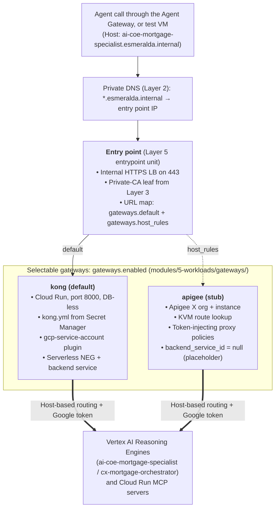

# Layer 5 Workloads: Entry Point & Swappable Ingress Gateways

Welcome to the technical deep-dive for **Layer 5 Ingress Gateways**.

**What an ingress gateway is:** an API gateway is a reverse proxy that sits in front of a set of backend services. It gives them one stable entry point and applies cross-cutting concerns (routing, authentication, rate limiting) so that each backend doesn't have to.

**How Esmeralda uses it:** every private hostname under `*.esmeralda.internal` (the A2A specialist, the orchestrator and the three MCP servers) resolves to a single internal load balancer, the **entry point**. The entry point terminates TLS and hands each request to one of the enabled **gateways** (Kong today). The gateway routes the request by its `Host` header to the right Reasoning Engine or Cloud Run service and adds the Google credential that backend requires. This guide details the **Gateway Adapter Pattern** that keeps that contract stable regardless of which gateway product is behind the entry point, and how to move hosts from one gateway to another without touching callers.

> [!NOTE]
> The ingress gateway is **not** the [Central Agent Gateway](../3-agentops-and-lifecycle/01-central-agent-gateway.md). The Agent Gateway (Layer 4, governance project) controls where agents may go *out* to; the ingress gateway (Layer 5, gateway project) is the private front door that those calls arrive *at*. A typical call goes agent → Agent Gateway → entry point (internal HTTPS LB) → Kong → target.

---

## The 60-Second Mental Model: Entry Point vs. Gateways

In enterprise environments, different business units and IT organizations have divergent API gateway standards:
* **Large Financial Enterprises** mandate **Apigee X** for API product cataloging, rate limiting, and compliance auditing.
* **Agile Cloud-Native Teams** prefer **Kong Gateway on Cloud Run** for lightweight, low-cost serverless DB-less execution.

**Esmeralda enforces an abstracted Gateway Adapter Pattern: downstream AI agents and MCP tools expose the exact same interface contract regardless of which gateway adapter is active.**

To make that possible, the ingress is split in two:

| Piece | What it is | Where it lives | Changes when |
| :--- | :--- | :--- | :--- |
| **Entry point: IP + DNS** | Reserved internal IP `ilb-esmeralda-vip-<env>` (gateway project, shared core subnet) and the `esmeralda.internal` / `*.esmeralda.internal` A records (TTL 300) pointing at it. | Layer 2: [`2-networking/main.tf`](../../../infrastructure/modules/2-networking/main.tf) §7 (outputs `entrypoint_address_id`, `entrypoint_address`, `entrypoint_domain`; optional `entrypoint_ip_address` to pin the IP). | Almost never. |
| **Entry point: certificate** | Leaf for `esmeralda.internal` + `*.esmeralda.internal` (only those two SANs), signed by the internal Root CA, stored as regional SSL certificate `cert-esmeralda-ilb-*` in the gateway project. | Layer 3: [`3-security/pki.tf`](../../../infrastructure/modules/3-security/pki.tf) (output `entrypoint_ssl_certificate_id`). The CA private key never leaves Layer 3. | When the leaf is re-issued. |
| **Entry point: routing** | URL map `ilb-esmeralda-url-map-<env>`, target HTTPS proxy `ilb-esmeralda-https-proxy-<env>`, forwarding rule `ilb-esmeralda-rule-<env>` on port **443** of the reserved IP. | Layer 5: [`5-workloads/entrypoint`](../../../infrastructure/modules/5-workloads/entrypoint/main.tf), live unit `layer-5-workloads/entrypoint`. | A gateway is added or swapped, or a host moves between gateways. |
| **Gateways** | Products that do host routing and token injection (Kong, Apigee, ...). Each one ends in a regional backend service. | Layer 5: `modules/5-workloads/gateways/<name>`, live units `layer-5-workloads/gateways/<name>`. | Routes or the gateway product change. |

Because the IP, the DNS records and the certificate live in lower layers, the hostnames outlive any gateway: destroying, adding or swapping a gateway never changes what `*.esmeralda.internal` resolves to or which certificate callers see.

---

## Persona & Role Breakdown: Who Owns Ingress Gateways?

| Engineering Persona | Role & Daily Responsibilities | What They Own | What They NEVER Touch |
| :--- | :--- | :--- | :--- |
| **PlatformOps / Ingress Lead** | Managing the gateways, the entry point routing, ingress security policies, routes, and upstream token injection. | `infrastructure/modules/5-workloads/gateways/kong/` (and `gateways/apigee/`), `infrastructure/modules/5-workloads/entrypoint/`, the `gateways` block in `env.yaml`, `apps/services/kong/` (custom image + plugin), `templates/kong.yml.tpl`. | Internal agent prompt graphs, Python business logic. |
| **NetOps Engineer** | Providing the Shared VPC subnets, the private DNS zone and the entry point address. | `sb-esmeralda-core-<env>` / `sb-esmeralda-proxy-<env>` subnets, the `esmeralda.internal.` zone, the reserved entry point IP and its `esmeralda.internal` / `*.esmeralda.internal` A records (all Layer 2). | Ingress route transformation policies. |
| **SecOps Engineer** | Owning the internal Root CA and the entry point certificate. | `infrastructure/modules/3-security/pki.tf` (Layer 3). | Gateway routes. |
| **AI Application Developer** (CX and AI CoE teams) | Calling targets via standard internal DNS hostnames. | Consuming `https://ai-coe-mortgage-specialist.esmeralda.internal` or `https://<svc>.esmeralda.internal/mcp`. | Gateway configuration, upstream token generation, or proxy infrastructure. |

---

## Architecture Decision Records (ADRs): The "Why"

### ADR-04.1: Gateway Adapter Contract & Upstream Token Injection
* **Context:** Private Vertex AI Reasoning Engines require a Google OAuth2 access token (`roles/aiplatform.user`), and Cloud Run MCP servers require a Google OIDC ID token for an identity holding `roles/run.invoker`. The engines are also only reachable through their `aiplatform.googleapis.com` resource URL, not a friendly hostname.
* **Decision:** The Ingress Gateway acts as an **Identity-Injecting Reverse Proxy**:
  1. Receives requests on `*.esmeralda.internal` (HTTPS, port 443) through the entry point.
  2. Routes by `Host` header to the target URL that Terraform rendered into the gateway config (engine resource URL or Cloud Run URI).
  3. Fetches a short-lived Google token for the gateway's own service account (`sa-esmeralda-kong-<env>`) from the metadata server.
  4. Replaces the `Authorization` header with that token before proxying the request to the backend.
* **Benefit:** Callers use one stable hostname per target. Backends only need to trust the gateway's service account, and engine IDs can change without touching callers (only the gateway config is re-rendered).

### ADR-04.2: Separate Entry Point in Front of the Gateways
* **Context:** When the gateway module owned the load balancer, the certificate and the DNS records, replacing the gateway meant destroying the front door, and two gateways could not serve the same domain at the same time.
* **Decision:** The IP and DNS records move to Layer 2, the certificate to Layer 3, and the URL map / HTTPS proxy / forwarding rule to a dedicated Layer 5 `entrypoint` unit. Gateways only expose a backend service.
* **Benefit:** Gateways can run side by side behind one entry point and hosts can be moved one at a time (see [Migrating Between Gateways](#migrating-between-gateways-host-by-host)). The Root CA key no longer has to be passed to Layer 5.

---

## The Gateway Options



---

## Technical Specifications & Blueprints

### 1. The Gateway Contract

A gateway is anything the entry point can route to. Adding one takes three pieces:

1. **A module** under `infrastructure/modules/5-workloads/gateways/<name>/` that outputs:
   * `backend_service_id`: the ID of a **regional `INTERNAL_MANAGED` backend service** in the gateway project, in the entry point's region. The entry point URL map points hosts at it.
   * `routes`: map of the hosts it serves and how `make test-gateway` probes each one (`host`, `probe` = `mcp`, `a2a` or `none`).
2. **A live unit** under `infrastructure/live/<env>/layer-5-workloads/gateways/<name>/` with an `exclude` block that skips it when `<name>` is not in `gateways.enabled`.
3. **One dependency block** in `infrastructure/live/<env>/layer-5-workloads/entrypoint/terragrunt.hcl` (with `enabled = contains(local.env_vars.locals.gateways.enabled, "<name>")`) plus its entry in `inputs.backends`.

The gateway owns no load balancer, certificate or DNS record. See [`kong/outputs.tf`](../../../infrastructure/modules/5-workloads/gateways/kong/outputs.tf) for the reference implementation.

### 2. The `gateways` Block in `env.yaml`

Each environment selects its gateways in `infrastructure/live/<env>/env.yaml`:

```hcl
gateways = {
  enabled    = ["kong"]  # gateway units deployed under layer-5-workloads/gateways/
  default    = "kong"    # receives every host not listed in host_rules (must be in enabled)
  host_rules = {}        # optional overrides: host label => gateway, e.g. "legacy-dms" = "envoy"
}
```

* A `host_rules` key is a host label (`legacy-dms` is routed as `legacy-dms.esmeralda.internal`) or a full FQDN.
* The entrypoint module validates the block: at least one gateway enabled, `default` and every `host_rules` value must be in `enabled`, and every enabled gateway must output a non-empty `backend_service_id`.
* Both **dev and prd use `enabled = ["kong"]`, `default = "kong"`**, no host rules.

### 3. The Entry Point (`entrypoint/`)

[`modules/5-workloads/entrypoint`](../../../infrastructure/modules/5-workloads/entrypoint/main.tf) builds the regional internal Application Load Balancer in the gateway project:

* **URL map** `ilb-esmeralda-url-map-<env>`: `default_service` is the backend service of `gateways.default`; one `host_rule` + `path_matcher` (`gw-<name>`) per gateway referenced in `host_rules`.
* **Target HTTPS proxy** `ilb-esmeralda-https-proxy-<env>`, presenting the Layer 3 certificate (`entrypoint_ssl_certificate_id`).
* **Forwarding rule** `ilb-esmeralda-rule-<env>`: port **443** on the Layer 2 reserved IP (`entrypoint_address`), `INTERNAL_MANAGED`, using the region's proxy-only subnet.
* **Outputs:** `url_map_id`, `ip_address`, and `routing` (the default gateway and the effective FQDN → gateway overrides).

Why a private CA is needed, and how the Agent Gateway trusts it, is explained in [Central Agent Gateway §5](../3-agentops-and-lifecycle/01-central-agent-gateway.md#5-tls-and-certificates-why-we-need-self-signed-cas).

### 4. Kong Gateway on Cloud Run (`gateways/kong/`, default)

**What Kong is:** an open-source API gateway built on NGINX/OpenResty. In **DB-less mode** it needs no database: its whole configuration is one declarative YAML file loaded at start-up.

**In Esmeralda:**
* **Custom image:** `apps/services/kong/Dockerfile` extends `kong:3.7-ubuntu` with the custom `gcp-service-account` Lua plugin. It is built with `make build-service-kong` (image `kong-gateway`) and deployed by digest like every other image.
* **Cloud Run service:** `kong-gateway-<env>` in the gateway project (`esm-<env>-gateway-<sfx>`), port 8000, `KONG_DATABASE=off`, running as `sa-esmeralda-kong-<env>`. Ingress is `INGRESS_TRAFFIC_INTERNAL_LOAD_BALANCER`, so it is reachable only through the entry point. Direct VPC egress on the Shared VPC core subnet.
* **Who may call Kong:** `roles/run.invoker` for the test VM, specialist, orchestrator and `sa-mcp-invoker-<env>` service accounts. Agents mint an ID token by impersonating `sa-mcp-invoker-<env>` with audience `https://<host>.esmeralda.internal`, which Kong accepts through its `custom_audiences`.
* **Declarative config:** Terraform renders `templates/kong.yml.tpl` from `agent_endpoints` and stores it in Secret Manager (`kong-config-<env>`), mounted into the container. For each target it creates:
  * a **host route** (`<name>.esmeralda.internal`) and a path route (`/agents/<name>`, `/<name>`);
  * the upstream URL: `<engine endpoint>/a2a` for the specialist, `<engine endpoint>:streamQuery?alt=sse` for the orchestrator, and the Cloud Run URI for each MCP server;
  * a global `rate-limiting` plugin (120 requests/minute per `X-API-Key`).
* **Token injection (`gcp-service-account` plugin):** for `*.googleapis.com` audiences (Reasoning Engines) it fetches an **OAuth2 access token**; for Cloud Run audiences it fetches an **OIDC ID token** for the service URI. MCP services list `sa-esmeralda-kong-<env>` as an invoker.
* **Gateway contract:** serverless NEG `neg-kong-<env>` → regional backend service `backend-kong-<env>` (`INTERNAL_MANAGED`), exposed as `backend_service_id`. The `routes` output lists every `<name>.esmeralda.internal` host with its probe kind. Kong no longer creates a load balancer, certificate or DNS record: those belong to the entry point. Module: [`gateways/kong/main.tf`](../../../infrastructure/modules/5-workloads/gateways/kong/main.tf); live unit: `layer-5-workloads/gateways/kong`.

> [!IMPORTANT]
> Kong routes use the agents' **engine IDs**. If an agent engine is recreated, run `make deploy-gateway ENV=<env>` to re-render the routes.

---

### 5. Apigee X (`gateways/apigee/`, stub)

**What Apigee is:** Google Cloud's managed enterprise API management platform (proxies, products, quotas, analytics).

**In Esmeralda** (not used by the current environments, and no live unit yet):
* **Organization & Environment:** Provisions `google_apigee_organization` with `authorized_network = var.vpc_id`, an environment (`var.environment`), and an environment group registering `*.esmeralda.internal`.
* **Runtime Plane:** Deploys `google_apigee_instance` with peering range `10.12.0.0/22`.
* **Dynamic Route KVM:** The `null_resource.populate_apigee_kvm` step iterates over `var.agent_endpoints`, populating the `agent-routes` Key-Value Map with logical-name → target URL entries.
* **Proxy Policies:** `KVM-Lookup.xml` extracts the subdomain and `Generate-Bearer-Token.xml` sets the `Authorization: Bearer` header.

> [!WARNING]
> The Apigee module is a placeholder for the gateway contract: its [`outputs.tf`](../../../infrastructure/modules/5-workloads/gateways/apigee/outputs.tf) returns `backend_service_id = null` and empty `routes`, so the entrypoint rejects `apigee` as a backend. To make it routable, add a regional PSC NEG targeting the Apigee instance service attachment and a regional `INTERNAL_MANAGED` backend service on top of it, return that ID, then add a live unit and a dependency block in the entrypoint unit. It has not been validated with the Agent Gateway path. Treat it as a starting point, not a drop-in replacement.

---

## Migrating Between Gateways, Host by Host

The entry point lets two gateways serve the same domain at once, so a new gateway (here a hypothetical `envoy`) can take over one host at a time while callers keep the same hostnames and certificate:

1. **Build the gateway.** Add `modules/5-workloads/gateways/envoy` (outputs `backend_service_id` and `routes`), its live unit `layer-5-workloads/gateways/envoy`, and a `dependency "envoy"` block + `backends` entry in the entrypoint unit.
2. **Enable it and move one host** in `env.yaml`:

   ```hcl
   gateways = {
     enabled    = ["kong", "envoy"]
     default    = "kong"
     host_rules = { "legacy-dms" = "envoy" }  # legacy-dms.esmeralda.internal -> envoy
   }
   ```

3. **Apply the gateway, then the entry point:**

   ```bash
   cd infrastructure/live/<env>/layer-5-workloads/gateways/envoy && terragrunt apply
   make deploy-entrypoint ENV=<env>
   ```

4. **Test** with `make test-gateway ENV=<env>`: every host must still answer through the entry point, `legacy-dms` now through `envoy`.
5. **Move more hosts** by adding them to `host_rules` and re-running `make deploy-entrypoint` + `make test-gateway`.
6. **Flip the default:** `default = "envoy"` and drop the overrides that now match the default (`host_rules = {}`). Apply the entry point and test again.
7. **Retire the old gateway:** remove `kong` from `enabled`, apply the entry point first (so it stops referencing Kong), then destroy `gateways/kong`.

To roll back at any step, revert `env.yaml` and re-apply the entry point.

---

## Apply Order

For a new environment: L0 → L1 → L2 (includes the entry point IP + DNS) → L3 (includes the entry point certificate) → L4 → images → L5 services → agents → `gateways/kong` → `entrypoint` → `iap-egress` / `test-vm`. `make deploy-workloads` (`terragrunt run --all`) derives the Layer 5 order from the dependency blocks; the individual targets are `make deploy-gateway` (Kong) and `make deploy-entrypoint`.

---

## Verification & Runbook

### Test Every Route: `make test-gateway`

```bash
make test-gateway ENV=dev
```

[`scripts/test_gateway.sh`](../../../scripts/test_gateway.sh) reads everything from Terragrunt outputs (test VM name / zone / project from the `test-vm` unit, entry point IP and domain from Layer 2, the internal Root CA secret from Layer 3, and the `routes` output of every `gateways/*` unit). It then connects to the test VM over IAP SSH and probes each route host through the entry point, pinned to the entry point IP, with an ID token from the VM metadata server (audience `https://<host>`) and TLS verified against the internal Root CA:

| Probe | Request | Expected |
| :--- | :--- | :--- |
| `mcp` | `POST /mcp` (MCP `initialize`) | 2xx |
| `a2a` | `GET /v1/card` (agent card) | 2xx |
| `none` | `GET /` | TLS + routing only, any HTTP status |

A gateway "no route" answer fails every kind.

### Manual Check via Test VM
The test VM (`test-vm-<env>`) currently lives in the CX agents project. The entry point only listens on HTTPS, so pass the internal Root CA public certificate (Secret Manager `esmeralda-internal-root-ca-<env>` in the gateway project) to `curl`.

```bash
CX_PROJ=$(cd infrastructure/live/dev/layer-1-projects && terragrunt output -raw cx_agents_project_id)
GW_PROJ=$(cd infrastructure/live/dev/layer-1-projects && terragrunt output -raw gateway_project_id)
ENTRY_IP=$(cd infrastructure/live/dev/layer-2-networking && terragrunt output -raw entrypoint_address)

# Copy the internal Root CA (public cert only) to the VM
gcloud secrets versions access latest --secret=esmeralda-internal-root-ca-dev --project=$GW_PROJ > /tmp/root-ca.pem
gcloud compute scp /tmp/root-ca.pem test-vm-dev:/tmp/root-ca.pem --zone=us-central1-f --project=$CX_PROJ --tunnel-through-iap

# SSH into the test VM
gcloud compute ssh test-vm-dev --zone=us-central1-f --project=$CX_PROJ --tunnel-through-iap

# Inside VM: fetch the AgentCard through the entry point (-> Kong)
HOST=ai-coe-mortgage-specialist.esmeralda.internal
getent hosts ${HOST}   # should print the entry point IP (ENTRY_IP above)
TOKEN=$(curl -s -H "Metadata-Flavor: Google" \
  "http://metadata.google.internal/computeMetadata/v1/instance/service-accounts/default/identity?audience=https://${HOST}")
curl -s --cacert /tmp/root-ca.pem -H "Authorization: Bearer ${TOKEN}" https://${HOST}/v1/card | jq .
```
