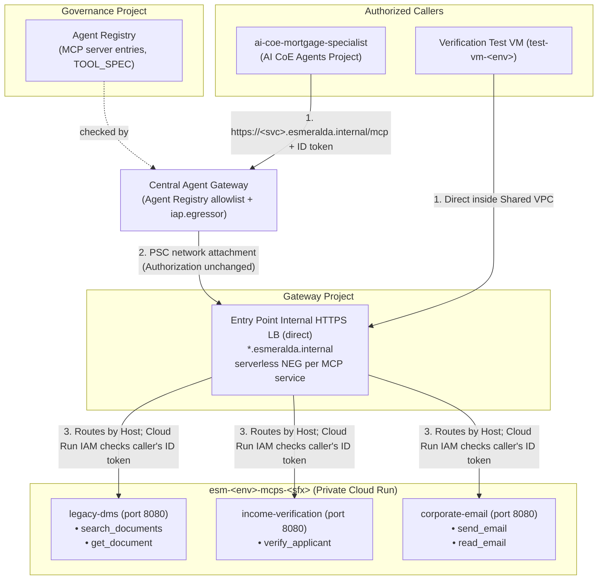

# 1.2 Wrapping Enterprise Systems as MCP Tool Servers

In [1.1 Two Teams, Two Agents](./03-ai-agents-and-database.md), the CX orchestrator handed Julian Sterling's underwriting request over to the AI CoE's **Mortgage Specialist** (`ai-coe-mortgage-specialist`). Now the specialist needs real facts—Julian's tax returns, his verified annual salary, and any recent correspondence with the loan officer.

In a quick laptop prototype, a developer would write three Python functions—`search_documents()`, `verify_applicant()`, and `read_email()`—directly inside the agent's codebase. In an enterprise, that shortcut quickly becomes a bottleneck: backend teams can't update a database query without forcing the AI team to redeploy their agent, other departments can't reuse the connectors, and the agent container accumulates broad credentials to every core system in the company.

This section explains how Esmeralda wraps enterprise systems as standalone **Model Context Protocol (MCP)** microservices on private **Cloud Run** (`esm-<env>-mcps-<sfx>`), how their schemas (`tools.json`) register in the central **Agent Registry**, and how developers can still run the entire stack on a laptop with a single `uv run esmeralda query` command.

---

## 1. Turning Legacy Backends into Governed Building Blocks

### What is MCP (and FastMCP)?

The **Model Context Protocol (MCP)** is an open standard that acts like a universal USB-C port for AI tools. Any **MCP server** can advertise the tools it offers (`tools/list`) and execute them (`tools/call`) over standard HTTP/JSON-RPC; **FastMCP** is the lightweight Python framework Esmeralda uses to build those servers in a few dozen lines of code.

### How Julian Sterling's Underwriting Uses Three MCP Servers

When `ai-coe-mortgage-specialist` evaluates Julian Sterling's application, it calls three decoupled FastMCP microservices owned by the Backend / AppDev Tools track:

| MCP Microservice | Enterprise System It Wraps | Internal Endpoint | Operations Declared in `tools.json` |
| :--- | :--- | :--- | :--- |
| **`legacy-dms`** (`apps/services/legacy-dms/`) | Legacy Document Management System (W-2s, tax returns, bank statements) | `https://legacy-dms.esmeralda.internal/mcp` | `search_documents`, `get_document` |
| **`income-verification`** (`apps/services/income-verification/`) | Payroll & Employment Verification Bureau | `https://income-verification.esmeralda.internal/mcp` | `verify_applicant` |
| **`corporate-email`** (`apps/services/corporate-email/`) | Loan Officer Corporate Mailbox | `https://corporate-email.esmeralda.internal/mcp` | `send_email`, `read_email` |

Every tool call from the specialist travels out through the **Central Agent Gateway** (which checks that the target URL is registered in the **Agent Registry**) and arrives through the private **entry point** (`*.esmeralda.internal`), which routes the request directly to the Cloud Run service:



---

## 2. Why We Designed It This Way: Key Decisions & Trade-offs

| Decision | Why We Made It | What We Avoided |
| :--- | :--- | :--- |
| **ADR-04.2: Standalone Cloud Run MCP Servers vs. Embedded Python Functions** | Lets backend teams build, patch, and scale connectors in any language (Python FastMCP, Go, TypeScript) on their own release schedule, scaling to zero when idle. | Redeploying and re-running LLM-as-judge evaluations on the AI agent every time a backend API changes; duplicating connector code across teams. |
| **Per-Tool IAM Invoker Lists Driven by `catalog` (`env.yaml`)** | Grants `roles/run.invoker` on each Cloud Run service only to the specific callers listed in `env.yaml`, and registers each tool's exact URL and `tools.json` schema in the **Agent Registry**. | Broad project-wide permissions where every agent can invoke every corporate tool by default. |
| **End-to-End Caller Identity with Custom Audiences (`direct` Backend)** | Configures each Cloud Run service to accept Google OIDC ID tokens minted for `https://<name>.esmeralda.internal`, passed through unchanged by both the Agent Gateway and the entry point. | Mandatory token-swapping reverse proxies that obscure which agent actually called the tool. |
| **Auto-Started Local MCP Subprocesses (`esmeralda query`)** | The `esmeralda` CLI reads the agent's config and launches local FastMCP servers over stdio/HTTP automatically when running on a laptop. | Requiring developers to deploy to GCP or maintain complex `docker-compose` files just to test a prompt change. |

### Clear Team Boundaries

| Engineering Persona | Role & Daily Responsibilities | What They Own | What They NEVER Touch |
| :--- | :--- | :--- | :--- |
| **Backend / Tools Engineer** | Wrapping enterprise APIs in FastMCP, maintaining tool schemas (`tools.json`), and writing unit tests. | `apps/services/<tool>/` (Python/FastMCP code, `Dockerfile`, `tools.json`). | Terraform infrastructure, Shared VPC subnets, or KMS keyrings. |
| **SecOps / Platform Engineer** | Governing tool authentication (`roles/run.invoker`), private ingress, Agent Registry entries, and `roles/iap.egressor` grants. | `infrastructure/modules/5-workloads/services/<tool>/`, Cloud Run IAM policies, and `catalog` callers in `env.yaml`. | Tool Python business logic or agent prompts. |
| **AI Reasoning Engineer** (AI CoE Team) | Discovering and invoking MCP tools from the specialist agent. | MCP URLs in `agent.yaml` (`DMS_MCP_URL`, `INCOME_VERIFICATION_URL`, `EMAIL_MCP_URL`) and ADK toolsets in `agent/tools.py`. | Tool container hosting or backend system credentials. |

---

## 3. How It Works & CLI in Practice

### Cloud Run Service Contract (`modules/5-workloads/services/<tool>/`)

Each MCP microservice is built via Cloud Build into the shared Layer 0 Artifact Registry (`make build-services` or `make build-service-<name>`) and deployed by immutable digest (`make deploy-services ENV=<env>` or `uv run esmeralda apply layer-5-workloads/services/<name> --env <env>`):

* **Internal-Only Ingress:** `INGRESS_TRAFFIC_INTERNAL_LOAD_BALANCER` ensures the Cloud Run service cannot be reached from the public internet; all traffic arrives through the private entry point (`*.esmeralda.internal`).
* **Cross-Project Serverless NEG (`direct` Backend):** With the default `direct` backend, Terraform creates a serverless Network Endpoint Group (NEG) and a regional backend service **inside the MCPs project** (since a serverless NEG must reside in the same project as its Cloud Run service) and attaches it cross-project to the entry point's URL map in the gateway project. See [1.3 Entry Point → The `direct` Backend](./01-ingress-gateways.md#4-the-direct-backend-gatewaysdirect-default).
* **Direct VPC Egress:** Sets `vpc_access { egress = "ALL_TRAFFIC" }` on the Shared VPC core subnet (`sb-esmeralda-core-<env>`) so the tool can reach private enterprise databases or internal APIs.
* **Custom OIDC Audiences:** Each service registers `https://<name>.esmeralda.internal` (plus legacy `*.internal.gateway` names) as a custom audience alongside its default `run.app` URI. Callers routed via `direct` mint an ID token for `https://<name>.esmeralda.internal`; an optional adapter like Envoy uses the `run.app` audience when injecting its own token.
* **Least-Privilege IAM & End-to-End Identity:** Only identities listed in `invoker_service_accounts`—derived automatically from the service's `callers` list in the catalog—receive `roles/run.invoker`; an agent caller is listed as its Agent Identity principal (`principal://…/reasoningEngines/<ENGINE_ID>`). At runtime, the specialist mints an unbound ID token as its own Agent Identity (see [Outbound tokens and the Agent Gateway](../1-platform-foundations/03-security-iam-and-telemetry.md#outbound-tokens-and-the-agent-gateway)), which traverses the Agent Gateway and entry point untouched.

> [!NOTE]
> The Cloud Run service modules currently run under the MCPs project's default compute service account. Layer 3 provisions a dedicated `sa-esmeralda-mcps-<env>` account ready for attachment when backend-specific IAM roles are added.

---

### Registering Tools in the Central Agent Registry

**What the Agent Registry Does:** The Central Agent Registry in the governance project (`esm-<env>-governance-<sfx>`) is the organization's authoritative catalog of approved MCP servers and A2A agents. The Central Agent Gateway treats it as a **deny-by-default allowlist**: an agent can only egress to a hostname registered there with an exact URL match (see [2.1 Central Agent Gateway §3.3](../3-agentops-and-lifecycle/01-central-agent-gateway.md#33-agent-registry)).

**Deploy-Time Registration in Terraform:** Each MCP service module registers its `https://<svc>.esmeralda.internal/mcp` endpoint and its `apps/services/<tool>/tools.json` schema in the governance project at deploy time:

```hcl
resource "google_agent_registry_service" "governance_mcp" {
  project    = var.governance_project_id
  service_id = "legacy-dms"
  interfaces {
    url              = "https://${var.internal_hostname}/mcp"   # e.g. https://legacy-dms.esmeralda.internal/mcp
    protocol_binding = "JSONRPC"
  }
  mcp_server_spec {
    type    = "TOOL_SPEC"
    content = file(var.tools_spec_path)   # apps/services/<tool>/tools.json
  }
}
```

Once the registry entries exist, the `services/iap-egress` unit (`make deploy-iap-egress` or `uv run esmeralda apply layer-5-workloads/services/iap-egress --env <env>`) grants `roles/iap.egressor` on those entries to the authorized agent principal sets.

*(For local convenience, each module also invokes `apps/services/register_mcp.py`, which writes the Cloud Run URL into a local, gitignored `apps/services/mcp_registry.json` file without calling any external API.)*

---

### Running & Verifying MCP Tools in Practice

#### 1. Local Full-Stack Execution (`uv run esmeralda query`)

Developers never need a cloud deployment just to test tool interactions. Running `esmeralda query` against an agent directory spins up the local FastMCP tool servers (`legacy-dms`, `income-verification`, `corporate-email`) automatically and wires their local URLs into the agent:

```bash
# Run the specialist locally against local FastMCP servers
uv run esmeralda query apps/agents/ai-coe-mortgage-specialist \
  -q "Verify Julian Sterling's income and list his tax documents."

# Or run the full CX orchestrator -> AI CoE specialist -> MCP chain locally
uv run esmeralda query apps/agents/cx-mortgage-orchestrator \
  -q "Can you verify Julian Sterling's income?"

# Plan or apply an individual MCP service in GCP
uv run esmeralda plan layer-5-workloads/services/legacy-dms --env dev
uv run esmeralda apply layer-5-workloads/services/legacy-dms --env dev

# Probe all deployed MCP routes and agents in dev
uv run esmeralda verify --env dev
```

#### 2. Manual JSON-RPC Probe from the Private Test VM

To inspect raw FastMCP JSON-RPC responses over the Shared VPC entry point (copy the internal Root CA to the VM first, as shown in [1.3 Entry Point → Verification and Runbook](./01-ingress-gateways.md#verification-and-runbook)):

```bash
CX_PROJ=$(cd infrastructure/live/dev/layer-1-projects && terragrunt output -raw cx_agents_project_id)
gcloud compute ssh test-vm-dev --zone=us-central1-f --project=$CX_PROJ --tunnel-through-iap

# Inside the VM: call Legacy DMS through the entry point via FastMCP JSON-RPC
HOST=legacy-dms.esmeralda.internal
TOKEN=$(curl -s -H "Metadata-Flavor: Google" \
  "http://metadata.google.internal/computeMetadata/v1/instance/service-accounts/default/identity?audience=https://${HOST}")

curl -s --cacert /tmp/root-ca.pem -X POST https://${HOST}/mcp \
    -H "Authorization: Bearer ${TOKEN}" \
    -H "Content-Type: application/json" \
    -H "Accept: application/json, text/event-stream" \
    -d '{"jsonrpc": "2.0", "method": "tools/call", "params": {"name": "search_documents", "arguments": {"applicant_last_name": "Sterling", "document_type": "tax_return"}}, "id": 1}' | jq .
```

You can also use the helper script `scripts/test_mcp_on_vm.sh` (`--service`, `--method`, `--params`) to run the same check.

---

Now that we have met the two agents (1.1) and the three MCP tool servers (1.2), how do friendly hostnames like `ai-coe-mortgage-specialist.esmeralda.internal` and `legacy-dms.esmeralda.internal` actually route to the right backend without extra proxy VMs? Turn to **[1.3 The Private Front Door & Pluggable Gateways](./01-ingress-gateways.md)**.
