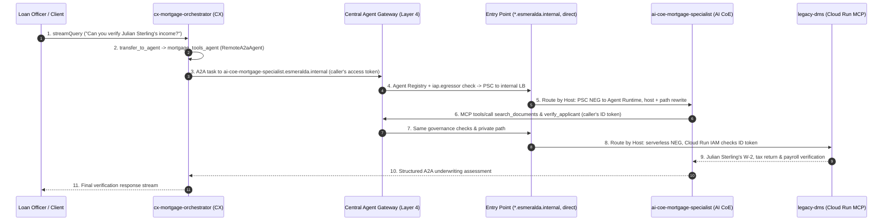

# 1.1 Two Teams, Two Agents — Orchestration vs. Specialization (ADK & A2A)

When our loan officer asks, ***"Can you verify Julian Sterling's income?"***, the first workload to wake up is an AI agent.

In a laptop prototype, a single agent usually handles everything: chatting with the user, knowing every underwriting rule, and calling every backend database. In an enterprise, however, **the team that owns the customer channel is rarely the team that owns core mortgage underwriting**.

This section explains how Esmeralda splits reasoning across two specialized agents owned by two independent teams—the **CX Mortgage Orchestrator** (`cx-mortgage-orchestrator`) and the **AI CoE Mortgage Specialist** (`ai-coe-mortgage-specialist`)—how both run as Bring-Your-Own-Container (BYOC) workloads on **Vertex AI Agent Runtime**, and how multi-turn conversation context is persisted in managed Vertex AI Sessions without provisioning an external database.

---

## 1. Orchestrators Meet Specialists

Think of how a modern financial institution is organized:

* The **Customer Experience (CX) Team** builds conversational assistants for web portals, mobile apps, and loan-officer desktops. They care about user intent, tone, session continuity, and routing questions to the right department.
* The **AI Center of Excellence (AI CoE) Team** builds deep domain capabilities—such as mortgage underwriting, fraud analysis, or credit scoring—that should be built once, audited rigorously, and reused by *every* customer channel across the bank.

In Esmeralda, each team owns its own agent inside its own isolated GCP project:

| Agent | Owning Team | Role in Julian Sterling's Request | GCP Project | Terraform Module |
| :--- | :--- | :--- | :--- | :--- |
| **`cx-mortgage-orchestrator`** | **CX Product Team** | User-facing **Google ADK** orchestrator. Greets the loan officer, understands that the request requires mortgage underwriting, and delegates the task. | `esm-<env>-cx-agents-<sfx>` | `modules/5-workloads/agents/adk-agent` |
| **`ai-coe-mortgage-specialist`** | **AI CoE Team** | Reusable **A2A (Agent-to-Agent)** specialist. Advertises its skills (*Document Search*, *Income Verification*, *Corporate Email*) in an **Agent Card** and calls the MCP tool servers to verify Julian Sterling's file. | `esm-<env>-ai-coe-agents-<sfx>` | `modules/5-workloads/agents/a2a-agent` |

### What is Vertex AI Agent Engine (Agent Runtime) with BYOC?

Both agents run on **Vertex AI Agent Engine** (also called **Agent Runtime**), Google Cloud's managed, serverless runtime for AI agents. Each deployed agent is a `ReasoningEngine` resource.

Rather than uploading raw Python pickles, Esmeralda uses **BYOC (Bring Your Own Container)**: you build a standard, immutable Docker image with `uv` and the `esmeralda` runtime library, and Agent Runtime executes that container inside an isolated micro-VM with a cryptographic **SPIFFE Agent Identity** (`identity_type = AGENT_IDENTITY`) and a mandatory binding to the [Central Agent Gateway](../3-agentops-and-lifecycle/01-central-agent-gateway.md).

### Following Julian Sterling's Request Across Both Agents



How each hop is authorized and how private TLS certificates work on this path is detailed in [2.1 Central Agent Gateway §4](../3-agentops-and-lifecycle/01-central-agent-gateway.md#4-life-of-a-request).

---

## 2. Why We Designed It This Way: Key Decisions & Trade-offs

In many organizations, deploying a multi-agent workflow requires coordinating across separate platform, networking, and security silos. Esmeralda eliminates those handoffs through deliberate design choices:

| Decision | Why We Made It | What We Avoided |
| :--- | :--- | :--- |
| **Separate GCP Projects per Agent Team (`cx-agents` vs. `ai-coe-agents`)** | Isolates IAM permissions, SPIFFE principal sets, model quotas, and FinOps token chargeback per department. The CX team consumes the specialist solely via its `*.esmeralda.internal` URL. | Cross-team IAM tangles where a bug in a customer chatbot can access another team's storage or exhaust its quota. |
| **BYOC Containers Pinned by SHA-256 Digest** | Guarantees that the exact container bytes tested in `dev` are promoted to `prd` (`release/prd.yaml`), with zero environment secrets or certificates baked into the image. | "Works in dev, breaks in prod" drift caused by rebuilding Python dependencies or pickle payloads per environment. |
| **Managed ADK Sessions Keyed by A2A `context_id`** | Persists multi-turn conversation history in Vertex AI Agent Engine managed sessions (`VertexAiSessionService`) keyed by the A2A `context_id`, while keeping transient A2A task state (`InMemoryTaskStore`) in process with `max_instances: 1`. | Paying 24/7 for an idle relational database instance and managing VPC database bootstrap jobs just to preserve multi-turn chat context. |

### Clear Team Boundaries

| Engineering Persona | Role & Daily Responsibilities | What They Own | What They NEVER Touch |
| :--- | :--- | :--- | :--- |
| **AI Reasoning Engineer** (CX or AI CoE Team) | Prompt engineering, multi-agent delegation, tool orchestration, and response quality evaluation. | `apps/agents/<agent>/` (Python/ADK code, `Dockerfile`, `agent.yaml`). Shared SDK: `packages/esmeralda/`. | VPC subnetting, KMS keys, or IAM project bindings. |
| **Platform Lead** | Ensuring zero public IPs, digest-pinned BYOC deployments, and private gateway routing. | `infrastructure/modules/5-workloads/agents/`, gateway backends, and entry point routing. | Agent prompt engineering or LLM temperature settings. |
| **SecOps / Identity Auditor** | Enforcing cryptographic SPIFFE Agent Identity and per-target Agent Gateway egress policies. | Service accounts (`sa-cx-mortgage-orch-<env>`, `sa-ai-coe-mortgage-spec-<env>`, `sa-mcp-invoker-<env>`) and Agent Identity grants. | Python business logic. |

---

## 3. How It Works & CLI in Practice

### Capabilities Common to Both Agents (`infrastructure/modules/5-workloads/agents/`)

* **BYOC Image Promotion:** Built with `make build-ai-coe-mortgage-specialist` / `make build-cx-mortgage-orchestrator` into the shared Layer 0 CI/CD Artifact Registry. Terraform pins `container_spec.image_uri` to an immutable **SHA-256 digest**: in `dev` it resolves the tag from `env.yaml` (`container_tag`); in `prd` it reads the verified digest from `release/prd.yaml`.
* **Cryptographic SPIFFE Agent Identity:** Setting `identity_type = AGENT_IDENTITY` assigns each engine a verifiable identity. IAM and egress grants target the team project's principal set (`principalSet://agents.global.org-<ORG>.system.id.goog/attribute.platformContainer/aiplatform/projects/<PROJECT_NUMBER>`), keeping CX and AI CoE authorization completely separate.
* **Central Agent Gateway Binding:** `deployment_spec.agent_gateway_config.agent_to_anywhere_config.agent_gateway` binds the runtime to the Layer 4 gateway. When bound, the module omits `psc_interface_config` so 100% of outbound traffic (Gemini, Google APIs, MCP tools, A2A) traverses the Central Agent Gateway.
* **Runtime Trust Bundle Injection:** The Layer 4 certificate bundle (gateway inspection roots + Esmeralda's internal Root CA) is injected via `AGENT_GATEWAY_ROOT_CERTIFICATES` and installed into the container's trust store at startup by the `esmeralda run` entrypoint (see [2.1 Central Agent Gateway §6](../3-agentops-and-lifecycle/01-central-agent-gateway.md#6-bring-your-own-container-byoc)).
* **Automatic Credential Selection for `*.esmeralda.internal`:** `SERVICE_ACCOUNT_EMAIL` points to `sa-mcp-invoker-<env>`. The agent impersonates this account to mint the exact token kind required by each target host: an **ID token** for Cloud Run MCP hosts and an **OAuth2 access token** for Agent Runtime hosts served by the `direct` backend. `esmeralda.auth.token_kind(url)` selects the token automatically from `ACCESS_TOKEN_HOSTS`, which Terraform populates from the service catalog (see [1.3 Entry Point → Token Kinds](./01-ingress-gateways.md#5-token-kinds-and-the-client-library)).
* **Per-Agent Storage & Analytics:** Provisions dedicated staging, artifacts, and logs Cloud Storage buckets, plus a BigQuery dataset (`<agent>_logs_<env>`) wired into central FinOps views.
* **Declarative `agent.yaml` Contract:** `apps/agents/<agent>/agent.yaml` defines the agent's name, compute scaling (CPU, memory, min/max instances, concurrency), skills, and default environment variables, while Terraform overlays live environment URLs and certificates at deploy time.

---

### Inside the AI CoE Mortgage Specialist (`agents/a2a-agent/main.tf`)

* **A2A Protocol Server:** Exposes the standard Agent-to-Agent JSON-RPC methods (`on_message_send`, `handle_authenticated_agent_card`, `on_get_task`, `on_cancel_task`) alongside the Agent Card declared in `agent.yaml` (advertising *Document Search*, *Income Verification*, and *Corporate Email* skills).
* **Agent Card in Agent Registry:** `google_agent_registry_service.agent_card` registers the specialist (`A2A_AGENT_CARD`, URL `https://ai-coe-mortgage-specialist.esmeralda.internal`) in the central **governance** project's Agent Registry—the exact allowlist entry that authorizes the CX orchestrator to call it through the Central Agent Gateway.
* **MCP Tool Bindings:** Injects `DMS_MCP_URL`, `INCOME_VERIFICATION_URL`, and `EMAIL_MCP_URL` pointing at `https://<svc>.esmeralda.internal/mcp` (detailed in [1.2 MCP Tool Servers](./02-mcp-tool-servers.md)).
* **Managed Sessions vs. In-Memory Task Store:** Multi-turn conversation history across follow-up A2A calls sharing a `context_id` is stored in Vertex AI managed sessions (`VertexAiSessionService`, enabled by `USE_IN_MEMORY_SESSIONS: "0"` in `agent.yaml`), while A2A `Task` objects (`task_id` status and artifacts) use `InMemoryTaskStore` by default.

> [!IMPORTANT]
> **Single-Worker & `max_instances: 1` Invariant for In-Memory A2A Task Stores:** Because `InMemoryTaskStore` is per-process, A2A agents that do not export a custom `a2a_task_store_builder` must run a single uvicorn worker process with `resources.max_instances: 1` in `agent.yaml` (`esmeralda serve` and `esmeralda contracts` warn if `max_instances > 1` without a custom builder). Follow-up messages in the same `context_id` always resolve their conversation history from `VertexAiSessionService`; a shared `TaskStore` (`a2a_task_store_builder`) is only needed if you scale `max_instances > 1` while relying on cross-instance `tasks/get` polling, stream resubscribe, or resuming `input-required` tasks.

---

### Inside the CX Mortgage Orchestrator (`agents/adk-agent/main.tf`)

* **Google ADK Coordinator:** Defines an ADK `Agent` named `cx_mortgage_orchestrator` (exported as `root_agent`) equipped with a `RemoteA2aAgent` sub-agent (`mortgage_tools_agent`). At runtime, it fetches the specialist's Agent Card from `${A2A_AGENT_URL}/v1/card` and delegates underwriting queries via `transfer_to_agent`. Because it is stateless, it provisions no database.
* **Entry-Point URL Pinning:** Although the specialist's Agent Card reports its internal `aiplatform.googleapis.com` resource URL, `esmeralda.a2a.remote_agent` pins every outbound RPC to `A2A_AGENT_URL` (`https://ai-coe-mortgage-specialist.esmeralda.internal`), ensuring all traffic flows through the Central Agent Gateway and the private entry point.
* **Consumer, Not Owner:** The CX team never deploys or configures the specialist or the MCP servers. It only needs the specialist's internal hostname, its Agent Registry entry, and an `iap.egressor` grant for the CX project's agent identities.

---

### Running & Verifying Agents in Practice

#### 1. Local Iteration & Live Queries (`uv run esmeralda`)

Use the `esmeralda` CLI to test either agent locally (automatically launching local FastMCP servers) or to inspect logs and verify deployed engines:

```bash
# Query the CX orchestrator locally (delegates to the specialist & local MCP tools)
uv run esmeralda query apps/agents/cx-mortgage-orchestrator \
  -q "Can you verify Julian Sterling's income?"

# Query the AI CoE specialist directly during prompt development
uv run esmeralda query apps/agents/ai-coe-mortgage-specialist \
  -q "Check Julian Sterling's income and tax documents."

# Plan or apply an agent unit in dev
uv run esmeralda plan layer-5-workloads/agents/cx-mortgage-orchestrator --env dev
uv run esmeralda apply layer-5-workloads/agents/cx-mortgage-orchestrator --env dev

# Stream structured agent logs or run full end-to-end verification in GCP
uv run esmeralda logs cx-mortgage-orchestrator --env dev
uv run esmeralda verify --env dev
```

#### 2. End-to-End Multi-Agent Suite (`make`)

```bash
# Test the specialist alone, then orchestrator -> specialist through the Agent Gateway and entry point
make test-e2e ENV=dev

# Or test each remote engine individually
make test-ai-coe-mortgage-specialist-remote ENV=dev
make test-cx-mortgage-orchestrator-remote ENV=dev   # TEST_VERBOSE=1 dumps raw A2A/ADK events

# Probe every catalog host through the entry point, including a live orchestrator query
make test-gateway ENV=dev
```

#### 3. Direct A2A Verification from the Private Test VM

To inspect the raw Agent Card and A2A JSON-RPC payload inside the Shared VPC:

```bash
CX_PROJ=$(cd infrastructure/live/dev/layer-1-projects && terragrunt output -raw cx_agents_project_id)
gcloud compute ssh test-vm-dev --zone=us-central1-f --project=$CX_PROJ --tunnel-through-iap \
  --command="bash -s" < scripts/test_a2a_through_gateway.sh

# If the specialist host is routed through an adapter (e.g. Envoy), pass an ID token instead:
gcloud compute ssh test-vm-dev --zone=us-central1-f --project=$CX_PROJ --tunnel-through-iap \
  --command="TOKEN_KIND=id bash -s" < scripts/test_a2a_through_gateway.sh
```

The script verifies TLS against Esmeralda's internal Root CA (`/tmp/root-ca.pem`), fetches `/v1/card`, and sends an A2A message through `https://ai-coe-mortgage-specialist.esmeralda.internal`.

---

Next, let's see how the specialist actually checks Julian Sterling's W-2s, payroll records, and loan-officer emails in **[1.2 Wrapping Enterprise Systems as MCP Tool Servers](./02-mcp-tool-servers.md)**.
