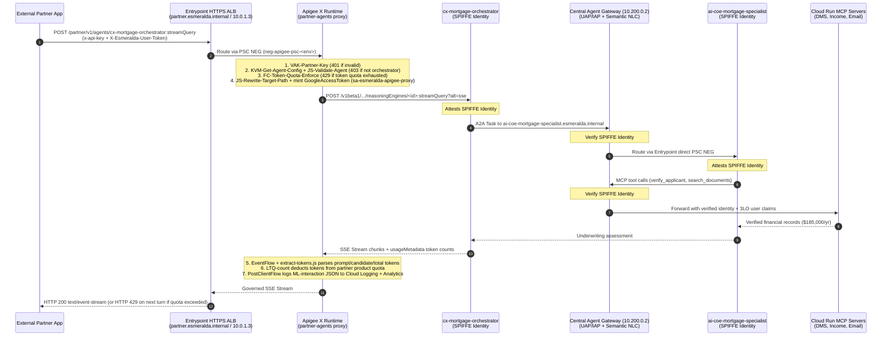
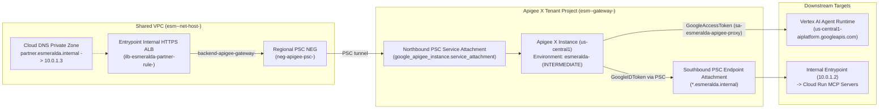
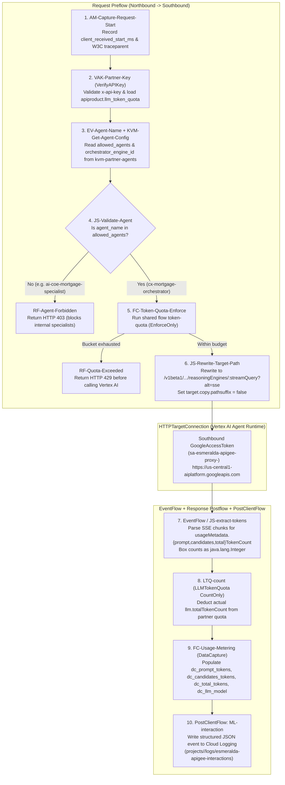

# 1.4 Partner API Management & Token Monetization with Apigee X

In **[1.3 The Private Front Door & Pluggable Gateways](./01-ingress-gateways.md)**, we saw how internal workloads inside the bank's VPC call `*.esmeralda.internal` through the internal HTTPS load balancer (`entrypoint`), using the built-in **`direct`** backend by default. And in **[2.1 Central Agent Gateway & Private PKI](../3-agentops-and-lifecycle/01-central-agent-gateway.md)**, we will see how every internal AI agent's outbound traffic is governed by Google's **Central Agent Gateway** using attested **SPIFFE Agent Identities (`principal://`)**.

But what happens when the business wants to expose Julian Sterling's mortgage underwriting workflow to **external B2B partners**—such as third-party real-estate portals, partner brokerage mobile apps, or external fintech aggregators?

External partners sit outside our Google Cloud organization:
1. **They do not have internal SPIFFE identities or GCP IAM service accounts.** They authenticate with commercial **API keys (`x-api-key`)** or **OAuth 2.0 client credentials** provisioned through a developer portal.
2. **They must never be allowed to call internal specialist agents or raw MCP tools directly.** A partner app may call the front-door `cx-mortgage-orchestrator`, or a curated read-only MCP tool (`verify_applicant`), but must receive an immediate `HTTP 403` if it tries to invoke `ai-coe-mortgage-specialist` directly or call administrative MCP tools.
3. **They require contractual LLM token quotas and billing attribution.** If a Bronze-tier partner is contracted for 10,000 Gemini tokens per minute, the gateway must parse Server-Sent Events (SSE) token usage in flight, deduct the exact prompt + candidate tokens consumed, and reject subsequent calls with `HTTP 429` once the budget is exhausted—*before* invoking Vertex AI.

This section explains **exactly how Apigee X works in Esmeralda** from network plumbing down to XML policies, JavaScript callouts, SSE token extraction, and how it hands off seamlessly to **GEAP Agent Identity** and the **Central Agent Gateway**.

---

## 1. Division of Responsibilities: Apigee X vs. GEAP Agent Identity vs. Central Agent Gateway

Before diving into the proxy bundles, it is important to see how **Apigee X**, **GEAP Agent Identity**, and the **Central Agent Gateway** divide responsibilities without overlapping:

| Layer / Component | Traffic Direction | Primary Role | What It Enforces |
| :--- | :--- | :--- | :--- |
| **1. Apigee X** (`partner.esmeralda.internal` / `10.0.1.3`) | **North–South (External / Partner Ingress)** | **Commercial & Partner API Management** | • Verifies partner API Keys / OAuth tokens (`VerifyAPIKey`) against tiered **API Products** (`bronze`, `silver`, `gold`)<br>• Enforces **agent & MCP tool exposure allowlists** (`kvm-partner-agents`, `kvm-partner-mcp`)<br>• Enforces per-partner **LLM Token Quotas** (`<LLMTokenQuota>` `EnforceOnly` + `CountOnly` → `HTTP 429`)<br>• Emits per-partner **Monetization & Token Analytics** (`DataCapture` + `PostClientFlow` `MessageLogging`) |
| **2. GEAP Agent Identity & Auth Manager** (`agents.global.org-<ORG>.system.id.goog`) | **End-to-End Cryptographic Identity** | **Workload & Delegated Human Identity** | • Assigns each Reasoning Engine a unique X.509 **SPIFFE ID (`principal://`)**<br>• Brokers **3-Legged OAuth (3LO)** end-user tokens (`X-Esmeralda-User-Token`) so downstream MCP tools can verify which human user authorized the call (`esmeralda.mcp_authz`) |
| **3. GEAP Central Agent Gateway** (`10.200.0.2`) | **East–West (Internal Agent Egress)** | **Zero-Trust Runtime Policy Enforcement** | • Enforces **Agent Registry** destination allowlists<br>• Enforces per-target **IAP `roles/iap.egressor`** policies on each Agent Registry entry: only `cx-mortgage-orchestrator` is listed on `ai-coe-mortgage-specialist`, and only `ai-coe-mortgage-specialist` on the MCP servers (A2A calls through the generic Vertex AI endpoint are a known gap, see [Security & IAM](../1-platform-foundations/03-security-iam-and-telemetry.md#4-three-identity-delegation-per-target-spiffe-governance))<br>• Evaluates **Semantic Governance (Natural Language Constraints, NLC)** and **Model Armor** on tool calls |

---

## 2. End-to-End Architecture & Packet Flow

When an external partner app calls `https://partner.esmeralda.internal/partner/v1/agents/cx-mortgage-orchestrator:streamQuery`, the request traverses both the **North–South Apigee X front door** and the **East–West GEAP Agent Identity + Central Agent Gateway loop**:



---

## 3. Private Networking & PSC Bridge (`apigee/platform` & `entrypoint`)

How does traffic get from our Shared VPC into Apigee X's Google-managed tenant project—and from Apigee X back to our private `*.esmeralda.internal` services—with zero public IP addresses?



1. **Apigee Organization & Instance ([`infrastructure/modules/5-workloads/gateways/apigee/`](../../../infrastructure/modules/5-workloads/gateways/apigee/main.tf)):**
   * Provisions (or adopts via `byo = true`) the `google_apigee_organization` and regional `google_apigee_instance` in `esm-<env>-gateway-<sfx>`.
   * Creates the Apigee environment `esmeralda-<env>` (configurable tier: `BASE`, `INTERMEDIATE`, or `COMPREHENSIVE`) and environment group `envgroup-esmeralda-<env>` listening on `partner.esmeralda.internal`.
   * Creates a regional **Private Service Connect (PSC) NEG** (`neg-apigee-psc-<env>`) pointing to `google_apigee_instance.apigee_instance.service_attachment`, wrapped in a regional `INTERNAL_MANAGED` HTTPS backend service (`backend-apigee-gateway-<env>`).
2. **Entry Point Partner VIP (`10.0.1.3`):**
   * When `partner_access = "apigee"` in `env.yaml`, the Layer 5 `entrypoint` unit attaches `backend-apigee-gateway-<env>` to the URL map for `partner.esmeralda.internal`, injects `Host: partner.esmeralda.internal` via `custom_request_headers`, and exposes the dedicated partner forwarding rule on `10.0.1.3:443` (`partner_ip_address`).

---

## 4. Tiered API Products & Consumer Credentials (`apigee/products`)

Before any partner can call an agent or MCP tool, they must subscribe to an **Apigee API Product** provisioned by [`infrastructure/modules/5-workloads/apigee/products/`](../../../infrastructure/modules/5-workloads/apigee/products/main.tf) (live unit `layer-5-workloads/apigee/products`):

| API Product | Proxies Bound | Quota Attribute (`llm_token_quota`) | Purpose |
| :--- | :--- | :--- | :--- |
| **`agent-partner-bronze-<env>`** | `partner-agents` | `10000/minute` (configurable; `50/minute` in quota exhaustion tests) | Entry-level partner tier for B2B orchestrator queries. |
| **`agent-partner-silver-<env>`** | `partner-agents` | `100000/minute` | Mid-tier partner product for high-volume brokerage portals. |
| **`agent-partner-gold-<env>`** | `partner-agents` | `1000000/minute` | Enterprise partner tier. |
| **`mcp-partner-tools-<env>`** | `partner-mcp` | Standard request quota | Partner access to curated MCP tool endpoints (`/partner/v1/mcp/<service>`). |

The `apigee/products` unit also provisions a default smoke-test developer (`partner-smoke-test@example.com`), developer app (`partner-smoke-test`), and consumer credential subscribed to `agent-partner-bronze-<env>` and `mcp-partner-tools-<env>` so `uv run esmeralda verify --env <env> --partner` can run non-interactively out of the box.

---

## 5. Inside the Proxy & Shared Flow Bundles: Step-by-Step Policy Execution

Esmeralda's Apigee implementation is split into **four independent, removable capability bundles** under [`apps/apigee/`](../../../apps/apigee/): two API proxies (`partner-agents` and `partner-mcp`) and two reusable shared flows (`token-quota` and `usage-metering`).

### 5.1 Proxy 1: `partner-agents` (`apps/apigee/proxies/partner-agents/`)

Exposes `/partner/v1/agents/{agent_name}:streamQuery` and `/partner/v1/agents/{agent_name}:query` for partner consumption.



#### Key Implementation Details in `partner-agents`:
1. **Blocking Direct Access to Internal Specialists (`KVM-Get-Agent-Config` + `JS-Validate-Agent`):**
   The Terraform module [`infrastructure/modules/5-workloads/apigee/partner-agents/`](../../../infrastructure/modules/5-workloads/apigee/partner-agents/main.tf) populates an encrypted environment KeyValueMap (`kvm-partner-agents`) with `allowed_agents = "cx-mortgage-orchestrator"` and `orchestrator_engine_id = "<numeric-id>"`. When a partner requests `/partner/v1/agents/ai-coe-mortgage-specialist:streamQuery`, `validate-agent.js` sets `agent.validation.Allowed = false` and `RF-Agent-Forbidden` immediately returns `HTTP 403 Forbidden`.
2. **Dynamic Vertex AI Reasoning Engine Target Rewriting (`JS-Rewrite-Target-Path`):**
   In Apigee X, `<HTTPTargetConnection><URL>` does not interpolate arbitrary path variables inside the XML tag. Instead, `rewrite-target-path.js` runs in the Target Preflow, disables default path suffix copying (`context.setVariable("target.copy.pathsuffix", false)`), and rewrites `target.url` to the exact Vertex AI Reasoning Engine endpoint (`https://us-central1-aiplatform.googleapis.com/v1beta1/projects/<project>/locations/us-central1/reasoningEngines/<engine_id>:streamQuery?alt=sse`).
3. **Two-Phase `<LLMTokenQuota>` Enforcement (`EnforceOnly` + `CountOnly`):**
   * **Pre-request (`LTQ-enforce.xml`):** Checks the partner's remaining token budget against `verifyapikey.VAK-Partner-Key.apiproduct.llm_token_quota` *before* forwarding the request to Vertex AI.
   * **Post-response (`extract-tokens.js` + `LTQ-count.xml`):** Extracts `usageMetadata.totalTokenCount` from the SSE stream (`current.event.data`) or JSON body, boxes it as a Java integer (`new java.lang.Integer(Math.round(totalTokens))`), and deducts the actual tokens consumed.

---

### 5.2 Proxy 2: `partner-mcp` (`apps/apigee/proxies/partner-mcp/`)

Exposes curated internal MCP tool servers at `/partner/v1/mcp/{service}` for external partner agents:

1. **API Key Verification (`VAK-Partner-Key`):** Verifies the partner's API key against `mcp-partner-tools-<env>`.
2. **JSON-RPC Tool-Level Allowlisting (`KVM-Get-Allowed-Tools` + `JS-Validate-MCP-Tool`):**
   Reads the comma-separated tool allowlist for `{service}` from `kvm-partner-mcp` (for example, allowing `verify_applicant` on `income-verification` while blocking administrative or bulk-export tools). `validate-mcp-tool.js` parses the JSON-RPC 2.0 request body; if `method === "tools/call"` and `params.name` is not in the allowlist, `RF-Tool-Forbidden` rejects the call with `HTTP 403`.
3. **Southbound OIDC ID Token Minting (`<GoogleIDToken>`):**
   In `targets/default.xml`, Apigee uses `<Authentication><GoogleIDToken><Audience ref="target.mcp.audience"/></GoogleIDToken></Authentication>` to mint a Google-signed OIDC ID token with custom audience `https://<service>.esmeralda.internal`, routing over the southbound PSC endpoint attachment to our internal HTTPS entry point (`10.0.1.2`).

---

### 5.3 Shared Flows: `token-quota` and `usage-metering`

* **`token-quota` (`apps/apigee/sharedflows/token-quota/`):**
  Encapsulates `AM-Resolve-Quota-Config` (resolving product attribute `llm_token_quota` into count/interval/timeUnit) and `LTQ-Enforce` (`<LLMTokenQuota>` with `EnforceOnly = true`). Requires an `INTERMEDIATE` or `COMPREHENSIVE` Apigee environment.
* **`usage-metering` (`apps/apigee/sharedflows/usage-metering/`):**
  Provisions 5 `google_apigee_addons_config` / `google_apigee_sharedflow` DataCollectors (`dc_prompt_tokens`, `dc_candidates_tokens`, `dc_total_tokens`, `dc_llm_model`, `dc_consumer_app`) and attaches `ML-interaction` in `PostClientFlow` so every partner interaction is logged to `projects/<gateway-project>/logs/esmeralda-apigee-interactions` with latency timestamps (`client_received_start_ms`, `target_sent_start_ms`, `target_received_end_ms`, `gateway_responded_ms`), consumer app name, model version, and token counts:

```json
{
  "event": "apigee.gateway.interaction",
  "proxy": "partner-agents",
  "revision": "4",
  "status": "200",
  "consumer_app": "partner-smoke-test",
  "gen_ai.request.model": "gemini-3.7-flash",
  "gen_ai.usage.input_tokens": "296",
  "gen_ai.usage.output_tokens": "29",
  "gen_ai.usage.total_tokens": "325",
  "path": "/cx-mortgage-orchestrator:streamQuery"
}
```

---

## 6. How to Enable, Remove, and Verify Apigee X (`esmeralda` CLI)

Every Apigee unit in Layer 5 is controlled declaratively by `governance` in `infrastructure/live/<env>/env.yaml` and includes a Terragrunt `exclude` block so it is automatically skipped when disabled:

```hcl
governance = {
  apigee = {
    enabled          = true
    byo              = false
    environment_type = "INTERMEDIATE" # Required when token_quota = "apigee"
  }
  capabilities = {
    egress_allowlist = "agent_gateway" # Internal East-West governed by Central Agent Gateway
    content_safety   = "agent_gateway" # Model Armor + Semantic Governance (NLC)
    partner_access   = "apigee"        # Enables partner-agents, partner-mcp, and partner VIP (10.0.1.3)
    token_quota      = "apigee"        # Enables token-quota shared flow (LLMTokenQuota)
    usage_metering   = "apigee"        # Enables usage-metering shared flow & DataCollectors
    cross_cloud      = "agent_gateway"
  }
}
```

### Deploying & Running the 5 Live Partner Conformance Probes

```bash
# 1. Inspect enabled Apigee units in your environment
uv run esmeralda units --env dev

# 2. Apply the Apigee platform, capability bundles, API products, and entrypoint
uv run esmeralda apply layer-5-workloads/gateways/apigee --env dev
uv run esmeralda apply layer-5-workloads/apigee/capabilities/token-quota --env dev
uv run esmeralda apply layer-5-workloads/apigee/capabilities/usage-metering --env dev
uv run esmeralda apply layer-5-workloads/apigee/capabilities/partner-agents --env dev
uv run esmeralda apply layer-5-workloads/apigee/capabilities/partner-mcp --env dev
uv run esmeralda apply layer-5-workloads/apigee/products --env dev
uv run esmeralda apply layer-5-workloads/entrypoint --env dev

# 3. Run the 5 live partner front-door conformance probes (including quota exhaustion)
ESMERALDA_TEST_QUOTA_EXHAUSTION=1 uv run esmeralda verify --env dev --partner
```

`uv run esmeralda verify --env dev --partner` (backed by [`scripts/test_partner.sh`](../../../scripts/test_partner.sh)) executes five live probes from the private test VM against `https://partner.esmeralda.internal` (`10.0.1.3`):

1. **Probe 1 (`HTTP 401`):** Unauthenticated partner request (no `x-api-key`) is rejected by `VAK-Partner-Key`.
2. **Probe 2 (`HTTP 403`):** Partner request with a valid API key attempting to call internal specialist `/partner/v1/agents/ai-coe-mortgage-specialist:streamQuery` is blocked by `JS-Validate-Agent`.
3. **Probe 3 (`HTTP 403`):** Partner request attempting to invoke an unallowlisted MCP tool via `/partner/v1/mcp/income-verification` is blocked by `JS-Validate-MCP-Tool`.
4. **Probe 4 (`HTTP 200`):** Partner request to `/partner/v1/agents/cx-mortgage-orchestrator:streamQuery` streams Julian Sterling's underwriting response end-to-end (Apigee X → `cx-mortgage-orchestrator` → GEAP Agent Identity → Central Agent Gateway → `ai-coe-mortgage-specialist` → MCP servers) and records token metrics.
5. **Probe 5 (`HTTP 429`):** Repeated partner calls exhaust the `llm_token_quota` budget on the product and are rejected with `HTTP 429 Too Many Requests` before reaching Vertex AI.

---

**Next Section:** Now that we have seen how requests enter the platform—both internally via `direct` / `envoy` and externally via **Apigee X**—continue to **[2.0 Governance, Identity & AgentOps — Overview & Release Lifecycle](../3-agentops-and-lifecycle/index.md)** to see how the **Central Agent Gateway**, **SPIFFE Agent Identity**, and **Semantic Governance** govern every internal hop.
