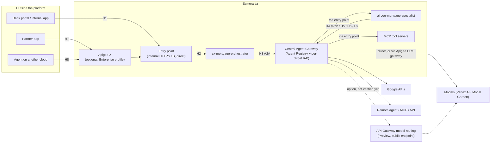

# 1.5 One Gateway per Hop

In [1.3](./01-ingress-gateways.md) and [1.4](./04-apigee-partner-gateway.md) we met the gateways one by one. This page puts them side by side.

Esmeralda has several components that can sit in a request path: the **entry point** load balancer, the **Central Agent Gateway**, **Apigee X**, the **Envoy** adapter and, for model calls, **API Gateway model routing**. Each one exists for a reason, but they don't all do the same job. This page answers one question for every hop a request can take: **which gateway handles it by default, and when would you choose something else?**

> [!NOTE]
> **The short version:** the **entry point** is where private calls *land*, the **Agent Gateway** is where agent calls *leave*, and **Apigee** is where *outside callers and commercial contracts* come in. **Envoy** is the self-managed L7 option when an environment doesn't run Apigee.

---

## 1. The Hops at a Glance

Follow Julian Sterling's mortgage request through the platform. Every arrow is a hop, and every hop has exactly one default gateway.



| # | Hop | Default | Status |
| :--- | :--- | :--- | :---: |
| H1 | Internal user or app → entry agent | Entry point (`direct`) | ✅ |
| H2 | Entry point → agents and MCP servers | `direct` backend (caller's own credential) | ✅ |
| H3 | Agent → agent (A2A) | Central Agent Gateway → entry point | ✅ |
| H4 | Agent → MCP tool server | Central Agent Gateway → entry point | ✅ |
| H5 | Agent → Google APIs | Central Agent Gateway | ✅ |
| H6 | Agent → model | Central Agent Gateway → Vertex AI (Core); alternatives: API Gateway model routing (managed multi-model, Preview) or Apigee LLM gateway (Enterprise) | ✅ / 🗺️ / 🚧 |
| H7 | Partner → agents and MCP tools | Apigee X (Enterprise); no partner path in Core | ✅ |
| H8 | Agent on another cloud → Esmeralda | Apigee X cross-cloud shared flow | 🚧 |
| H9 | Esmeralda agent → other cloud or external API | Central Agent Gateway + Agent Registry | ✅ |
| H10 | Streaming and live sessions | See [§4](#4-streaming-and-live-sessions) | ✅ / 🗺️ |

**Legend:** ✅ available on `main` · 🚧 in progress · 🗺️ planned

---

## 2. Defaults by Deployment Profile

| Hop | **Core** (no Apigee) | **Enterprise** (adds Apigee) | **Multi-cloud** |
| :--- | :--- | :--- | :--- |
| H1, H2 Ingress | Entry point, `direct` | Same; `agent_backend = "hybrid"` for long unary agent calls | Same |
| H3–H5 Agent egress | Central Agent Gateway | Same | Same |
| H6 Agent → model | Agent Gateway → Vertex AI; usage from workload `esmeralda.usage` records. Option: API Gateway model routing for managed multi-model (Preview, public endpoints) | Apigee LLM gateway behind the Agent Gateway: per-caller token quota, gateway usage record | Same as the profile it extends |
| H7 Partner | None | Apigee partner proxies + API products | Same as Enterprise |
| H8 Cross-cloud inbound | `direct` + Workload Identity Federation + IAM (no gateway record) | Apigee cross-cloud shared flow | Apigee; or Envoy JWT verification (🗺️) without Apigee |
| H9 Cross-cloud outbound | Agent Gateway + Agent Registry | Same | Same, plus private connectivity (HA VPN / Interconnect) |

---

## 3. Hop by Hop: the Default and When to Choose Something Else

### H1–H2: Ingress through the entry point

**Default:** every `*.esmeralda.internal` host is served by the [entry point](./01-ingress-gateways.md), and the built-in `direct` backend routes straight to Cloud Run or Agent Runtime. No proxy runs on the path, and the destination checks the **caller's own** credential.

| Choose instead | When |
| :--- | :--- |
| **Envoy adapter** (`gateways.host_rules`) | You need per-key rate limiting, header transformation, or a long unary timeout on a host. Envoy calls the backend with its own identity, so the backend sees Envoy rather than the original caller. |
| **`agent_backend = "hybrid"`** | Unary agent calls can take longer than 30 seconds to send their first byte. The default Private Service Connect backend has a fixed 30-second cap. |
| **Agent Gateway ingress (`CLIENT_TO_AGENT`)** | You need gateway-side checks on calls *into* an agent, such as content screening of an ADK `streamQuery`. Not wired in Esmeralda today. |

### H3–H5: Everything an agent calls goes through the Central Agent Gateway

**Default:** all outbound traffic from an Agent Runtime engine crosses the [Central Agent Gateway](../3-agentops-and-lifecycle/01-central-agent-gateway.md), whether it goes to another agent, an MCP server, or a Google API. The gateway verifies the engine's Agent Identity, denies any host not registered in the Agent Registry, and checks per-target permission (`roles/iap.egressor`) compiled from the catalog `callers`. You can't switch it off (`egress_allowlist` cannot be `"none"`).

For private targets, the gateway forwards to the entry point, so an agent-to-agent call is: **caller agent → Agent Gateway → entry point → target**. The caller's `Authorization` header passes through unchanged.

| Choose instead | When |
| :--- | :--- |
| **Apigee managed MCP** (🗺️) | You want to expose existing REST APIs as MCP tools with tool-level access by API product. The managed MCP server doesn't stream responses. |
| **Unary A2A** | Keep agent-to-agent calls unary where content screening is required: gateway content screening covers unary messages, not streamed ones. |

### H6: Agent → model

Three options, one per need:

| Option | Path | Choose it when | Trade-offs |
| :--- | :--- | :--- | :--- |
| **Vertex AI direct (Core default)** | agent → Agent Gateway → Vertex AI | You call Gemini on Vertex AI and want the simplest private path. | No gateway token quota. Usage comes from the workload's own `esmeralda.usage` records. For content screening, use Vertex AI's own Model Armor settings. |
| **API Gateway model routing** (Public Preview, 🗺️) | agent → OpenAI-compatible gateway endpoint → Model Garden models, chosen by the request's `model` field | You want a managed router across Google, Anthropic and OpenAI models in Model Garden without running Apigee, and public endpoints are acceptable. | Public endpoints only for now (no Private Service Connect, no VPC Service Controls). No token quotas or counting, no inline Model Armor. Streams responses (SSE) but not requests; no live/bidirectional sessions. The combination with the Central Agent Gateway in front is not verified yet. |
| **Apigee LLM gateway (Enterprise default, 🚧)** | agent → Agent Gateway → entry point → Apigee → Vertex AI | You need per-caller token quotas, a gateway usage record for chargeback, routing policies or semantic caching. | Needs an Apigee environment that supports LLM policies (`governance.capabilities.model_gateway = "apigee"`). |

Apigee verifies the calling agent, enforces a per-caller `LLMTokenQuota`, counts tokens in streamed responses, and writes a gateway usage record.

| Also consider | When |
| :--- | :--- |
| **Agent Gateway token policies** | Once generally available: token budgets without Apigee. |
| **A self-managed AI gateway on Envoy** | Your organization already operates one and doesn't run Apigee. |

> [!NOTE]
> The model router for the agent → model hop is being evaluated in its own issue (API Gateway model routing vs the Apigee LLM gateway); this page will link the decision when it lands. For the API Gateway option, see the [model routing overview](https://docs.cloud.google.com/api-gateway/docs/model-routing-overview).

### H7: Partners

**Default (Enterprise):** the [Apigee X partner front door](./04-apigee-partner-gateway.md) (`partner_access = "apigee"`). Partners authenticate with API keys or OAuth, API products decide which agents and MCP tools each partner sees, and `LLMTokenQuota` enforces contracted token budgets. The Core profile has no partner path.

| Choose instead | When |
| :--- | :--- |
| **Envoy with API keys** | A single, low-volume partner in an environment without Apigee. You give up products, token quotas and gateway usage records. |
| **External load balancer in front of Apigee** | Partners reach you over the internet rather than a private connection. The repository ships the private path only. |

### H8–H9: Across clouds

**Inbound (H8), default:** the Apigee cross-cloud shared flow verifies the remote workload's OIDC token against a trusted issuer, binds it to the partner key, and records the verified caller. See [5.1 Identity Across Clouds](../5-multi-cloud/01-identity-across-clouds.md).

**Outbound (H9), default:** the Central Agent Gateway. Register the remote agent card, MCP tool specification, or HTTPS endpoint in the Agent Registry; anything unregistered is denied. See [5.2 Cross-Cloud Connectivity](../5-multi-cloud/02-cross-cloud-connectivity.md).

| Choose instead | When |
| :--- | :--- |
| **Envoy JWT verification** (🗺️) | Inbound cross-cloud calls in an environment without Apigee. |
| **`direct` + Workload Identity Federation** | The minimum: IAM authorization only, with no gateway record. |
| **Agent Gateway with all traffic through the VPC + Cloud NAT** | The remote side allowlists source IPs, or the environment runs inside a VPC Service Controls perimeter. Changing this replaces the gateway. |

---

## 4. Streaming and Live Sessions

| Path | Default | Notes |
| :--- | :--- | :--- |
| App → orchestrator stream (`/api/stream_reasoning_engine`) | Entry point, `direct` | The 30-second Private Service Connect cap applies only until the first byte, so streams pass. |
| Agent → agent | Unary A2A | Gateway content screening covers unary messages only. |
| Agent → Gemini streaming | Agent Gateway → Vertex AI | Streams pass but aren't screened at the gateway; use Vertex AI's own Model Armor settings. |
| Live (bidirectional audio/video) sessions | Not part of the blueprint yet (🗺️) | Open the session from the app's backend to the regional Vertex AI endpoint, and keep it off Apigee. |

---

## 5. Which `env.yaml` Switch Selects What

| Hop | Switch |
| :--- | :--- |
| H1–H2 | `gateways.default`, `gateways.enabled`, `gateways.host_rules`, `gateways.agent_backend`, `gateways.hybrid_agent_backend` |
| H3–H5, H9 | Always on: `governance.capabilities.egress_allowlist = "agent_gateway"`; targets and callers come from `catalog/` |
| H6 | `governance.capabilities.model_gateway` (`"none"` or `"apigee"`, 🚧; an API Gateway option depends on the model-router decision) |
| H7 | `governance.apigee.enabled` + `governance.capabilities.partner_access`, `token_quota`, `usage_metering` |
| H8 | `governance.capabilities.cross_cloud = "apigee"` |

To check the hops in a live environment, run:

```bash
uv run esmeralda status --env dev
uv run esmeralda verify --env dev            # internal hops
uv run esmeralda verify --env dev --partner  # partner hop, when Apigee is enabled
```

---

## 6. Apigee, Agent Gateway or Envoy: Which One Where?

1. **Entry point:** every private call lands here. It runs no proxy, and the destination checks the caller's own identity.
2. **Central Agent Gateway:** every call an agent makes passes through it, whether to agents, tools, Google APIs, models or other clouds. It checks identity, the allowlist and per-target permission. It's always on.
3. **Apigee X:** add it when someone outside the platform calls in or a contract applies: partners, cross-cloud callers, per-consumer token quotas, chargeback and an LLM gateway.
4. **Envoy:** the self-managed L7 option without Apigee: per-key rate limits, external JWTs and long timeouts.
5. **API Gateway model routing:** a managed multi-model router (Preview, under evaluation) for agent → model calls. Public-only endpoints for now, with no token quotas or content screening.

---

**Next:** see how agent egress is governed, hop by hop, in **[2.1 Zero-Trust Egress & The Central Agent Gateway](../3-agentops-and-lifecycle/01-central-agent-gateway.md)**, or go back to how the entry point routes each host in **[1.3 The Private Front Door & Pluggable Gateways](./01-ingress-gateways.md)**.
