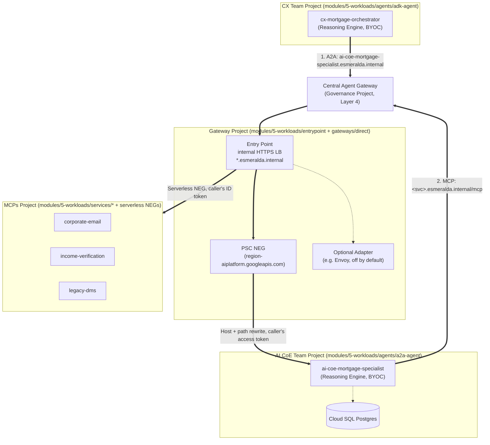

# Part I — The Cast: Agents, Tools & Gateways (Layer 5)

In the [Prologue](../index.md), our loan officer asked a simple question: ***"Can you verify Julian Sterling's income?"***

Before we look at the security checkpoints (Part II) or the cloud landing zone beneath the floor (Part III), **Part I introduces the cast of workloads on stage (`layer-5-workloads`)**—the agents, tool microservices, and private front door that collaborate to answer that question—and shows how a single declarative **service catalog** (`catalog` in `env.yaml`) wires them together without coupling the teams that build them.

---

## 1. The Story & Why It Matters: Four Teams, One Seamless Conversation

Imagine how a traditional bank processes Julian Sterling's mortgage application. A customer relationship manager takes the borrower's request, hands the file to a specialized mortgage underwriter, and the underwriter checks three internal systems: the document vault (W-2s and tax returns), the payroll verification service, and corporate email.

Esmeralda mirrors that exact organizational structure in software. Instead of cramming every prompt, database credential, and API integration into one giant "Mega-Agent," **Layer 5 splits the work across four independent tracks**, each living in its own isolated GCP project:

| Track / Team | Role in Julian Sterling's Story | GCP Project | Layer 5 Units |
| :--- | :--- | :--- | :--- |
| **CX Product Team** | Owns the customer conversation. Builds the **orchestrator** agent (`cx-mortgage-orchestrator`, Google ADK) that greets the loan officer and delegates specialized work. | `esm-<env>-cx-agents-<sfx>` | `agents/cx-mortgage-orchestrator` |
| **AI CoE Team** | Owns reusable domain intelligence. Builds the **mortgage specialist** (`ai-coe-mortgage-specialist`), published over the **Agent-to-Agent (A2A)** protocol so any business unit can invoke it. | `esm-<env>-ai-coe-agents-<sfx>` | `agents/ai-coe-mortgage-specialist` |
| **Backend / MCP Tools Team** | Wraps core enterprise systems as standardized **Model Context Protocol (MCP)** microservices on private Cloud Run. | `esm-<env>-mcps-<sfx>` | `services/legacy-dms`, `services/income-verification`, `services/corporate-email` |
| **Gateway / PlatformOps Team** | Operates the private front door (**entry point** at `*.esmeralda.internal`), routing traffic via the built-in `direct` backend or optional adapters (`envoy`, `apigee`). | `esm-<env>-gateway-<sfx>` | `entrypoint`, `gateways/direct`, `gateways/envoy` |

Neither agent team needs network peering or IAM admin rights in the other's project. Every call from an agent leaves through the **Central Agent Gateway** (Layer 4) and arrives at the target through the **private entry point** (`*.esmeralda.internal`):



---

## 2. Why We Designed It This Way: Key Decisions & Trade-offs

Why separate orchestrators, specialists, MCP tools, and gateways into distinct Layer 5 units? Here is the summary of the architectural decisions behind Part I:

| Decision | Why We Made It | What We Avoided |
| :--- | :--- | :--- |
| **ADR-04: Standalone MCP Microservices Instead of In-Process Python Functions** | Exposes every enterprise connector (`legacy-dms`, `income-verification`, `corporate-email`) as an independent FastMCP service on Cloud Run that scales to zero and has its own IAM invoker list and `Agent Registry` entry. | Redeploying and re-evaluating the entire AI agent every time a backend SQL query or API schema changes; granting the agent raw database credentials. |
| **ADR-05: Multi-Agent Delegation (A2A) Over a Single Mega-Prompt** | Splits customer conversation (`cx-mortgage-orchestrator`) from domain underwriting (`ai-coe-mortgage-specialist`) using the open A2A protocol and published Agent Cards. | Context-window pollution, inflated token costs, degraded tool-selection accuracy, and duplicate underwriting logic across multiple customer channels. |
| **ADR-06: Automated VPC-Internal Database Bootstrapping** | Provisions the specialist's private Cloud SQL PostgreSQL instance alongside an ephemeral VPC-bound Cloud Run Job (`<agent>-db-bootstrap-<env>`) that grants IAM database privileges automatically during deployment. | Public database IPs, manual `psql` steps from developer laptops, or long-lived bastion VMs. |
| **Declarative Service Catalog (`catalog` in `env.yaml`)** | Defines every private host, its workload kind (`mcp`, `a2a`, `adk`), its credential type (`id` vs `access`), its health probe, and its authorized `callers` in one file. | Scattering hostname mappings, IAM invoker bindings, and smoke-test scripts across dozens of unrelated Terraform files. |

---

## 3. How It Works & CLI in Practice

### The Layer 5 Deployment Order

When you deploy Layer 5 (`make deploy-workloads ENV=dev` or unit-by-unit via `uv run esmeralda apply <unit> --env dev`), Terragrunt resolves the dependency graph in six deterministic stages:

1. **MCP Tool Services** (`services/{legacy-dms,income-verification,corporate-email}`) — Deploys the private Cloud Run containers and registers their `TOOL_SPEC` schemas (`tools.json`) in the central **Agent Registry**.
2. **AI Reasoning Engines** (`agents/ai-coe-mortgage-specialist`, then `agents/cx-mortgage-orchestrator`) — Deploys the BYOC containers on Vertex AI Agent Runtime, binds them to the Layer 4 Central Agent Gateway, and registers the specialist's `A2A_AGENT_CARD`.
3. **Gateway Backends** (`gateways/direct` always, plus any enabled adapter in `gateways.enabled` such as `gateways/envoy`) — Creates the serverless NEGs and Private Service Connect NEGs pointing at the deployed services and agent engine IDs.
4. **Private Entry Point** (`entrypoint`) — Configures the internal HTTPS load balancer (`*.esmeralda.internal`) using the reserved IP and DNS zone from Layer 2 and the internal Root CA leaf certificate from Layer 3.
5. **IAP Egress Grants** (`services/iap-egress`) — Grants `roles/iap.egressor` on the Agent Registry entries so the agents' SPIFFE identities are authorized to egress through the Central Agent Gateway.
6. **Verification Test VM** (`services/test-vm`) — Provisions the private IAP-tunneled runner VM used by `uv run esmeralda verify` (`make test-gateway`) to probe every catalog route from inside the Shared VPC.

### Operating Layer 5 with the `esmeralda` CLI

You can inspect, test, deploy, and verify every Layer 5 workload directly from the CLI:

```bash
# List all Layer 5 units and live catalog routing
uv run esmeralda units --env dev
uv run esmeralda status --env dev

# Run Julian Sterling's underwriting query locally (starts local MCP servers automatically)
uv run esmeralda query apps/agents/cx-mortgage-orchestrator \
  -q "Can you verify Julian Sterling's income?"

# Plan or apply a specific Layer 5 workload unit (with destroy-guard protection)
uv run esmeralda plan layer-5-workloads/services/income-verification --env dev
uv run esmeralda apply layer-5-workloads/services/income-verification --env dev

# Verify all *.esmeralda.internal routes and run a live end-to-end orchestrator query
uv run esmeralda verify --env dev
```

---

## Chapters in Part I

Follow Julian Sterling's request through the three chapters of Part I:

1. **[Chapter 1: Two Teams, Two Agents — Orchestration vs. Specialization](./03-ai-agents-and-database.md)**
   * Meet `cx-mortgage-orchestrator` (Google ADK) and `ai-coe-mortgage-specialist` (A2A).
   * Why they live in separate GCP projects, how BYOC on Vertex AI Agent Runtime works, and how the zero-bastion Cloud SQL task store is bootstrapped.
2. **[Chapter 2: Wrapping Enterprise Systems as MCP Tool Servers](./02-mcp-tool-servers.md)**
   * Meet `legacy-dms`, `income-verification`, and `corporate-email` on private Cloud Run.
   * How `tools.json` contracts register in the Agent Registry, how caller ID tokens flow end-to-end, and how developers test tools locally.
3. **[Chapter 3: The Private Front Door & Pluggable Gateways](./01-ingress-gateways.md)**
   * How the `*.esmeralda.internal` entry point routes traffic with the built-in `direct` backend (zero extra proxy VMs).
   * How teams can plug in **Envoy** or **Apigee X** via `gateways` in `env.yaml` and migrate hosts one at a time without touching agent code.
4. **[Chapter 3B: Partner API Management & Token Monetization with Apigee X](./04-apigee-partner-gateway.md)**
   * Step-by-step walkthrough of how Apigee X (`partner.esmeralda.internal` / `10.0.1.3`) exposes curated agents (`partner-agents`) and MCP tools (`partner-mcp`) to external B2B partners.
   * How `VerifyAPIKey`, KVM allowlists, two-phase `<LLMTokenQuota>` (`EnforceOnly` + SSE `EventFlow` `CountOnly`), and `PostClientFlow` analytics work end-to-end with GEAP Agent Identity and the Central Agent Gateway.

> [!TIP]
> Curious how the outbound **Central Agent Gateway** verifies SPIFFE identities and private TLS certificates on every hop? After finishing Part I, head to **[Part II — Ch 4: Central Agent Gateway](../3-agentops-and-lifecycle/01-central-agent-gateway.md)**.
