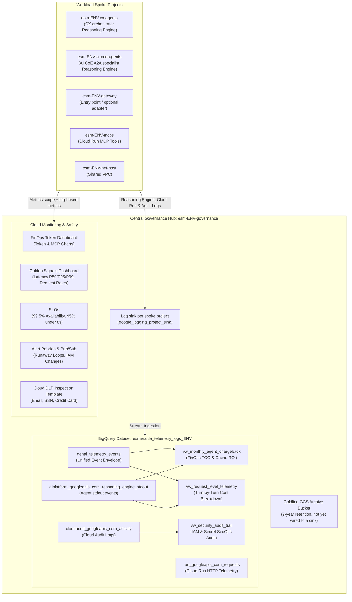
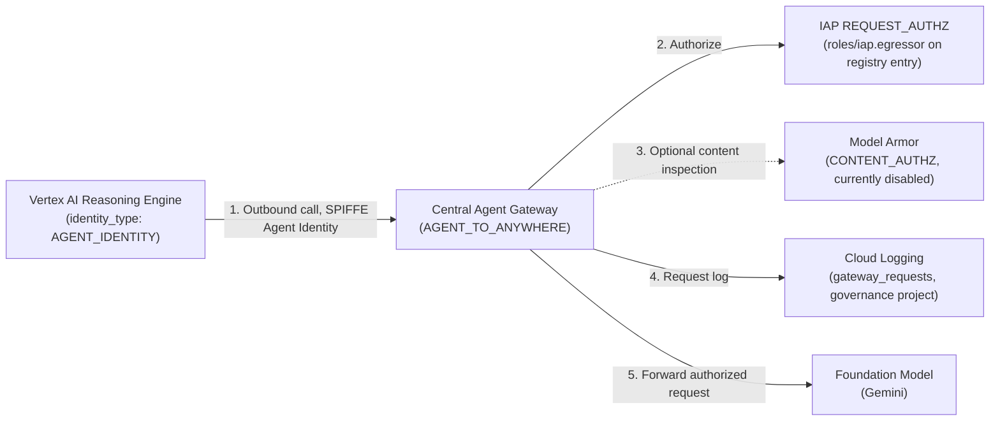

# 2.3 FinOps, Telemetry & Cross-Team Chargeback

Imagine it is the first Monday of the month. The bank's **Chief Financial Officer (CFO)** and **VP of Engineering** sit down to review the cloud bill for the new AI mortgage platform.

In a naive multi-agent deployment, that meeting turns into an argument within five minutes:
* The **AI Center of Excellence (AI CoE)** owns the project `esm-<env>-ai-coe-agents-<sfx>`, where `ai-coe-mortgage-specialist` runs. Because the specialist performs the heavy underwriting reasoning and calls three MCP tools (`legacy-dms`, `income-verification`, `corporate-email`), 75% of the Gemini token spend appears on the AI CoE project's GCP invoice.
* Yet the AI CoE team didn't initiate a single one of those requests! Every underwriting call was triggered on behalf of **Julian Sterling** and thousands of other applicants talking to `cx-mortgage-orchestrator`, owned by the **Customer Experience (CX) team** in `esm-<env>-cx-agents-<sfx>`.
* Worse, when a request takes 6.4 seconds or a prompt loop spikes token consumption at 3:00 AM, SREs shouldn't have to SSH into five separate GCP projects—or grant application developers broad access to production database logs—just to reconstruct a single conversation.

How do we give the CFO **penny-accurate, per-request token chargeback across team boundaries**, give the VP of Engineering **real-time Golden Signals and runaway-loop circuit alerts**, and give SecOps **an immutable 7-year compliance audit trail**—all while preserving strict project isolation?

Esmeralda solves this in **Layer 4 (`infrastructure/modules/4-governance`)** with a **Hub-and-Spoke Telemetry & FinOps Architecture** centered in `esm-<env>-governance-<sfx>`, paired with **OpenTelemetry caller baggage propagation** (`caller.project_id` and `caller.agent_name`) built into the [`esmeralda` runtime library](../4-esmeralda-library/index.md).

---

## Tracing Julian Sterling's Mortgage Query Across Two Teams' Budgets

When Julian Sterling asks `cx-mortgage-orchestrator` to check his loan status, here is how Esmeralda tracks both the technical latency and the financial cost across project boundaries:

1. **Caller Context Propagation (`caller.project_id`, `caller.agent_name`):**
   When `cx-mortgage-orchestrator` (in `esm-<env>-cx-agents-<sfx>`) calls `ai-coe-mortgage-specialist` (in `esm-<env>-ai-coe-agents-<sfx>`) over A2A, the `esmeralda` library attaches W3C OpenTelemetry baggage carrying `caller.project_id` and `caller.agent_name`. Inside the specialist container, `BaggageSpanProcessor` ([`telemetry.py`](../../../packages/esmeralda/src/esmeralda/telemetry.py)) automatically copies those attributes onto every child Cloud Trace span—including the specialist's Gemini model calls and MCP tool calls.
2. **Structured JSON Token & Tool Events on `stdout`:**
   After every LLM turn and every MCP tool invocation, `TelemetryEmitter` writes a single-line structured JSON event (`genai_token_consumption` or `mcp_tool_execution`) to `stdout`, recording `prompt_tokens`, `completion_tokens`, `thoughts_tokens`, `cached_tokens`, `cache_hit_ratio`, `execution_path`, `session_id`, and the W3C `trace_id`/`span_id`.
3. **Hub-and-Spoke Log Sinks to BigQuery:**
   Every workload spoke project (`cx-agents`, `ai-coe-agents`, `mcps`, `gateway`, `net-host`) has a Layer 4 `google_logging_project_sink` that streams Reasoning Engine `stdout`, Cloud Run request logs, and Cloud Audit logs into a single BigQuery dataset (`esmeralda_telemetry_logs_<env>`) in the central governance project.
4. **Instant Executive Rollups (`vw_monthly_agent_chargeback` & `vw_request_level_telemetry`):**
   In BigQuery, pre-built analytical views calculate the exact USD cost of Julian's turn, quantify how much money Gemini context caching saved (`cache_hit_ratio_pct`), and roll up monthly chargeback per agent and model.

---

## Why We Built It This Way: Architectural Decisions

| Architectural Choice | Alternative Considered | Why Esmeralda Chose This Design |
| :--- | :--- | :--- |
| **Hub-and-Spoke Log Sinks into a Central Governance BigQuery Dataset** | Querying logs separately inside each team's project, or running a single shared project for all teams | Separate log silos make cross-agent trace correlation and enterprise FinOps reporting impossible, while a single shared project destroys IAM blast-radius isolation. Hub-and-spoke sinks let each team work in an isolated spoke project while SecOps and FinOps query one unified hub in `esm-<env>-governance-<sfx>`. |
| **Structured `stdout` JSON Events (`genai_token_consumption`) + OTel Baggage (`caller.project_id`, `caller.agent_name`)** | Estimating token cost from raw GCP project billing exports alone | Cloud Billing exports show aggregate SKU spend per project with a multi-hour delay, cannot distinguish which *initiating caller* triggered a shared A2A specialist, and cannot detect a runaway prompt loop in 60 seconds. Emitting per-turn token counters with W3C trace IDs and caller baggage gives both real-time Cloud Monitoring metrics and request-level BigQuery chargeback. |
| **Pre-Created BigQuery Schemas & Views in Layer 4 (`4_finops_analytics`)** | Waiting for Cloud Logging sinks to auto-create tables on first traffic before deploying SQL views | If SQL views depend on tables that only appear after an agent serves traffic, fresh environments fail `terraform apply` or require manual two-phase deployments. Pre-creating the core `reasoning_engine_stdout` schema in Terraform ensures `vw_monthly_agent_chargeback` and `vw_request_level_telemetry` deploy cleanly on Day 1. |

---

## Complete Technical Architecture & Reference

All resources below are created by the Layer 4 module [`infrastructure/modules/4-governance`](../../../infrastructure/modules/4-governance/main.tf) (`make deploy-governance ENV=<env>`). The Central Agent Gateway, which lives in the same module, has its own deep-dive in **[2.1 Central Agent Gateway & Private PKI](./01-central-agent-gateway.md)**.



---

## 1. Telemetry Ingestion & Storage Architecture

### Central Logging Sinks (`modules/1_telemetry_sinks`)

**What it is:** a Cloud Logging *sink* is a routing rule on a project that copies every log entry matching a filter to a destination (BigQuery, Cloud Storage, Pub/Sub or another log bucket).

**In Esmeralda:** one sink, `esmeralda-central-telemetry-sink-<env>` (`google_logging_project_sink.central_sinks`), is created in each of the five spoke projects: net-host, gateway, mcps, ai-coe-agents and cx-agents. Each sink writes into the governance BigQuery dataset with partitioned tables, and its writer identity gets `roles/bigquery.dataEditor` on that dataset.

* **Routing Filter**:
  ```hcl
  filter = "resource.type=\"aiplatform.googleapis.com/ReasoningEngine\" OR logName=~\"gen_ai\" OR logName=~\"reasoning_engine_stdout\" OR logName=~\"reasoning_engine_stderr\" OR resource.type=\"cloud_run_revision\" OR logName=~\"cloudaudit.googleapis.com\""
  ```
* **Exclusions**: Debug logs (`severity < INFO`) are excluded unless they contain structured `genai_token_consumption` events, to reduce BigQuery ingestion costs.
* **Metrics scope**: the spoke projects are also attached to the governance project's Cloud Monitoring metrics scope (`google_monitoring_monitored_project`), so dashboards and alerts in the hub can see spoke metrics.
* **Agent Gateway audit logs**: `ADMIN_READ`, `DATA_READ` and `DATA_WRITE` audit logs are enabled on the governance project for `iap`, `networkservices` and `agentregistry`, and the `_Default` log buckets have Log Analytics enabled (with a linked BigQuery dataset `default_logs_analytics` in governance).

### 7-Year Regulatory Coldline Archival
* **Bucket Name**: `esmeralda-telemetry-archive-<governance_project_id>`
* **Storage Class**: `COLDLINE`
* **Retention Policy**: a 7-year retention policy (`retention_period = 220898400` seconds, not locked) plus a lifecycle rule that deletes objects after 2555 days.

> [!NOTE]
> The sink writer identities already have `roles/storage.objectCreator` on this bucket, but **no sink routes logs to it yet**: the sinks above only target BigQuery. Archival requires adding a second sink (or a scheduled export) with the bucket as destination.

---

## 2. BigQuery Data Engine (`modules/4_finops_analytics`)

**What it is:** BigQuery is Google Cloud's serverless data warehouse. A *view* is a saved SQL query that behaves like a read-only table.

**In Esmeralda:** the dataset `esmeralda_telemetry_logs_<env>` in the governance project hosts the sink tables and the analytical views below.

### Primary Tables

| Table ID | Created by | Partitioning & Clustering | Description |
| :--- | :--- | :--- | :--- |
| **`genai_telemetry_events`** | Terraform | Partitioned `DAY` (`timestamp`), Clustered `(event_type, agent_id, session_id)` | Unified JSON Event Envelope storing `timestamp`, `event_type`, `session_id`, `user_id`, `agent_id`, `execution_path`, and `payload` (`JSON`). |
| **`cloudaudit_googleapis_com_activity`** | Terraform (schema), filled by the sinks | Partitioned `DAY` (`timestamp`) | Cloud Audit Activity logs for IAM, Secret Manager, and Reasoning Engine operations. |
| **`aiplatform_googleapis_com_reasoning_engine_stdout`** | Terraform (schema), filled by the sinks | Partitioned `DAY` (`timestamp`) | Reasoning Engine stdout from both agent projects, including the agents' structured `genai_token_consumption` and `mcp_tool_execution` events. |
| **`run_googleapis_com_requests`** | The sinks, on first log | Partitioned `DAY` | Cloud Run HTTP request logs (the MCP servers, and the Envoy adapter when enabled). |

### Analytical Views

> [!NOTE]
> All three views are created by `make deploy-governance`, including on a fresh environment. `vw_monthly_agent_chargeback` and `vw_request_level_telemetry` read the stdout table, which Terraform pre-creates with the columns they query (the sinks add the remaining log columns on write), so they return rows as soon as the agents have served traffic.
>
> Upgrading an environment where the sinks already created the stdout table: import it once before applying, e.g. `cd infrastructure/live/<env>/layer-4-governance && terragrunt import module.finops_analytics.google_bigquery_table.reasoning_engine_stdout projects/<governance-project>/datasets/esmeralda_telemetry_logs_<env>/tables/aiplatform_googleapis_com_reasoning_engine_stdout`.

#### 1. `vw_monthly_agent_chargeback` (FinOps Monthly TCO & Cache ROI)
Calculates monthly agent cost and context-caching savings. The rates are **estimates hard-coded** in [`sql/vw_monthly_agent_chargeback.sql.tpl`](../../../infrastructure/modules/4-governance/sql/vw_monthly_agent_chargeback.sql.tpl) (Gemini 3.7 Flash tier); update them to match your contract:
* **Uncached Prompt Tokens**: `\$0.075` per 1M tokens
* **Cached Prompt Tokens**: `\$0.01875` per 1M tokens (**75% cost reduction**)
* **Response & Reasoning Tokens**: `\$0.30` per 1M tokens

```sql
SELECT
  billing_month,
  agent_id,
  model,
  total_requests,
  total_tokens,
  cache_hit_ratio_pct,
  net_total_chargeback_usd
FROM `esm-<env>-governance-<sfx>.esmeralda_telemetry_logs_<env>.vw_monthly_agent_chargeback`
ORDER BY billing_month DESC;
```

#### 2. `vw_request_level_telemetry` (Turn-by-Turn Cost Breakdown)
Unifies the stdout stream and the event envelope to output per-request costs (`request_cost_usd`), token counts (`prompt`, `completion`, `thoughts`, `cached`), `execution_path`, and session context.

#### 3. `vw_security_audit_trail` (SecOps Compliance Audit)
Filters audit logs for security-critical methods:
* `SetIamPolicy`: Tracks IAM role modifications and privilege escalations.
* `AccessSecretVersion`: Audits Secret Manager credential reads.
* `ReasoningEngine`: Tracks Reasoning Engine deployments, updates, and deletions.

---

## 3. Log-Based Metrics & Cloud Monitoring Dashboards (`modules/3_alert_policies`)

**What it is:** a *log-based metric* turns matching log entries into a Cloud Monitoring time series (a counter or a distribution of an extracted value). Dashboards and alert policies can then use it like any built-in metric.

**In Esmeralda:** the agents print structured JSON events to stdout ([`agent/telemetry.py`](../../../apps/agents/cx-mortgage-orchestrator/agent/telemetry.py)), and Layer 4 turns them into metrics. Token and MCP metrics are created in the governance project **and** every spoke project; security metrics only in the governance project.

| Metric (`logging.googleapis.com/user/...`) | Source event / filter | Labels |
| :--- | :--- | :--- |
| `genai/realtime_token_consumption` | `genai_token_consumption` (`tokens.total_tokens`) | `agent_id`, `user_id`, ... |
| `genai/prompt_tokens`, `genai/completion_tokens`, `genai/cached_tokens`, `genai/thoughts_tokens` | `genai_token_consumption` (per token type) | |
| `genai/mcp_tool_execution_count` | `mcp_tool_execution` | `tool_name`, `mcp_service`, `status` |
| `security/iam_privilege_changes`, `security/secret_access_operations`, `security/reasoning_engine_deployments` | Cloud Audit Logs (`SetIamPolicy`, `AccessSecretVersion`, `ReasoningEngine`) | |

Two dashboards are provisioned in the governance project. Get their IDs with `terragrunt output golden_signals_dashboard_id` / `finops_dashboard_id` in `infrastructure/live/<env>/layer-4-governance`.

### 1. `[Esmeralda <env>] FinOps - Real-Time Token Budget & Usage`
* **Widgets**:
  1. **Total LLM Token Consumption Volume over Time** (MQL: `fetch aiplatform.googleapis.com/ReasoningEngine | metric 'logging.googleapis.com/user/genai/realtime_token_consumption' | align delta(1m) | sum`)
  2. **Prompt Cache Hit Token Savings over Time** (MQL on `genai/cached_tokens`)
  3. **Gemini 3.7 Reasoning (Thoughts) Tokens over Time** (MQL on `genai/thoughts_tokens`)
  4. **MCP Tool Executions Count over Time** (`genai/mcp_tool_execution_count`)
  5. **P99 Token Consumption Spike (Runaway Loop Detector)** (`ALIGN_PERCENTILE_99`)
  6. **MCP Tool Execution Frequency per Microservice** (grouped by `metric.label.tool_name`)

### 2. `[Esmeralda <env>] Agent Platform - Golden Signals & Health`
* **Widgets**: Cloud Run latencies (P50/P95/P99), Cloud Run request volume & HTTP status, Reasoning Engine query rates & 429s, Cloud Run instance count, and the entry point's request rate by response code class (internal Application Load Balancer metrics).

> [!NOTE]
> The former synthetic uptime check of the ingress gateway was removed: it targeted an internal host, which a public uptime check can't reach. The entry point request-rate tile replaces it.

---

## 4. Alert Policies, SLOs & DLP Safety (`modules/3_alert_policies`, `modules/2_dlp_inspection`)

### Automated Alert Policies

**What it is:** a Cloud Monitoring *alert policy* evaluates a metric condition and notifies one or more *notification channels* when it is breached.

**In Esmeralda:** two channels are created: an email channel (address set in the Layer 4 live config) and a Pub/Sub channel on topic `esmeralda-monitoring-alerts-<env>`, available for automated remediation.

| Alert Policy (`[Esmeralda <env>] ...`) | Condition | Channels |
| :--- | :--- | :--- |
| **Runaway Agent Loop - Token Budget Exceeded** | P99 of `genai/realtime_token_consumption` > `runaway_loop_token_threshold` (50,000 in dev) for 60s | Email + Pub/Sub |
| **Reasoning Engine High Query Rate / 429 Quota** | Reasoning Engine `request_count` rate > 80 for 3 min | Email + Pub/Sub |
| **High P95 Latency (>10s)** | Cloud Run `request_latencies` P95 > 10,000 ms for 5 min | Email |
| **Token Rate-of-Change Anomaly (>300% Spike)** | P99 of `genai/realtime_token_consumption` > 500,000 over 5 min | Email + Pub/Sub |
| **SecOps - Privilege Escalation & IAM Modification Alert** | Any `security/iam_privilege_changes` event | Email + Pub/Sub |

> [!NOTE]
> Secret access and Reasoning Engine deployments are tracked as metrics and in `vw_security_audit_trail`, but have no alert policy. The Pub/Sub topic has no subscriber in the IaC yet.
>
> When the optional Envoy adapter is enabled (`envoy` in `gateways.enabled`), Layer 4 also creates a 5xx-ratio alert and a token-fetch-failure alert for `envoy-gateway-<env>`, and excludes it from the P95 latency alert and SLO. The default `direct` backend has no proxy of its own, so it adds no alert.

### Platform Service Level Objectives (SLOs)

**What it is:** an *SLO* is a reliability target over a time window (e.g. "99.5% of requests succeed over 30 days"); the shortfall you may still afford is the *error budget*.

**In Esmeralda:** a custom monitored service `esmeralda-agent-platform-<env>` carries two SLOs, both on a 30-day rolling window:
* **Availability SLO**: 99.5% success rate (`platform-availability-995`).
* **Latency SLO**: 95% of Cloud Run requests served under 8,000 ms (`reasoning-latency-95-8s`).

### Cloud Data Loss Prevention (DLP) PII Template

**What it is:** a Cloud DLP *inspect template* is a reusable definition of which sensitive data types (*infoTypes*) to look for, and at what confidence.

**In Esmeralda:**
* **Template**: "Esmeralda Telemetry PII Inspection Template" in the governance project. Its generated ID is the Layer 4 output `dlp_inspect_template_id`.
* **Inspected infoTypes**: `EMAIL_ADDRESS`, `CREDIT_CARD_NUMBER`, `US_SOCIAL_SECURITY_NUMBER`.
* **Likelihood Threshold**: `LIKELY`.
* The template is available for DLP inspection jobs; it is **not** applied automatically to the log sinks.

---

## 5. Central Agent Gateway & Model Armor Guardrails (`modules/6_agent_gateway`, `modules/5_model_armor`)

**Agent Gateway** is a Google-managed egress proxy: every outbound call from the two Reasoning Engines (Gemini, MCP tools, the A2A specialist) is transparently routed through `esmeralda-agent-egress-gateway-<env>` in the governance project. The full design (identity, registry, certificates, BYOC) is in **[2.1 Central Agent Gateway & Private PKI](./01-central-agent-gateway.md)**; this section only covers its governance and observability touchpoints.



### Key Gateway Controls & Security Features:
1. **SPIFFE Agent Identity Authorization (`roles/iap.egressor`)**:
   * Each engine runs with its own Agent Identity; Esmeralda grants roles per team project (`principalSet://agents.global.org-<ORG_ID>.system.id.goog/attribute.platformContainer/aiplatform/projects/<PROJECT_NUMBER>`).
   * The gateway is deny-by-default: it forwards a request only if the hostname is registered in Agent Registry and IAP confirms the identity holds `roles/iap.egressor` on that entry.
2. **Model Armor Guardrails**:
   * Two templates are deployed: `esmeralda-prompt-guardrails-<env>` (prompt injection & jailbreak, malicious URIs, RAI filters) and `esmeralda-response-guardrails-<env>`.
   * The gateway's `CONTENT_AUTHZ` extension that would send decrypted payloads to Model Armor is written but **disabled** (`count = 0`); the service-agent grants are already in place.
3. **Gateway Request Logs**:
   * Every gateway decision (host, status, allow/deny) is logged in the governance project: `gcloud logging read 'logName:"gateway_requests"' --project=<governance-project-id>`.
   * Token counts for FinOps do **not** come from the gateway; they come from the agents' own `genai_token_consumption` events (sections 2 and 3).

---

**Next Subsection:** We have seen how Layer 4 governs outbound connections, evaluates semantic policies, and streams FinOps telemetry into BigQuery. How do platform engineers—and their AI coding assistants—actually operate this platform day to day without drowning in raw Terraform output or accidentally destroying stateful infrastructure? Turn to **[2.4 Day-2 Operations with the `esmeralda` CLI & MCP Server](./04-operating-with-agents.md)**.
