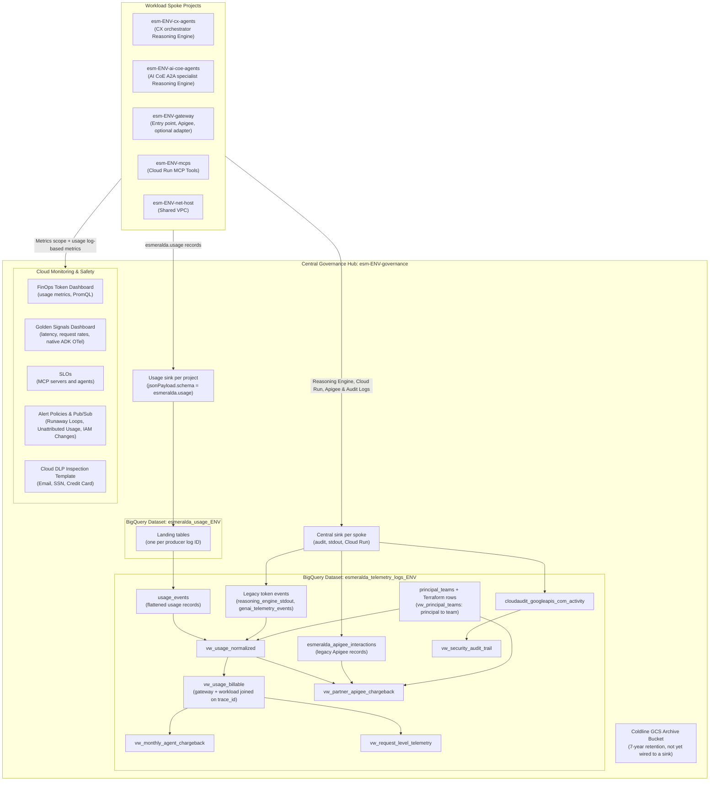
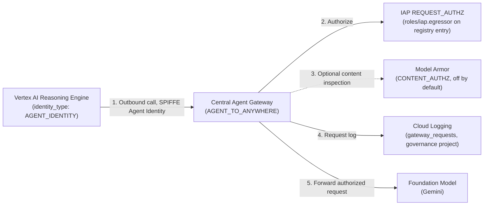

# 2.3 FinOps, Telemetry & Cross-Team Chargeback

Imagine it is the first Monday of the month. The bank's **Chief Financial Officer (CFO)** and **VP of Engineering** sit down to review the cloud bill for the new AI mortgage platform.

In a naive multi-agent deployment, that meeting turns into an argument within five minutes:
* The **AI Center of Excellence (AI CoE)** owns the project `esm-<env>-ai-coe-agents-<sfx>`, where `ai-coe-mortgage-specialist` runs. Because the specialist performs the heavy underwriting reasoning and calls three MCP tools (`legacy-dms`, `income-verification`, `corporate-email`), 75% of the Gemini token spend appears on the AI CoE project's GCP invoice.
* Yet the AI CoE team didn't initiate a single one of those requests! Every underwriting call was triggered on behalf of **Julian Sterling** and thousands of other applicants talking to `cx-mortgage-orchestrator`, owned by the **Customer Experience (CX) team** in `esm-<env>-cx-agents-<sfx>`.
* Worse, when a request takes 6.4 seconds or a prompt loop spikes token consumption at 3:00 AM, SREs shouldn't have to SSH into five separate GCP projects—or grant application developers broad access to production database logs—just to reconstruct a single conversation.

How do we give the CFO **penny-accurate, per-request token chargeback across team boundaries**, give the VP of Engineering **real-time Golden Signals and runaway-loop circuit alerts**, and give SecOps **an immutable 7-year compliance audit trail**—all while preserving strict project isolation?

Esmeralda solves this in **Layer 4 (`infrastructure/modules/4-governance`)** with a **Hub-and-Spoke Telemetry & FinOps Architecture** centered in `esm-<env>-governance-<sfx>`, paired with **OpenTelemetry caller baggage propagation** (`caller.project_id` and `caller.agent_name`) built into the [`esmeralda` runtime library](../4-esmeralda-library/index.md).

---

## Tracing Julian Sterling's Mortgage Query Across Two Teams' Budgets

When Julian Sterling asks `cx-mortgage-orchestrator` to check his loan status, here is how Esmeralda tracks both the technical latency and the financial cost across project boundaries:

1. **Caller Context Propagation (`caller.project_id`, `caller.agent_name`):**
   When `cx-mortgage-orchestrator` (in `esm-<env>-cx-agents-<sfx>`) calls `ai-coe-mortgage-specialist` (in `esm-<env>-ai-coe-agents-<sfx>`) over A2A, the `esmeralda` library attaches W3C OpenTelemetry baggage carrying `caller.project_id` and `caller.agent_name`. Inside the specialist container, `BaggageSpanProcessor` ([`telemetry.py`](../../../packages/esmeralda/src/esmeralda/telemetry.py)) automatically copies those attributes onto every child Cloud Trace span—including the specialist's Gemini model calls and MCP tool calls.
2. **One usage record per model call, tool call and gateway request (`esmeralda.usage`):**
   Every producer writes the same structured JSON record: the agents (any framework, through the `esmeralda` library), and any gateway that adopts the contract (`source = gateway`). Each record carries `"schema": "esmeralda.usage"`, a `schema_version`, the `event` (`llm.call`, `tool.call`, `agent.invocation`, `gateway.request`), `source` (`gateway` or `workload`), the serving `workload`, the `caller` (`principal`, `team`, `verified`), OpenTelemetry GenAI token counts (`gen_ai."usage.input_tokens"`, ...), tool details and the W3C `trace_id`. The contract lives in `contracts/usage-event.schema.json`.
3. **A sink keyed on the record type, not on a log name:**
   A Layer 4 sink in every project routes `jsonPayload.schema = "esmeralda.usage"` into a dedicated BigQuery dataset (`esmeralda_usage_<env>`), wherever the record was logged (Agent Engine stdout, Cloud Run, Apigee, the Cloud Logging API).
4. **Gateway and workload records joined, billed to the verified team (`vw_monthly_agent_chargeback` & `vw_request_level_telemetry`):**
   In BigQuery, the views join the gateway and workload records of one request on `trace_id`, prefer the gateway's tokens and caller identity, calculate the USD cost of Julian's request, quantify how much Gemini context caching saved (`cache_hit_ratio_pct`), and roll up monthly chargeback by **verified team**, agent and model.

---

## Why We Built It This Way: Architectural Decisions

| Architectural Choice | Alternative Considered | Why Esmeralda Chose This Design |
| :--- | :--- | :--- |
| **Hub-and-Spoke Log Sinks into a Central Governance BigQuery Dataset** | Querying logs separately inside each team's project, or running a single shared project for all teams | Separate log silos make cross-agent trace correlation and enterprise FinOps reporting impossible, while a single shared project destroys IAM blast-radius isolation. Hub-and-spoke sinks let each team work in an isolated spoke project while SecOps and FinOps query one unified hub in `esm-<env>-governance-<sfx>`. |
| **One usage contract (`esmeralda.usage`) for every producer, matched on `jsonPayload.schema`** | Parsing each framework's or gateway's own log format, or matching on log names | Cloud Billing exports show aggregate SKU spend per project with a multi-hour delay and can't tell which *caller* triggered a shared A2A specialist. Framework-specific events (the old `genai_token_consumption`) only cover one framework and one log stream. A single contract, selected by its `schema` field, lets agents of any framework, Apigee, Envoy and other clouds feed the same sink, metrics and views. |
| **Bill the verified team; gateway records win over workload records** | Trusting the team a caller declares in its payload | Attribution comes from authentication, never from the payload. A caller's team counts for billing only when the identity was verified (by the gateway, or through the `principal_teams` mapping). Until callers are verified, a workload's own records (`source = workload`) are billed to the team that owns the project they were logged from (Cloud Logging sets that project from the writer's identity, not from the payload). Gateway records never use this fallback: a gateway's project is not the caller. Everything else is reported as `unattributed`. When a gateway saw the request, its tokens and identity are the primary source; workload records are the floor on `direct` hops. |
| **Pre-Created BigQuery Schemas & Views in Layer 4** | Waiting for Cloud Logging sinks to auto-create tables on first traffic before deploying SQL views | If SQL views depend on tables that only appear after an agent serves traffic, fresh environments fail `terraform apply` or require manual two-phase deployments. Pre-creating the usage landing tables and the legacy tables in Terraform lets every view deploy cleanly on Day 1. |

---

## Complete Technical Architecture & Reference

All resources below are created by the Layer 4 module [`infrastructure/modules/4-governance`](../../../infrastructure/modules/4-governance/main.tf) (`make deploy-governance ENV=<env>`). The Central Agent Gateway, which lives in the same module, has its own deep-dive in **[2.1 Central Agent Gateway & Private PKI](./01-central-agent-gateway.md)**.



---

## 1. Telemetry Ingestion & Storage Architecture

### Central Logging Sinks (`modules/1_telemetry_sinks`)

**What it is:** a Cloud Logging *sink* is a routing rule on a project that copies every log entry matching a filter to a destination (BigQuery, Cloud Storage, Pub/Sub or another log bucket).

**In Esmeralda:** two kinds of sink.

**Central telemetry sink.** `esmeralda-central-telemetry-sink-<env>` (`google_logging_project_sink.central_sinks`) is created in each of the five spoke projects: net-host, gateway, mcps, ai-coe-agents and cx-agents. Each sink writes into the governance dataset `esmeralda_telemetry_logs_<env>` with partitioned tables, and its writer identity gets `roles/bigquery.dataEditor` on that dataset.

* **Routing Filter**:
  ```hcl
  filter = "resource.type=\"aiplatform.googleapis.com/ReasoningEngine\" OR logName=~\"gen_ai\" OR logName=~\"reasoning_engine_stdout\" OR logName=~\"reasoning_engine_stderr\" OR logName=~\"esmeralda-apigee-interactions\" OR resource.type=\"cloud_run_revision\" OR logName=~\"cloudaudit.googleapis.com\""
  ```
* **Exclusions**: Debug logs (`severity < INFO`) are excluded, except usage records (`jsonPayload.schema = "esmeralda.usage"`), the legacy `genai_token_consumption` events and the legacy Apigee `apigee.gateway.interaction` records, to reduce BigQuery ingestion costs.
* **Metrics scope**: the spoke projects are also attached to the governance project's Cloud Monitoring metrics scope (`google_monitoring_monitored_project`), so dashboards and alerts in the hub can see spoke metrics.
* **Agent Gateway audit logs**: `ADMIN_READ`, `DATA_READ` and `DATA_WRITE` audit logs are enabled on the governance project for `iap`, `networkservices` and `agentregistry`, and the `_Default` log buckets have Log Analytics enabled (with a linked BigQuery dataset `default_logs_analytics` in governance).

**Usage sink.** `esmeralda-usage-sink-<env>` (`google_logging_project_sink.usage_events`) is created in the governance project and every spoke project (the Apigee organization lives in the gateway project). It writes to the dataset `esmeralda_usage_<env>`:

* **Routing Filter**: `jsonPayload.schema="esmeralda.usage"`, never a log name, so a new producer needs no sink change.
* **Landing tables**: a BigQuery sink writes one table per log ID, so Terraform pre-creates one typed, day-partitioned table per producer log ID (Layer 4 variable `usage_landing_tables`):

  | Landing table | Producer |
  | :--- | :--- |
  | `aiplatform_googleapis_com_reasoning_engine_stdout`, `..._stderr` | `esmeralda` library on Agent Engine |
  | `run_googleapis_com_stdout`, `run_googleapis_com_stderr` | Cloud Run workloads, the Envoy gateway access log |
  | `esmeralda_apigee_interactions` | Apigee `ML-interaction` MessageLogging policy, once it writes contract records |
  | `esmeralda_usage` | Producers writing through the Cloud Logging API (OTel collector, other clouds) |

  Cloud Logging exports dotted keys with underscores (`gen_ai."usage.input_tokens"` becomes `gen_ai.usage_input_tokens`) and every JSON number as `FLOAT`; the `usage_events` view casts. A producer writing under another log ID needs its table name added to `usage_landing_tables`; until then the sink auto-creates the table and its rows are stored but not visible in `usage_events`.

> [!NOTE]
> The list is explicit on purpose. A `dataset.*` wildcard view takes the schema of the newest table, so one auto-created table missing a column would break `usage_events`. And BigQuery only clusters on top-level columns, while every usage field sits under `jsonPayload`, so the landing tables are partitioned but not clustered.

### 7-Year Regulatory Coldline Archival
* **Bucket Name**: `esmeralda-telemetry-archive-<governance_project_id>`
* **Storage Class**: `COLDLINE`
* **Retention Policy**: a 7-year retention policy (`retention_period = 220898400` seconds, not locked) plus a lifecycle rule that deletes objects after 2555 days.

> [!NOTE]
> The sink writer identities already have `roles/storage.objectCreator` on this bucket, but **no sink routes logs to it yet**: the sinks above only target BigQuery. Archival requires adding a second sink (or a scheduled export) with the bucket as destination.

---

## 2. BigQuery Data Engine (`modules/4_finops_analytics`)

**What it is:** BigQuery is Google Cloud's serverless data warehouse. A *view* is a saved SQL query that behaves like a read-only table.

**In Esmeralda:** the dataset `esmeralda_telemetry_logs_<env>` in the governance project hosts the tables and the analytical views below; the usage landing tables live in `esmeralda_usage_<env>`.

### Primary Tables

| Table ID | Created by | Partitioning & Clustering | Description |
| :--- | :--- | :--- | :--- |
| **`principal_teams`** | Terraform (empty schema), filled by tools such as the catalog compiler | None | Attribution lookup: `principal`, `principal_type` (`gcp_project`, `agent_runtime`, `spiffe`, `service_account`, `group`, `apigee_app`, `workload_identity_federation`, `oidc`), `team`, `source` (who wrote the row). `gcp_project` rows key on a project ID; the others on `caller.principal`. More columns: Layer 4 variable `principal_teams_extra_columns`. |
| **`cloudaudit_googleapis_com_activity`** | Terraform (schema), filled by the sinks | Partitioned `DAY` (`timestamp`) | Cloud Audit Activity logs for IAM, Secret Manager, and Reasoning Engine operations. |
| **`aiplatform_googleapis_com_reasoning_engine_stdout`** | Terraform (schema), filled by the central sinks | Partitioned `DAY` (`timestamp`) | Reasoning Engine stdout, including the agents' legacy `genai_token_consumption` events (historical data, still read by `vw_usage_normalized`). |
| **`genai_telemetry_events`** | Terraform | Partitioned `DAY` (`timestamp`), Clustered `(event_type, agent_id, session_id)` | Legacy unified JSON event envelope (historical data, read by `vw_usage_normalized`). |
| **`esmeralda_apigee_interactions`** | Terraform (schema), filled by the central sinks | Partitioned `DAY` (`timestamp`) | Apigee partner gateway interactions in the pre-contract `ML-interaction` shape (`event = apigee.gateway.interaction`: consumer app, verified caller identity and issuer, OTel GenAI token counts, quota counters, per-leg latency timestamps; never the API key). Historical data, read by `vw_partner_apigee_chargeback`; contract-shaped Apigee records are read from `esmeralda_usage_<env>` instead. |
| **`run_googleapis_com_requests`** | The sinks, on first log | Partitioned `DAY` | Cloud Run HTTP request logs (the MCP servers, and the Envoy adapter when enabled). |

> [!NOTE]
> The `principal_teams` table is created empty. Rows declared in Terraform (Layer 4 variable `principal_teams`, `source = terraform`) are served with it through the view `vw_principal_teams`, which is what the attribution reads. Each environment's `layer-4-governance` unit maps its workload projects to their owning teams (`principal_type = gcp_project`, from the Layer 1 project outputs). The Layer 5 `iap-egress` unit writes the catalog's verified principals (`catalog/.resolved/<env>.json` `attribution.principal_teams`, with references resolved to unit outputs) as `source = catalog` rows. It replaces only those rows, in one transaction, and only when they change. A partner Apigee app is one row with `principal_type = apigee_app`, e.g. `principal = example-partner-app`, `team = example-partner`.

### Analytical Views

The FinOps views are layered, each one built on the previous:

| View | Grain | What it does |
| :--- | :--- | :--- |
| **`usage_events`** | One row per usage record | Unions the landing tables into flat, typed columns (`schema_version`, `event`, `source`, `trace_id`, `workload_name`, `workload_team`, `caller_principal`, `caller_team`, `caller_verified`, `input_tokens`, ..., `tool_name`, `tool_status`, `gateway_product`, `latency_ms`, `dimensions`). |
| **`vw_principal_teams`** | One row per principal | The effective principal → team mapping: the `principal_teams` table plus the Terraform-declared rows. |
| **`vw_usage_normalized`** | One row per record, any era | Adds the legacy `genai_token_consumption` rows (stdout and `genai_telemetry_events`) mapped onto the contract's OpenTelemetry semantics (`input_tokens` includes cached, `output_tokens` includes reasoning), casts every token count to `INT64`, maps project numbers to project IDs (`caller_project_id`, `workload_project`), and adds the attribution: `verified`, `billed_team`, `attribution` (`verified`, `principal_table`, `workload`, `declared`, `unattributed`, `legacy`), `declared_team`. |
| **`vw_usage_billable`** | One **billable unit** per (`trace_id`, agent) | Joins the gateway and workload records of a request on `trace_id`. Tokens come from the gateway when it recorded them, else from the workload's `llm.call` records, else from legacy events (`token_source`). Identity: the verified gateway caller first. `agent.invocation` records are never billed (they roll up the calls), and while agents emit both the legacy and the contract events nothing is counted twice. |
| **`vw_monthly_agent_chargeback`** | Month × team × agent × model | Monthly cost and context-caching savings (below). |
| **`vw_request_level_telemetry`** | One row per billable unit | Per-request cost (`request_cost_usd`), token counts (`prompt`, `completion`, `thoughts`, `cached`), session and trace IDs, plus `billed_team`, `verified`, `caller_principal` and `token_source`. |
| **`vw_partner_apigee_chargeback`** | Month × partner app × caller × proxy × model × team | Partner gateway chargeback (below): Apigee `gateway.request` rows of `vw_usage_normalized` plus the legacy `esmeralda_apigee_interactions` records, billed to the verified partner team. |
| **`vw_security_audit_trail`** | One row per audit event | SecOps audit (below). |

> [!NOTE]
> All views are created by `make deploy-governance`, including on a fresh environment: Terraform pre-creates every table they read.
>
> Upgrading an environment where the sinks already created the stdout table: import it once before applying, e.g. `cd infrastructure/live/<env>/layer-4-governance && terragrunt import module.finops_analytics.google_bigquery_table.reasoning_engine_stdout projects/<governance-project>/datasets/esmeralda_telemetry_logs_<env>/tables/aiplatform_googleapis_com_reasoning_engine_stdout`.
>
> Upgrading an environment that still has the pre-contract `genai/*` log metrics: Cloud Monitoring refuses to delete a metric that an alert policy still uses, and Terraform may try to delete `genai/realtime_token_consumption` before it updates the runaway-loop alert. If `make deploy-governance` fails with "Cannot delete metric … still used in an alerting policy", apply the alert first (`terragrunt apply -target=module.alert_policies.google_monitoring_alert_policy.runaway_loop_token_cap` in `infrastructure/live/<env>/layer-4-governance`), then deploy again.

#### 1. `vw_monthly_agent_chargeback` (FinOps Monthly TCO & Cache ROI)
Calculates monthly cost and context-caching savings per **paying team** (`billed_team`), agent and model. A caller's team counts only when it comes from authentication (`verified = TRUE`); without a verified caller, a workload's records (`source = workload`, never gateway records) are billed to the team that owns its project (`attribution = 'workload'`, `verified = FALSE`); anything else lands in `billed_team = 'unattributed'`, and `attribution` says why. The rates are **estimates hard-coded** in [`sql/vw_monthly_agent_chargeback.sql.tpl`](../../../infrastructure/modules/4-governance/sql/vw_monthly_agent_chargeback.sql.tpl) (Gemini 3.7 Flash tier); update them to match your contract:
* **Uncached Prompt Tokens**: `\$0.075` per 1M tokens
* **Cached Prompt Tokens**: `\$0.01875` per 1M tokens (**75% cost reduction**)
* **Response & Reasoning Tokens**: `\$0.30` per 1M tokens

```sql
SELECT
  billing_month,
  billed_team,
  verified,
  agent_id,
  model,
  total_requests,
  total_llm_calls,
  total_tokens,
  cache_hit_ratio_pct,
  net_total_chargeback_usd
FROM `esm-<env>-governance-<sfx>.esmeralda_telemetry_logs_<env>.vw_monthly_agent_chargeback`
ORDER BY billing_month DESC, net_total_chargeback_usd DESC;
```

> [!IMPORTANT]
> `total_requests` counts **billable units** (one request trace through one agent), no longer individual model turns: a request that made three model calls counts once. The model-call count is in `total_llm_calls`. Token and cost totals are unchanged on legacy data. The historical columns keep their names and order; `billed_team`, `verified`, `attribution`, `workload_team`, `total_llm_calls` and `gateway_metered_requests` are appended.

#### 2. `vw_request_level_telemetry` (Per-Request Cost Breakdown)
One row per billable unit (a request through one agent): per-request costs (`request_cost_usd`), token counts (`prompt`, `completion`, `thoughts`, `cached`), `execution_path`, session and trace context, and who pays (`billed_team`, `verified`, `caller_principal`). `token_source` says whether the tokens came from the gateway, the workload or legacy events. `workload_project`, `workload_project_team`, `caller_project_id` and `declared_team` show where the record came from and what the caller claimed.

> [!NOTE]
> Agent Runtime reports project **numbers**, not IDs: the calling project the `esmeralda` library declares (`caller.declared.project_id`) is a number there. `vw_usage_normalized` maps numbers back to IDs for every project that produces usage (the governance and spoke projects, looked up by Terraform); an unknown number is kept as is and reported in `caller_project_number`.

#### 3. `vw_partner_apigee_chargeback` (Partner Gateway Chargeback)
Monthly chargeback, token consumption, quota exhaustion and latency for traffic through the Apigee partner proxies (`partner-agents`, `partner-mcp`, the `usage-metering` shared flow), one row per month, partner app (`consumer_app`), verified caller (`caller_identity`, `caller_issuer` for a cross-cloud JWT), proxy, model and paying team. Two sources, one shape:

* **Contract records**: rows of `vw_usage_normalized` with `source = gateway`, `gateway_product = apigee` and `event = gateway.request`. They keep that view's `billed_team`, `verified` and `attribution`: the partner team counts only when the gateway verified the caller (`verified`, or the Apigee app's `principal_teams` row: `principal_table`); gateway records never fall back to the gateway project's team. The contract carries only the end-to-end `latency_ms`, so the per-leg latency columns are empty for these rows. Model calls through an Apigee model gateway (`llm.call`) are internal agent usage and stay in `vw_usage_billable`.
* **Legacy records**: `esmeralda_apigee_interactions` rows with `event = apigee.gateway.interaction`. The Apigee app was authenticated by its API key, so its `principal_teams` row (`principal_type = apigee_app`) is verified attribution (`principal_table`); an app without a row is `unattributed`, and a record without an app (rejected before key verification) is `legacy`.

Tokens come only from the gateway record (never from the records of the agent behind the proxy), each request is written by one template version, and duplicate sink exports are dropped, so nothing is counted twice. Token columns are `INT64`. The historical columns keep their names and order; `billed_team`, `verified` and `attribution` are appended.

```sql
SELECT
  billing_month,
  billed_team,
  verified,
  attribution,
  consumer_app,
  proxy_name,
  total_requests,
  quota_exceeded_requests,
  total_billed_tokens,
  avg_total_e2e_latency_ms,
  estimated_cost_usd
FROM `esm-<env>-governance-<sfx>.esmeralda_telemetry_logs_<env>.vw_partner_apigee_chargeback`
ORDER BY billing_month DESC, estimated_cost_usd DESC;
```

#### 4. `vw_security_audit_trail` (SecOps Compliance Audit)
Filters audit logs for security-critical methods:
* `SetIamPolicy`: Tracks IAM role modifications and privilege escalations.
* `AccessSecretVersion`: Audits Secret Manager credential reads.
* `ReasoningEngine`: Tracks Reasoning Engine deployments, updates, and deletions.

---

## 3. Log-Based Metrics & Cloud Monitoring Dashboards (`modules/3_alert_policies`)

**What it is:** a *log-based metric* turns matching log entries into a Cloud Monitoring time series (a counter or a distribution of an extracted value). Dashboards and alert policies can then use it like any built-in metric.

**In Esmeralda:** every FinOps metric keys on `jsonPayload.schema="esmeralda.usage"`, so it covers every producer. Usage metrics are created in the governance project **and** every spoke project; security metrics only in the governance project.

| Metric (`logging.googleapis.com/user/...`) | Source / filter | Labels |
| :--- | :--- | :--- |
| `usage/input_tokens`, `usage/output_tokens`, `usage/cached_tokens`, `usage/reasoning_tokens` | Usage records with that token count > 0 (distribution of the per-record count) | `caller_team`, `verified`, `workload`, `workload_team`, `model`, `source`, `event` |
| `usage/tool_calls` | Usage records with `event = "tool.call"` | `tool`, `server`, `status`, `workload`, `caller_team` |
| `usage/unattributed_records` | Usage records without `caller.verified = true` (every runtime, for reference) | `workload`, `source`, `event`, `caller_team` |
| `usage/unattributed_guarded_records` | The same, from guarded workloads only (`workload.runtime` other than `agent_engine`); read by the alert and the dashboard tile | `workload`, `source`, `event`, `caller_team` |
| `attribution/gateway_unattributed_decisions` (governance project, created by the Layer 5 `iap-egress` unit) | Agent Gateway (IAP egress) decisions on agents and MCP servers that granted a principal missing from the catalog's `principal_teams` rows (decisions on external endpoint entries are not counted yet; the catalog compile already refuses an external caller list with a member that has no row) | `target` |
| `security/iam_privilege_changes`, `security/secret_access_operations`, `security/reasoning_engine_deployments` | Cloud Audit Logs (`SetIamPolicy`, `AccessSecretVersion`, `ReasoningEngine`) | |

In PromQL a log-based metric is `logging_googleapis_com:user_<name>` with `/` replaced by `_`, and a distribution's total is its `_sum` series, e.g. `sum by (caller_team) (increase(logging_googleapis_com:user_usage_input_tokens_sum[1h]))`.

Two dashboards are provisioned in the governance project. Get their IDs with `terragrunt output golden_signals_dashboard_id` / `finops_dashboard_id` in `infrastructure/live/<env>/layer-4-governance`.

### 1. `[Esmeralda <env>] FinOps - Real-Time Token Budget & Usage`
All tiles are PromQL over the usage metrics:
1. **Tokens per Minute by Caller Team** (input + output, split by `verified`)
2. **Tokens per Minute by Workload & Model**
3. **Prompt Cache Hit Token Savings over Time** (`usage/cached_tokens`)
4. **Reasoning (Thinking) Tokens over Time** (`usage/reasoning_tokens`)
5. **Tool Calls per Minute by Tool & Status** and **by MCP Server** (`usage/tool_calls`)
6. **P99 Input Tokens per Call (Runaway Loop Detector)** (`histogram_quantile` on `usage/input_tokens`)
7. **Unattributed Usage Records (expected: 0)** (guarded workloads: `usage/unattributed_guarded_records`)

### 2. `[Esmeralda <env>] Agent Platform - Golden Signals & Health`
* **Widgets**: Cloud Run latencies, Cloud Run request volume & HTTP status, Reasoning Engine query rates & 429s, Cloud Run instance count, the entry point's request rate by response code class (internal Application Load Balancer metrics), and Agent Engine query latency P95.
* **Native ADK OpenTelemetry tiles** (PromQL; series land as `prometheus.googleapis.com/<name>/histogram`): agent invocation duration P95 by `gen_ai.agent.name`, tool executions by agent and tool (`gen_ai.execute_tool.duration_count`), model tokens per agent (`adk.experimental.invoke_agent.total_tokens_sum`) and client tokens by model and token type (`gen_ai.client.token.usage_sum`). These feed the ops view only; FinOps uses the usage records.

> [!NOTE]
> The former synthetic uptime check of the ingress gateway was removed: it targeted an internal host, which a public uptime check can't reach. The entry point request-rate tile replaces it.

---

## 4. Alert Policies, SLOs & DLP Safety (`modules/3_alert_policies`, `modules/2_dlp_inspection`)

### Automated Alert Policies

**What it is:** a Cloud Monitoring *alert policy* evaluates a metric condition and notifies one or more *notification channels* when it is breached.

**In Esmeralda:** two channels are created: an email channel (address set in the Layer 4 live config) and a Pub/Sub channel on topic `esmeralda-monitoring-alerts-<env>`, available for automated remediation.

| Alert Policy (`[Esmeralda <env>] ...`) | Condition | Channels |
| :--- | :--- | :--- |
| **Runaway Agent Loop - Token Budget Exceeded** | P99 of `usage/input_tokens` (per model call or gateway request) > `runaway_loop_token_threshold` (50,000 in dev) for 60s | Email + Pub/Sub |
| **Reasoning Engine High Query Rate / 429 Quota** | Reasoning Engine `request_count` rate > 80 for 3 min | Email + Pub/Sub |
| **High P95 Latency (>10s)** | Cloud Run `request_latencies` P95 > 10,000 ms for 5 min | Email |
| **Token Rate-of-Change Anomaly (>300% Spike)** | PromQL: input + output tokens over 5 min (all producers) > 500,000 | Email + Pub/Sub |
| **Unattributed Usage - Records Without a Verified Caller** | Any `usage/unattributed_guarded_records` in 5 min (expected: 0): guarded workloads only (not Agent Runtime). On by default (`alert_on_unattributed_usage`) | Email + Pub/Sub |
| **Gateway Attribution - Principal Without a Team** | Any `attribution/gateway_unattributed_decisions` in 5 min (expected: 0): an Agent Gateway decision let through a principal that has no `principal_teams` row. Created by the Layer 5 `iap-egress` unit, follows `alert_on_unattributed_usage` | Email + Pub/Sub |
| **SecOps - Privilege Escalation & IAM Modification Alert** | Any `security/iam_privilege_changes` event | Email + Pub/Sub |

> [!IMPORTANT]
> Unattributed usage is checked where the caller can be verified. A guarded workload (an MCP server on Cloud Run with the catalog caller guard, or a workload on GKE or another cloud) records `caller.verified = true` for every allowed caller, so any record without it counts. Agents on Agent Runtime never receive the caller's credential: their records always say `caller.verified = false`, so they are excluded from that count. Their hops are checked at the Agent Gateway instead, through the gateway decision count. See [5.3 §5](../5-multi-cloud/03-unified-observability-and-chargeback.md#5-verified-attribution-on-internal-hops-end-to-end).

> [!NOTE]
> Secret access and Reasoning Engine deployments are tracked as metrics and in `vw_security_audit_trail`, but have no alert policy. The Pub/Sub topic has no subscriber in the IaC yet.
>
> When the optional Envoy adapter is enabled (`envoy` in `gateways.enabled`), Layer 4 also creates a 5xx-ratio alert and a token-fetch-failure alert for `envoy-gateway-<env>`, and excludes it from the P95 latency alert. The default `direct` backend has no proxy of its own, so it adds no alert.

### Service Level Objectives (SLOs)

**What it is:** an *SLO* is a reliability target over a time window (e.g. "99.5% of requests succeed over 30 days"); the shortfall you may still afford is the *error budget*.

**In Esmeralda:** custom monitored services with request-based SLIs, all on a 30-day rolling window, evaluated over the governance metrics scope (goals and thresholds in the Layer 4 variable `slo_config`):

| Service | SLO | Metric |
| :--- | :--- | :--- |
| `esmeralda-mcp-<name>-<env>`, one per MCP server in `slo_mcp_services` (Cloud Run service `<name>-<env>`) | `availability`: 99.5% non-5xx requests; `latency`: 95% under 5,000 ms | `run.googleapis.com/request_count`, `run.googleapis.com/request_latencies` |
| `esmeralda-agents-<env>` (all Agent Engine agents) | `availability`: 99.5% non-5xx queries; `latency`: 95% under 10,000 ms (end to end, streamed queries included) | `aiplatform.googleapis.com/reasoning_engine/request_count`, `.../request_latencies` |

> [!NOTE]
> The former platform SLOs pointed at `cx-mortgage-orchestrator` as a Cloud Run service, but it runs on Agent Engine, so they never had data. The agent SLOs now use the Agent Engine platform metrics, which every Reasoning Engine emits whatever its framework.

### Cloud Data Loss Prevention (DLP) PII Template

**What it is:** a Cloud DLP *inspect template* is a reusable definition of which sensitive data types (*infoTypes*) to look for, and at what confidence.

**In Esmeralda:**
* **Template**: "Esmeralda Telemetry PII Inspection Template" in the governance project. Its generated ID is the Layer 4 output `dlp_inspect_template_id`.
* **Inspected infoTypes**: `EMAIL_ADDRESS`, `CREDIT_CARD_NUMBER`, `US_SOCIAL_SECURITY_NUMBER`.
* **Likelihood Threshold**: `LIKELY`.
* The template is available for DLP inspection jobs; it is **not** applied automatically to the log sinks.

---

## 5. Central Agent Gateway & Model Armor Guardrails (`modules/6_agent_gateway`, `modules/5_model_armor`)

**Agent Gateway** is a Google-managed egress proxy: every outbound call from the two Reasoning Engines (Gemini, MCP tools, the A2A specialist) is transparently routed through `esmeralda-agent-egress-gateway-<env>` in the governance project. The full design (identity, registry, certificates, BYOC) is in **[2.1 Central Agent Gateway & Private PKI](./01-central-agent-gateway.md)**; this section only covers its governance and observability touchpoints.



### Key Gateway Controls & Security Features:
1. **SPIFFE Agent Identity Authorization (`roles/iap.egressor`)**:
   * Each engine runs with its own Agent Identity; Esmeralda grants roles per team project (`principalSet://agents.global.org-<ORG_ID>.system.id.goog/attribute.platformContainer/aiplatform/projects/<PROJECT_NUMBER>`).
   * The gateway is deny-by-default: it forwards a request only if the hostname is registered in Agent Registry and IAP confirms the identity holds `roles/iap.egressor` on that entry.
2. **Model Armor Guardrails**:
   * Two templates are deployed: `esmeralda-prompt-guardrails-<env>` (prompt injection & jailbreak, malicious URIs, RAI filters) and `esmeralda-response-guardrails-<env>`.
   * Gemini calls are screened by Vertex AI built-in Model Armor (a floor setting on each agent project) when `governance.model_armor.model_calls` is `inspect` or `enforce`. With `enable_cloud_logging`, findings go to Cloud Logging in the agent projects.
   * The gateway's `CONTENT_AUTHZ` extension, which sends decrypted unary MCP `tools/call` and agent card payloads to Model Armor, follows `governance.model_armor.gateway` (off by default). Sanitize results are logged in the governance project (`modelarmor.googleapis.com/sanitize_operations`). Coverage and limits: [Model Armor](./01-central-agent-gateway.md#35-model-armor-model-calls-and-optional-content_authz).
3. **Gateway Request Logs**:
   * Every gateway decision (host, status, allow/deny) is logged in the governance project: `gcloud logging read 'logName:"gateway_requests"' --project=<governance-project-id>`.
   * Token counts for FinOps come from `esmeralda.usage` records (sections 1 to 3): the agents' own records today, and gateway records when a gateway on the hop writes them (Agent Gateway request logs would need an adapter view).

---

**Next Subsection:** We have seen how Layer 4 governs outbound connections, evaluates semantic policies, and streams FinOps telemetry into BigQuery. How do platform engineers—and their AI coding assistants—actually operate this platform day to day without drowning in raw Terraform output or accidentally destroying stateful infrastructure? Turn to **[2.4 Day-2 Operations with the `esmeralda` CLI & MCP Server](./04-operating-with-agents.md)**.
