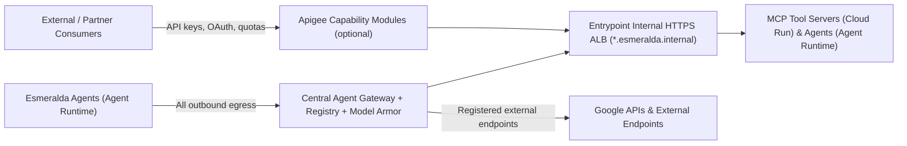
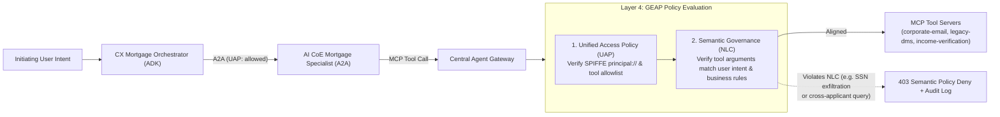

# Capability-Based Governance: Agent Gateway & Optional Apigee Modules

Agent Gateway is Esmeralda's governance plane for agent traffic. Apigee can optionally add API-management capabilities, such as partner access, API products and token quotas, through independent modules selected per capability in `env.yaml`.

This guide explains how Esmeralda models governance as a declarative capability map in `infrastructure/live/<env>/env.yaml`, how Layer 4 validates provider and environment-tier rules before deployment, and how capabilities can be toggled without modifying agent code, service catalog entries, or internal DNS (`*.esmeralda.internal`).

---

## 1. Architecture Overview



In Esmeralda, every AI agent runs with a cryptographic SPIFFE Agent Identity and sends all outbound traffic through the **Central Agent Gateway** ([01. Central Agent Gateway](./01-central-agent-gateway.md)). When an environment also needs external API-management features—such as partner onboarding with developer apps, API product packaging, or consumer-level LLM token quotas—those features are enabled individually in `env.yaml` as modular capabilities.

Because internal routing (`*.esmeralda.internal`), service discovery, and workload identities remain unchanged regardless of which capability provider is active, application and agent teams never have to rewrite code or change endpoint URLs when platform governance capabilities are toggled.

---

## 2. The `governance` Block in `env.yaml`

Each environment (`infrastructure/live/dev/env.yaml` and `infrastructure/live/prd/env.yaml`) declares its governance configuration in a single `governance` block:

```hcl
governance = {
  apigee = {
    enabled          = false
    byo              = false
    environment_type = "BASE"
  }
  capabilities = {
    egress_allowlist = "agent_gateway" # Agent Registry + IAP egress
    content_safety   = "agent_gateway" # Model Armor on Agent Gateway
    partner_access   = "none"          # "none" | "apigee" | "agent_gateway"
    token_quota      = "none"          # "none" | "apigee" | "agent_gateway"
    usage_metering   = "agent_gateway" # "agent_gateway" (OTel + BQ FinOps) | "apigee"
    cross_cloud      = "agent_gateway" # "agent_gateway" (outbound registry) | "apigee" (inbound/partner)
  }
}
```

### Default Posture
By default in both `dev` and `prd`:
- `governance.apigee.enabled` is `false` (no Apigee organization, instance, or environment is required).
- Outbound allowlisting (`egress_allowlist`), inline prompt/response inspection (`content_safety`), telemetry and chargeback (`usage_metering`), and outbound cross-cloud endpoint governance (`cross_cloud`) are served by `agent_gateway`.
- External partner access (`partner_access`) and per-consumer token quotas (`token_quota`) default to `"none"`.

---

## 3. Capability & Provider Matrix

Every capability in `governance.capabilities` accepts one of three provider values (`"agent_gateway"`, `"apigee"`, or `"none"`), subject to the validation contract enforced by Layer 4 (`infrastructure/modules/4-governance/capabilities.tf`):

| Capability | Purpose | `"agent_gateway"` | `"apigee"` | `"none"` |
| :--- | :--- | :--- | :--- | :--- |
| **`egress_allowlist`** | Controls which MCP servers, A2A agents, and external APIs an agent may call | Agent Registry catalog + IAP `roles/iap.egressor` authorization | Supported when `apigee.enabled = true` | **Not allowed** (agent egress must always be governed) |
| **`content_safety`** | Screens prompts and tool responses for prompt injection, jailbreaks, and sensitive data | Model Armor templates attached to Agent Gateway | Supported when `apigee.enabled = true` | Disables inline content screening |
| **`partner_access`** | Exposes selected agents or MCP tools to external partner consumers with API products and credentials | Supported when configured on Agent Gateway ingress | North-south partner proxy modules, API products, and developer app credentials | No external partner front door (internal VPC callers only) |
| **`token_quota`** | Enforces per-consumer LLM token rate limits and quotas | Supported when configured on Agent Gateway | Apigee `LLMTokenQuota` shared flow (`INTERMEDIATE` or `COMPREHENSIVE` tier required) | No gateway-enforced token quota (BigQuery runaway-loop alerts remain active) |
| **`usage_metering`** | Captures token consumption and request latency for FinOps chargeback | OpenTelemetry structured logs sunk to BigQuery (`vw_monthly_chargeback`) | Structured `PostClientFlow` `MessageLogging` + SSE token extraction into Cloud Logging / BigQuery | Disables gateway-level usage metering |
| **`cross_cloud`** | Governs traffic between Esmeralda and workloads on other clouds | Outbound calls to registered external endpoints via Agent Registry | Inbound partner/cross-cloud traffic via Apigee API products | Disables cross-cloud governance routes |

---

## 4. Apigee Environment Tiers (`BASE`, `INTERMEDIATE`, `COMPREHENSIVE`)

When `governance.apigee.enabled = true`, `governance.apigee.environment_type` controls the Apigee environment tier and validates compatibility with the selected capabilities:

| `environment_type` | Compatible Capabilities | Notes |
| :--- | :--- | :---
| **`BASE`** | `partner_access`, `usage_metering`, `cross_cloud` | Standard API proxy routing, API key / OAuth / JWT verification, and `MessageLogging`. Does **not** support extensible AI policies such as `LLMTokenQuota`. |
| **`INTERMEDIATE`** | All `BASE` capabilities + **`token_quota = "apigee"`** | Required for `LLMTokenQuota` (`EnforceOnly` / `CountOnly` policies) and extensible JavaScript/event-stream policies. |
| **`COMPREHENSIVE`** | All `INTERMEDIATE` capabilities + advanced distributed tracing and security add-ons | Full enterprise tier with optional distributed trace sampling (`traceConfig`). |

> [!IMPORTANT]
> Setting `token_quota = "apigee"` while `governance.apigee.environment_type = "BASE"` fails `terraform validate` / `plan` immediately in Layer 4 with a clear diagnostic message, preventing deployment of `LLMTokenQuota` policies to an incompatible `BASE` environment.

---

## 5. Layer 4 Validation Contract & Outputs

The contract is enforced in [`infrastructure/modules/4-governance/capabilities.tf`](../../../infrastructure/modules/4-governance/capabilities.tf) and wired from `env.yaml` in `infrastructure/live/<env>/layer-4-governance/terragrunt.hcl`:

1. **Allowed Environment Types:** `governance_config.apigee.environment_type` must be `"BASE"`, `"INTERMEDIATE"`, or `"COMPREHENSIVE"`.
2. **Allowed Providers:** Every key in `governance_config.capabilities` must be `"none"`, `"agent_gateway"`, or `"apigee"`.
3. **Mandatory Egress Governance:** `egress_allowlist` cannot be `"none"`.
4. **Platform Prerequisite:** No capability may be set to `"apigee"` when `governance_config.apigee.enabled = false`.
5. **Tier Prerequisite:** `token_quota = "apigee"` requires `governance_config.apigee.environment_type` to be `"INTERMEDIATE"` or `"COMPREHENSIVE"`.

Layer 4 exports four governance contract outputs for downstream Layer 5 units and audit pipelines:
- `capabilities`: The validated map of capability names to active provider strings.
- `apigee_enabled`: Boolean indicating whether the Apigee platform is enabled.
- `effective_capability_routing`: Resolved capability routing metadata including GEAP Semantic Governance (NLC) and Unified Access Policy (UAP) activation flags.
- `semantic_governance_manifest`: Compiled GEAP Semantic Governance (Natural Language Constraints) and Unified Access Policy (UAP) manifest for the Central Agent Gateway.

---

## 6. GEAP Semantic Governance Policies (Natural Language Constraints, NLC) & Unified Access Policies (UAPs)

While static IAM and [Unified Access Policies (UAPs)](https://docs.cloud.google.com/gemini-enterprise-agent-platform/govern/policies/overview-uap) enforce deterministic *who-can-call-what* access boundaries using attested SPIFFE `principal://` identities, non-deterministic LLM tool invocations require runtime semantic inspection. Even when an agent (`ai-coe-mortgage-specialist`) is legitimately authorized to invoke an MCP tool (`send_email`, `get_document`, `verify_applicant`), an indirect prompt injection or confused-deputy payload inside an untrusted document could attempt to trick the agent into calling that tool with unauthorized arguments.

To close this gap at the platform control plane, Layer 4 Submodule 7 (`infrastructure/modules/4-governance/modules/7_semantic_governance/`) defines declarative **[GEAP Semantic Governance Policies](https://docs.cloud.google.com/gemini-enterprise-agent-platform/govern/policies/semantic-governance-overview)** using **Natural Language Constraints (NLC)** paired with **Unified Access Policies (UAPs)** on the Central Agent Gateway:



### Default Mortgage Underwriting NLC & UAP Rules

Submodule `7_semantic_governance` compiles three default NLC policies and four UAP bindings (`geap.semantic-governance/v1`):

| Policy ID | Target MCP Server & Tools | Authorized Principal (UAP) | Natural Language Constraints (NLC) |
| :--- | :--- | :--- | :--- |
| **`corporate-email-nlc`** | `corporate-email` (`send_email`, `read_email`) | `ai-coe-mortgage-specialist` (`cx-mortgage-orchestrator` explicitly denied) | 1. Allow `send_email` only when the recipient address belongs to an internal underwriting domain (`@megabank.com`) and the user explicitly requested sending an underwriting notification.<br>2. Deny `send_email` if the subject or body contains unmasked Social Security Numbers (SSNs) matching `XXX-XX-XXXX` or raw tax return payloads. |
| **`legacy-dms-nlc`** | `legacy-dms` (`search_documents`, `get_document`) | `ai-coe-mortgage-specialist` (`cx-mortgage-orchestrator` explicitly denied) | 1. Allow `search_documents` and `get_document` only for the mortgage applicant family or document ID explicitly named in the initiating user request.<br>2. Deny bulk retrieval or enumeration of documents across unrelated applicants in a single turn. |
| **`income-verification-nlc`** | `income-verification` (`verify_applicant`) | `ai-coe-mortgage-specialist` (`cx-mortgage-orchestrator` explicitly denied) | 1. Allow `verify_applicant` only when `first_name` and `last_name` match the mortgage applicant being evaluated in the active underwriting session. |

### Enforcement Modes & Custom Policies

- **`semantic_governance_enforcement_mode`**: Defaults to `"ENFORCE"` (blocking non-compliant tool calls at the Central Agent Gateway) and supports `"DRY_RUN"` for shadow evaluation and audit logging prior to enforcement.
- **`custom_semantic_governance_policies`**: Allows environment operators to merge additional MCP NLC policies into the Layer 4 bundle without modifying the base module. A `terraform_data` precondition rejects any policy that omits tools/constraints or attempts to bind a wildcard principal (`*` or `/*`).
- **`enable_semantic_governance`**: When set to `true` in Layer 4, publishes the compiled JSON policy bundle (`esmeralda-semantic-governance-policies-<env>`) to Secret Manager in the central governance project.

---

## 7. Switching Providers Without Changing Workloads

To enable partner access and token quotas via Apigee in an environment:

1. Update `infrastructure/live/<env>/env.yaml`:
   ```hcl
   governance = {
     apigee = {
       enabled          = true
       byo              = false
       environment_type = "INTERMEDIATE"
     }
     capabilities = {
       egress_allowlist = "agent_gateway"
       content_safety   = "agent_gateway"
       partner_access   = "apigee"
       token_quota      = "apigee"
       usage_metering   = "apigee"
       cross_cloud      = "agent_gateway"
     }
   }
   ```
2. Run offline contract and guard verification:
   ```bash
   make test-guards
   ```
3. Apply Layer 4 governance and Layer 5 workloads. Neither agent containers (`apps/agents/*`), MCP tool servers (`apps/services/*`), nor internal `*.esmeralda.internal` hostnames change.

---

## 8. Repository & Governance Contract Guards (`make test-guards`)

Esmeralda ships an offline pytest suite executed via `make test-guards` (and included in `make test-all`):

- **[`tests/governance/test_capabilities_contract.py`](../../../tests/governance/test_capabilities_contract.py):** Runs `terraform init -backend=false` and validates `infrastructure/modules/4-governance/capabilities.tf` across valid and invalid `governance_config` combinations.
- **`tests/governance/test_semantic_governance.py`:** Validates `infrastructure/modules/4-governance/modules/7_semantic_governance` with `terraform validate` and offline `terraform apply`, verifying NLC policies for all three MCP servers (`corporate-email`, `legacy-dms`, `income-verification`), least-privilege UAP principal bindings (`ai-coe-mortgage-specialist`), SSN exfiltration prevention in `send_email`, wildcard principal rejection, and integration with `capabilities.tf`.
- **[`tests/guards/test_repo_guards.py`](../../../tests/guards/test_repo_guards.py):**
  - Verifies tracked source files and `docs/src/` contain no hardcoded suffixed project IDs (`esm-dev-*-<sfx>`), billing account IDs, or non-public domain addresses.
  - Verifies schema parity between `infrastructure/live/dev/env.yaml` and `infrastructure/live/prd/env.yaml` (top-level keys, `gateways` keys, and `governance.capabilities` keys).
  - Verifies any Apigee proxy bundle under `apps/apigee/proxies/*/apiproxy` attaches `ML-interaction` in `PostClientFlow` and enforces consumer authentication (`VerifyAPIKey`, `OAuthV2`, or `VerifyJWT`).

---

## Acknowledgements

Esmeralda's Apigee AI-traffic policy patterns (SSE `EventFlow` token extraction, `LLMTokenQuota` enforcement paired with product attributes, structured `PostClientFlow` interaction logging, and repository hygiene guards) are informed by the Apache-2.0 [`ricardosmh/adk-apigee-multiagent-demo`](https://github.com/ricardosmh/adk-apigee-multiagent-demo) reference implementation by Ricardo Santamaria.
