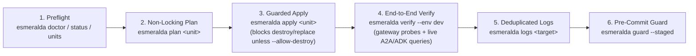

# Chapter 7: Day-2 Operations with the `esmeralda` CLI & MCP Server

Building an enterprise multi-agent platform is only half the story. What happens on **Day 2**, when six independent tracks—NetOps, SecOps, FinOps, AppDev Tools, AI CoE, and CX—are shipping updates in parallel, and both human platform engineers and **AI coding assistants** are operating the repository?

Traditional infrastructure toolchains were designed for human eyes staring at a terminal window:
* A raw `terragrunt plan` across 20 units dumps 4,000 lines of verbose HCL diffs—instantly exhausting an AI coding assistant's context window and hiding a dangerous `-/+ destroy and then create replacement` on a stateful database or Agent Connectivity Template.
* A raw `gcloud logging read` command returns pages of nested JSON envelopes and duplicated stack traces when an operator just wants to know why `ai-coe-mortgage-specialist` returned an error two minutes ago.
* Interactive prompts (`Are you sure you want to run 'terragrunt apply'? [y/N]`) hang automated CI pipelines and background agent tasks indefinitely.

To make Day-2 operations fast, deterministic, and safe for both **human SREs** and **AI coding agents**, Esmeralda provides a unified operational engine in [`esmeralda.ops`](../../../packages/esmeralda/src/esmeralda/ops/__init__.py), exposed through three synchronized interfaces:

1. **The `esmeralda` CLI** (`uv run esmeralda <subcommand> [--json]`): compact, human-readable summaries by default, and structured `--json` output for scripts and automation.
2. **Slim `Makefile` targets** (`make status`, `make doctor`, `make units`, `make plan`, `make apply`, `make verify`, `make logs`, `make guard`): ergonomic one-liner wrappers that delegate directly to `uv run esmeralda ...`.
3. **The read-only MCP Server** (`uv run --frozen --all-packages esmeralda mcp`): exposes the platform's inspection, planning, verification, and log-tailing capabilities over stdio via the Model Context Protocol (MCP) so an IDE coding agent can diagnose and test the live environment without ever holding destructive `apply` or `destroy` tools.

---

## Why We Built It This Way: Architectural Decisions

| Architectural Choice | Alternative Considered | Why Esmeralda Chose This Design |
| :--- | :--- | :--- |
| **CLI-First Operational Engine (`esmeralda.ops`) with Slim `Makefile` Wrappers** | Putting hundreds of lines of bash loops, `awk`, and `jq` directly inside the `Makefile` | Complex bash inside `Makefile` recipes is brittle, untestable, and returns unstructured text. Implementing operations in typed Python (`packages/esmeralda/src/esmeralda/ops/`) gives us unit-tested logic, collapsible tracebacks, and identical behavior across the CLI, `make`, and the MCP server. |
| **Plan-First Apply with Exit-Code `2` Destroy Guard (`esmeralda apply`)** | Running `terragrunt apply -auto-approve` directly | In a multi-layer platform where replacing an Agent Connectivity Template (ACT) or a KMS key cascades to downstream workloads, blind `-auto-approve` is dangerous. `esmeralda apply` saves a planfile first, inspects the JSON plan for `destroy > 0` or `replace > 0`, and **refuses to apply (exit code `2`)** unless `--allow-destroy` is explicitly passed. |
| **Read-Only `esmeralda mcp` Server for AI Coding Assistants** | Letting AI assistants run arbitrary `terragrunt` / `gcloud` shell commands or giving MCP write tools (`apply`, `destroy`) | Giving an AI assistant structured read-only MCP tools (`status`, `list_units`, `plan_unit`, `query_agent`, `test_gateway`, `agent_logs`, `describe_contracts`) lets it inspect state, run non-locking plans, verify routes, and debug logs autonomously—while keeping state-mutating `apply` actions gated by human review. |

---

## 1. Complete Operational Workflow: A Day in the Life of an Operator



### CLI Subcommands & `make` Targets Reference

Every operational subcommand accepts `--repo PATH` (defaults to `$ESMERALDA_REPO` or the current git checkout root) and `--json`.

| CLI Command | `make` Target | What It Does |
| :--- | :--- | :--- |
| `esmeralda status [--env dev\|prd] [--unit <unit>] [--json]` | `make status ENV=dev` | Shows git branch, HEAD SHA, dirty/clean state, active git worktrees, local state units in `infrastructure/live/.local_states/<env>`, image tags/digests vs HEAD, and deployed unit outputs (entry point IP/domain, gateways, agent engine IDs, MCP URIs). |
| `esmeralda doctor [--env dev\|prd] [--json]` | `make doctor ENV=dev` | Preflight check: verifies required tools (`git`, `uv`, `terraform`, `terragrunt`, `gcloud`), `ESMERALDA_BILLING_ACCOUNT` (warns if unset), ADC token availability, `uv.lock` frozen check, and local state readability. Exits `1` if required checks fail. |
| `esmeralda units [--env dev\|prd] [--layer 0..5] [--json]` | `make units ENV=dev` | Lists all Terragrunt units for `<env>`, their layer (`0..5`), dependencies, whether enabled or excluded in `env.yaml`, and whether local state exists. |
| `esmeralda plan <unit\|--all> [--env dev\|prd] [--json]` | `make plan [UNIT=...] ENV=dev` | Runs `terragrunt plan -lock=false` on a unit (full path like `layer-5-workloads/entrypoint` or short name `entrypoint`) or `--all` enabled units, and prints the resource change summary (`to add`, `to change`, `to destroy`, `to replace`). |
| `esmeralda apply <unit> [--env dev\|prd] [--allow-destroy] [--json]` | `make apply UNIT=... ENV=dev [ALLOW_DESTROY=1]` | Plans `<unit>` to a planfile first, inspects the plan for `destroy` or `replace` actions, **refuses to apply with exit code `2` if `destroy > 0` or `replace > 0` unless `--allow-destroy` is passed**, and otherwise applies the saved planfile. |
| `esmeralda verify [--env dev\|prd] [--probe <name>] [--skip-query] [--partner] [--json]` | `make verify ENV=dev` | Runs gateway conformance probes (`scripts/test_gateway.sh`), optional Apigee partner front-door probes (`--partner`, running `scripts/test_partner.sh`), and—unless `--skip-query` is passed—live remote queries against both `ai-coe-mortgage-specialist` and `cx-mortgage-orchestrator`. Exits `1` if any check fails. |
| `esmeralda logs <target> [--env dev\|prd] [--minutes 30] [--severity DEFAULT] [--limit 50] [--json]` | `make logs TARGET_NAME=... ENV=dev` | Pulls recent Cloud Logging entries for an agent (Reasoning Engine) or MCP/gateway service (Cloud Run), collapsing multi-line Python tracebacks and deduplicating repeated messages with an `(xN)` counter. |
| `esmeralda contracts [--section all\|entrypoint\|gateway_adapter\|agent_card\|env_yaml] [--json]` | — | Prints the architectural contracts (`entrypoint`, `gateway_adapter`, `agent_card`, `env_yaml`) and each environment's current `gateways` configuration so teams can verify interface compatibility before writing code. |
| `esmeralda guard [--staged \| --diff <range> \| --all] [--json]` | `make guard` | Public-repository sensitive-content scanner across staged changes, a diff range, or all tracked files. Exits `1` if any secret, forbidden path, or internal/customer marker is detected. |

---

## 2. Inspecting the Platform (`doctor`, `status`, `units`, `contracts`)

Before running any infrastructure or workload change, operators verify their workstation credentials and inspect the live topology:

```bash
# 1. Verify workstation tools, ADC credentials, and frozen uv.lock
uv run esmeralda doctor --env dev

# 2. Inspect Git worktrees, container digests, entry point VIP, and deployed Engine IDs
uv run esmeralda status --env dev

# 3. List all Layer 0..5 Terragrunt units, their dependencies, and enabled/excluded state
uv run esmeralda units --env dev
uv run esmeralda units --env dev --layer 5

# 4. Inspect the platform's architectural contracts (e.g., gateway_adapter or agent_card)
uv run esmeralda contracts --section all
```

---

## 3. Safe Infrastructure Changes: Plan & Apply with the Destroy Guard

```bash
# Plan a single unit by short name or full path (or pass --all for the entire environment)
make plan UNIT=entrypoint ENV=dev
uv run esmeralda plan entrypoint --env dev --json

# Plan-first apply with the built-in destroy guard
make apply UNIT=entrypoint ENV=dev
uv run esmeralda apply entrypoint --env dev
```

`esmeralda apply <unit>` never runs an uninspected apply. It always writes a deterministic planfile to `.esmeralda/plans/<env>/<slug>.tfplan` first and inspects `terragrunt show -json` before touching cloud resources:

* **Safe plans (`destroy == 0` and `replace == 0`)**: applies the exact saved planfile (`terragrunt apply <planfile>`) and cleans up the single-use planfile afterward.
* **Destructive plans (`destroy > 0` or `replace > 0`)**: **refuses to apply with exit code `2`** and prints every resource that would be deleted or replaced. To proceed intentionally when a replacement is expected, pass `--allow-destroy` (or `ALLOW_DESTROY=1` with `make apply`).

---

## 4. End-to-End Verification & Log Triage (`verify`, `query`, `logs`)

In a zero-trust multi-agent architecture, checking that a Terraform deployment succeeded is not enough: a subtle mismatch in an Agent Registry URL, a missing `roles/iap.egressor` binding, or an expired certificate on the internal entry point will only surface when real traffic flows across the trust boundary.

### Running `esmeralda verify`

```bash
# Run all internal entry point route probes + live queries to both specialist and orchestrator
uv run esmeralda verify --env dev

# Run only the fast gateway route probes (skipping LLM agent queries)
uv run esmeralda verify --env dev --skip-query

# When Apigee partner capabilities are enabled, run external B2B partner front-door probes
uv run esmeralda verify --env dev --partner
```

Under the hood, `uv run esmeralda verify --env dev` executes three verification stages:
1. **Gateway Route Probes (`scripts/test_gateway.sh`):** Connects from the internal test VM inside the Shared VPC to every host declared in `env.yaml`'s `catalog` (`legacy-dms.esmeralda.internal`, `income-verification.esmeralda.internal`, `corporate-email.esmeralda.internal`, `ai-coe-mortgage-specialist.esmeralda.internal`), verifying TLS against the internal Root CA, MCP `initialize` handshakes, and A2A agent card retrieval.
2. **Direct Specialist Query:** Sends a live underwriting query to `ai-coe-mortgage-specialist` on Vertex AI Agent Runtime and verifies that its MCP tool calls succeed through the Central Agent Gateway.
3. **Full Orchestrator-to-Specialist Query:** Sends Julian Sterling's mortgage inquiry to `cx-mortgage-orchestrator`, verifying the complete end-to-end chain: `cx-mortgage-orchestrator` → Central Agent Gateway → Internal HTTPS Entry Point (`ai-coe-mortgage-specialist.esmeralda.internal`) → `ai-coe-mortgage-specialist` → Central Agent Gateway → Internal HTTPS Entry Point (`*.esmeralda.internal/mcp`) → MCP Tool Servers.

### Querying Agents Directly (`esmeralda query`) & Tailing Logs (`esmeralda logs`)

When iterating on prompts or debugging a specific turn:

```bash
# Query a deployed agent on Vertex AI Agent Runtime (or locally with --url http://localhost:8080)
uv run esmeralda query --agent-dir apps/agents/cx-mortgage-orchestrator \
  --engine "projects/<project>/locations/us-central1/reasoningEngines/<engine-id>" \
  "Check the mortgage status for Julian Sterling."

# Fetch the last 30 minutes of deduplicated, traceback-collapsed logs for an agent or MCP tool
uv run esmeralda logs cx-mortgage-orchestrator --env dev --minutes 30
uv run esmeralda logs ai-coe-mortgage-specialist --env dev --severity WARNING
uv run esmeralda logs legacy-dms --env dev --limit 25
```

---

## 5. Operating Esmeralda from an AI Coding Assistant (`esmeralda mcp`)

Because every function in `esmeralda.ops` returns compact, structured JSON rather than raw console dumps, Esmeralda includes a built-in, **read-only Model Context Protocol (MCP) server** (`packages/esmeralda/src/esmeralda/ops/server.py`) that you can attach directly to your IDE coding agent (such as Gemini Code Assist, Claude Code, Cursor, or Cline).

### Configuring Your IDE Coding Agent

Add the following stdio server entry to your assistant's MCP configuration:

```json
{
  "mcpServers": {
    "esmeralda-ops": {
      "command": "uv",
      "args": [
        "run",
        "--frozen",
        "--all-packages",
        "esmeralda",
        "mcp"
      ]
    }
  }
}
```

### Tools Exposed by `esmeralda mcp`

Every MCP tool is annotated with `read_only_hint = True` and `destructive_hint = False`. There are **no** `apply` or `destroy` tools in the MCP server—your coding assistant can inspect, plan, test, and diagnose, and then recommend the exact `uv run esmeralda apply` command for you to review and run:

| MCP Tool Name | Parameters | What the Coding Agent Receives |
| :--- | :--- | :--- |
| **`status`** | `env`, `unit` (optional) | Git branch/SHA, active worktrees, deployed unit count, entry point VIP/domain, gateway routes, agent engine IDs, and MCP service URIs. |
| **`list_units`** | `env` | Every Terragrunt unit in the environment with its layer (`0..5`), dependencies, enabled flag, and local state status. |
| **`plan_unit`** | `env`, `unit` | Runs a read-only `terragrunt plan -lock=false` and returns resource counts (`add`, `change`, `destroy`, `replace`) plus one concise line per changed resource. |
| **`query_agent`** | `env`, `agent`, `message` | Queries the live Reasoning Engine in `<env>` and returns the agent's final answer, tool calls executed, token counts, latency, and pass/fail status. |
| **`test_gateway`** | `env` | Runs the gateway conformance probes from the internal test VM and returns per-host HTTP status codes and probe verdicts. |
| **`agent_logs`** | `env`, `agent`, `since`, `severity`, `limit` | Returns newest-first Cloud Logging entries with multi-line tracebacks collapsed to their final exception line and repeated lines deduplicated. |
| **`describe_contracts`** | *(none)* | Returns the architectural contracts (`entrypoint`, `gateway_adapter`, `env_yaml`, `agent_card`) and current `gateways` configuration across environments. |

*(For more details on how the `esmeralda` Python package is structured, see the [Esmeralda Library Usage Guide](../4-esmeralda-library/guide.md#operating-a-checkout-from-an-agent-esmeralda-mcp)).*

---

## 6. Repository Hygiene & Sensitive-Content Guard (`esmeralda guard`)

Because Esmeralda is a public reference blueprint—and because enterprise teams frequently adapt blueprints alongside internal architecture notes—`make bootstrap` (or `make hooks`) configures Git's `core.hooksPath` to `.githooks`, wiring `esmeralda guard` directly into every commit and push:

* **`.githooks/pre-commit`**: runs `uv run --frozen --package esmeralda esmeralda guard --staged` on staged diffs and file paths, blocking accidental commits of customer names, internal URLs, real GCP project suffixes, billing account IDs, `.env` files, or Terraform state files.
* **`.githooks/commit-msg`**: runs `uv run --frozen --package esmeralda esmeralda guard --message-file "$1"` to ensure commit messages stay clean of internal markers or bug IDs.
* **`.githooks/pre-push`**: runs `scripts/check_lock.sh` to verify `uv.lock` is in sync before any branch is pushed.
* **Full repository scan**: `make guard` (or `uv run esmeralda guard --all`) scans every tracked file in the repository on demand.

You can also add local, untracked regex patterns (one case-insensitive regex per line, `#` comments) to `$(git rev-parse --git-common-dir)/info/sensitive-patterns` or point `ESMERALDA_SENSITIVE_PATTERNS_FILE` at a local file outside the repository. To bypass the hook once for a reviewed false positive, set `SKIP_SENSITIVE_SCAN=1`.

---

## Where to Go Next: Part III (Workloads & The `esmeralda` Runtime Library)

In **Part II**, we saw how Layer 4 surrounds our platform with a zero-trust **Central Agent Gateway** ([Chapter 4](./01-central-agent-gateway.md)), enforces **Capability-Based & Semantic Governance (GEAP UAP/NLC)** ([Chapter 5](./04-capability-based-governance.md)), attributes **FinOps token costs and Golden Signals across team projects** ([Chapter 6](./03-centralized-monitoring-and-dashboards.md)), and empowers human operators and AI assistants with **safe Day-2 operations** ([Chapter 7](./04-operating-with-agents.md)).

In **Part III**, we move into **Layer 5 (`Workloads & Catalog`)** and the **[Esmeralda Runtime Library](../4-esmeralda-library/index.md)** to see how the private internal HTTPS entry point, stateless Cloud Run MCP tool servers, `ai-coe-mortgage-specialist` (with its zero-bastion private Cloud SQL database), and `cx-mortgage-orchestrator` are built, configured, and deployed on top of this trust boundary.
