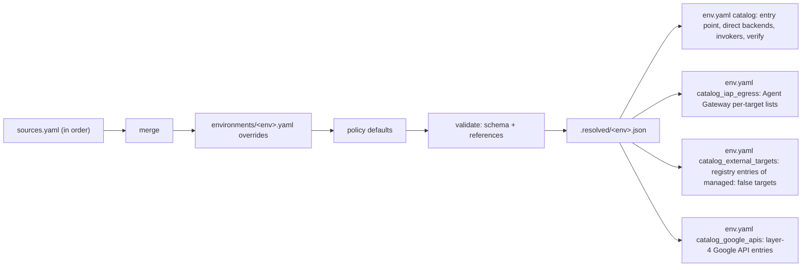

# 2.6 Service Catalog: Teams, Callers, Targets & Policy

The **catalog** is the single place that says which targets exist (agents, MCP servers, models,
legacy APIs), which team owns each one, which callers may call it, through which gateway, and who
pays for the calls. Terraform, the entry point, the invoker grants and `esmeralda verify` all
derive from it, so adding a caller or a target is a catalog change reviewed by the owning team.

Two principles shape it:

* **Where the data lives is pluggable; enforcement is compiled.** The catalog can be assembled
  from several sources (Git files, Agent Registry, project labels, a CMDB). `esmeralda catalog
  resolve` merges and validates them, and compiles the result into what the platform enforces.
  Neither the runtime nor Terraform ever reads a source directly.
* **Contracts, not implementations.** Every document follows
  [`contracts/catalog.schema.json`](../../../contracts/catalog.schema.json) (`schema:
  esmeralda.catalog`, integer `schema_version`, additive changes only). Any source that produces
  documents of that shape can feed the resolver.

---

## 1. Data model

| Section | Holds | Natural source in a real organization |
| :--- | :--- | :--- |
| **teams** | cost centres, country, `external` flag | project labels, finance, CMDB |
| **callers** (non-workload identities) | identity type + id → team | IdP groups, Apigee apps, federation config |
| **targets** | `kind`, `owner_team`, `deploy` (`unit`, or `managed: false` + `endpoint`), `serving`, `gateway`, `callers` (tools, quota, product, allowed cost centres, gateway per caller), `user_credential`, `models`, `observability` | Agent Registry, API Hub, Backstage (inventory); Git (policy) |
| **policy** | `attribution.unmapped_caller` (`deny` / `flag`), `attribution.declared_mismatch` (`reject` / `bill_own_team`), defaults, registered usage dimensions | platform and security |

Agents call as themselves: a target of kind `a2a` or `adk` can be listed directly under another
target's `callers`. Every other identity is declared under `callers` with its team and an
`identity` of type `service_account`, `group`, `apigee_app`, `federated` (OIDC issuer + subject)
or `spiffe`. When the platform creates the identity, the identity points at a unit output
(`ref: layer-3-security:<output>`) rather than a pasted value.

**The calling team pays.** A caller's grant may list the `cost_centers` it is allowed to declare;
they must belong to that caller's team.

An example target:

```yaml
schema: esmeralda.catalog
schema_version: 1
name: ai-coe-mortgage-specialist
kind: a2a
owner_team: ai-coe
deploy: { unit: agents/ai-coe-mortgage-specialist }
serving: { token: access, probe: a2a }
models: [gemini-flash]
callers:
  cx-mortgage-orchestrator: { cost_centers: [cc-cx-br, cc-cx-mx] }
  test-vm: {}
observability:
  usage_sources: [gateway, workload]
  framework: adk
  dimensions: [loan_product]
  slo: { latency_p95_ms: 10000, availability: 0.995 }
```

---

## 2. Folder layout (the default `files` source)

```text
catalog/
├── README.md
├── sources.yaml                 # which sources the resolver merges, in order
├── teams.yaml                   # team registry
├── policy.yaml                  # attribution rules, defaults, registered dimensions
├── teams/
│   ├── ai-coe/{team.yaml, agents/…, mcp/…}
│   ├── cx/{agents/…}
│   └── platform/{callers.yaml, models/…}
├── external/
│   ├── partners/…               # Apigee apps -> partner teams
│   ├── clouds/…                 # federated (issuer, subject) callers
│   └── legacy/…                 # managed: false endpoints (brownfield)
├── environments/{dev.yaml, prd.yaml}   # overrides only
└── .resolved/{dev.json, prd.json}      # generated and committed: what Terraform reads
```

Ownership comes from `CODEOWNERS`: each team approves its own `teams/<team>/` folder, while platform
and security approve `external/`, `policy.yaml` and `sources.yaml` (`catalog/README.md` has a
snippet). Entries marked `example: true` (the samples under `external/`) are resolved and shown,
but never compiled into enforcement.

---

## 3. Resolve, compile, inspect

```bash
uv run esmeralda catalog resolve --env dev                  # full resolved catalog (JSON)
uv run esmeralda catalog resolve --env dev --format hcl     # the Terraform catalog map, as HCL
uv run esmeralda catalog resolve --env all --write          # regenerate catalog/.resolved/*.json
uv run esmeralda catalog resolve --env all --check          # exit 1 when a generated file is stale
uv run esmeralda catalog show --env dev                     # who can call what, via which gateway, who pays
uv run esmeralda catalog show --env dev --caller test-vm    # everything one caller can call
```



1. **Merge.** Sources are merged in the order `sources.yaml` lists them. In the `files` source, an
   entry or a policy leaf defined twice is an error. A later source may add entries or fill fields
   an earlier source left unset; giving a different value for a field already set is a conflict.
2. **Override.** `environments/<env>.yaml` is applied last: maps merge, lists replace, and `null`
   deletes a key (for example, `callers: { test-vm: null }` removes the test VM in one environment).
3. **Validate.** The result is checked against the schema, then the references: unknown teams,
   callers, models or dimensions, duplicate names or units, and cost centres that a caller's team
   doesn't own all fail the resolve.
4. **Compile.** Deployed targets (kind `mcp`, `a2a` or `adk` with a `deploy.unit`) become the
   `catalog` map in `catalog/.resolved/<env>.json`: `kind`, `unit`, `token`, `probe`, an optional
   `timeout`, and optional `callers` (agents, which get `run.invoker` / `aiplatform.user` as their
   Agent Identity principal, and `service_account` callers, which get them as their service account).
   Each `infrastructure/live/<env>/env.yaml` decodes it:

    ```hcl
    catalog_sources = "catalog/sources.yaml"
    catalog         = lookup(jsondecode(file("${get_repo_root()}/catalog/.resolved/<env>.json")), "catalog")
    ```

    The generated files are committed with each catalog change, and `make test-guards` fails when
    they are stale.

5. **Compile the Agent Gateway lists.** The same callers also become `iap_egress` in the same file:
   the per-target `roles/iap.egressor` member lists the Layer 5 `iap-egress` unit writes on each
   Agent Registry entry (`agents` for `a2a` targets, `mcp_servers` for `mcp` targets). Members are
   references, never pasted values: an agent caller contributes its Agent Identity principal
   (`agents/<name>:agent_identity_principal`), which is also the identity it calls out as, and a
   `service_account` caller contributes its `ref`.
   `env.yaml` decodes the lists as `catalog_iap_egress`, and the `iap-egress` unit maps each
   reference to the matching unit output (`identity_refs`). A reference with no mapping fails the
   plan.

    ```json
    "iap_egress": {
      "agents":      { "ai-coe-mortgage-specialist": ["agents/cx-mortgage-orchestrator:agent_identity_principal",
                                                      "layer-3-security:test_vm_sa_email"] },
      "mcp_servers": { "legacy-dms": ["agents/ai-coe-mortgage-specialist:agent_identity_principal",
                                      "layer-3-security:test_vm_sa_email"] }
    }
    ```

    One `callers` entry therefore drives both the Cloud Run / Agent Runtime IAM grants and the
    gateway list, so the two can't disagree. A new agent caller also needs its `dependency` block and
    its `identity_refs` entry in the `iap-egress` unit (and in each MCP service unit, which grants it
    `run.invoker` as its principal); `make test-guards` checks that every
    reference has one and that each list names exactly the target's callers.

    A caller that reaches its targets directly, not through the Agent Gateway, is declared with
    `agent_gateway: false`. In dev, the Apigee partner-mcp proxy (`apigee-partner-mcp`) calls the
    MCP servers it exposes with its own ID token: it keeps `run.invoker` on them but is left out of
    their gateway lists, since Apigee never egresses through the Agent Gateway. A gateway-listed
    caller whose service account comes from a unit the `iap-egress` unit doesn't map (anything other
    than `layer-3-security`) fails the resolve with a hint to set the flag.

    No shared identity is added: agents call out with their own Agent Identity, so each list names
    only the target's callers. (The resolver still accepts a generic
    `policy.agent_gateway.shared_workload_identity` block, which adds one shared member to targets
    with an agent caller; this repository doesn't use it.)

6. **Register the targets Esmeralda doesn't deploy.** A non-example target with `deploy.managed:
    false` (a legacy API, an agent on another cloud, an external gateway such as an Apigee model
    gateway) compiles into `external_targets`: one Agent Registry entry per target, which the
    Layer 5 `iap-egress` unit creates (`env.yaml` decodes it as `catalog_external_targets`). Its
    callers compile into `iap_egress` like any other target, so only they can reach it through the
    Agent Gateway:

    | `kind` | Registry entry | `iap_egress` group |
    | --- | --- | --- |
    | `http` | endpoint (`HTTP_JSON`, no spec) | `endpoints` |
    | `model` on a non-Google host | endpoint | `endpoints` |
    | `mcp` | MCP server (`JSONRPC`, no tool spec) | `mcp_servers` |
    | `a2a` | agent, with an A2A card generated from the catalog entry | `agents` |

    ```yaml
    # catalog/environments/dev.yaml (overrides.targets): the synthetic target dev verifies with
    external-probe:
      kind: http
      owner_team: platform
      deploy: { managed: false, endpoint: "https://external-probe.{domain}" }
      callers:
        ai-coe-mortgage-specialist: {}
    ```

    - **Hostnames.** The Agent Registry matches exact hostnames (no wildcards), so `endpoint` is an
      exact `https://` URL. Environment-specific parts are placeholders the `iap-egress` unit
      substitutes from layer outputs instead of literals: `{domain}` (the entry point domain, only
      as `<label>.{domain}`) and `{region}`. Two targets can't share a host, and a host can't be the
      `<name>.{domain}` of a deployed target. Hosts under a private domain other than the entry point
      domain also need DNS peering and CA trust in the Agent Connectivity Template (not compiled).
    - **Google APIs.** A target on `*.googleapis.com` (such as `gemini-flash` on Vertex AI) gets no
      entry of its own: its host is a layer-4 Google API entry, reachable only by the agents that
      declare that API in `google_apis` (see step 6b). An agent that lists such a model must
      declare its API, or the resolve fails; an unknown Google host fails too.
    - **No callers, no access.** A target whose callers are all unenforced (groups, federated or
      Apigee app identities) or absent is still registered, with an empty policy. Removing the
      target deletes its entry, so the gateway denies the host again; removing a caller rewrites the
      entry's policy without it.
    - **Callee authentication** is the target's business: the Agent Gateway neither adds nor swaps
      credentials. `serving.token` records what agents send (`id`: a Google ID token for the
      endpoint, as the Apigee model gateway, Cloud Run or API Gateway expect; `access`; or omitted).
    - **Examples** (`example: true`, such as `external/legacy/example-core-banking.yaml`) stay
      illustrative: they are never registered.
    - **The Apigee model gateway** is one: with `governance.capabilities.model_gateway = "apigee"`,
      dev's overrides declare `llm-gateway` (`kind: http`, `https://apigee.{domain}/llm`,
      `serving.token: id`) with both agents as callers. Its callers are also the proxy's allowlist
      ([Apigee `llm-gateway`](../2-workloads-and-catalog/04-apigee-partner-gateway.md#reaching-the-gateway-the-catalog-llm-gateway-target)),
      and `make test-guards` fails if it is declared where the capability is off, or missing where
      it is on.
    - **Verification.** `esmeralda verify` (step `registry-egress`) reads every registry entry and
      its IAP policy and fails unless the registry root holds no binding, each baseline Google API
      entry lists exactly the layer-4 members, each catalog entry lists exactly its compiled callers,
      each external target is registered with its exact URL, the registered Google API entries are
      exactly the declared ones, and any other entry has no policy. In dev,
      an allowed call from the specialist to `external-probe.<domain>` reaches the entry point and
      gets its no-route `404`; any other agent gets the gateway's `403`.

    The registry root never holds a `roles/iap.egressor` binding: a root binding would be inherited
    by every external entry (see
    [2.1 §3.4](01-central-agent-gateway.md#34-iap-authorization-authz-extension-authz-policy-and-rolesiapegressor)).

    <a id="google-apis"></a>
    **6b. Declare the Google APIs each agent calls.** Agents reach Google APIs through the Agent
    Gateway too, and the gateway only lets a caller reach registered hosts it's granted on. The
    catalog declares them, and layer 4 registers nothing else:

    ```yaml
    # catalog/policy.yaml: every agent runtime
    policy:
      agent_gateway:
        google_apis:
          baseline: [telemetry, aiplatform_runtime_region, cloudresourcemanager, iamcredentials]

    # catalog/teams/ai-coe/agents/ai-coe-mortgage-specialist.yaml: this agent only
    google_apis: [aiplatform, bigquery, bigquerystorage, storage]
    ```

    They compile into `google_apis` in `.resolved/<env>.json` (`env.yaml` decodes it as
    `catalog_google_apis`): one Agent Registry entry per API at least one deployed agent may reach,
    keyed by its service id, with `url`, `protocol_binding`, `description` (see 6c), `grant` and
    `callers`.

    - **Names** come from the resolver's known-hosts table (`esmeralda.catalog.GOOGLE_APIS`): real,
      serving hostnames only, such as `aiplatform` (`aiplatform.googleapis.com`, the global model
      endpoint), `aiplatform_runtime_region` (`<region>-aiplatform.googleapis.com`, Agent Runtime
      sessions), `bigquerystorage` (gRPC). An unknown name fails the resolve. There are no mTLS,
      multi-region or REP variants: agents pin `GOOGLE_API_USE_MTLS_ENDPOINT=never`.
    - **Baseline entries** (`grant: baseline`) are granted by layer 4 to the agent projects'
      `principalSet`s, so a replaced engine can start before its new identity is granted.
    - **Per-agent entries** (`grant: callers`) are granted by the `iap-egress` unit to each declaring
      agent's Agent Identity; they're in `iap_egress.endpoints` under the same key. No other agent can
      reach them.
    - **Registration:** layer 4 registers each entry as `https://<host>` and `https://<host>:443`
      (gRPC clients send `host:443`). An API nobody declares isn't registered, and removing the last
      declaration removes the entry.
    - **Guards** (`make test-guards`): every compiled host is in the known-hosts table, each
      per-agent entry lists exactly the declaring agents (never a service agent or a project-wide
      set), and the code signals of each agent (model location, sessions, `--otel-to-cloud`, the
      BigQuery analytics plugin, literal `*.googleapis.com` hosts) are covered by its declarations.

    <a id="registry-descriptions"></a>
    **6c. Registry descriptions.** Every Agent Registry entry Esmeralda creates says why it exists
    and who uses it, so an operator can tell from the console whether an entry is safe to remove.
    The text comes from the catalog and is compiled into `.resolved/<env>.json` as `description`:

    - **Google APIs:** the API's `description` in the known-hosts table, which names the client that
      calls it (for example `bigquerystorage`: the BigQuery Agent Analytics plugin's `AppendRows`
      writes).
    - **MCP servers, A2A agents and `managed: false` targets:** the target's `description`, which is
      required for any target with a registry entry (at most 1,024 characters).
    - **Who uses it:** a generated suffix, `Used by: <callers>` (the target's catalog callers, or the
      agents that declare the API; `Used by every agent (baseline): ...` for baseline APIs).

    Layer 4, the `iap-egress` unit and the MCP and agent units pass it to
    `google_agent_registry_service.description`, an in-place update. The resolve fails when a
    description is missing or the result is over the Agent Registry limit (2,048 characters), and a
    guard checks that every `google_agent_registry_service` resource sets one.

7. **Compile verified attribution.** The same callers compile into an `attribution` block: the
    `principal_teams` rows (each verified principal, its catalog caller and the team that pays), the
    shared identities, and per-target allowlists for the in-process caller guard on MCP servers
    (`ESMERALDA_CALLER_ALLOWLIST`). `policy.attribution.unmapped_caller` (`deny`, or `flag` in the
    environments listed in `flag_environments`) and `declared_mismatch` (`reject` or `bill_own_team`)
    decide what the guard does with unknown callers and foreign cost centres. The compile fails if a
    principal that gets a grant has no team, or if one principal maps to two teams. See
    [5.3 §5](../5-multi-cloud/03-unified-observability-and-chargeback.md#5-verified-attribution-on-internal-hops-end-to-end).

Later phases compile the same resolved catalog into Apigee products and `allowed_tools`, Agent
Gateway rules beyond caller lists and observability configuration.

---

## 4. Swapping or adding sources

`catalog/sources.yaml` lists the sources:

```yaml
schema: esmeralda.catalog
schema_version: 1
sources:
  - { name: catalog-files,   type: files, paths: [teams.yaml, policy.yaml, teams, external] }
  - { name: agent-registry,  type: agent_registry, enabled: false }   # extension point
  - { name: project-labels,  type: project_labels, enabled: false }   # extension point
environments_dir: environments
resolved_dir: .resolved
```

| Organization | Typical setup |
| :--- | :--- |
| Greenfield / demo | `files` only (the default) |
| Inventory already in Agent Registry or API Hub | `agent_registry` reports what exists; `files` keeps policy, callers and grants, and adopts entries by pin |
| Teams and cost centres in project labels or finance systems | `project_labels` maps projects to the teams declared in `files` (attribution only) |
| Backstage, a CMDB or another catalog | A custom adapter |

`agent_registry` and `project_labels` are registered extension points. Enabling one today fails
with a clear "not implemented" error.

**Discovery never grants; adoption is a repo review.** The merge rules hold for every source:

- `files` must be the first enabled source, and it's the only one that may set **authorization
  data**: target callers and their grants (tools, quota, product, cost centres, gateway), the
  `callers` section, identities, `policy`, teams and their `cost_centers`, `google_apis`,
  `user_credential`, `deploy.unit`, `serving`, `models`, `gateway` and `observability`.
  `environments/<env>.yaml` overrides stay repo-reviewed too.
- Any other source contributes only what the **capability allowlist** of its type permits (a code
  constant, never configuration). Anything else fails the resolve with a message naming the source
  and the field, for example `my-cmdb: may not set targets.legacy-dms.callers`. `options.fields` in
  `sources.yaml` can narrow a source, never widen it.

  | Source type | May contribute |
  | :--- | :--- |
  | `files` | everything |
  | `agent_registry` | inventory entries; on adopted targets: `deploy.endpoint`, `runtime`, `runtime_resource`, `description`, `registry` |
  | `project_labels` | `teams.<existing team>.projects`; `owner_team` of inventory entries another source reported |
  | `backstage` | inventory entries; on adopted targets: `description`, `system`, `deploy.endpoint`; team profile `description`, `contacts`, `oncall` |
  | custom adapter | what its `CAPABILITIES` declare, capped by the inventory and attribution fields above |

- External entries land in a separate `inventory` section of the resolved catalog. Inventory is
  shown but **never compiled**: no IAM, no Agent Gateway policy, no registry entry, no allowlist.
- A catalog file adopts an inventory entry **only through a pin**, never by name:
  `deploy: { managed: false, endpoint: ..., registry: { source: <source name>, id: <entry id> } }`.
  An inventory entry named like an unpinned target fails the resolve, and so does a pin whose id the
  source doesn't report. Callers of an adopted target still come from the file.
- **Field strategies.** `strict` fields (`kind`, `owner_team`, `deploy.endpoint`, `runtime`,
  `runtime_resource`, `registry.id`) must agree across sources, otherwise the resolve fails and
  names both origins. `first` fields (`description`, `system`, `registry.skills`, profile
  `description`/`contacts`/`oncall`) keep the earliest value (files first) and record the loser as
  `shadowed`. To override a strict external value, use `environments/<env>.yaml`.
- **Provenance and determinism.** The resolved catalog (`--format json`) carries a `provenance`
  map: entry-level for every entry, field-level for each field an external source contributed or
  shadowed. When an external source contributed, `.resolved/<env>.json` also gets `provenance` and
  `inventory_summary`, so a reviewer sees which source changed a compiled value; for a files-only
  catalog both are omitted. Sources merge in `sources.yaml` order and entries in sorted order, so
  the output doesn't depend on adapter dict order or hash seeds.

A custom adapter is a small Python class that reports what it discovered as inventory:

```python
from esmeralda.catalog import Layer, Source, register_source

@register_source("my_cmdb")
class CmdbSource(Source):
    # Inventory only: whole inventory entries, and the description of the targets that pin it.
    CAPABILITIES = {"inventory": ["*"], "targets": ["description"]}

    def load(self) -> Layer:
        layer = Layer(source=self.name)
        for item in read_export(self.spec.get("options", {})):  # your client or a file export
            layer.inventory[item.name] = {
                "kind": "http",
                "description": item.description,
                "deploy": {"endpoint": item.url},
                "registry": {"id": item.id},
            }
        return layer
```

Then add `- { name: my-cmdb, type: my_cmdb, options: {...} }` to `sources.yaml` after the `files`
source. To put one of those entries under enforcement, a team adds a catalog file for it with the
pin `deploy.registry: { source: my-cmdb, id: <id> }` and the callers it allows, and that change goes
through review like any other grant.

### Snapshots and `catalog fetch`

A source that reads a live system (Agent Registry, project labels, Backstage, an API) is read in two
steps, so resolving the catalog never needs the network:

1. `esmeralda catalog fetch` calls the adapter (network, read-only on the source), normalizes what
   it returns and writes a **snapshot**: `catalog/snapshots/<source>/<env>.json`
   (`contracts/catalog-snapshot.schema.json`; `options.snapshot` changes the path). The snapshot is
   committed and reviewed like any other catalog change, so every external change reaches the
   catalog through a pull request.
2. `esmeralda catalog resolve` (including `--check` in CI) and `catalog show` read only the
   snapshot. They never open a network socket, and the same tree always gives the same bytes. The
   resolved catalog lists each snapshot source as `{name, type, snapshot, sha256}`, so a changed
   snapshot shows up in its diff.

```bash
uv run esmeralda catalog sources --env dev                         # sources, capabilities, snapshot path, sha256, entries
uv run esmeralda catalog fetch --env dev --source all --dry-run    # what a fetch would change; writes nothing
uv run esmeralda catalog fetch --env dev --source my-cmdb          # refresh one snapshot (exit 2: source unreachable)
uv run esmeralda catalog diff --env dev                            # findings for review (exit 3 when there are any)
uv run esmeralda catalog diff --env dev --live                     # also live vs snapshot (network, never written)
uv run esmeralda catalog show --env dev --provenance               # where each entry and external field came from
uv run esmeralda catalog show --env dev --inventory                # discovered entries, never compiled
```

- **Normalized and reproducible.** A fetch sorts entries by id and mapping keys, drops volatile
  fields (`etag`, `createTime`, `updateTime`, ...) and writes no timestamp: fetching the same live
  state twice gives the same bytes. Two entries with the same id or derived name fail the fetch;
  they are never ordered or suffixed.
- **No environment literals.** Project ids and numbers, the organization id, the domain and the
  region become placeholders: `{project:<alias>}`, `{project_number:<alias>}`, `{org}`, `{domain}`,
  `{region}` (aliases are layer-1 output names; units substitute them back at apply time, as
  `iap-egress` does for `{domain}`). A snapshot that still holds a raw 12-digit project number, an
  organization id, an email or IAM member, or a token-like string is refused by `catalog fetch`
  and by `esmeralda guard`.
- **Missing snapshot.** An enabled source without its snapshot fails the resolve with the
  `catalog fetch` command to run. With `options: { optional: true }` it is a warning and an empty
  layer instead, until a catalog file adopts one of its entries: then the snapshot is required.
- **Drift.** `catalog diff` reports discovered entries no catalog file adopts, external values a
  catalog file shadows or `environments/<env>.yaml` overrides, and optional sources without a
  snapshot; `--live` adds the entries that changed in the live source since the snapshot.

An adapter for a live system subclasses `SnapshotSource` and implements `fetch()` (plus
`layer_from_entries()` when its entries aren't `{id, name, inventory}`, and `placeholders()`):

```python
from esmeralda.catalog import Placeholders, SnapshotSource, SourceUnreachable, register_source

@register_source("my_cmdb")
class CmdbSource(SnapshotSource):
    CAPABILITIES = {"inventory": ["*"], "targets": ["description"]}

    def placeholders(self) -> Placeholders:
        return Placeholders(domain=..., projects={"apps": ...})   # from layer outputs

    def fetch(self) -> list[dict]:
        try:
            items = read_export(self.spec.get("options", {}))     # your client, read-only
        except OSError as exc:
            raise SourceUnreachable(f"{self.name}: {exc}") from exc
        return [
            {"id": item.id, "name": item.name,
             "inventory": {"kind": "http", "description": item.description,
                           "deploy": {"endpoint": item.url}, "registry": {"id": item.id}}}
            for item in items
        ]
```

The repository's `sources.yaml` keeps every network source disabled and commits no real
snapshot; the tests use synthetic snapshots under
`packages/esmeralda/tests/fixtures/catalog_sources/`.
