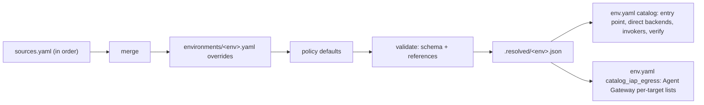

# 2.6 Service Catalog: Teams, Callers, Targets & Policy

The **catalog** is the single place that says which targets exist (agents, MCP servers, models,
legacy APIs), which team owns each one, which callers may call it, through which gateway, and who
pays for the calls. Terraform, the entry point, the invoker grants and `esmeralda verify` all
derive from it, so adding a caller or a target is a catalog change reviewed by the owning team.

Two principles shape it:

* **Where the data lives is pluggable; enforcement is compiled.** The catalog can be assembled
  from several sources (Git files, Agent Registry, project labels, a CMDB). `esmeralda catalog
  resolve` merges and validates them, and compiles the result into what the platform enforces.
  Neither the runtime nor Terraform ever reads a source directly.
* **Contracts, not implementations.** Every document follows
  [`contracts/catalog.schema.json`](../../../contracts/catalog.schema.json) (`schema:
  esmeralda.catalog`, integer `schema_version`, additive changes only). Any source that produces
  documents of that shape can feed the resolver.

---

## 1. Data model

| Section | Holds | Natural source in a real organization |
| :--- | :--- | :--- |
| **teams** | cost centres, country, `external` flag | project labels, finance, CMDB |
| **callers** (non-workload identities) | identity type + id → team | IdP groups, Apigee apps, federation config |
| **targets** | `kind`, `owner_team`, `deploy` (`unit`, or `managed: false` + `endpoint`), `serving`, `gateway`, `callers` (tools, quota, product, allowed cost centres, gateway per caller), `user_credential`, `models`, `observability` | Agent Registry, API Hub, Backstage (inventory); Git (policy) |
| **policy** | `attribution.unmapped_caller` (`deny` / `flag`), `attribution.declared_mismatch` (`reject` / `bill_own_team`), defaults, registered usage dimensions | platform and security |

Agents call as themselves: a target of kind `a2a` or `adk` can be listed directly under another
target's `callers`. Every other identity is declared under `callers` with its team and an
`identity` of type `service_account`, `group`, `apigee_app`, `federated` (OIDC issuer + subject)
or `spiffe`. When the platform creates the identity, the identity points at a unit output
(`ref: layer-3-security:<output>`) rather than a pasted value.

**The calling team pays.** A caller's grant may list the `cost_centers` it is allowed to declare;
they must belong to that caller's team.

An example target:

```yaml
schema: esmeralda.catalog
schema_version: 1
name: ai-coe-mortgage-specialist
kind: a2a
owner_team: ai-coe
deploy: { unit: agents/ai-coe-mortgage-specialist }
serving: { token: access, probe: a2a }
models: [gemini-flash]
callers:
  cx-mortgage-orchestrator: { cost_centers: [cc-cx-br, cc-cx-mx] }
  test-vm: {}
observability:
  usage_sources: [gateway, workload]
  framework: adk
  dimensions: [loan_product]
  slo: { latency_p95_ms: 10000, availability: 0.995 }
```

---

## 2. Folder layout (the default `files` source)

```text
catalog/
├── README.md
├── sources.yaml                 # which sources the resolver merges, in order
├── teams.yaml                   # team registry
├── policy.yaml                  # attribution rules, defaults, registered dimensions
├── teams/
│   ├── ai-coe/{team.yaml, agents/…, mcp/…}
│   ├── cx/{agents/…}
│   └── platform/{callers.yaml, models/…}
├── external/
│   ├── partners/…               # Apigee apps -> partner teams
│   ├── clouds/…                 # federated (issuer, subject) callers
│   └── legacy/…                 # managed: false endpoints (brownfield)
├── environments/{dev.yaml, prd.yaml}   # overrides only
└── .resolved/{dev.json, prd.json}      # generated and committed: what Terraform reads
```

Ownership comes from `CODEOWNERS`: each team approves its own `teams/<team>/` folder, while platform
and security approve `external/`, `policy.yaml` and `sources.yaml` (`catalog/README.md` has a
snippet). Entries marked `example: true` (the samples under `external/`) are resolved and shown,
but never compiled into enforcement.

---

## 3. Resolve, compile, inspect

```bash
uv run esmeralda catalog resolve --env dev                  # full resolved catalog (JSON)
uv run esmeralda catalog resolve --env dev --format hcl     # the Terraform catalog map, as HCL
uv run esmeralda catalog resolve --env all --write          # regenerate catalog/.resolved/*.json
uv run esmeralda catalog resolve --env all --check          # exit 1 when a generated file is stale
uv run esmeralda catalog show --env dev                     # who can call what, via which gateway, who pays
uv run esmeralda catalog show --env dev --caller test-vm    # everything one caller can call
```



1. **Merge.** Sources are merged in the order `sources.yaml` lists them. In the `files` source, an
   entry or a policy leaf defined twice is an error. A later source may add entries or fill fields
   an earlier source left unset; giving a different value for a field already set is a conflict.
2. **Override.** `environments/<env>.yaml` is applied last: maps merge, lists replace, and `null`
   deletes a key (for example, `callers: { test-vm: null }` removes the test VM in one environment).
3. **Validate.** The result is checked against the schema, then the references: unknown teams,
   callers, models or dimensions, duplicate names or units, and cost centres that a caller's team
   doesn't own all fail the resolve.
4. **Compile.** Deployed targets (kind `mcp`, `a2a` or `adk` with a `deploy.unit`) become the
   `catalog` map in `catalog/.resolved/<env>.json`: `kind`, `unit`, `token`, `probe`, an optional
   `timeout`, and optional `callers` (agents and `service_account` callers, whose service accounts get
   `run.invoker` / `aiplatform.user`). Each `infrastructure/live/<env>/env.yaml` decodes it:

    ```hcl
    catalog_sources = "catalog/sources.yaml"
    catalog         = lookup(jsondecode(file("${get_repo_root()}/catalog/.resolved/<env>.json")), "catalog")
    ```

    The generated files are committed with each catalog change, and `make test-guards` fails when
    they are stale.

5. **Compile the Agent Gateway lists.** The same callers also become `iap_egress` in the same file:
   the per-target `roles/iap.egressor` member lists the Layer 5 `iap-egress` unit writes on each
   Agent Registry entry (`agents` for `a2a` targets, `mcp_servers` for `mcp` targets). Members are
   references, never pasted values: an agent caller contributes its Agent Identity principal
   (`agents/<name>:agent_identity_principal`) and its service account
   (`layer-3-security:<name>_sa_email`), and a `service_account` caller contributes its `ref`.
   `env.yaml` decodes the lists as `catalog_iap_egress`, and the `iap-egress` unit maps each
   reference to the matching unit output (`identity_refs`). A reference with no mapping fails the
   plan.

    ```json
    "iap_egress": {
      "agents":      { "ai-coe-mortgage-specialist": ["agents/cx-mortgage-orchestrator:agent_identity_principal",
                                                      "layer-3-security:cx_mortgage_orchestrator_sa_email",
                                                      "layer-3-security:test_vm_sa_email"] },
      "mcp_servers": { "legacy-dms": ["agents/ai-coe-mortgage-specialist:agent_identity_principal",
                                      "layer-3-security:ai_coe_mortgage_specialist_sa_email",
                                      "layer-3-security:mcp_invoker_sa_email",
                                      "layer-3-security:test_vm_sa_email"] }
    }
    ```

    One `callers` entry therefore drives both the Cloud Run / Agent Runtime IAM grants and the
    gateway list, so the two can't disagree. A new agent caller also needs its `dependency` block and
    its `identity_refs` entry in the `iap-egress` unit; `make test-guards` checks that every
    reference has one and that each list names exactly the target's callers.

    A caller that reaches its targets directly, not through the Agent Gateway, is declared with
    `agent_gateway: false`. In dev, the Apigee partner-mcp proxy (`apigee-partner-mcp`) calls the
    MCP servers it exposes with its own ID token: it keeps `run.invoker` on them but is left out of
    their gateway lists, since Apigee never egresses through the Agent Gateway. A gateway-listed
    caller whose service account comes from a unit the `iap-egress` unit doesn't map (anything other
    than `layer-3-security`) fails the resolve with a hint to set the flag.

    `policy.agent_gateway.shared_workload_identity` adds one more member. While agents run with
    `enable_native_spiffe_auth = false`, they mint their tokens as the shared MCP invoker service
    account, so every `mcp` target with at least one agent caller also lists
    `layer-3-security:mcp_invoker_sa_email`. Delete the block (or set it to `null` in one
    environment's overrides) once every agent authenticates with its native Agent Identity.

Later phases compile the same resolved catalog into Apigee products and `allowed_tools`, Agent
Gateway rules beyond caller lists, the `esmeralda serve` caller allowlist, observability
configuration and the `principal → team` attribution table.

---

## 4. Swapping or adding sources

`catalog/sources.yaml` lists the sources:

```yaml
schema: esmeralda.catalog
schema_version: 1
sources:
  - { name: catalog-files,   type: files, paths: [teams.yaml, policy.yaml, teams, external] }
  - { name: agent-registry,  type: agent_registry, enabled: false }   # extension point
  - { name: project-labels,  type: project_labels, enabled: false }   # extension point
environments_dir: environments
resolved_dir: .resolved
```

| Organization | Typical setup |
| :--- | :--- |
| Greenfield / demo | `files` only (the default) |
| Inventory already in Agent Registry or API Hub | `agent_registry` for targets and endpoints; `files` keeps policy, callers and grants |
| Teams and cost centres in project labels or finance systems | `project_labels` fills `owner_team` and team `cost_centers` |
| Backstage, a CMDB or another catalog | A custom adapter |

`agent_registry` and `project_labels` are registered extension points. Enabling one today fails
with a clear "not implemented" error. A custom adapter is a small Python class that returns entries
of the schema's shape:

```python
from esmeralda.catalog import Layer, Source, register_source

@register_source("backstage")
class BackstageSource(Source):
    def load(self) -> Layer:
        layer = Layer(source=self.name)
        for component in fetch_components(self.spec.get("options", {})):  # your client
            layer.targets[component.name] = {
                "kind": "http",
                "owner_team": component.owner,
                "deploy": {"managed": False, "endpoint": component.url},
            }
        return layer
```

Then add `- { name: backstage, type: backstage, options: {...} }` to `sources.yaml`. The merge,
validation and compile steps stay the same, so enforcement doesn't depend on where the data lives.
