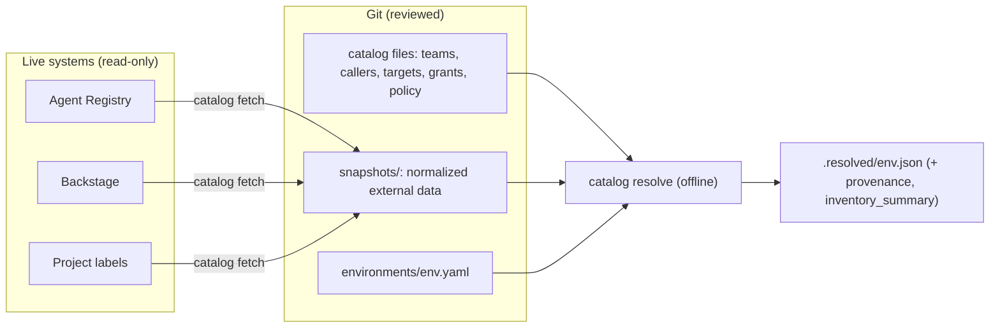

# 2.7 Catalog Sources

The [service catalog](06-service-catalog.md) is declared in Git, but real organizations already
keep parts of it elsewhere: which agents and MCP servers exist (Agent Registry, Backstage), and who
owns which project (project labels). Catalog sources let `esmeralda catalog resolve` merge that
data **without** making an external system the source of truth for who may call what.

> [!IMPORTANT]
> **Discovery never grants; adoption is a repo review.** External sources contribute inventory
> (what exists, where, at what runtime) and attribution metadata (which team owns it). Callers,
> grants, identities, policy, teams and their cost centres stay in catalog files, reviewed through
> CODEOWNERS.

This page is the model in one place. Per-source details (options, fetch, mapping) are in
[2.6 §4](06-service-catalog.md#4-swapping-or-adding-sources).

---

## 1. Model



- **Offline by construction.** `esmeralda catalog fetch` reads a live system (read-only) and writes
  a normalized **snapshot**, `catalog/snapshots/<source>/<env>.json`, committed and reviewed like
  any catalog change. `resolve`, `resolve --check` (CI), `show` and `diff` read only snapshots:
  they never open a socket, and the same tree always gives the same bytes.
- **No environment literals, no secrets.** Snapshots hold placeholders (`{project:<alias>}`,
  `{project_number:<alias>}`, `{org}`, `{domain}`, `{region}`), no timestamps, no emails, IAM
  members or token-like strings. `catalog fetch` refuses to write them and `esmeralda guard`
  rejects them. Source tokens (Backstage) are read at fetch time and never written.
- **This repository** keeps every external source disabled and commits no real snapshot. The tests
  use synthetic snapshots.

| Source type | Contributes | Reads |
| :--- | :--- | :--- |
| `files` (first, required) | everything, including all authorization data | catalog YAML |
| `agent_registry` | inventory: agents, MCP servers, endpoints (including auto-registered runtimes) | Agent Registry |
| `backstage` | inventory: Components, APIs, Resources; team profile metadata from Groups | Backstage Catalog API or a JSON export |
| `project_labels` | `teams.<team>.projects`; `owner_team` of discovered entries | project labels |
| custom adapter | what its `CAPABILITIES` declare, capped at inventory and attribution | anything |

## 2. Entry states

| State | How it arises | In the resolved catalog | Compiled (IAM, Agent Gateway, registry, allowlists) |
| :--- | :--- | :--- | :--- |
| **declared** | a catalog file entry without a pin | `targets` | yes, as declared |
| **adopted** | a catalog file entry with a pin that matches a snapshot entry | `targets`, with the external fields it may take | yes, with **callers from the file only** |
| **discovered** | an external entry no catalog file pins | `inventory` | **never** |

Pins, never names:

```yaml
deploy:
  managed: false
  endpoint: https://loan-helper.{domain}/a2a
  registry: { source: agent-registry, id: "<registry id>" }     # Agent Registry (or any source)
backstage: { source: backstage, ref: Component:default/loan-helper }   # a Backstage entity
```

One catalog entry may carry both pins: that is how two sources describing the same thing are
joined. Without it they stay two discovered entries, and two sources deriving the same name fail
the resolve. An external entry named like an unpinned catalog target fails (no name squatting),
and so does a pin whose entry the snapshot doesn't hold (an adopted target never resolves without
its source).

## 3. Merge rules

1. **Order.** Sources merge in `sources.yaml` order (`files` first), entries in sorted order, then
   `environments/<env>.yaml` overrides everything (it is repo-reviewed too).
2. **Capabilities.** Each source type has a code allowlist; `options.fields` may narrow it, never
   widen it. Anything else fails the resolve, naming the source and the field.

   | Source type | May set |
   | :--- | :--- |
   | `agent_registry` | inventory; adopted targets: `deploy.endpoint`, `runtime`, `runtime_resource`, `description`, `registry` |
   | `backstage` | inventory; adopted targets: `description`, `system`, `deploy.endpoint`; profiles of existing teams: `description`, `contacts`, `oncall` |
   | `project_labels` | `teams.<existing>.projects`; `owner_team` of discovered entries |
   | any non-files source | never: `callers` (section or field), `identity`, `policy`, `google_apis`, `user_credential`, `deploy.unit`, `serving`, `models`, `gateway`, `observability`, pins, new teams, `cost_centers` |

3. **Field strategies.**

   | Strategy | Fields | On disagreement |
   | :--- | :--- | :--- |
   | `strict` | `kind`, `owner_team`, `deploy.endpoint`, `runtime`, `runtime_resource`, `registry.id`, `teams.*.projects` | the resolve fails and names both origins (fix the file, re-fetch, or override in `environments/<env>.yaml`) |
   | `first` | `description`, `system`, `registry.skills`, profile `description` / `contacts` / `oncall` | the earliest contributor wins (files first); the loser is recorded as `shadowed` |
   | `override` | anything `environments/<env>.yaml` sets | the override wins; the source value is recorded as `shadowed` |

   A target deployed by a unit never takes `deploy.endpoint` from a source: its endpoint is its
   entry point host.

4. **Findings.** Source data that disagrees with the catalog files (a label or Backstage Group that
   maps to no catalog team, a cost-centre label outside the team's `cost_centers`, a declared owner
   that differs from its project's label) is a finding: `label_mismatch` (project labels) or
   `metadata_mismatch` (Backstage). `policy.attribution.label_mismatch: fail` (the default) fails
   the resolve; `warn` is accepted only in `flag_environments`.
5. **Provenance.** The resolved catalog carries a `provenance` map: entry-level for every entry,
   field-level for each external, shadowed or overridden field. When an external source
   contributed, `.resolved/<env>.json` also carries `provenance` (compiled entries only) and
   `inventory_summary` (adopted and discovered counts per source); for a files-only catalog both
   are omitted, so its file doesn't change.

## 4. Invariants

Each one is a test (`packages/esmeralda/tests/test_catalog_*.py`):

| # | Invariant |
| :--- | :--- |
| I1 | No compiled grant (callers, `iap_egress`, allowlists, `principal_teams`, `google_apis`) comes from a source other than catalog files or `environments/<env>.yaml` |
| I2 | Teams and their `cost_centers` come from catalog files only: labels and Backstage never create a team or widen what callers may declare |
| I3 | Discovered entries are never compiled: adding any number leaves the compiled blocks byte-identical |
| I4 | Adoption by pin only; a name match without a pin, or a pin without its entry, fails |
| I5 | What Esmeralda registers itself is never imported back (Agent Registry fetch excludes the compiled set) |
| I6 | `resolve`, `--check`, `show` and `diff` open no socket |
| I7 | Permuted adapter output, re-runs and different hash seeds give identical bytes |
| I8 | Snapshots hold no secret, token, email, raw project number or organization id |
| I9 | `sources.yaml` can narrow a source's capabilities, never widen them |
| I10 | Allowed ⇒ attributable still holds: every compiled caller has a `principal_teams` row |
| I11 | Only `environments/<env>.yaml` overrides a strict external field |

The **golden multi-source test** (`test_catalog_golden.py`) resolves a synthetic catalog that uses
all four source types together (`packages/esmeralda/tests/fixtures/catalog_golden/`) and compares
the result, byte for byte, with its committed `resolved.dev.json` and `catalog/.resolved/dev.json`.
It shows each rule above in one place: discovered entries, an Agent Registry entry and a Backstage
entity joined by one catalog file, a deployed agent adopted by Backstage, a shadowed description,
an environment override, Backstage team profiles and project-label attribution.

## 5. CLI

```bash
uv run esmeralda catalog sources --env dev                        # sources, capabilities, snapshot, sha256, entries
uv run esmeralda catalog fetch --env dev --source all --dry-run   # what a fetch would change (network, read-only)
uv run esmeralda catalog fetch --env dev --source backstage       # refresh one snapshot (exit 2: unreachable)
uv run esmeralda catalog resolve --env all --check                # offline; CI gate
uv run esmeralda catalog show --env dev --provenance              # where each entry and external field came from
uv run esmeralda catalog show --env dev --inventory               # discovered entries, never compiled
uv run esmeralda catalog diff --env dev                           # findings for review (exit 3 when any)
uv run esmeralda catalog diff --env dev --live                    # also live vs snapshot (network, never written)
```

`catalog diff` lists, for review: `discovered` entries, `shadowed` and `overridden` external
values, `label_mismatch` / `metadata_mismatch` findings, `suggested_grant` hints (Backstage
`consumesApis`, never a caller), `missing_snapshot` for optional sources and, with `--live`,
`live_drift` and `missing` (entries Esmeralda registers that the live registry doesn't list).

**Later.** `esmeralda catalog export --format backstage` (Esmeralda as the producer of Backstage
`catalog-info.yaml` entities) is planned, not implemented.
