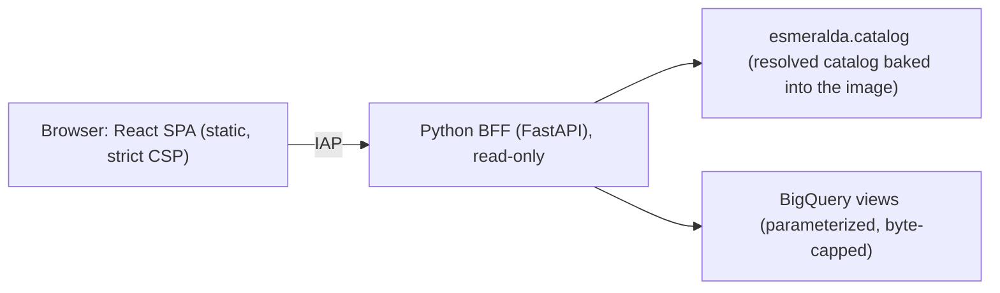

# 2.7 Esmeralda Console

The **Esmeralda console** is a read-only web UI for the platform. It shows three things the CLI and
BigQuery already know, in one place:

| View | What it shows | Where the data comes from |
| :--- | :--- | :--- |
| **Service Catalog** | Every target (agents, MCP servers, models, external APIs), its owner team, the gateway it sits behind, who may call it and who pays for each caller | The resolved catalog, through `esmeralda.catalog` (the same resolver as `esmeralda catalog show`) |
| **FinOps & Audit** | Monthly chargeback per billed team, agent and model; the security audit trail (IAM changes, secret access, agent deployments) | BigQuery views `vw_monthly_agent_chargeback` and `vw_security_audit_trail` ([2.3](03-centralized-monitoring-and-dashboards.md)) |
| **Traces** | Recent traced requests and the waterfall of one request: each hop's gateway and workload records, tokens, caller verification and status | BigQuery `vw_usage_billable` and `usage_events` ([2.5](05-usage-telemetry-contract.md)) |

> [!NOTE]
> This page covers the app and running it locally. Deploying it (a Terraform unit behind the private
> entry point with IAP, a least-privilege service account, and the image promoted by digest) comes in a
> follow-up.

---

## 1. Architecture



* **One source of truth.** The browser never re-implements platform logic. The backend-for-frontend
  (BFF, `apps/frontends/esmeralda-ui/api`) imports the `esmeralda` package: the catalog view is
  `esmeralda.catalog.show()`, the same function behind `esmeralda catalog show`, and usage comes from
  the existing BigQuery views. A catalog or usage change lands once.
* **Read-only by construction.** The BFF accepts only `GET` and `HEAD`, refuses request bodies, runs
  only fixed `SELECT` statements, and never emits `esmeralda.usage` records: the console consumes no
  tokens, so it bills nothing.
* **Contract between the two halves.** The BFF publishes its OpenAPI document
  (`apps/frontends/esmeralda-ui/openapi.json`) and the web's TypeScript types are generated from it with
  `openapi-typescript`. Tests on both sides fail when either file is stale, so the UI can't use a
  field the API doesn't have.
* **One image, Node at build time only.** A multi-stage Dockerfile builds the web with Node (lockfile,
  no install scripts) and copies the static bundle into a Python image that runs the BFF as a non-root
  user. Base images are pinned by digest.

## 2. Security model

| Concern | What the console does |
| :--- | :--- |
| **Identity** | Every request except `/healthz` must carry the IAP assertion (`x-goog-iap-jwt-assertion`). The BFF verifies its ES256 signature against IAP's public keys, the issuer, the audience (from configuration) and the expiry; anything else is a `401`. There is no default identity, and no header (such as the IAP email header) can stand in for the JWT. |
| **Local runs** | `esmeralda ui --local` uses a fixed development identity, shown as "Local dev identity (not verified)". It binds to `127.0.0.1` only and refuses to start on Cloud Run. |
| **Browser** | Strict Content Security Policy: `default-src 'self'`, no inline scripts or event handlers, no external fonts or CDNs, `frame-ancestors 'none'`; plus `X-Content-Type-Options`, `Referrer-Policy` and `X-Frame-Options`. React renders every value as text (no raw HTML anywhere in the app). |
| **Queries** | Table names are validated identifiers from configuration; every value (month, team, trace ID, window) is a typed BigQuery query parameter. Each job sets `maximum_bytes_billed`. Trace IDs must match `^[0-9a-f]{32}$` before any query runs. |
| **Errors** | Generic messages (`{"error": "data source unavailable"}`); details go to the server log only. |
| **Honest data** | Synthetic data exists only in an explicit demo mode and every view then shows a "Demo data" badge. With no data source configured, the data views show an error state: never silent sample data. The catalog fails closed (`503`) if the baked resolved catalog doesn't match its sources. |

## 3. Running it locally

Prerequisites: the workspace bootstrapped (`make bootstrap`) and, to build the web, Node 24 with npm.

Build the web once (or after changing it):

```bash
npm ci --prefix apps/frontends/esmeralda-ui/web
npm run build --prefix apps/frontends/esmeralda-ui/web
```

Then start the console on `http://127.0.0.1:8090`, with synthetic data:

```bash
uv run esmeralda ui --local --demo
make ui DEMO=1
```

or read-only against an environment's BigQuery views, with your Application Default Credentials (the
project is the environment's governance project from the layer-1 outputs, the dataset
`esmeralda_telemetry_logs_<env>`; your identity needs read access to that dataset and permission to run
query jobs):

```bash
uv run esmeralda ui --local --bigquery --env dev
make ui BQ=1 ENV=dev
```

To work on the web with hot reload, keep the console running and start the Vite dev server, which
proxies `/api` to it:

```bash
npm run dev --prefix apps/frontends/esmeralda-ui/web
```

## 4. API

All endpoints are `GET`, read-only, and need an identity (except `/healthz`):

| Endpoint | Returns |
| :--- | :--- |
| `/api/me` | The verified identity (email), how it was verified (`iap` or `local-dev`), the environment, and whether demo mode is on |
| `/api/catalog`, `/api/catalog/{target}` | The resolved catalog: targets, owner teams, callers and who pays, teams, policy |
| `/api/usage?month=YYYY-MM&team=<team>` | Chargeback rows from `vw_monthly_agent_chargeback`, plus totals per billed team |
| `/api/audit?days=7&limit=100` | Rows from `vw_security_audit_trail` |
| `/api/traces?days=1` | Recent traced requests from `vw_usage_billable` |
| `/api/traces/{trace_id}?days=7` | The usage records of one trace from `usage_events`, as a waterfall |
| `/healthz` | Liveness |

Every data response carries `source`: `bigquery` or `demo`.

## 5. Configuration

The BFF reads `ESMERALDA_UI_*` environment variables (the image sets the paths; the deployment sets
the rest):

| Variable | Meaning |
| :--- | :--- |
| `ESMERALDA_UI_MODE` | `cloud` (default; IAP required) or `local` (fixed local identity, loopback only) |
| `ESMERALDA_UI_IAP_AUDIENCE` | Expected `aud` of the IAP JWT: `/projects/<number>/global/backendServices/<id>` behind a load balancer. Required in cloud mode |
| `ESMERALDA_UI_ENV` | Catalog environment (default `dev`) |
| `ESMERALDA_UI_CATALOG_ROOT` | Directory holding `catalog/` and `contracts/` (baked into the image) |
| `ESMERALDA_UI_BQ_PROJECT`, `ESMERALDA_UI_BQ_DATASET` | Project and dataset of the usage views; both or neither |
| `ESMERALDA_UI_BQ_LOCATION`, `ESMERALDA_UI_BQ_MAX_BYTES_BILLED` | Optional BigQuery location and per-query byte cap (default 1 GiB) |
| `ESMERALDA_UI_DEMO` | `true` for synthetic data (badged); off by default |
| `ESMERALDA_UI_STATIC_DIR` | Built web bundle (baked into the image) |

## 6. Tests

```bash
make test-ui-api
make test-ui
```

`make test-ui-api` runs the BFF tests (identity and `401`s with throwaway signing keys, security
headers, parameterized queries against a fake BigQuery client, trace ID validation, catalog fail-closed,
no usage emission, `openapi.json` drift). `make test-ui` adds the web checks: strict `tsc --noEmit`,
Vitest with Testing Library (including the generated types drift check), and the production build. The
Console GitHub Actions workflow runs both on every change to the app.
