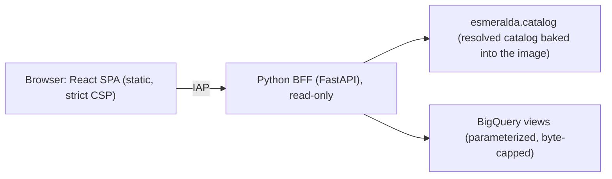
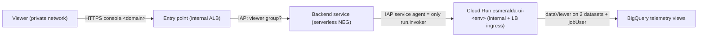

# 2.7 Esmeralda Console

The **Esmeralda console** is a read-only web UI for the platform. It shows three things the CLI and
BigQuery already know, in one place:

| View | What it shows | Where the data comes from |
| :--- | :--- | :--- |
| **Service Catalog** | Every target (agents, MCP servers, models, external APIs), its owner team, the gateway it sits behind, who may call it and who pays for each caller | The resolved catalog, through `esmeralda.catalog` (the same resolver as `esmeralda catalog show`) |
| **FinOps & Audit** | Monthly chargeback per billed team, agent and model; the security audit trail (IAM changes, secret access, agent deployments) | BigQuery views `vw_monthly_agent_chargeback` and `vw_security_audit_trail` ([2.3](03-centralized-monitoring-and-dashboards.md)) |
| **Traces** | Recent traced requests and the waterfall of one request: each hop's gateway and workload records, tokens, caller verification and status | BigQuery `vw_usage_billable` and `usage_events` ([2.5](05-usage-telemetry-contract.md)) |

> [!NOTE]
> The console is **off by default** in every environment. Deploying it ([section 4](#4-deploying-it))
> takes one `env.yaml` switch and an existing viewer group of your organization.

---

## 1. Architecture



* **One source of truth.** The browser never re-implements platform logic. The backend-for-frontend
  (BFF, `apps/frontends/esmeralda-ui/api`) imports the `esmeralda` package: the catalog view is
  `esmeralda.catalog.show()`, the same function behind `esmeralda catalog show`, and usage comes from
  the existing BigQuery views. A catalog or usage change lands once.
* **Read-only by construction.** The BFF accepts only `GET` and `HEAD`, refuses request bodies, runs
  only fixed `SELECT` statements, and never emits `esmeralda.usage` records: the console consumes no
  tokens, so it bills nothing.
* **Contract between the two halves.** The BFF publishes its OpenAPI document
  (`apps/frontends/esmeralda-ui/openapi.json`) and the web's TypeScript types are generated from it with
  `openapi-typescript`. Tests on both sides fail when either file is stale, so the UI can't use a
  field the API doesn't have.
* **One image, Node at build time only.** A multi-stage Dockerfile builds the web with Node (lockfile,
  no install scripts) and copies the static bundle into a Python image that runs the BFF as a non-root
  user. Base images are pinned by digest.

## 2. Security model

| Concern | What the console does |
| :--- | :--- |
| **Identity** | Every request except `/healthz` must carry the IAP assertion (`x-goog-iap-jwt-assertion`). The BFF verifies its ES256 signature against IAP's public keys, the issuer, the audience (from configuration) and the expiry; anything else is a `401`. There is no default identity, and no header (such as the IAP email header) can stand in for the JWT. |
| **Local runs** | `esmeralda ui --local` uses a fixed development identity, shown as "Local dev identity (not verified)". It binds to `127.0.0.1` only and refuses to start on Cloud Run. |
| **Browser** | Strict Content Security Policy: `default-src 'self'`, no inline scripts or event handlers, no external fonts or CDNs, `frame-ancestors 'none'`; plus `X-Content-Type-Options`, `Referrer-Policy` and `X-Frame-Options`. React renders every value as text (no raw HTML anywhere in the app). |
| **Queries** | Table names are validated identifiers from configuration; every value (month, team, trace ID, window) is a typed BigQuery query parameter. Each job sets `maximum_bytes_billed`. Trace IDs must match `^[0-9a-f]{32}$` before any query runs. |
| **Errors** | Generic messages (`{"error": "data source unavailable"}`); details go to the server log only. |
| **Honest data** | Synthetic data exists only in an explicit demo mode and every view then shows a "Demo data" badge. With no data source configured, the data views show an error state: never silent sample data. The catalog fails closed (`503`) if the baked resolved catalog doesn't match its sources. |

## 3. Running it locally

Prerequisites: the workspace bootstrapped (`make bootstrap`) and, to build the web, Node 24 with npm.

Build the web once (or after changing it):

```bash
npm ci --prefix apps/frontends/esmeralda-ui/web
npm run build --prefix apps/frontends/esmeralda-ui/web
```

Then start the console on `http://127.0.0.1:8090`, with synthetic data:

```bash
uv run esmeralda ui --local --demo
make ui DEMO=1
```

or read-only against an environment's BigQuery views, with your Application Default Credentials (the
project is the environment's governance project from the layer-1 outputs, the dataset
`esmeralda_telemetry_logs_<env>`; your identity needs read access to that dataset and permission to run
query jobs):

```bash
uv run esmeralda ui --local --bigquery --env dev
make ui BQ=1 ENV=dev
```

To work on the web with hot reload, keep the console running and start the Vite dev server, which
proxies `/api` to it:

```bash
npm run dev --prefix apps/frontends/esmeralda-ui/web
```

## 4. Deploying it

The Terraform unit `layer-5-workloads/frontends/esmeralda-ui` (module
`infrastructure/modules/5-workloads/frontends/esmeralda-ui`) runs the console on Cloud Run in the
**gateway project**, next to the entry point. The console is a caller-side front end, not a catalog
target, so it lives under `frontends/` and not in the MCP tools project.



| Aspect | How it is deployed |
| :--- | :--- |
| **Exposure** | Cloud Run ingress `INGRESS_TRAFFIC_INTERNAL_LOAD_BALANCER`: no public endpoint. The entry point serves it as `console.<domain>` (the existing `*.<domain>` DNS record and certificate cover it), so viewers need private network reach to the entry point (VPN, Interconnect or a host in the VPC) and must trust the internal Root CA. |
| **Authentication** | IAP on the console's regional backend service. IAP uses its Google-managed OAuth client, which admits identities of your organization. The app verifies the IAP JWT on every request; its expected audience (`ESMERALDA_UI_IAP_AUDIENCE`) is computed from the backend service by Terraform. |
| **Access** | `roles/iap.httpsResourceAccessor` on that backend service for **existing groups only** (`iap_accessors`). Terraform rejects `allUsers`, `allAuthenticatedUsers`, `user:` and service accounts; `domain:` needs `allow_domain_accessors = true`. Esmeralda never creates groups: the group owner manages membership. An apply with no accessor fails instead of revoking everyone. |
| **Invocation** | Only the IAP service agent holds `roles/run.invoker` on the service, so nothing that bypasses IAP can call it (`invoker_iam_disabled` exists as a fallback; the app still rejects requests without a valid IAP JWT). |
| **Identity and data** | Dedicated service account `sa-esmeralda-ui-<env>` with `roles/bigquery.dataViewer` on the telemetry dataset and on the usage dataset (the views read its landing tables) and `roles/bigquery.jobUser` on the governance project. No project-wide viewer, no logging access, no Secret Manager. It is registered as the catalog caller `esmeralda-ui` (team `platform`) and calls no target yet. |
| **Image** | `esmeralda build esmeralda-ui` (part of `esmeralda build images`) builds it from the repository root; deployments pin the digest (dev: the tag resolved at plan time; prd: `release/prd.yaml`, written by `esmeralda release promote`), and `esmeralda build --verify` checks the running digest. |

### Enable it

1. Pick (or have your directory admin create) a group for console viewers, for example
   `esmeralda-console-viewers@example.com`, and add the people who need the console.
2. In `infrastructure/live/<env>/env.yaml`:

    ```hcl
    frontends = {
      esmeralda_ui = {
        enabled                = true
        host                   = "console"
        iap_accessors          = ["group:esmeralda-console-viewers@example.com"]
        allow_domain_accessors = false
      }
    }
    ```

    To keep the group out of the repository, leave `iap_accessors = []` and set
    `ESMERALDA_UI_IAP_ACCESSORS=group:<email>` (comma-separated for several) in the user-local env file
    (`~/.config/esmeralda/env`). Use one stable group for everyone who applies, so access doesn't depend on
    who ran the last apply.

3. Build the image (if the environment has none yet), then deploy the unit and the entry point:

    ```bash
    uv run esmeralda build esmeralda-ui
    uv run esmeralda deploy frontends/esmeralda-ui entrypoint --env dev
    uv run esmeralda ui --url --env dev
    ```

4. Open the printed URL from a network that reaches the entry point. Members of the group sign in;
   everyone else gets IAP's access-denied page.

For `prd`, promote a verified dev build first (`esmeralda release promote`), so the console runs the
promoted digest from `release/prd.yaml`.

> [!IMPORTANT]
> **Viewers outside your organization.** Domain Restricted Sharing (`iam.allowedPolicyMemberDomains`)
> decides which identities may hold IAM grants, and Esmeralda doesn't work around it. For partners or
> auditors, either have your directory admins add them to the viewer group under your own
> external-member policy, or configure IAP with Identity Platform (external identities) outside this
> module.

## 5. Operating it (runbook)

| Task | How |
| :--- | :--- |
| Find the URL | `uv run esmeralda ui --url --env <env>` (from the checkout that holds the state, or `--repo <checkout>`) |
| Grant or revoke access | Change the group's membership. No apply needed. |
| Change the viewer group | Edit `iap_accessors` (or `ESMERALDA_UI_IAP_ACCESSORS`), then `uv run esmeralda apply frontends/esmeralda-ui --env <env>` |
| Roll out a new build | `uv run esmeralda build esmeralda-ui`, then `uv run esmeralda apply frontends/esmeralda-ui --env dev` (the plan shows the new digest); prd: promote, merge `release/prd.yaml`, apply |
| Check the running image | `uv run esmeralda build --verify --env <env>` |
| Logs | Cloud Run service `esmeralda-ui-<env>` in the gateway project (the BFF logs errors server-side only; the browser gets generic messages) |
| `401` from the app behind IAP | The audience doesn't match: compare `ESMERALDA_UI_IAP_AUDIENCE` (unit output `iap_audience`) with the **Signed Header JWT Audience** of the backend service on the IAP page, and set `iap_audience_override` if they differ |
| `403` from IAP | The viewer is not in an `iap_accessors` group (membership can take a few minutes to apply) |
| Data views show an error | Check that the layer-4 views exist and that the service account still holds the two dataset grants |
| Turn it off | Set `enabled = false`, apply the `entrypoint` (removes the host), then destroy the unit's resources with Terraform from the checkout that holds its state |

## 6. API

All endpoints are `GET`, read-only, and need an identity (except `/healthz`):

| Endpoint | Returns |
| :--- | :--- |
| `/api/me` | The verified identity (email), how it was verified (`iap` or `local-dev`), the environment, and whether demo mode is on |
| `/api/catalog`, `/api/catalog/{target}` | The resolved catalog: targets, owner teams, callers and who pays, teams, policy |
| `/api/usage?month=YYYY-MM&team=<team>` | Chargeback rows from `vw_monthly_agent_chargeback`, plus totals per billed team |
| `/api/audit?days=7&limit=100` | Rows from `vw_security_audit_trail` |
| `/api/traces?days=1` | Recent traced requests from `vw_usage_billable` |
| `/api/traces/{trace_id}?days=7` | The usage records of one trace from `usage_events`, as a waterfall |
| `/healthz` | Liveness |

Every data response carries `source`: `bigquery` or `demo`.

## 7. Configuration

The BFF reads `ESMERALDA_UI_*` environment variables (the image sets the paths; the Terraform unit sets
the rest):

| Variable | Meaning |
| :--- | :--- |
| `ESMERALDA_UI_MODE` | `cloud` (default; IAP required) or `local` (fixed local identity, loopback only) |
| `ESMERALDA_UI_IAP_AUDIENCE` | Expected `aud` of the IAP JWT: `/projects/<number>/<location>/backendServices/<id>` of the backend service behind the load balancer (computed by the unit). Required in cloud mode |
| `ESMERALDA_UI_ENV` | Catalog environment (default `dev`) |
| `ESMERALDA_UI_CATALOG_ROOT` | Directory holding `catalog/` and `contracts/` (baked into the image) |
| `ESMERALDA_UI_BQ_PROJECT`, `ESMERALDA_UI_BQ_DATASET` | Project and dataset of the usage views; both or neither |
| `ESMERALDA_UI_BQ_LOCATION`, `ESMERALDA_UI_BQ_MAX_BYTES_BILLED` | Optional BigQuery location and per-query byte cap (default 1 GiB) |
| `ESMERALDA_UI_DEMO` | `true` for synthetic data (badged); off by default |
| `ESMERALDA_UI_STATIC_DIR` | Built web bundle (baked into the image) |

## 8. Tests

```bash
make test-ui-api
make test-ui
```

`make test-ui-api` runs the BFF tests (identity and `401`s with throwaway signing keys, security
headers, parameterized queries against a fake BigQuery client, trace ID validation, catalog fail-closed,
no usage emission, `openapi.json` drift). `make test-ui` adds the web checks: strict `tsc --noEmit`,
Vitest with Testing Library (including the generated types drift check), and the production build. The
Console GitHub Actions workflow runs both on every change to the app. `tests/guards/test_frontend_guards.py`
(part of `make test-guards`) checks the deployment: no public Cloud Run ingress anywhere, IAP on every
frontend backend service, the `iap_accessors` validation (evaluated with Terraform), no Cloud Identity
groups, and the console service account's role list.
