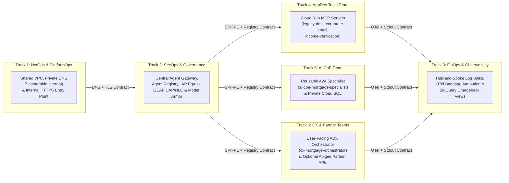
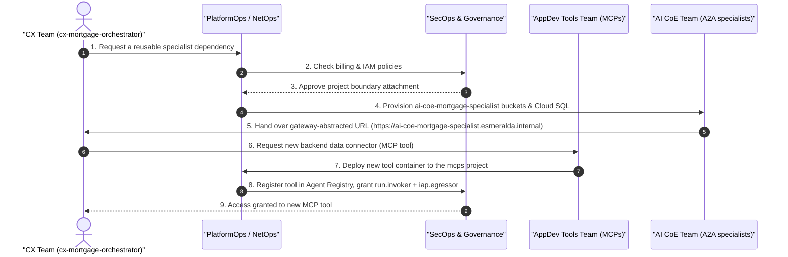
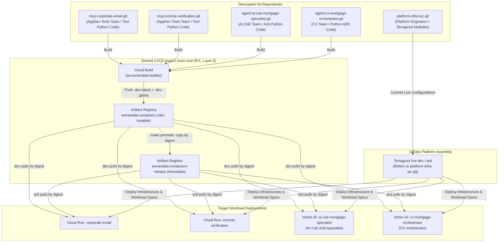
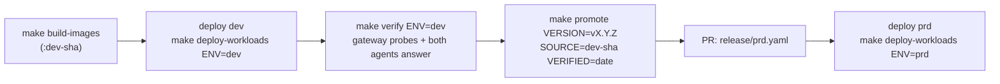

# 2.0 Governance, Identity & AgentOps — Overview & Release Lifecycle (Layer 4)

In **[1. Workloads, Catalog & Gateways](../2-workloads-and-catalog/index.md)**, we met the cast of runtime workloads in Layer 5: `cx-mortgage-orchestrator`, `ai-coe-mortgage-specialist`, the three Cloud Run MCP tool servers (`legacy-dms`, `income-verification`, `corporate-email`), the internal HTTPS entry point (`*.esmeralda.internal`), and the optional **Apigee X** partner front door (`partner.esmeralda.internal`).

Now, in **Section 2**, we step into **Layer 4 (`layer-4-governance`)** and the day-to-day operational rhythm of **AgentOps**. Before a single line of agent or MCP tool code is allowed to handle a customer conversation in Layer 5, Layer 4 establishes the **Trust Boundary**: the central egress control plane, semantic policy guardrails, and cross-project FinOps telemetry hub that govern every action an agent takes.

---

## Subsections in Section 2

| Subsection | Title & Focus | Who Should Read This |
| :--- | :--- | :--- |
| **[2.1 Zero-Trust Egress & The Central Agent Gateway](./01-central-agent-gateway.md)** | Follows Julian Sterling's mortgage request as `cx-mortgage-orchestrator` and `ai-coe-mortgage-specialist` make outbound calls. Explains why enterprise AI requires a deny-by-default egress proxy (`AGENT_TO_ANYWHERE`), per-target SPIFFE `principal://` IAP authorization, and an internal Root CA—followed by the complete, preserved technical deep dive and reference. | Security Architects, NetOps, Platform Engineers, Agent Developers |
| **[2.2 Capability-Based & Semantic Governance](./04-capability-based-governance.md)** | Explains how Esmeralda prevents the "Confused Deputy" problem at the tool layer using **GEAP Unified Access Policies (UAPs)** and **Natural Language Constraints (NLC)**, why governance is declared by capability (`governance.capabilities` in `env.yaml`), and how optional **Apigee X** capabilities (`partner-agents`, `partner-mcp`, `token-quota`, `usage-metering`) plug in when external B2B partner APIs are needed. | CISOs, Governance Leads, API Product Managers, SecOps |
| **[2.3 FinOps, Telemetry & Cross-Team Chargeback](./03-centralized-monitoring-and-dashboards.md)** | Shows how a CFO and Engineering VP trace the exact token cost, cache savings, and latency of Julian Sterling's mortgage inquiry across two separate teams' GCP projects using OpenTelemetry baggage (`caller.project_id`, `caller.agent_name`), central Cloud Logging sinks, BigQuery views (`vw_monthly_agent_chargeback`), and Golden Signals dashboards. | FinOps Leads, CFO / Engineering Leadership, SREs |
| **[2.4 Day-2 Operations with the `esmeralda` CLI & MCP Server](./04-operating-with-agents.md)** | Walks through day-to-day platform operations—both for human engineers and AI coding assistants—using `uv run esmeralda` (`status`, `doctor`, `units`, `plan`, `apply` with the destroy guard, `verify`, `logs`, `contracts`, `guard`) and the read-only `uv run esmeralda mcp` server. | Platform Operators, SREs, Developers using AI Coding Assistants |

---

## Why Multi-Track Layered Parallelism Matters

In many organizations, the first AI agent prototype succeeds in a single notebook—and then stalls for six months on the road to production. Why? Because every team gets locked into a single, serialized delivery queue:

* The **Customer Experience (CX) team** wants to iterate on conversational prompts every afternoon.
* The **AI Center of Excellence (AI CoE)** is refining underwriting rules and database schemas for reusable specialist agents.
* The **AppDev Tools team** is wrapping legacy banking systems into Model Context Protocol (MCP) microservices.
* **SecOps and Governance** need cryptographic proof that a prompt injection cannot exfiltrate Social Security Numbers or call unauthorized endpoints.
* **FinOps** needs to know which business unit is spending tokens when a front-door agent delegates work to a shared specialist agent.
* **Partner API teams** want to package selected capabilities for external mortgage brokers with rate limits and monetization.

If these six tracks are coupled into a single project or a single deployment step, the fastest team moves at the speed of the slowest approval gate.

Esmeralda replaces serialized bottlenecks with **Multi-Track Layered Parallelism**. Each team works in its own dedicated GCP project (and, in production, its own Git repository), connected only through **explicit, versioned platform contracts**:



### Who Owns What: Engineering Roles and Project Boundaries

Every track maps cleanly to a dedicated GCP project and `team` cost-allocation label:

| Engineering Track (`team` label) | Primary Responsibility | Owned GCP Project | Contract Surface With Other Tracks |
| :--- | :--- | :--- | :--- |
| **NetOps** (`netops`) | Shared VPC, subnets, Cloud NAT, Private DNS (`esmeralda.internal.`). | `esm-<env>-net-host-<sfx>` | Publishes the reserved internal VIP (`ilb-esmeralda-vip-<env>`) and wildcard DNS (`*.esmeralda.internal`). |
| **PlatformOps** (`platformops`) | Private internal HTTPS entry point and optional gateway adapters (`direct`, `envoy`). | `esm-<env>-gateway-<sfx>` | Routes `https://<service>.esmeralda.internal` to the target backend based on the `catalog` block in `env.yaml`. |
| **SecOps & Governance** (`security-and-platformops`) | Central Agent Gateway, Agent Registry, GEAP UAP/NLC policies, Model Armor, KMS, Secret Manager, BigQuery telemetry hub. | `esm-<env>-governance-<sfx>` | Publishes the `agw_root_ca_bundle`, evaluates SPIFFE `principal://` identities against Agent Registry & IAP, and collects spoke logs. |
| **Platform Engineering** | Shared CI/CD pipelines and container registries (Layer 0). | `esm-cicd-<sfx>` | Builds environment-neutral container images (`esmeralda-containers`) and promotes immutable `sha256` digests (`esmeralda-containers-release`). |
| **AppDev Tools Team** (`appdev-tools`) | Enterprise data connectors and MCP tool servers on Cloud Run. | `esm-<env>-mcps-<sfx>` | Exposes stateless MCP servers (`legacy-dms`, `income-verification`, `corporate-email`) behind `https://<svc>.esmeralda.internal/mcp`. |
| **AI CoE Team** (`ai-coe`) | Reusable A2A domain specialists and private relational state. | `esm-<env>-ai-coe-agents-<sfx>` | Publishes `ai-coe-mortgage-specialist` and its A2A Agent Card at `https://ai-coe-mortgage-specialist.esmeralda.internal`. |
| **CX Team** (`cx`) | User-facing conversational orchestrators (ADK). | `esm-<env>-cx-agents-<sfx>` | Consumes the specialist via `A2A_AGENT_URL` without ever knowing its underlying engine ID, database IP, or MCP tool implementation. |

Notice the decoupling between the **CX Team** and the **AI CoE Team**: `cx-mortgage-orchestrator` never calls `ai-coe-mortgage-specialist` by a raw Vertex AI Reasoning Engine resource ID, and it never calls MCP tools directly. It calls `https://ai-coe-mortgage-specialist.esmeralda.internal`, and the request flows through the **Central Agent Gateway** and the private **entry point** (see [2.1 Central Agent Gateway §4.2](./01-central-agent-gateway.md#4-life-of-a-request)). The AI CoE team can redeploy, scale, or replace its specialist engine at 2:00 PM without requiring a single configuration change or redeployment from the CX team.

---

## Why We Built the AgentOps Lifecycle This Way

Before diving into the repository layout and release pipeline, here are the core architectural decisions that shape Section 2:

| Architectural Decision | The Problem It Solves | Why Esmeralda Chose This Approach |
| :--- | :--- | :--- |
| **ADR-07: Central Agent Gateway (`AGENT_TO_ANYWHERE`) + SPIFFE Identity over Direct Cloud NAT** | Standard Cloud NAT allows a prompt-injected agent to exfiltrate customer PII to arbitrary external servers or enter runaway token loops without per-agent visibility. | Every Reasoning Engine runs with an attested SPIFFE `AGENT_IDENTITY`. All outbound calls traverse the Central Agent Gateway in `esm-<env>-governance-<sfx>`, which enforces deny-by-default Agent Registry allowlisting, IAP `roles/iap.egressor` checks, GEAP Semantic Governance (NLC), and optional Model Armor inspection. |
| **ADR-08: Decoupled Multi-Track Repositories Bound by Immutable `sha256` Digests** | Putting platform Terraform, MCP microservices, and multiple teams' agents into a single monolithic release cycle means a tiny email tool tweak forces a full re-test of every agent—or worse, gives application developers IAM access to KMS and VPC state. | Production teams work in decoupled repositories (Platform IaC, MCP Tools, Specialist Agents, Orchestrator Agents) that publish environment-neutral containers to Layer 0 Artifact Registry and bind into environments exclusively via immutable `@sha256:...` digests. |
| **Environment-Neutral BYOC Containers + Deploy-Time CA Injection** | Baking `dev` certificates or URLs into a container image makes it impossible to promote the exact same binary artifact to `prd`. | Images contain zero certificates or environment URLs. Layer 4 assembles the gateway inspection roots + internal Root CA into `AGENT_GATEWAY_ROOT_CERTIFICATES`, and `esmeralda run` installs them into the container's system trust store at startup (see [2.1 Central Agent Gateway §6](./01-central-agent-gateway.md#6-bring-your-own-container-byoc)). |

---

## Multi-Track Coordination in Action

How do these independent teams collaborate when Julian Sterling's mortgage experience needs a new capability? Let's trace a realistic cross-team workflow where the CX team needs a reusable mortgage specialist backed by a new MCP document connector:



1. **Workload Request**: The CX team requests a domain specialist capable of underwriting mortgages.
2. **Platform & Security Review**: PlatformOps and SecOps verify project boundaries, budget alerts, and identity separation.
3. **Infrastructure Provisioning**: PlatformOps provisions the private Cloud SQL PostgreSQL instance (with its zero-bastion schema bootstrap job), GCS buckets, and service accounts in `esm-<env>-ai-coe-agents-<sfx>`.
4. **Stable Endpoint Handoff**: The AI CoE team deploys `ai-coe-mortgage-specialist`, which registers its **agent card** in the governance Agent Registry. PlatformOps applies `gateways/direct` (`make deploy-gateway`) and `entrypoint` (`make deploy-entrypoint`) so `ai-coe-mortgage-specialist.esmeralda.internal` routes to the new engine. The CX team receives only the stable URL `https://ai-coe-mortgage-specialist.esmeralda.internal` (`A2A_AGENT_URL`).
5. **Tool Request & Deployment**: When the specialist needs access to legacy loan files, the AppDev Tools team builds `legacy-dms` in `esm-cicd-<sfx>` and deploys it as an internal-LB Cloud Run service in `esm-<env>-mcps-<sfx>`, registered in Agent Registry as `https://legacy-dms.esmeralda.internal/mcp`.
6. **Least-Privilege Access Grant**: PlatformOps lists the allowed `callers` in the `catalog` block of `env.yaml` and runs the `services/iap-egress` unit (`make deploy-iap-egress`), granting `roles/run.invoker` and per-target `roles/iap.egressor` only to the authorized agent identity.

---

## The Decoupled Multi-Repository Strategy

While this open-source blueprint lives in a single repository so you can clone, explore, and deploy it in one sitting, running a multi-team enterprise platform inside a single monorepo creates release coupling and IAM privilege creep. For enterprise production, Esmeralda is designed to split cleanly across **decoupled repository classes** bound together by Layer 0 Artifact Registry digests:



### Directory-to-Repository Migration Map

When transitioning from this reference repository to decoupled team repositories, split folders along these exact boundaries:

| Blueprint Folder (Monorepo) | Target Production Git Repository | Deployment Endpoint |
| :--- | :--- | :--- |
| `infrastructure/modules/0-cicd/`<br/>`infrastructure/modules/1-projects/`<br/>`infrastructure/modules/2-networking/`<br/>`infrastructure/modules/3-security/`<br/>`infrastructure/modules/4-governance/`<br/>`infrastructure/modules/5-workloads/`<br/>`infrastructure/live/` | **`platform-infra-iac.git`** | GCP Projects, VPCs, KMS Keys, IAM Policies, and Terragrunt orchestrations |
| `apps/services/envoy/` (optional adapter) | **`platform-infra-iac.git`** (or a dedicated `gateway-envoy.git`) | Cloud Run Service: `envoy-gateway-{env}` in `esm-<env>-gateway-<sfx>` (only when `envoy` is in `gateways.enabled`) |
| `apps/services/corporate-email/` | **`mcp-corporate-email.git`** | Cloud Run Service: `corporate-email-{env}` in `esm-<env>-mcps-<sfx>` |
| `apps/services/income-verification/` | **`mcp-income-verification.git`** | Cloud Run Service: `income-verification-{env}` in `esm-<env>-mcps-<sfx>` |
| `apps/services/legacy-dms/` | **`mcp-legacy-dms.git`** | Cloud Run Service: `legacy-dms-{env}` in `esm-<env>-mcps-<sfx>` |
| `apps/agents/ai-coe-mortgage-specialist/` | **`agent-ai-coe-mortgage-specialist.git`** | Vertex AI Reasoning Engine in `esm-<env>-ai-coe-agents-<sfx>` |
| `apps/agents/cx-mortgage-orchestrator/` | **`agent-cx-mortgage-orchestrator.git`** | Vertex AI Reasoning Engine in `esm-<env>-cx-agents-<sfx>` |

### The Parameter Linkage Pattern

Application repositories never execute Terraform against cloud projects directly. Instead, `platform-infra-iac.git` acts as the declarative binder. Each environment declares **which images to run** in `infrastructure/live/<env>/env.yaml`:

```hcl
# infrastructure/live/<env>/env.yaml (HCL locals, read by Terragrunt)
image_repository = "dev"         # dev → esmeralda-containers; prd uses "release" → esmeralda-containers-release
container_tag    = "dev-latest"  # prd: fallback only, used while release/prd.yaml does not exist
# prd only: every image pinned by digest from the release manifest (see "From dev to prd: Immutable Digest Promotion")
image_digests    = try(yamldecode(file("${get_repo_root()}/release/prd.yaml")).images, {})
```

Terragrunt constructs each workload's container URI from the Layer 0 repository outputs plus either the immutable digest in `image_digests` (`<repo>/<image>@sha256:...`) or the tag (`<repo>/<image>:<container_tag>`):

#### 1. Tool Container Image (`live/<env>/layer-5-workloads/services/legacy-dms/terragrunt.hcl`)
```hcl
locals {
  name    = basename(get_terragrunt_dir())                                      # catalog key: legacy-dms
  callers = try(local.env_vars.locals.catalog[local.name].callers, [])
  # Callers that are catalog agents (they call with their own Agent Identity), and the rest.
  agent_callers = [
    for caller in local.callers : caller
    if contains(["a2a", "adk"], try(local.env_vars.locals.catalog[caller].kind, ""))
  ]
  # Deprecated fallback (env.yaml legacy_shared_invoker): agents impersonate the shared invoker again.
  legacy_shared_invoker = try(local.env_vars.locals.legacy_shared_invoker, false)
}

inputs = {
  container_image   = "${<dev or release repository_url from layer-0-cicd>}/${local.image_ref}" # legacy-dms@sha256:... or legacy-dms:<tag>
  internal_hostname = "${local.name}.${dependency.networking.outputs.entrypoint_domain}"        # Agent Registry URL

  # run.invoker: each agent caller's Agent Identity principal (resolved through identity_refs), the
  # service accounts of the other callers (apigee-partner-mcp: the Apigee proxy runtime SA), and the
  # SA of each enabled adapter. legacy_shared_invoker adds the shared MCP invoker SA instead.
  invoker_service_accounts = distinct(compact(concat(
    [for caller in local.agent_callers : "${local.env_vars.locals.catalog[caller].unit}:agent_identity_principal"],
    [for caller in local.callers : (
      caller == "apigee-partner-mcp"
      ? (local.apigee_partner ? dependency.apigee.outputs.proxy_runtime_sa_email : "")
      : dependency.security.outputs["${replace(caller, "-", "_")}_sa_email"]
    ) if !contains(local.agent_callers, caller)],
    local.legacy_shared_invoker && length(local.agent_callers) > 0 ? [dependency.security.outputs.mcp_invoker_sa_email] : [],
    contains(local.gateways.enabled, "envoy") ? [try(dependency.security.outputs.envoy_sa_email, "")] : [],
  )))
}
```

#### 2. Agent Container Digest Pinning (`live/<env>/layer-5-workloads/agents/ai-coe-mortgage-specialist/terragrunt.hcl`)
To prevent silent container drift and guarantee that Vertex AI Agent Runtime executes the exact binary validated by the owning team, the agent modules always deploy `image@sha256:...`. A digest from `release/prd.yaml` is passed straight through, while a mutable `dev` tag is resolved to its **immutable SHA256 digest** at plan time (`data.google_artifact_registry_docker_image`):
```hcl
inputs = {
  agent_image_uri       = "${<dev or release repository_url>}/${local.image_ref}" # ai-coe-mortgage-specialist@sha256:... or :<tag>
  agent_service_account = dependency.security.outputs.ai_coe_mortgage_specialist_sa_email
}
```

---

## From `dev` to `prd`: Immutable Digest Promotion Pipeline

In traditional software delivery, rebuilding an image from a Git branch for `prd` risks subtle dependency drift. In AI agent systems, where a minor library update can alter tool serialization or prompt formatting, rebuilding for production is even riskier.

Esmeralda enforces a strict **Build Once, Promote by Digest** lifecycle. Container images are built once in an environment-neutral form, verified end-to-end in `dev`, and promoted byte-for-byte into `prd` through an auditable Git release manifest (`release/prd.yaml`):



### Step-by-Step Release Lifecycle

1. **Local Iteration & Unit Testing**:
   * Developers iterate locally using `make test-agents`, `make test-terraform`, `make run-mcp-local`, and `make test-*-local` (or `uv run esmeralda serve --local`).
   * Before committing, `.githooks/pre-commit` runs `uv run esmeralda guard --staged` to verify repo hygiene.
2. **Build Once in Shared CI/CD (`dev`)**:
   * `make build-*` (e.g., `make build-cx-mortgage-orchestrator` or `make build-images`) submits a Cloud Build job in the shared Layer 0 project `esm-cicd-<sfx>` using `sa-esmeralda-builder`.
   * The image is pushed to the **mutable dev repository** (`esmeralda-containers`) with two tags: `:dev-latest` and `:dev-<gitsha>`.
3. **Deploy and Verify in `dev`**:
   * `make deploy-workloads ENV=dev` (or `uv run esmeralda apply <unit> --env dev`) deploys Layer 5, resolving each tag to its `sha256` digest and running the serverless Cloud SQL schema bootstrap job.
   * `uv run esmeralda verify --env dev` (`make verify ENV=dev`) executes all gateway conformance probes through the internal entry point (`make test-gateway`) **plus** live end-to-end queries against both `ai-coe-mortgage-specialist` and `cx-mortgage-orchestrator` (`make test-e2e`).
4. **Promote by Digest (`make promote`)**:
   * Once `dev` verification passes, `make promote VERSION=vX.Y.Z SOURCE=dev-<gitsha> VERIFIED=<YYYY-MM-DD>` runs [`scripts/promote_release.sh`](../../../scripts/promote_release.sh).
   * It resolves the `sha256` digest of every workload image tagged `dev-<gitsha>`, copies those exact digests into the **immutable release repository** (`esmeralda-containers-release`) as `vX.Y.Z` (writable only by `sa-esmeralda-promoter`), and writes `release/prd.yaml`.
   * Re-running the same promotion is an idempotent no-op, while attempting to overwrite an existing `vX.Y.Z` tag with different bytes is rejected by both the script and Artifact Registry's immutable tag policy.
5. **Review and Merge the Release Manifest (`release/prd.yaml`)**:
   * The promoter opens a Pull Request with `release/prd.yaml`. Because the manifest stores only logical image names and `sha256` digests (never hardcoded project IDs; the registry URL comes from Layer 0 outputs, as documented in [`scripts/release_manifest.py`](../../../scripts/release_manifest.py)), reviewers see a crisp diff of which components changed, from which commit, and when `dev` verified them.
6. **Deploy and Audit `prd` (`make verify-images`)**:
   * After merging `release/prd.yaml`, `make deploy-workloads ENV=prd` reads `image_digests` from `infrastructure/live/prd/env.yaml` and deploys `<release_repository>/<image>@sha256:...`.
   * `make verify-images ENV=prd` inspects the live Cloud Run revisions and Vertex AI Reasoning Engines in `prd` and verifies that every running container digest matches `release/prd.yaml` (and `make status-release` displays the active manifest at any time).
7. **Instant, Deterministic Rollback**:
   * Rolling back `prd` is simply `git revert` on the `release/prd.yaml` PR followed by `make deploy-workloads ENV=prd`. Because `esmeralda-containers-release` is immutable, every historical release digest remains permanently available.

> [!TIP]
> **Production Roadmap Extensions:** In your enterprise CI/CD pipeline, you can wire Steps 1–4 into an automated post-merge workflow that opens the `release/prd.yaml` PR automatically after `make verify ENV=dev` succeeds, and pair `esmeralda-containers-release` with **Binary Authorization** so `prd` admits only cryptographically attested digests.

---

## Preview: Hub-and-Spoke Observability

How does Layer 4 observe all of these decoupled projects without giving developers direct access to production databases or raw infrastructure logs? Esmeralda uses a **hub-and-spoke telemetry model** (covered in full in [2.3 FinOps, Telemetry & Cross-Team Chargeback](./03-centralized-monitoring-and-dashboards.md)):

* **Spoke Sources**:
  * **MCP Tool Servers** on Cloud Run emit structured HTTP request logs and export OpenTelemetry metrics to the Cloud Telemetry API (`telemetry.googleapis.com`).
  * **AI Agent Reasoning Engines** emit single-line JSON events (`genai_token_consumption`, `mcp_tool_execution`) to `stdout` alongside OpenTelemetry trace spans enriched with `caller.project_id` and `caller.agent_name` baggage.
  * **Central Agent Gateway** records every outbound allow/deny decision (`logName:"gateway_requests"`) directly in the governance project.
* **Central Governance Hub (`esm-<env>-governance-<sfx>`)**:
  * Layer 4 installs a project-level log sink (`google_logging_project_sink`) in each of the five spoke projects (`net-host`, `gateway`, `mcps`, `ai-coe-agents`, `cx-agents`) that streams logs into the central BigQuery dataset `esmeralda_telemetry_logs_<env>`, and attaches all spoke projects to the governance Cloud Monitoring metrics scope.

Let's begin our tour of Layer 4 in **[2.1 Zero-Trust Egress & The Central Agent Gateway](./01-central-agent-gateway.md)**, where we follow Julian Sterling's mortgage application across the trust boundary.
