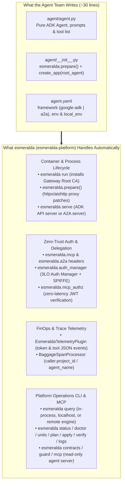
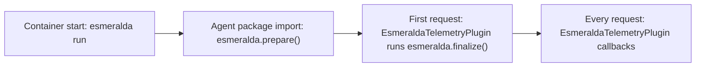

# Part IV: The `esmeralda` Runtime & Operations Library (`esmeralda-platform`)

## 1. The Story & Business Why: Keeping Every Agent at ~30 Lines of Pure Domain Logic

Suppose an AI engineer on the CX team wants to add a new skill to `cx-mortgage-orchestrator` to help **Julian Sterling** compare mortgage rates, or the AI CoE team wants to launch a second specialist agent. What should that engineer's workday look like?

Ideally, the engineer writes **~30 lines of pure domain logic**: an `agent/agent.py` file declaring the ADK `Agent`, its system instructions, and its tools or sub-agents, alongside a concise `agent.yaml` manifest.

In reality, running an enterprise agent inside a zero-trust bank environment requires solving half a dozen thorny operational problems on every single container startup and request:
* Installing the Layer 3 internal Root CA (`AGENT_GATEWAY_ROOT_CERTIFICATES`) into the Linux system trust store and Python's `certifi` bundle before any TLS connection opens.
* Patching `google-genai` onto `httpx` and configuring `aiohttp` so every outbound call honors the Central Agent Gateway's HTTPS egress proxy.
* Minting and caching Google ID tokens or OAuth2 access tokens, forwarding end-user OAuth tokens (`User-Auth-Token`), attaching the engine's SPIFFE identity (`X-Agent-Spiffe-Id`), and brokering 3-legged OAuth (3LO) credentials through Agent Identity Auth Manager (`esmeralda.auth_manager`).
* Emitting structured FinOps token events (`genai_token_consumption`) and tool latency events (`mcp_tool_execution`), while propagating `caller.project_id` and `caller.agent_name` across OpenTelemetry spans.
* Serving both `google-adk` (`adk api_server`) and `a2a` (A2A REST server with `AgentCard` URL pinning) identically on a workstation and in production.

Before the `esmeralda` library existed, each agent carried its own copy-pasted `entrypoint.sh`, telemetry callbacks, and monkey-patches. Those copies inevitably drifted apart—and worse, code wired onto `AdkApp` subclasses never even executed when the container launched `adk api_server` or an A2A server in production.

**We extracted [`packages/esmeralda`](../../../packages/esmeralda/README.md) (published on PyPI as `esmeralda-platform`, imported as `esmeralda`) so agent authors never write plumbing code again—and platform operators get a single, unified CLI (`uv run esmeralda ...`) and MCP server (`esmeralda mcp`) to operate the entire repository.**

* **[Usage guide](guide.md):** step-by-step patterns for adding `esmeralda` to an agent, serving ADK/A2A workloads, calling MCP servers and remote agents, brokering 3LO tokens, querying agents, and operating a checkout with `esmeralda mcp`.
* **[Package reference](reference.md):** complete API reference for every module, function, class, CLI subcommand, environment variable, and telemetry event schema.

---

## 2. Why We Built It This Way (Key Decisions & Rationale)

| Decision | Alternative Considered | Why We Chose This |
| :--- | :--- | :--- |
| **Shared Workspace & PyPI Package (`esmeralda-platform` / `import esmeralda`)** | Copy-pasting `entrypoint.sh`, auth helpers, and OTel callbacks into each agent directory | Eliminates code drift across teams; keeps every agent's `agent/__init__.py` to 4 lines and `agent/agent.py` focused 100% on business prompts and tools. |
| **Hook Only Universal Extension Points (`ENTRYPOINT`, import-time `prepare()`, ADK `App` plugin)** | Subclassing `AdkApp` or attaching per-agent `after_model_callback` | `adk api_server` and A2A servers bypass `AdkApp` subclasses in production. Using `esmeralda run` (`ENTRYPOINT`), `esmeralda.prepare()`, and `EsmeraldaTelemetryPlugin` guarantees identical behavior in Agent Runtime, Gemini Enterprise, A2A, and `adk web`. |
| **Runtime CA Injection (`esmeralda run`) Instead of Baking Certs into Dockerfiles** | `COPY root-ca.crt` inside `Dockerfile` during `docker build` | Baking an environment's CA into the image breaks immutable promotion from `dev` to `prd`. Injecting `AGENT_GATEWAY_ROOT_CERTIFICATES` at deploy time lets the exact same image digest run in every environment. |
| **Unified Runtime + Operations CLI (`uv run esmeralda ...` & `esmeralda mcp`)** | Separate bash scripts and raw `terragrunt`/`gcloud` one-liners | Gives human engineers (`esmeralda status/plan/apply/verify/query/logs`) and AI coding agents (`esmeralda mcp`) one structured, destroy-guarded interface backed by `esmeralda.ops`. |

---

## 3. Technical Architecture & In Practice

### Why Universal Extension Points Matter

The library hooks only into extension points that execute in **every** serving mode (local in-process runs, `adk web`, `adk api_server`, A2A servers, and Vertex AI Agent Runtime):

| Extension point | Runs in production because |
|---|---|
| Container `ENTRYPOINT` (`esmeralda run --`) | Docker always runs it before `CMD` (`esmeralda serve --otel-to-cloud`) |
| Code executed when the agent package is imported (`esmeralda.prepare()`) | Every server imports the agent package to load the agent |
| An ADK `App` with a plugin (`esmeralda.create_app(root_agent)`) | The ADK loader looks for `app` before `root_agent`; plugins run inside the ADK runner, whatever the API in front of it |

### The Four Stages of a Request's Life

| Stage | When | What the library does |
|---|---|---|
| **Entrypoint** | Once, before the server process starts | Installs the Agent Gateway root CA into the system trust store and certifi, then `exec`s the server |
| **prepare** | Once, when the agent package is imported, before the agent and its clients exist | Environment defaults; forces google-genai onto httpx and makes aiohttp honor the proxy env; points the genai client at the model location |
| **finalize** | Once, when ADK and its telemetry providers exist | Registers the span processor that copies the caller context onto spans |
| **Per request** | Every run of the ADK runner | Puts the caller context in OpenTelemetry baggage for the run; emits tool and token telemetry events |

### What You Get Out of the Box

- **One image for every environment.** No certificate is baked in. The entrypoint installs the bundle that Terraform injects at deploy time, so the image digest tested in dev is the one promoted to prd.
- **Egress through the gateway works out of the box.** google-genai, aiohttp and the genai client defaults are adjusted before any client is created.
- **Telemetry in every serving mode.** The Agent Runtime query API, Gemini Enterprise, A2A and `adk web` all emit the same `mcp_tool_execution` and `genai_token_consumption` events. The Layer 4 log metrics and dashboards read them.
- **Caller attribution.** Every span of a request carries `caller.project_id` and `caller.agent_name` when the caller identifies itself. Agent-to-agent calls do it automatically.
- **One CLI for runtime and platform operations.** From `uv run esmeralda query` to `uv run esmeralda verify --env dev`, every developer and operator workflow runs through a single tested CLI.

> [!IMPORTANT]
> The caller context is whatever the caller sends. Use it for telemetry and cost attribution only, never for authorization.
