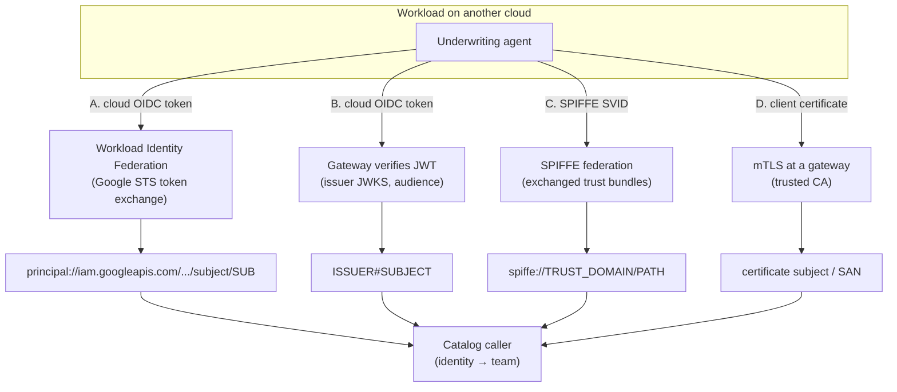
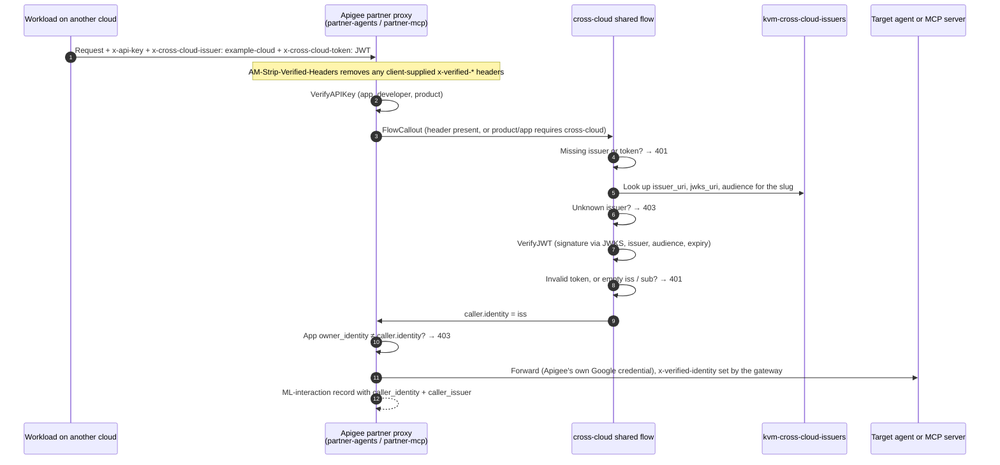

# 5.1 Identity Across Clouds

Inside one Google Cloud organization, identity is easy to take for granted. When `cx-mortgage-orchestrator` calls `ai-coe-mortgage-specialist`, the Central Agent Gateway sees an attested SPIFFE `principal://` identity, and IAM sees a Google-issued token. Both were minted by the same platform that checks them.

Now picture a new caller: an underwriting agent that a risk team runs on another cloud. It has an identity there (an IAM role, a managed identity, a Kubernetes service account), but Google Cloud did not issue it. Before that agent may touch Julian Sterling's file, Esmeralda needs to answer three questions:

1. **Can the identity be verified cryptographically**, without a shared secret or a long-lived key?
2. **Which team does it belong to**, so the call can be authorized and billed?
3. **What happens when either answer is missing?**

The short answers: federated, signed tokens verified at the gateway; the catalog; and the call is denied.

---

## 1. The Rule: Attribution Comes from Authentication

Every request can carry two kinds of information about its caller:

| Kind | Example | Trusted For |
| :--- | :--- | :--- |
| **Verified identity** | A JWT signed by the caller's cloud and validated against that issuer's published keys; a federated principal minted by Google's Security Token Service; a client certificate chained to a trusted CA. | Authorization **and** chargeback. |
| **Declared context** | A header or A2A metadata field saying `cost_center: cc-underwriting-example` or `agent_name: underwriter`. | Telemetry and reporting only, and only when the catalog allows that value for the verified caller. |

Esmeralda never bills or authorizes on declared context alone. Self-asserted headers (such as an agent name in `X-API-Key`, or a SPIFFE ID copied into a custom header) stay telemetry-only. This is what makes cross-team, and now cross-cloud, chargeback impossible to fake.

---

## 2. Four Ways a Workload on Another Cloud Proves Who It Is



| Pattern | How It Works | Verified Principal | Best Fit |
| :--- | :--- | :--- | :--- |
| **A. Workload Identity Federation** | The workload exchanges a token from its own cloud (for example an AWS or Azure workload credential) with Google's Security Token Service through a [workload identity pool](https://cloud.google.com/iam/docs/workload-identity-federation-with-other-clouds) and provider. It then calls Google Cloud APIs with a short-lived federated token, either directly or by impersonating a dedicated service account. | `principal://iam.googleapis.com/projects/<PROJECT_NUMBER>/locations/global/workloadIdentityPools/<POOL>/subject/<SUBJECT>` | Callers that need Google Cloud IAM directly (Cloud Run invoker, Vertex AI, BigQuery, the Telemetry API). |
| **B. OIDC verified at the gateway** | The workload sends a JWT from its cloud's OIDC issuer. The gateway looks the issuer up in an allowlist, fetches its JWKS, and verifies signature, issuer, audience and expiry. | `<issuer>#<subject>` | Inbound agent calls through Apigee (the cross-cloud best path), or Envoy with JWT verification. |
| **C. SPIFFE federation** | Both sides run SPIFFE-compatible identity and exchange trust bundles, so each side can verify the other's SVIDs. | `spiffe://<trust-domain>/<path>` | Organizations that already standardized on SPIFFE across clouds and clusters. |
| **D. mTLS** | The caller presents a client certificate at a gateway that terminates TLS and validates the chain against a trusted CA. | Certificate subject or SAN | Legacy or partner systems that cannot mint OIDC tokens. |

> [!TIP]
> Prefer keyless patterns (A, B, C). They rely on short-lived tokens signed by an identity provider you already operate, so there is no long-lived secret to rotate or leak. Use mTLS (D) when a system can only present certificates, and terminate it at a gateway rather than inside agent code.

### Why `issuer#subject` and Not Just `subject`

A JWT `sub` claim is only unique **within its issuer**. Two clouds, or two tenants of the same cloud, can both issue a token with `sub: underwriter`. If the gateway keyed callers on `sub` alone, a workload from the wrong issuer could inherit another team's grants and bill another team's cost centre.

Esmeralda therefore keys OIDC callers on the pair: the gateway composes `caller.identity = <iss>#<sub>` from the **verified** claims, and the catalog registers the same `(issuer, subject)` pair. Workload Identity Federation principals already encode both the pool (the trust relationship) and the subject in one string, so they need no extra composition.

---

## 3. Verifying an OIDC Caller at Apigee: The Cross-Cloud Shared Flow

When `governance.capabilities.cross_cloud = "apigee"`, the Layer 5 Apigee `cross-cloud` unit manages an allowlist of trusted external issuers in an Apigee KeyValueMap (`kvm-cross-cloud-issuers`). Each entry maps a short issuer **slug** to three values: the issuer URI, the JWKS URI, and the expected audience:

```hcl
# Illustrative: trusted issuers for the Apigee cross-cloud unit (synthetic values)
trusted_issuers = {
  example-cloud = {
    issuer_uri = "https://oidc.example.com"
    jwks_uri   = "https://oidc.example.com/.well-known/jwks.json"
    audience   = "https://partner.esmeralda.internal"
  }
}
```

The cross-cloud **shared flow** turns that allowlist into a fail-closed verification step that the partner proxies call before anything else is trusted:



Three details make this path trustworthy:

1. **Spoof-proof headers.** The proxy strips every client-supplied `x-verified-*` header first, so the only `x-verified-identity` that can reach a target is the one the gateway set after verification.
2. **Key-to-identity binding.** A partner API key alone is not enough. When the developer app carries an `owner_identity` attribute, the proxy rejects the call (`403`) unless it matches the verified `iss#sub`. A leaked key is useless without a valid token from the right workload.
3. **The raw token stops at the gateway.** The shared flow removes the cross-cloud JWT before forwarding. Downstream services receive the verified identity, never the credential.

> [!IMPORTANT]
> The target behind Apigee (for example, an agent on Agent Runtime) authenticates **Apigee's** service identity, not the original caller's. That is by design: the gateway is the verification point, and the gateway's `ML-interaction` record is the **source of truth for attribution** on this path. Targets should not try to re-derive the caller from forwarded headers.

---

## 4. Registering a Federated Caller in the Catalog

Verification answers *"is this token genuine?"* The catalog answers *"who is this, and what may they do?"* Every non-workload identity (a VM, a human group, a partner Apigee app, a SPIFFE ID, or a workload on another cloud) is declared under `callers`, mapped to the **team** that pays for its calls.

A workload on another cloud is declared with identity type `federated` and its `(issuer, subject)` pair. In the team-owned `catalog/` layout, such entries live under `catalog/external/clouds/`, which platform and security own:

```yaml
# catalog/external/clouds/example-cloud-underwriter.yaml (synthetic)
schema: esmeralda.catalog
schema_version: 1

teams:
  example-cloud-underwriting:
    description: Synthetic underwriting team running on another cloud.
    cost_centers: [cc-underwriting-example]
    country: BR
    external: true

callers:
  aws-underwriter:
    team: example-cloud-underwriting
    description: Underwriting workload on another cloud (federated identity).
    identity:
      type: federated
      issuer: https://oidc.example.com
      subject: example-underwriter-role
```

The **target** owner then decides what that caller may do. The AI CoE grants it access to its specialist, through Apigee, under a specific API product and quota:

```yaml
# catalog/teams/ai-coe/agents/ai-coe-mortgage-specialist.yaml (excerpt)
callers:
  cx-mortgage-orchestrator: { cost_centers: [cc-cx-br, cc-cx-mx] }
  aws-underwriter:          { gateway: apigee, product: gold, quota: { tokens_per_minute: 50000 } }
```

The other identity types follow the same shape:

| Identity `type` | Required Fields | Example |
| :--- | :--- | :--- |
| `federated` | `issuer`, `subject` | An OIDC workload on another cloud |
| `spiffe` | `ref` (unit output) or `id` | `spiffe://example.org/ns/risk/sa/underwriter` |
| `apigee_app` | `id` (and optional `product`) | A partner developer app |
| `service_account` | `ref` (unit output) or `id` | A test VM or a platform workload |
| `group` | `id` | An operator group |

Identities the platform creates are referenced from Terraform unit outputs (`ref: layer-3-security:<output>`), never pasted by hand. Identities owned elsewhere, such as an external issuer, are written as literals and reviewed by platform and security through CODEOWNERS.

> [!NOTE]
> The team-owned `catalog/` folder, the `federated` identity type, and `esmeralda catalog resolve` / `show` are in an open pull request. On `main`, the service catalog still lives in the `catalog` block of `infrastructure/live/<env>/env.yaml`, whose `callers` lists agents and the test VM. See [5.5 Status & Roadmap](./05-status-and-roadmap.md).

---

## 5. Fail Closed, at Every Step

Every way a cross-cloud call can go wrong ends in a denial, never in an "allowed but unattributed" request:

| Situation | Result | Where It Is Enforced |
| :--- | :--- | :--- |
| No credentials at all | `401` | Every hop: IAM, IAP, Apigee keys |
| Issuer header or token missing where cross-cloud is required (by header, product or app attribute) | `401` | Apigee cross-cloud shared flow |
| Issuer not in the trusted allowlist | `403` | Apigee cross-cloud shared flow |
| Bad signature, wrong audience, expired token, or empty `iss` / `sub` | `401` | Apigee cross-cloud shared flow |
| Valid key but `owner_identity` does not match the verified `iss#sub` | `403` | Apigee partner proxy |
| Client tries to inject `x-verified-identity` | Header stripped; the binding check then fails | Apigee partner proxy |
| Authenticated caller not in the catalog | Denied (`policy.attribution.unmapped_caller: deny`) | Gateway grants compiled from the catalog |
| Declared cost centre not allowed for the caller | Rejected or billed to the caller's own team (`policy.attribution.declared_mismatch`) | Attribution views |

The last two rows describe the catalog **policy**:

```yaml
# catalog/policy.yaml (excerpt)
policy:
  attribution:
    unmapped_caller: deny       # deny | flag (allow + alert, e.g. a dev sandbox)
    declared_mismatch: reject   # reject | bill_own_team
```

Because enforcement is **compiled** from the catalog, `unmapped_caller: deny` is a property of the build: a caller absent from the catalog never receives a gateway grant, an API product, or an IAM binding in the first place. And because being listed is what makes a caller billable, the "unattributed" count in the usage views has an expected value of zero, with an alert when it is ever greater ([5.3](./03-unified-observability-and-chargeback.md)).

---

## 6. The Outbound Direction: Esmeralda Agents Calling Other Clouds

Identity also matters when `ai-coe-mortgage-specialist` calls *out* to a service on another cloud. The remote side wants proof of who is calling, and it should not have to trust a static API key.

The keyless pattern mirrors pattern A in reverse:

1. The agent obtains a **Google-signed OIDC ID token** for its own service identity, with the remote service as the audience.
2. The remote cloud trusts Google as an OIDC identity provider and exchanges that token for its own short-lived credential (for example, assuming a role with a web identity, or a federated credential on an application registration). The trust policy pins the expected audience and the agent's subject.
3. The agent calls the remote service with the remote credential.

The Central Agent Gateway governs every one of those calls: the remote service **and** the remote cloud's token-exchange endpoint must both be registered in the Agent Registry, or the gateway blocks them. Tokens travel as ordinary HTTP headers, so they pass through the gateway's inspection unchanged.

> [!TIP]
> Give each agent its own outbound identity. When several agents share one service account for outbound calls, no callee, on any cloud, can tell them apart, and per-agent attribution is lost. Per-agent identities are a prerequisite for verified attribution and are on the roadmap ([5.5](./05-status-and-roadmap.md)).

---

**Next Subsection:** The caller is verified. Now, which path does its request take between clouds, and which gateway sits on each hop? Continue to **[5.2 Cross-Cloud Connectivity & Protocols](./02-cross-cloud-connectivity.md)**.
