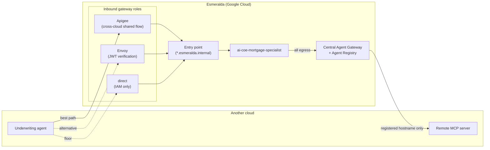
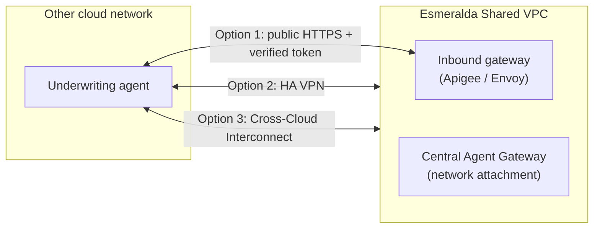

# 5.2 Cross-Cloud Connectivity & Protocols

In **[5.1 Identity Across Clouds](./01-identity-across-clouds.md)**, the underwriting agent on another cloud learned how to prove who it is. Its request still has to *get somewhere*: across a network boundary between two providers, through a gateway that can verify, authorize, meter and log it, and in a protocol both sides understand.

Esmeralda treats each of those as a separate, swappable decision:

| Decision | Options | Esmeralda Default |
| :--- | :--- | :--- |
| **Which gateway role on the hop?** | Apigee, Envoy, Agent Gateway, `direct` | Apigee for inbound cross-cloud calls when it is enabled; Agent Gateway for all agent egress |
| **Which network path?** | Public endpoint with TLS + identity, HA VPN, Cross-Cloud Interconnect | Whatever the organization already runs; identity is verified the same way on every path |
| **Which protocol?** | A2A for agent-to-agent, MCP for agent-to-tool | A2A and MCP over HTTPS |

---

## 1. The Gateway per Hop

The rule from [Section 1](../2-workloads-and-catalog/01-ingress-gateways.md) still holds across clouds: **every hop goes through a gateway role**, and the product filling that role is chosen per hop. `direct` is the always-available floor.

| Hop | Gateway Role | With Apigee | Without Apigee |
| :--- | :--- | :--- | :--- |
| Other cloud → Esmeralda agent | North–south ingress + caller verification | Apigee partner proxies + cross-cloud shared flow | Internal load balancer + Envoy (JWT verification), or `direct` with IAM |
| Other cloud → Esmeralda MCP server | Ingress + tool authorization | Apigee `partner-mcp` proxy (per-product `allowed_tools`) | Envoy, or `direct` with IAM |
| Esmeralda agent → agent or MCP server on another cloud | East–west egress | Central Agent Gateway (Apigee optional for monetized or cross-organization APIs) | Central Agent Gateway |
| Esmeralda agent → model on another provider | Model egress (AI gateway) | Apigee LLM proxy | Central Agent Gateway + workload usage records |

### Apigee: The Best Path for Inbound Calls

Apigee is the most complete inbound gateway for cross-cloud callers because it combines, in one hop, everything the call needs:

* **Caller verification:** `VerifyAPIKey` for the app, plus the cross-cloud shared flow for the workload's OIDC token ([5.1 §3](./01-identity-across-clouds.md#3-verifying-an-oidc-caller-at-apigee-the-cross-cloud-shared-flow)).
* **Authorization by product:** which agents (`allowed_agents`) and which MCP tools (`allowed_tools`) the caller's API product exposes.
* **Commercial controls:** `LLMTokenQuota` per consumer, so a runaway loop on another cloud cannot exhaust a shared budget.
* **The attribution record:** the `ML-interaction` log written in `PostClientFlow`, carrying the verified `caller_identity` and `caller_issuer` next to token counts.

The full Apigee deep dive (PSC plumbing, products, quota phases) is in **[1.4 Partner API Management & Token Monetization with Apigee X](../2-workloads-and-catalog/04-apigee-partner-gateway.md)**.

### Envoy and `direct`: The Alternatives

Not every organization runs Apigee, so the cross-cloud model must work without it:

* **Envoy** is already a gateway adapter in Esmeralda. Its standard JWT authentication filter can verify an external issuer's tokens against a JWKS, and its JSON access log can emit `esmeralda.usage` records natively. The cross-cloud configuration for Envoy is planned.
* **`direct`** is the floor: the caller federates into Google Cloud with Workload Identity Federation ([5.1 pattern A](./01-identity-across-clouds.md#2-four-ways-a-workload-on-another-cloud-proves-who-it-is)) and calls the target with IAM authorization alone. There is no gateway record, so the workload's own usage records carry attribution, and only identities the target can verify count as verified.

### Agent Gateway: Every Outbound Hop

When an Esmeralda agent calls something on another cloud, the **Central Agent Gateway** is already on the path, because all agent egress crosses it (the `cross_cloud = "agent_gateway"` provider in [2.2 Capability-Based & Semantic Governance](../3-agentops-and-lifecycle/04-capability-based-governance.md)). The remote endpoint is registered in the **Agent Registry**, which accepts agents, MCP servers and plain HTTPS endpoints hosted outside Google Cloud:

| Remote Resource | Registry Entry |
| :--- | :--- |
| A2A agent on another cloud | An agent entry with its A2A agent card |
| MCP server on another cloud | An MCP server entry with its tool specification |
| Any other HTTPS API (including the remote cloud's token-exchange endpoint) | An endpoint entry with its URL |

The gateway matches **exact hostnames**, so register every hostname variant the agent will use. Anything unregistered is denied by default, which is exactly the property that makes outbound cross-cloud calls auditable. See **[2.1 Zero-Trust Egress & The Central Agent Gateway](../3-agentops-and-lifecycle/01-central-agent-gateway.md)** for how per-target IAP authorization and the internal Root CA work.

---

## 2. Network Options

Identity is verified the same way on every network path, so the network choice is about latency, cost, privacy and what the organization already operates, not about trust. Three options cover most estates:

| Option | What It Is | When to Choose It | What to Plan For |
| :--- | :--- | :--- | :--- |
| **Public endpoints with TLS + identity** | The caller reaches a public HTTPS endpoint; every request carries a verified token. | Fastest start, low volume, partners you do not share a network with. | Expose the inbound gateway publicly (for example, Apigee behind an external load balancer); outbound calls from the Agent Gateway leave from shared Google addresses unless egress is routed through Cloud NAT with reserved IPs. |
| **HA VPN** | Encrypted IPsec tunnels between the Shared VPC and the other cloud's network. | Private connectivity at moderate bandwidth. | Advertise the relevant subnets on both sides, extend private DNS (for example, forwarding zones for the other cloud's private domains), and trust the other side's private CA if it uses one. |
| **Cross-Cloud Interconnect** | A dedicated physical connection between Google Cloud and another provider. | High, steady volume and predictable latency. | The same routing, DNS and certificate work as HA VPN, at higher capacity. |

On the private options, the Agent Gateway reaches private destinations through its network attachment into the Shared VPC; from there, normal VPC routes carry traffic over the VPN or Interconnect. The other cloud needs a return route to that attachment subnet.

> [!WARNING]
> **Plan end-to-end mTLS carefully.** The Agent Gateway terminates and re-originates TLS so it can inspect and authorize each request (agents trust it through the gateway root certificates that Esmeralda injects at deploy time). A client certificate held by an agent therefore does not reach the remote backend. If the remote side requires mTLS, terminate it at a proxy on the remote side and keep identity at L7 with signed tokens. The same applies inbound: terminate client certificates at the gateway, not inside agent code.

---

## 3. A2A and MCP: The Interoperable Protocols

A gateway and a network path are only useful if both sides speak the same language. Esmeralda standardizes on two open protocols that work regardless of cloud or framework:

| Protocol | Used For | What Esmeralda Exposes | Spec |
| :--- | :--- | :--- | :--- |
| **A2A (Agent2Agent)** | Agent-to-agent delegation: discovery through an agent card, then task messages | Agent card at `https://<agent>.esmeralda.internal/v1/card`; messages at `/v1/message:send` and `/v1/message:stream` | [a2a-protocol.org](https://a2a-protocol.org/) |
| **MCP (Model Context Protocol)** | Agent-to-tool calls: listing and calling tools | `https://<server>.esmeralda.internal/mcp` (Streamable HTTP) | [modelcontextprotocol.io](https://modelcontextprotocol.io/) |

Because both are plain HTTPS with JSON payloads, an agent written in LangGraph on another cloud can call `ai-coe-mortgage-specialist` exactly the way `cx-mortgage-orchestrator` does, and an Esmeralda agent can call an MCP server written in any language anywhere. Neither side needs to know the other's runtime, framework or cloud.

Two supporting standards keep the conversation observable and governable across the boundary:

* **W3C Trace Context (`traceparent`)** travels on every A2A and MCP request through standard OpenTelemetry HTTP instrumentation, so a request that starts on another cloud and ends in an Esmeralda MCP server shares one `trace_id`. That id is also the join key for usage records ([5.3](./03-unified-observability-and-chargeback.md)).
* **Agent cards and tool specifications** registered in the Agent Registry make remote agents and tools discoverable and governable, just like local ones.

> [!TIP]
> Content inspection on the gateway (Model Armor) covers specific protocol operations, and coverage differs between protocol versions and between streaming and non-streaming calls. When a cross-cloud call must be inspected, check the [Model Armor integration documentation](https://cloud.google.com/model-armor/docs) for the operations it covers and prefer a non-streaming call shape for that hop.

---

**Next Subsection:** The request is verified, routed and understood. How do the CFO and the FinOps team see what it cost when half of the work happened on another cloud? Continue to **[5.3 Unified Observability & Chargeback](./03-unified-observability-and-chargeback.md)**.
