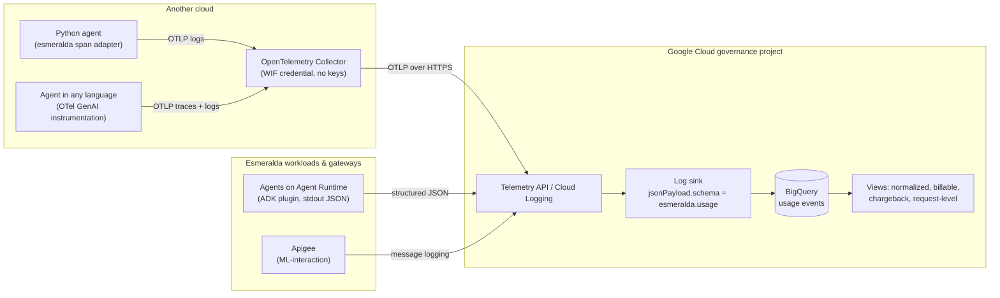

# 5.3 Unified Observability & Chargeback

In **[2.3 FinOps, Telemetry & Cross-Team Chargeback](../3-agentops-and-lifecycle/03-centralized-monitoring-and-dashboards.md)**, the CFO could see what Julian Sterling's mortgage inquiry cost, because every agent wrote structured telemetry into Cloud Logging and Layer 4 sank it into BigQuery. That worked because every producer was an Esmeralda agent on Google Cloud, using the same library.

Multi-cloud breaks that assumption three ways at once:

* The underwriting agent on another cloud is written in a **different framework**, maybe a different language.
* Its telemetry lands in a **different cloud's** logging and tracing stack.
* Its token usage is billed by a **different model provider**.

If each producer describes usage its own way, FinOps ends up writing one parser per cloud, per framework, per gateway, and the numbers never quite add up. Esmeralda's answer is a **contract**: one normalized record that every producer emits, wherever it runs.

---

## 1. The Normalized Schema: `esmeralda.usage`

Every unit of usage, from any producer, is one `esmeralda.usage` record. There are four event types:

| Event | One Record Per | Typical Producer |
| :--- | :--- | :--- |
| `llm.call` | Model call | The workload (agent library, span adapter) |
| `tool.call` | Tool call | The workload |
| `agent.invocation` | Agent run (with a token roll-up for budgets and alerts) | The workload |
| `gateway.request` | Request crossing a gateway | Apigee, Envoy, or a mapped gateway log |

Field names follow the [OpenTelemetry GenAI semantic conventions](https://opentelemetry.io/docs/specs/semconv/gen-ai/) wherever they exist, so any OTel-instrumented framework already produces most of the data. Two fields make the record work across clouds:

* **`workload.cloud`** (`gcp`, `aws`, `azure`, `on_prem`, `other`) and **`workload.runtime`** (`agent_engine`, `cloud_run`, `gke`, `external`) say *where* the work ran.
* **`caller`** says *who* asked for it. `caller.principal` and `caller.team` count for chargeback **only** when `caller.verified` is `true`, meaning they came from authentication. Anything the caller merely claimed goes in `caller.declared`.

Each record carries `schema: "esmeralda.usage"` and an integer `schema_version`. Additive changes keep the version; only a breaking change bumps it. Consumers select records by `schema`, never by log name, which is what lets records from any cloud and any transport land in the same tables. Records never contain credentials, tokens or the delegated user credential, in any field.

> [!NOTE]
> The `esmeralda.usage` contract (`contracts/usage-event.schema.json`), its Python producers and the Layer 4 usage views are in open pull requests. On `main`, agents emit the earlier `genai_token_consumption` and `mcp_tool_execution` events with OpenTelemetry baggage, read by `vw_monthly_agent_chargeback` (see [2.3](../3-agentops-and-lifecycle/03-centralized-monitoring-and-dashboards.md)). See [5.5 Status & Roadmap](./05-status-and-roadmap.md).

---

## 2. Producers on Every Cloud

The contract is the same everywhere; only the producer changes.

| Producer | Where It Runs | How It Emits `esmeralda.usage` |
| :--- | :--- | :--- |
| **`esmeralda` library, ADK plugin** | Any Python ADK agent, on any cloud | `esmeralda.create_app(root_agent)` installs a telemetry plugin that emits `llm.call`, `tool.call` and `agent.invocation` records. |
| **`esmeralda` library, OTel GenAI span adapter** | Any OTel-instrumented Python framework (LangGraph, LangChain, CrewAI, custom code) | `UsageSpanProcessor` on the `TracerProvider` maps finished GenAI spans to records. |
| **`esmeralda` library, manual API** | Python code without ADK or OTel instrumentation | Typed builders such as `record_llm_call()` and `record_tool_call()`. |
| **OpenTelemetry Collector** | Any language, any cloud | Receives OTLP from the workload and forwards records (or maps GenAI spans to records) to Google Cloud. |
| **Apigee** | Inbound gateway | The `ML-interaction` message-logging policy writes gateway records with the verified caller. |
| **Envoy** | Gateway adapter | A JSON access-log format that matches the schema. |
| **Fixed-format gateways** (such as Agent Gateway logs) | Google Cloud | Mapped to the schema by a BigQuery view. |

For a Python agent on another cloud, the span adapter is usually all it takes. The workload declares where it runs through environment variables (`ESMERALDA_CLOUD=aws`, `ESMERALDA_RUNTIME=external`, `ESMERALDA_TEAM=example-cloud-underwriting`) and switches the transport to OpenTelemetry logs so a collector can ship the records:

```python
from opentelemetry.sdk.trace import TracerProvider

from esmeralda.usage import UsageSpanProcessor

# Environment: ESMERALDA_USAGE_TRANSPORT=otel, ESMERALDA_CLOUD=aws, ESMERALDA_RUNTIME=external
provider = TracerProvider()
provider.add_span_processor(UsageSpanProcessor(framework="langgraph"))
```

For workloads in other languages, an **OpenTelemetry Collector** is the bridge. The workload exports standard OTLP traces and logs to a collector on its own cloud; the collector exports to Google Cloud's OTLP endpoint (the Telemetry API, `telemetry.googleapis.com`), authenticating keylessly with a [Workload Identity Federation credential configuration](https://cloud.google.com/iam/docs/workload-identity-federation-with-other-clouds) instead of a downloaded key. The federated principal needs only permission to write telemetry.

```yaml
# Illustrative OpenTelemetry Collector config on the other cloud.
# GOOGLE_APPLICATION_CREDENTIALS points at a Workload Identity Federation
# credential configuration file (no service account key).
extensions:
  googleclientauth: {}

receivers:
  otlp:
    protocols:
      http: {}

exporters:
  otlphttp:
    endpoint: https://telemetry.googleapis.com
    encoding: proto
    auth:
      authenticator: googleclientauth

service:
  extensions: [googleclientauth]
  pipelines:
    traces: { receivers: [otlp], exporters: [otlphttp] }
    logs:   { receivers: [otlp], exporters: [otlphttp] }
```



> [!NOTE]
> On Google Cloud, the default transport is one JSON line on stdout, which Cloud Logging stores as `jsonPayload` on Agent Runtime, Cloud Run and GKE. OTLP through a collector is the multi-cloud transport: the record is the same, only the envelope changes. A tested reference collector configuration (including a processor that maps GenAI spans to records for non-Python workloads) is on the roadmap; until then, treat the snippet above as a starting point and validate that the records arrive with `schema = "esmeralda.usage"` in the governance project.

---

## 3. Landing in BigQuery

Layer 4's hub-and-spoke telemetry model extends naturally: records from Google Cloud spokes and from other clouds all reach the governance project, and one sink keyed on `jsonPayload.schema = "esmeralda.usage"` streams them into a BigQuery usage table. Views on top of it do the rest:

1. **Normalize.** Gateway and workload records, from any producer, are flattened into one shape.
2. **Join on `trace_id`.** A single request usually leaves several records: an Apigee `gateway.request` on the way in, `llm.call` and `tool.call` records from the specialist, and maybe an `llm.call` from the caller on its own cloud. W3C trace context propagation ([5.2 §3](./02-cross-cloud-connectivity.md#3-a2a-and-mcp-the-interoperable-protocols)) gives them all the same `trace_id`.
3. **Pick the billing source per hop.** When a gateway is on the hop, its record is the primary source for tokens and caller identity. Workload records add per-tool and sub-agent detail, and are the floor on `direct` hops.
4. **Accept only registered dimensions.** Business keys such as `loan_product` are accepted only if the catalog's `policy.dimensions` registers them.

---

## 4. Chargeback by Verified Team

The goal of all this plumbing is a simple, defensible statement: **the team whose verified identity triggered the work pays for it**, wherever the work ran.

| Question | Answered From |
| :--- | :--- |
| Who called? | `caller.principal` with `caller.verified = true` (an `iss#sub`, a federated principal, a SPIFFE ID, an Apigee app or a service account) |
| Which team pays? | The catalog's `callers` / targets mapping of that principal to a team, compiled into an attribution table |
| Which cost centre? | The caller's declared cost centre, only if the catalog allows it for that caller (`policy.attribution.declared_mismatch` decides otherwise) |
| What did it cost? | Token counts from `llm.call` or `gateway.request` records (`usage.input_tokens` includes cached tokens; `usage.output_tokens` includes reasoning tokens) |
| Where did it run? | `workload.cloud`, `workload.runtime`, `workload.team` |

A month-end chargeback row for the worked example in [5.4](./04-bringing-an-agent-from-another-cloud.md) might read:

| Calling Team (verified) | Serving Team | Serving Cloud | Requests | Input Tokens | Output Tokens |
| :--- | :--- | :--- | ---: | ---: | ---: |
| `example-cloud-underwriting` | `ai-coe` | `gcp` | 1,240 | 4,860,800 | 812,200 |
| `cx` | `ai-coe` | `gcp` | 9,310 | 36,494,000 | 6,098,050 |

*(Synthetic numbers.)*

Two alarms keep the view honest:

* **Unattributed usage.** Any record whose principal is not in the attribution table counts as unattributed. The expected value is zero; an alert fires when it is ever greater.
* **Declared vs. verified mismatch.** A caller declaring a cost centre its team does not own is rejected or billed to its own team, per policy, and surfaced for review.

> [!IMPORTANT]
> Verified attribution needs every caller to present a **distinct** verified identity. On paths where the callee only sees a gateway's identity (such as a target behind Apigee), the gateway's record is the attribution source. Self-declared context (OpenTelemetry baggage such as `caller.project_id`, A2A caller metadata) stays useful for dashboards but never decides who pays.

---

## 5. Verified Attribution on Internal Hops, End to End

This section follows one internal call from catalog entry to chargeback row: an agent or a platform identity calling an agent or an MCP server inside Google Cloud. The partner front door (Apigee apps and cross-cloud callers) uses the same table and policy and is documented separately as a follow-up.

### 5.1 Who the callee can verify, per hop

| Hop | Verified identity | Read by | Deny enforced by |
| :--- | :--- | :--- | :--- |
| Agent → agent or MCP server through the Agent Gateway | The calling agent's Agent Identity (`principal://…/reasoningEngines/<id>`), proven by mTLS | The Agent Gateway's authorization decision (IAP egress audit record: principal, target, granted or denied) | Per-target `roles/iap.egressor` lists compiled from the catalog: a principal with no binding gets `403` at the gateway |
| Any caller → MCP server on Cloud Run | The caller's Google ID token (`email` or `sub`). Cloud Run validates it, then passes it on with its signature removed | The in-process **caller guard** (`esmeralda.attribution`) | Cloud Run `run.invoker` (catalog callers only), then the guard's allowlist |
| Any caller → agent on Agent Runtime | The caller's access token, checked by Agent Runtime IAM. The container never receives the caller's credential | The Agent Gateway record only (when the caller is an agent) | `aiplatform.user` and the gateway lists; no in-process check is possible |
| Humans and operators | Group membership | IAM | Group grants (the catalog maps the group to a team) |

Self-asserted values (`X-Agent-Spiffe-Id`, `X-API-Key`, the A2A caller context) never count as verified.

> [!NOTE]
> **Why Agent Runtime records are attributed at the gateway, not in the process.** Agent Runtime authenticates the caller at its front end, then calls the agent's container with the platform's own credential. The caller's token never reaches the container, so no code in the agent can verify who called. The usage records an agent on Agent Runtime writes therefore always carry `caller.verified = false`, and the Agent Gateway's authorization record (verified principal and target) is what attributes the hop. For the same reason, the "unattributed" checks are split in two, each with an expected count of 0:
>
> * workload records from guarded workloads (`workload.runtime` other than `agent_engine`) without `caller.verified = true`;
> * Agent Gateway decisions that let a principal through (`granted = true`) when that principal has no `principal_teams` row.

### 5.2 Catalog policy

```yaml
# catalog/policy.yaml
policy:
  attribution:
    unmapped_caller: deny          # deny (403) | flag (allow, record unattributed, alert)
    declared_mismatch: reject      # reject (403) | bill_own_team
    flag_environments: [dev]       # flag is a resolve error anywhere else
```

`flag` only relaxes the in-process guard. Gateway and IAM grants always come from the catalog, so a caller that is not in the catalog has no grant in either mode.

### 5.3 What the catalog compiles

`esmeralda catalog resolve --env <env> --write` adds an `attribution` block to `catalog/.resolved/<env>.json`:

* **`principal_teams`**: one row per verified principal (`principal`, `caller`, `team`, `cost_centers`, `verified_by`). Each agent contributes its Agent Identity principal and the service account it calls out as. Callers contribute their identity (`group:<email>` for groups). It fills the `principal_teams` attribution table that the usage views join.
* **`allowlists`**: for each guarded target (MCP servers and A2A agents), the principals the caller guard accepts, with the team and the cost centres each one may declare on that target.
* **`shared_principals`**: identities several agents present (the shared invoker service account while agents don't have their own outbound identity, [#134](https://github.com/google/esmeralda/issues/134)). They are not in `principal_teams`. On a target they resolve to a team only when every agent caller of that target belongs to the same team. Otherwise the call is accepted but carries no team, and the gateway record decides who pays.

The compiler also checks that **anything allowed is attributable**. A principal that would get a gateway or IAM grant without a `principal_teams` row, or one principal mapped to two teams, fails the build.

### 5.4 The caller guard

The MCP servers wrap their app with the guard: `app = CallerGuard(app)`. Each one ships a byte-identical copy of the package module as `caller_guard.py`, because the module uses only the standard library. The guard reads its allowlist from `ESMERALDA_CALLER_ALLOWLIST`, which the service's Terraform unit writes from the compiled block (`env.yaml` `attribution.caller_guard`). For each request:

| Situation | `deny` / `reject` | `flag` / `bill_own_team` |
| :--- | :--- | :--- |
| No platform-validated identity (missing, malformed, or still signed) | `401` | Allowed, `caller.verified = false` |
| Verified principal not in the allowlist | `403` | Allowed, principal recorded, no team |
| Mapped principal declaring a cost centre (`X-Esmeralda-Cost-Center`) it may not use | `403` | Allowed, billed to its own team, `declared` keeps the claim |
| Mapped principal | Allowed. `caller.verified = true`, `caller.principal`, `caller.team`; the response carries `X-Esmeralda-Billed-Team` | Same |

`esmeralda serve` installs the same guard on A2A servers when an allowlist is configured, except on Agent Runtime, where the container can't see the caller. The ADK plugin then fills `caller.verified`, `caller.principal` and `caller.team` only from the guard's decision.

### 5.5 Proving it: `esmeralda verify`

On top of the route probes, `scripts/test_gateway.sh` (run by `esmeralda verify`) runs two attribution probes from the test VM:

* **Unregistered caller:** the probe identity `sa-probe-unregistered-<env>` is in no catalog entry and holds no role. The test VM can only mint its tokens. It calls every MCP and A2A host and must get `403`, in both `deny` and `flag`, because IAM and the Agent Gateway reject it before any caller guard. The probe reads the effective policy from the resolved catalog. If a host ever let the identity through to its guard, `deny` still requires `403`. Under `flag`, the call may succeed but must stay unattributed, and the probe warns that the IAM grant shouldn't exist.
* **Declared mismatch:** the test VM declares another team's cost centre on every guarded MCP host. It must get `403` under `reject`, or `2xx` billed to its own team under `bill_own_team`.

Both are controlled by `env.yaml` `attribution` (`unregistered_probe`, `caller_guard`): on in `dev`, off in `prd` until the rollout below is done there.

### 5.6 Rolling it out without locking out traffic

1. In `dev`, set `catalog/environments/dev.yaml` `policy.attribution.unmapped_caller: flag`. Redeploy the MCP services, run `esmeralda verify --env dev`, and check that the guard logged no `"reason": "unmapped"` or `"unverified"` decision (`esmeralda logs <service> --env dev`).
2. Remove the override (deny), redeploy, and run `esmeralda verify --env dev` again, including the `403` probes.
3. Turn on the "unattributed usage" alert. Its expected count is 0.
4. Repeat in `prd` by enabling `attribution.caller_guard` and `attribution.unregistered_probe` in its `env.yaml` (`flag` is refused there).

> [!NOTE]
> The partner hop (Apigee apps and cross-cloud `iss#sub` callers) attributes from the gateway's `ML-interaction` record: the callee only sees the proxy's identity. Mapping those principals through the same `principal_teams` table, with the same `unmapped_caller` policy, is the next step.

---

**Next Subsection:** Identity, connectivity and telemetry are in place. Let's put them together and onboard a real (synthetic) agent from another cloud, step by step. Continue to **[5.4 Bringing an Agent from Another Cloud, End to End](./04-bringing-an-agent-from-another-cloud.md)**.
