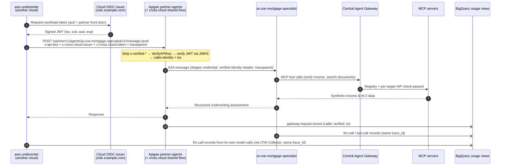

# 5.4 Bringing an Agent from Another Cloud, End to End

The previous three subsections introduced the pieces one at a time. Now let's watch them work together on a single, concrete onboarding.

**The scenario (synthetic):** a risk team called **Example Cloud Underwriting** runs an underwriting agent, `aws-underwriter`, on another cloud. It is built with LangGraph and calls its own cloud's models. For mortgage applications like Julian Sterling's, it wants a second opinion from the AI CoE's `ai-coe-mortgage-specialist` before it issues a recommendation.

By the end of this walkthrough:

* the underwriter calls the specialist over **A2A** with a **verified identity** and no shared secret beyond its API key;
* the call passes through **Apigee** with an explicit API product and token quota;
* every token is attributed to **`example-cloud-underwriting`**, not to the AI CoE and not to "unknown."

---

## 1. The Cast and the Flow

| Actor | Where It Runs | Identity | Owned By |
| :--- | :--- | :--- | :--- |
| `aws-underwriter` | Another cloud (LangGraph, `runtime: external`) | OIDC token from `https://oidc.example.com`, subject `example-underwriter-role` | Example Cloud Underwriting |
| Apigee partner front door (`partner.esmeralda.internal`) | Esmeralda gateway project | Apigee's own service identity toward targets | Gateway / Partner team |
| `ai-coe-mortgage-specialist` | Vertex AI Agent Runtime | SPIFFE Agent Identity | AI CoE |
| `income-verification`, `legacy-dms` | Private Cloud Run | IAM | AppDev Tools |



---

## 2. Step by Step

### Step 1: Register the Team and the Caller (Platform + Security)

Platform and security own `catalog/external/`. They declare the team that pays and the federated identity that represents its workload:

```yaml
# catalog/external/clouds/example-cloud-underwriter.yaml
schema: esmeralda.catalog
schema_version: 1

teams:
  example-cloud-underwriting:
    description: Synthetic underwriting team running on another cloud.
    cost_centers: [cc-underwriting-example]
    country: BR
    external: true

callers:
  aws-underwriter:
    team: example-cloud-underwriting
    description: LangGraph underwriting agent on another cloud.
    identity:
      type: federated
      issuer: https://oidc.example.com
      subject: example-underwriter-role
```

### Step 2: Grant Access on the Target (AI CoE)

The AI CoE owns its specialist's catalog entry, so the AI CoE decides who may call it. It adds the new caller, pins the gateway and the API product, and caps its token rate:

```yaml
# catalog/teams/ai-coe/agents/ai-coe-mortgage-specialist.yaml (excerpt)
name: ai-coe-mortgage-specialist
kind: a2a
owner_team: ai-coe
deploy: { unit: agents/ai-coe-mortgage-specialist }
serving: { token: access, probe: a2a }
callers:
  cx-mortgage-orchestrator: { cost_centers: [cc-cx-br, cc-cx-mx] }
  aws-underwriter:
    gateway: apigee
    product: gold
    cost_centers: [cc-underwriting-example]
    quota: { tokens_per_minute: 50000 }
  test-vm: {}
observability:
  usage_sources: [gateway, workload]
  dimensions: [loan_product]
```

Then they resolve and inspect the result:

```bash
uv run esmeralda catalog resolve --env all --write
uv run esmeralda catalog show --env dev --caller aws-underwriter
```

`catalog show` answers the three questions a reviewer cares about: what the underwriter can call, through which gateway, and which team pays.

### Step 3: Trust the Issuer (Platform + Security)

With `governance.capabilities.cross_cloud = "apigee"` and Apigee enabled, the environment lists the external issuers the cross-cloud shared flow may accept. Each entry is a slug that callers send in `x-cross-cloud-issuer`:

```hcl
# infrastructure/live/<env>/env.yaml (excerpt, synthetic values)
governance = {
  apigee = {
    enabled          = true
    environment_type = "INTERMEDIATE"
    trusted_issuers = {
      example-cloud = {
        issuer_uri = "https://oidc.example.com"
        jwks_uri   = "https://oidc.example.com/.well-known/jwks.json"
        audience   = "https://partner.esmeralda.internal"
      }
    }
  }
  capabilities = {
    # ...
    partner_access = "apigee"
    token_quota    = "apigee"
    cross_cloud    = "apigee"
  }
}
```

### Step 4: Create the Developer App with an Identity Binding (Gateway / Partner Team)

The underwriter gets an Apigee developer app subscribed to an API product that exposes the specialist. By default, the partner products expose only the front-door orchestrator, so exposing the specialist is an explicit product decision. Two app attributes tie the key to the verified workload:

| Attribute | Value | Effect |
| :--- | :--- | :--- |
| `owner_identity` | `https://oidc.example.com#example-underwriter-role` | The key is accepted only together with a valid token for exactly this `iss#sub` (otherwise `403`). |
| `requires_cross_cloud` | `true` | The cross-cloud shared flow always runs for this app, so a missing token is a `401`, never a silent pass. |

> [!NOTE]
> Steps 3 and 4 are configured directly in Terraform today. Compiling them from the catalog (API products, apps and `owner_identity` generated from the `callers` grant in Step 2) is planned; see [5.5 Status & Roadmap](./05-status-and-roadmap.md).

### Step 5: Connect the Networks (NetOps)

`partner.esmeralda.internal` is a private address inside the Shared VPC. The underwriter reaches it either over HA VPN or Cross-Cloud Interconnect (with DNS forwarding for `esmeralda.internal` on the other cloud), or through a public front door for Apigee that the organization adds for external callers. Either way, identity is verified the same way ([5.2 §2](./02-cross-cloud-connectivity.md#2-network-options)).

### Step 6: Instrument the Underwriter (Example Cloud Underwriting)

The underwriting team adds the span adapter (or an OpenTelemetry Collector) so its own model calls also become `esmeralda.usage` records, and propagates `traceparent` on its outbound A2A call:

```python
from opentelemetry.sdk.trace import TracerProvider

from esmeralda.usage import UsageSpanProcessor

# ESMERALDA_WORKLOAD_NAME=aws-underwriter  ESMERALDA_TEAM=example-cloud-underwriting
# ESMERALDA_CLOUD=aws  ESMERALDA_RUNTIME=external  ESMERALDA_USAGE_TRANSPORT=otel
provider = TracerProvider()
provider.add_span_processor(UsageSpanProcessor(framework="langgraph"))
```

### Step 7: Make the Call

From the other cloud, the request looks like any A2A call, plus three headers:

```bash
# Illustrative. Token values are never logged or stored by Esmeralda.
curl -sS https://partner.esmeralda.internal/partner/v1/agents/ai-coe-mortgage-specialist/v1/message:send \
  -H "x-api-key: ${UNDERWRITER_API_KEY}" \
  -H "x-cross-cloud-issuer: example-cloud" \
  -H "x-cross-cloud-token: ${WORKLOAD_OIDC_TOKEN}" \
  -H "traceparent: 00-7d3f0a9c41e24b6f8a1c5e2d9b0f4a37-a1b2c3d4e5f60718-01" \
  -H "content-type: application/json" \
  -d '{"message": {"messageId": "msg-example-001", "role": "user", "parts": [{"text": "Assess the income documents for applicant Julian Sterling."}]}}'
```

### Step 8: Verify

The partner conformance probes exercise the front door (API keys, products, quotas):

```bash
uv run esmeralda verify --partner --env dev
```

The cross-cloud cases to cover on top of them (the offline proxy-bundle tests already assert the policy wiring; adding live cross-cloud probes to `verify --partner` is planned):

| Probe | Expected |
| :--- | :--- |
| Valid key + valid token for the bound `iss#sub` | `200` |
| Valid key, no token, app requires cross-cloud | `401` |
| Valid key + token from an issuer not in `trusted_issuers` | `403` |
| Valid key + spoofed `x-verified-identity` header, no token | `403` |
| Valid key + valid token for a **different** subject | `403` |

---

## 3. What Lands in BigQuery

One request, three producers, one `trace_id`. First, Apigee's gateway record, which is the billing source for this hop because it carries the **verified** caller:

```json
{
  "schema": "esmeralda.usage",
  "schema_version": 1,
  "event": "gateway.request",
  "timestamp": "2026-01-15T16:20:41.512Z",
  "trace_id": "7d3f0a9c41e24b6f8a1c5e2d9b0f4a37",
  "span_id": "3c9e1b7a5d2f8e40",
  "source": "gateway",
  "workload": {"name": "ai-coe-mortgage-specialist", "team": "ai-coe", "runtime": "agent_engine", "cloud": "gcp"},
  "caller": {
    "principal": "https://oidc.example.com#example-underwriter-role",
    "team": "example-cloud-underwriting",
    "verified": true,
    "declared": {"cost_center": "cc-underwriting-example", "country": "BR"}
  },
  "gateway": {"product": "apigee", "name": "partner-agents"},
  "http": {
    "request.method": "POST",
    "response.status_code": 200,
    "route": "/partner/v1/agents/ai-coe-mortgage-specialist/v1/message:send"
  },
  "gen_ai": {"usage.input_tokens": 3920, "usage.output_tokens": 655},
  "status": "ok",
  "latency_ms": 4180.2
}
```

Next, one of the specialist's own workload records. Its `caller` is only *declared* (the specialist sees Apigee's identity, not the underwriter's), so it adds detail but does not decide who pays:

```json
{
  "schema": "esmeralda.usage",
  "schema_version": 1,
  "event": "llm.call",
  "timestamp": "2026-01-15T16:20:39.904Z",
  "trace_id": "7d3f0a9c41e24b6f8a1c5e2d9b0f4a37",
  "span_id": "5e8a2c4b6d1f3a90",
  "source": "workload",
  "workload": {"name": "ai-coe-mortgage-specialist", "team": "ai-coe", "runtime": "agent_engine", "framework": "adk", "cloud": "gcp"},
  "caller": {"verified": false, "declared": {"agent_name": "aws_underwriter"}},
  "gen_ai": {
    "system": "gcp.vertex_ai", "operation.name": "generate_content",
    "request.model": "gemini-flash", "usage.input_tokens": 1840, "usage.output_tokens": 312,
    "agent.name": "mortgage_specialist"
  },
  "status": "ok",
  "dimensions": {"loan_product": "fixed-30"},
  "latency_ms": 1432.5
}
```

Finally, the underwriter's own model call on its cloud, shipped through the collector. It is billed by that cloud's provider, but it now appears in the same view, under the same trace:

```json
{
  "schema": "esmeralda.usage",
  "schema_version": 1,
  "event": "llm.call",
  "timestamp": "2026-01-15T16:20:36.118Z",
  "trace_id": "7d3f0a9c41e24b6f8a1c5e2d9b0f4a37",
  "span_id": "a1b2c3d4e5f60718",
  "source": "workload",
  "workload": {"name": "aws-underwriter", "team": "example-cloud-underwriting", "runtime": "external", "framework": "langgraph", "cloud": "aws"},
  "caller": {"verified": false},
  "gen_ai": {"system": "aws.bedrock", "operation.name": "chat", "request.model": "example-model", "usage.input_tokens": 2210, "usage.output_tokens": 180},
  "status": "ok",
  "latency_ms": 2290.0
}
```

Joined on `trace_id`, those records tell the whole story of one cross-cloud request: who asked (verified), which team pays (`example-cloud-underwriting`), what the specialist did on Google Cloud, and what the underwriter spent on its own cloud. The chargeback views in [5.3 §4](./03-unified-observability-and-chargeback.md#4-chargeback-by-verified-team) sum them by verified team.

---

## 4. What Each Team Touched

| Team | Changed | Did Not Change |
| :--- | :--- | :--- |
| **Example Cloud Underwriting** | Its agent's outbound call (three headers) and telemetry setup | Nothing on Google Cloud |
| **Platform + Security** | One file in `catalog/external/clouds/`, one trusted issuer | Agent code, MCP servers, routes |
| **AI CoE** | One caller grant in its own catalog entry | The specialist's code, image or deployment |
| **Gateway / Partner team** | One developer app and product subscription | Entry point, DNS, certificates |
| **CX, AppDev Tools** | Nothing | Everything |

That is the point of the whole model: a new caller from another cloud is a **catalog change and a gateway configuration**, reviewed by the owners of each piece, not a redesign.

---

**Next Subsection:** Which of these steps can you run on `main` today, and which are still arriving? Continue to **[5.5 Status & Roadmap](./05-status-and-roadmap.md)**.
