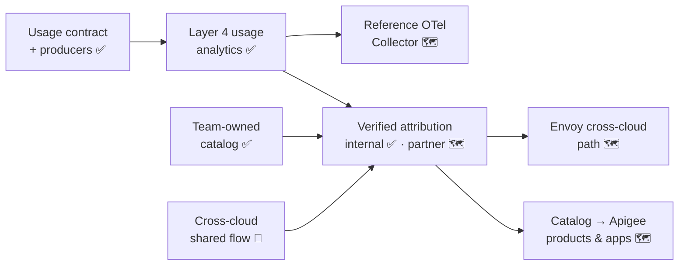

# 5.5 Status & Roadmap

Multi-cloud support in Esmeralda is being delivered in small steps, each one deployed and verified end to end in a `dev` environment before it merges. Some building blocks from this section are on `main` today, some are in open pull requests, and some are planned. This page keeps the line between them explicit, so you can tell what you can deploy now from what is still arriving.

**Legend:** ✅ available on `main` · 🚧 in progress (open pull request or branch) · 🗺️ planned

---

## 1. Status by Building Block

### Identity

| Building Block | Status | Notes |
| :--- | :---: | :--- |
| SPIFFE Agent Identity per agent, verified by the Central Agent Gateway on every egress hop | ✅ | See [2.1 Central Agent Gateway](../3-agentops-and-lifecycle/01-central-agent-gateway.md). |
| Apigee partner authentication (`VerifyAPIKey`), API products and `owner_identity` app attribute | ✅ | See [1.4 Apigee X Partner Gateway](../2-workloads-and-catalog/04-apigee-partner-gateway.md). |
| Apigee `cross-cloud` capability unit: trusted-issuer KeyValueMap | ✅ | The KeyValueMap is managed; nothing on `main` reads it yet. |
| Cross-cloud shared flow: fail-closed OIDC verification (`401` / `403`), `iss#sub` principal, spoof-proof `x-verified-*` headers, key-to-identity binding | 🚧 | Open pull request (Apigee cross-cloud shared flow and partner chargeback). |
| `federated` and `spiffe` caller types in the catalog | ✅ | Declared and validated in the team-owned `catalog/`; only `service_account` callers and agents are compiled into IAM today. |
| Catalog callers compiled into the Agent Gateway per-target egress lists | ✅ | One `callers` entry drives both the callee's IAM and the gateway list; callers that don't egress through the gateway (such as the Apigee proxy) use `agent_gateway: false`. See [2.6 Service Catalog](../3-agentops-and-lifecycle/06-service-catalog.md). |
| Delegated end-user credential, forwarded only to opted-in targets | ✅ | Kept out of logs, traces, usage records and stored sessions. See [Delegated user credential](../4-esmeralda-library/guide.md#delegated-user-credential). |
| End-user authorization enforced by the MCP tool servers (per-tool modes) | 🗺️ | The claims guard (`esmeralda.mcp_authz`) exists; the sample servers don't enforce it yet. |
| Per-agent outbound identity (no shared invoker identity across agents) | ✅ | Agents call out with their own Agent Identity; each callee grants the calling agent's principal. See [Outbound tokens and the Agent Gateway](../1-platform-foundations/03-security-iam-and-telemetry.md#outbound-tokens-and-the-agent-gateway). |
| Compile catalog callers into Apigee products, apps and `owner_identity` | 🗺️ | Today configured directly in Terraform ([5.4 Steps 3–4](./04-bringing-an-agent-from-another-cloud.md#step-3-trust-the-issuer-platform-security)). |
| Envoy cross-cloud path (JWT verification against an external issuer) | 🗺️ | The non-Apigee inbound alternative. |
| SPIFFE federation and mTLS callers, end to end | 🗺️ | The catalog shape exists; enforcement planned. |

### Connectivity & Protocols

| Building Block | Status | Notes |
| :--- | :---: | :--- |
| A2A between agents and MCP to tool servers over `*.esmeralda.internal` | ✅ | Framework-neutral; any cloud can speak them. |
| Central Agent Gateway + Agent Registry: deny-by-default egress to registered endpoints (`cross_cloud = "agent_gateway"`) | ✅ | External agents, MCP servers and HTTPS endpoints are registered as registry entries. |
| Apigee partner front door (`partner-agents`, `partner-mcp`) with `LLMTokenQuota` | ✅ | Optional; enabled with `governance.apigee.enabled`. `partner-mcp` reaches the MCP servers through a private path to the entry point, with per-product tool scopes. See [1.4](../2-workloads-and-catalog/04-apigee-partner-gateway.md). |
| Long unary agent-to-agent calls (no fixed 30 s time-to-first-byte cap) | ✅ | Opt-in hybrid agent backend (`gateways.agent_backend = "hybrid"`). See [1.3](../2-workloads-and-catalog/01-ingress-gateways.md). |
| Apigee LLM proxy for agent → model calls | 🚧 | Branch in progress. The model-router choice for this hop is summarized in [1.5 One Gateway per Hop](../2-workloads-and-catalog/05-gateway-per-hop.md#h6-agent-model). |
| Reference hybrid networking (HA VPN / Cross-Cloud Interconnect to another cloud) | 🗺️ | Conceptual guidance in [5.2](./02-cross-cloud-connectivity.md#2-network-options); no Terraform module yet. |
| Registering `managed: false` external targets from the catalog into the Agent Registry | 🗺️ | Catalog shape exists; compile planned. |

### Observability & Chargeback

| Building Block | Status | Notes |
| :--- | :---: | :--- |
| Hub-and-spoke log sinks, OpenTelemetry baggage, `vw_monthly_agent_chargeback` | ✅ | Attribution from declared baggage. See [2.3](../3-agentops-and-lifecycle/03-centralized-monitoring-and-dashboards.md). |
| Apigee `ML-interaction` gateway records | ✅ | Partner app, product and token counts. |
| `esmeralda.usage` contract (`contracts/usage-event.schema.json`), validated in CI | ✅ | See [5.3](./03-unified-observability-and-chargeback.md). |
| Python producers: ADK plugin, OTel GenAI span adapter, manual API, OTel logs transport | ✅ | Ship with the `esmeralda` library. |
| Layer 4 usage analytics: usage table, normalized and billable views, schema-keyed metrics | ✅ | Read only the `esmeralda.usage` contract. |
| `caller_identity` / `caller_issuer` in Apigee records and the partner chargeback view | 🚧 | Part of the cross-cloud shared flow pull request. |
| Verified attribution, internal hops: principal → team table compiled from the catalog, catalog caller guard on MCP servers (`unmapped_caller: deny`, flag in dev first), unregistered-caller and declared-mismatch probes, unattributed alarm on | ✅ | Turns chargeback from declared to verified. The caller guard, the unregistered-caller probe and the principal → team load are off in `prd` by default. See [5.3 §5](./03-unified-observability-and-chargeback.md#5-verified-attribution-on-internal-hops-end-to-end). |
| Verified attribution, partner hop: Apigee apps and cross-cloud `iss#sub` callers in the same table and policy | 🗺️ | Follows the cross-cloud shared flow. |
| Reference OpenTelemetry Collector configuration and GenAI-span-to-record processor for non-Python workloads on other clouds | 🗺️ | [5.3 §2](./03-unified-observability-and-chargeback.md#2-producers-on-every-cloud) shows a starting point. |
| Gateway records from Envoy in the `esmeralda.usage` shape | 🗺️ | JSON access-log template. |

### Catalog

| Building Block | Status | Notes |
| :--- | :---: | :--- |
| `catalog` map consumed by the Terraform units (targets, routes, probes, `callers` for agents and the test VM) | ✅ | Drives the entry point, IAM grants and `esmeralda verify`; `env.yaml` decodes it from `catalog/.resolved/<env>.json`. |
| Team-owned `catalog/` folder, `contracts/catalog.schema.json`, `esmeralda catalog resolve` / `show` | ✅ | Compiles to the same Terraform input as the former inline `env.yaml` block. See [2.6 Service Catalog](../3-agentops-and-lifecycle/06-service-catalog.md). |
| Additional catalog sources (Agent Registry inventory, project labels, enterprise adapters) | 🗺️ | Extension points are declared in `catalog/sources.yaml`. |

---

## 2. The Path from Here

The remaining work follows a deliberate order: first a normalized way to *describe* usage, then a single list of *who may call*, then *verified* attribution on top of both.

1. **Describe usage the same way everywhere.** The `esmeralda.usage` contract and its producers, then the Layer 4 views that read only that contract.
2. **Know who may call.** The team-owned catalog, compiled into the same enforcement the platform already uses: callee IAM and the Agent Gateway per-target lists (done).
3. **Verify, then bill.** A principal-to-team table compiled from the catalog, `unmapped_caller: deny` as a property of the compile, and the "unattributed" alarm switched on.
4. **Widen the paths.** Catalog-driven Apigee products and apps, the Envoy cross-cloud alternative, and a reference collector for workloads in any language.

> [!TIP]
> Want to help? Each row marked 🗺️ is a self-contained contribution. See the **[Contributing Guide](../contributing.md)** for the workflow, and open an issue on [GitHub](https://github.com/google/esmeralda/issues) to discuss a design before you start.

---

**Next:** For every Make target and the contribution workflow, continue to **[6.1 Make Targets](../reference/make-targets.md)**.
