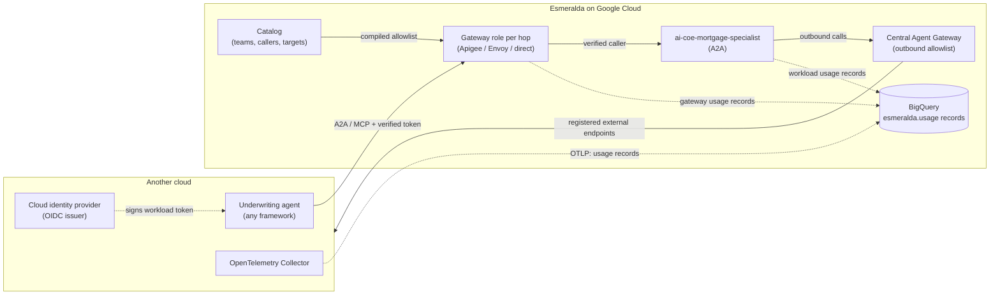

# 5.0 Multi-Cloud & Interoperability — Why Multi-Cloud Agents

Until now, every actor in Julian Sterling's mortgage story has lived inside one Google Cloud organization. `cx-mortgage-orchestrator` and `ai-coe-mortgage-specialist` run on Vertex AI Agent Runtime with SPIFFE Agent Identities, the MCP tool servers run on private Cloud Run, and every hop crosses the **Central Agent Gateway** and the private **entry point** (`*.esmeralda.internal`).

Real enterprises rarely look like that. A risk team may already run an underwriting agent on another cloud. An acquired subsidiary may bring a fraud-scoring service that runs on premises. A partner may offer an MCP server hosted wherever it likes. The question stops being *"how do we run agents on Google Cloud?"* and becomes:

> *"How do agents on **different clouds** call each other with verified identity, through governed paths, and show up in **one** usage and chargeback view?"*

Section 5 answers that question with the same tools the earlier sections introduced: the gateway on every hop, the catalog as the single list of who may call what, and published contracts that any producer can implement.

---

## Subsections in Section 5

| Subsection | Title & Focus | Who Should Read This |
| :--- | :--- | :--- |
| **[5.1 Identity Across Clouds](./01-identity-across-clouds.md)** | How a workload on another cloud proves who it is (workload identity federation, OIDC `iss#sub` verified at the gateway, SPIFFE federation, mTLS), how it is registered as a caller in the catalog, and why everything fails closed. | Security Architects, Identity Teams, Governance Leads |
| **[5.2 Cross-Cloud Connectivity & Protocols](./02-cross-cloud-connectivity.md)** | The gateway on each cross-cloud hop (Apigee as the best path, Envoy or `direct` as alternatives), network options from public endpoints to Cross-Cloud Interconnect, and A2A and MCP as the interoperable protocols. | Cloud Architects, NetOps, Platform Engineers |
| **[5.3 Unified Observability & Chargeback](./03-unified-observability-and-chargeback.md)** | The `esmeralda.usage` record as the normalized schema for every cloud and framework, producers on other clouds (OTel GenAI span adapter, OpenTelemetry Collector), landing in BigQuery, and chargeback by verified team. | FinOps Leads, SREs, Observability Engineers |
| **[5.4 Bringing an Agent from Another Cloud, End to End](./04-bringing-an-agent-from-another-cloud.md)** | A worked example: a synthetic underwriting agent on another cloud calls `ai-coe-mortgage-specialist`, with its catalog entries, the request flow, and the usage records it leaves behind. | Everyone, especially Agent Developers and Platform Teams |
| **[5.5 Status & Roadmap](./05-status-and-roadmap.md)** | What is available on `main`, what is in open pull requests, and what is planned. | Engineering Leaders, Contributors |

---

## 1. Why Agents End Up on More Than One Cloud

Multi-cloud agents are rarely a strategy decision on day one. They usually arrive for one of four reasons:

| Driver | What It Looks Like | What the Platform Must Provide |
| :--- | :--- | :--- |
| **Data gravity** | The loan-servicing data lives in another cloud's database, so the team that owns it builds its agent next to the data. | A way to call that agent without copying the data. |
| **Team autonomy** | A business unit already standardized on another cloud or another agent framework (LangGraph, CrewAI, custom code). | Framework-neutral protocols and telemetry. |
| **Mergers & partners** | A subsidiary or a partner exposes agents and MCP servers that the mortgage flow should reuse. | Identity that works across organizations, not only across projects. |
| **Resilience & regulation** | A workload must stay in a given country or provider for compliance, or the business wants no single-provider dependency. | Governed, auditable paths between providers. |

Each driver adds the same three problems that Esmeralda already solved *inside* Google Cloud:

1. **Who is calling?** Inside Google Cloud, the answer is a SPIFFE `principal://` identity or a service account. Across clouds there is no shared identity provider, so the answer has to be **federated** and **verified**.
2. **Through which governed path?** Inside Google Cloud, every egress crosses the Central Agent Gateway. Across clouds, every hop still needs a **gateway role** that authenticates, authorizes, meters and logs.
3. **Who pays?** Inside Google Cloud, OpenTelemetry baggage and BigQuery views attribute tokens to teams. Across clouds, every producer must describe usage in the **same schema**, and attribution must come from authentication, not from what a caller claims.

---

## 2. Four Principles That Carry Across Clouds

Esmeralda does not add a separate "multi-cloud product." It applies four principles that already shape the rest of the platform:

1. **Contracts, not implementations.** Esmeralda publishes two schemas: the **catalog** (`esmeralda.catalog`) and the **usage event** (`esmeralda.usage`). Any producer, in any cloud or language, can implement them.
2. **Every hop goes through a gateway role.** The product is chosen per hop: Apigee, Envoy, Agent Gateway, or the always-available `direct` floor.
3. **Attribution comes from authentication, never from the payload.** A cost centre in a header is a *declaration*; a verified token is an *identity*.
4. **Fail closed.** Only a caller listed in the catalog may call, and being listed is what makes it billable. Nothing ends up "allowed but unattributed."

---

## 3. Two Directions, One Model

Cross-cloud traffic flows in two directions, and Esmeralda governs both with the same model:

| Direction | Example | Gateway Role | Identity Verified | Where It Is Covered |
| :--- | :--- | :--- | :--- | :--- |
| **Inbound** (other cloud → Esmeralda) | An underwriting agent on another cloud asks `ai-coe-mortgage-specialist` for an assessment. | Apigee cross-cloud shared flow (best path), or Envoy / `direct` | OIDC `(issuer, subject)`, federated principal, SPIFFE ID or client certificate | [5.1](./01-identity-across-clouds.md), [5.2](./02-cross-cloud-connectivity.md), [5.4](./04-bringing-an-agent-from-another-cloud.md) |
| **Outbound** (Esmeralda → other cloud) | `ai-coe-mortgage-specialist` calls an MCP server or agent hosted on another cloud. | Central Agent Gateway + Agent Registry (deny by default) | The agent's own identity, presented to the remote side as a signed token | [2.1 Central Agent Gateway](../3-agentops-and-lifecycle/01-central-agent-gateway.md), [5.2](./02-cross-cloud-connectivity.md) |

In both directions, the usage that results lands in the same BigQuery tables, keyed by the same `trace_id` and attributed to the same catalog teams ([5.3](./03-unified-observability-and-chargeback.md)).

> [!NOTE]
> Multi-cloud support is being delivered in steps. Some building blocks are on `main` today, some are in open pull requests, and some are planned. Every subsection is explicit about which is which, and **[5.5 Status & Roadmap](./05-status-and-roadmap.md)** collects the full picture in one table.

---

## 4. Where Section 5 Connects to the Rest of the Platform

| Earlier Topic | What Section 5 Builds On |
| :--- | :--- |
| **[1.3 The Private Front Door & Pluggable Gateways](../2-workloads-and-catalog/01-ingress-gateways.md)** | The gateway adapter contract and the `direct` floor, reused as cross-cloud gateway roles. |
| **[1.4 Partner API Management & Token Monetization with Apigee X](../2-workloads-and-catalog/04-apigee-partner-gateway.md)** | API products, `VerifyAPIKey`, `LLMTokenQuota` and `ML-interaction` logging, extended with cross-cloud JWT verification. |
| **[2.1 Zero-Trust Egress & The Central Agent Gateway](../3-agentops-and-lifecycle/01-central-agent-gateway.md)** | Agent Registry as the deny-by-default list of external endpoints an agent may reach. |
| **[2.2 Capability-Based & Semantic Governance](../3-agentops-and-lifecycle/04-capability-based-governance.md)** | The `cross_cloud` capability and its `agent_gateway` / `apigee` providers. |
| **[2.3 FinOps, Telemetry & Cross-Team Chargeback](../3-agentops-and-lifecycle/03-centralized-monitoring-and-dashboards.md)** | Hub-and-spoke sinks and BigQuery views, generalized to records from any cloud. |

Let's begin with the question every cross-cloud call must answer first: **who is calling?** Continue to **[5.1 Identity Across Clouds](./01-identity-across-clouds.md)**.
