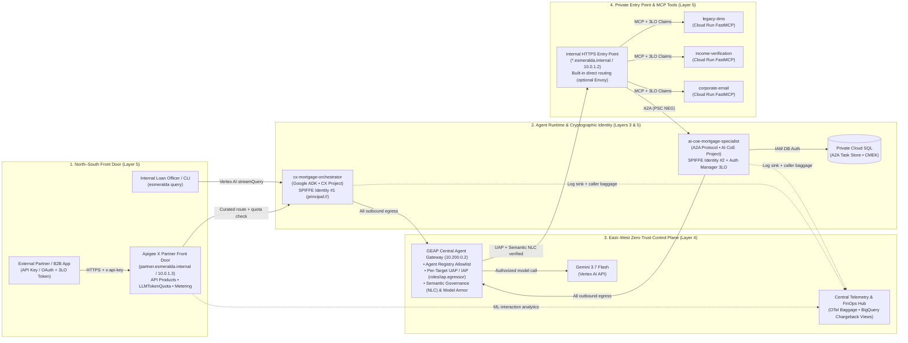
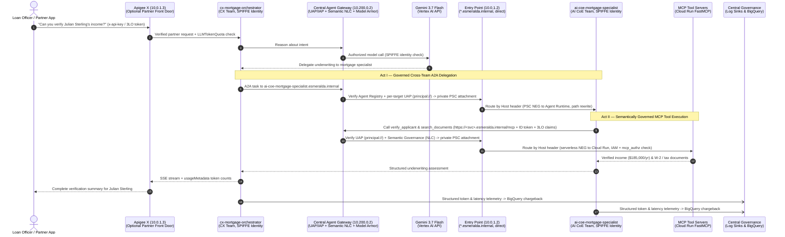
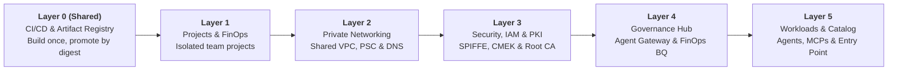

# Prologue & Book Index: The Esmeralda Architecture Book


Welcome to **Esmeralda**—an opinionated, commercial-grade reference blueprint for taking autonomous AI agents and Model Context Protocol (MCP) tool servers from a developer's laptop into zero-trust enterprise production on **Google Cloud**.

This documentation is written to be read like a cohesive book, from **Page 1 to Page N**, following a single real-world scenario (**Julian Sterling's mortgage underwriting application**). Use the **collapsible Part I–IV drop-down menus in the left sidebar** (or the interactive Book Index right below) to jump to any chapter, or read straight through using the **Next / Previous** links at the bottom of each page.

---

## Book Index: All Parts & Chapters (Page 1 to Page N)

???+ abstract "Part I — The Cast: Agents, Tools & Gateways (Layer 5)"
    *Best for AI Engineers, Application Architects, and Product & Engineering Leaders.*

    * **[Part I Overview — Four Teams, One Seamless Conversation](./2-workloads-and-catalog/index.md)** — How the Layer 5 workloads and the declarative `catalog` in `env.yaml` fit together.
    * **[Chapter 1: Two Teams, Two Agents — Orchestration vs. Specialization](./2-workloads-and-catalog/03-ai-agents-and-database.md)** — Why `cx-mortgage-orchestrator` (Google ADK) and `ai-coe-mortgage-specialist` (A2A) live in separate team GCP projects, run as BYOC on Vertex AI Agent Runtime with SPIFFE Agent Identity, and use a private Cloud SQL task store.
    * **[Chapter 2: Wrapping Enterprise Systems as MCP Tool Servers](./2-workloads-and-catalog/02-mcp-tool-servers.md)** — Turning `legacy-dms`, `income-verification`, and `corporate-email` into private Cloud Run FastMCP microservices with `tools.json` registration and end-to-end caller/user claims verification.
    * **[Chapter 3: The Private Front Door & Pluggable Gateways](./2-workloads-and-catalog/01-ingress-gateways.md)** — Why `*.esmeralda.internal` uses an internal HTTPS load balancer with built-in `direct` routing by default (zero proxy VMs) and how Envoy or Apigee X adapters plug in per host.
    * **[Chapter 3B: Partner API Management & Token Monetization with Apigee X](./2-workloads-and-catalog/04-apigee-partner-gateway.md)** — Complete deep dive into how Apigee X (`partner.esmeralda.internal` / `10.0.1.3`) works: PSC NEG plumbing, tiered API Products (`bronze`, `silver`, `gold`), `partner-agents` and `partner-mcp` proxy policies, two-phase `<LLMTokenQuota>` enforcement (`EnforceOnly` + SSE `EventFlow` `CountOnly`), and how Apigee hands off to GEAP Agent Identity and the Central Agent Gateway.

???+ abstract "Part II — The Trust Boundary: Governance, Identity & Operations (Layer 4)"
    *Best for CISOs, SecOps, Governance Leads, FinOps, and SRE / Platform Operators.*

    * **[Part II Overview — Multi-Track Release Lifecycle & Governance](./3-agentops-and-lifecycle/index.md)** — How six independent engineering tracks ship in parallel and promote immutable container digests (`release/prd.yaml`) from `dev` to `prd`.
    * **[Chapter 4: Zero-Trust Egress & The Central Agent Gateway](./3-agentops-and-lifecycle/01-central-agent-gateway.md)** — How Google's Central Agent Gateway (`AGENT_TO_ANYWHERE`), Agent Registry, per-target SPIFFE `roles/iap.egressor` bindings, and the internal Root CA govern every outbound packet (includes the **Complete Technical Deep Dive & Reference**).
    * **[Chapter 5: Capability-Based & Semantic Governance — Preventing the "Confused Deputy"](./3-agentops-and-lifecycle/04-capability-based-governance.md)** — Division of responsibilities across **Apigee X**, **GEAP Agent Identity & Auth Manager (3LO)**, and **Central Agent Gateway**; Unified Access Policies (UAPs), Semantic Governance (Natural Language Constraints, NLC), and removable Apigee X partner modules.
    * **[Chapter 6: FinOps, Telemetry & Cross-Team Chargeback](./3-agentops-and-lifecycle/03-centralized-monitoring-and-dashboards.md)** — Attributing every Gemini token across team boundaries via OpenTelemetry `BaggageSpanProcessor`, hub-and-spoke Cloud Logging sinks, BigQuery views (`vw_monthly_agent_chargeback`), and Golden Signals.
    * **[Chapter 7: Day-2 Operations with the `esmeralda` CLI & MCP Server](./3-agentops-and-lifecycle/04-operating-with-agents.md)** — Operating and verifying environments safely with `uv run esmeralda doctor/status/units/plan/apply/verify/logs/guard` and the read-only `esmeralda mcp` server.

???+ abstract "Part III — The Stage: Cloud Foundations (Layers 0–3)"
    *Best for Cloud Architects, NetOps, SecOps, and Infrastructure Engineers.*

    * **[Part III Overview — How Layered Contracts Unlock Parallel Teams](./1-platform-foundations/index.md)** — How Layers 0–3 bootstrap greenfield or brownfield (`byo_*`) enterprise landing zones.
    * **[Chapter 8: Project Isolation, Blast Radius & FinOps (Layer 1)](./1-platform-foundations/01-projects-and-finops.md)** — Why Esmeralda provisions six per-environment projects (`net-host`, `gateway`, `mcps`, `ai-coe-agents`, `cx-agents`, `governance`) plus shared Layer 0 `cicd`, and eagerly bootstraps service identities.
    * **[Chapter 9: Private Networking, Shared VPC & Private DNS (Layer 2)](./1-platform-foundations/02-private-networking.md)** — How tenant-hosted Reasoning Engines reach private `*.esmeralda.internal` endpoints with zero public IPs via Shared VPC, Direct VPC Egress, PSC attachments, and DNS peering.
    * **[Chapter 10: Cryptographic Trust — SPIFFE Agent Identity, CMEK & Internal PKI (Layer 3)](./1-platform-foundations/03-security-iam-and-telemetry.md)** — The Three-Identity Delegation Architecture (`User Identity`, `Agent SPIFFE Identity`, `Delegated Identity`), centralized KMS CMEK keys, and the internal Root CA.

???+ abstract "Part IV — The Developer Toolkit: `esmeralda` Library & CLI (`esmeralda-platform`)"
    *Best for Application Developers, Platform Engineers, and AI Coding Agents.*

    * **[Part IV Overview — Keeping Every Agent at ~30 Lines of Pure Domain Logic](./4-esmeralda-library/index.md)** — How `packages/esmeralda` (`esmeralda-platform` on PyPI) handles certificates, proxy routing, auth, telemetry, and CLI operations.
    * **[Chapter 11: Developer Usage Guide](./4-esmeralda-library/guide.md)** — Recipes for serving ADK/A2A agents, calling MCP servers and remote agents, propagating 3LO user tokens, and running local full-stack queries.
    * **[Chapter 12: Package & CLI Reference](./4-esmeralda-library/reference.md)** — Complete specification of every module (`esmeralda.app`, `auth`, `auth_manager`, `mcp`, `mcp_authz`, `a2a`, `telemetry`, `certs`, `ops`, `cli`), CLI flag, and environment variable.

---

## 1. The Story & Why It Matters: Why 90% of Enterprise Agents Stall

In almost every enterprise today, building a compelling AI agent demo takes a single afternoon. A developer wires an LLM prompt to a few Python helper functions on a laptop, runs a sample query, and the prototype works.

Then the team tries to take that prototype to production—and hits a wall:

* **Security & Egress Risk:** How do we guarantee an autonomous agent can only call approved internal tools and partner APIs, without opening broad firewall holes or embedding static API keys?
* **Cross-Team Bottlenecks:** If the Customer Experience (CX) team wants to reuse an underwriting capability built by the AI Center of Excellence (AI CoE), how do they call it across GCP project boundaries without sharing databases or service accounts?
* **Coupled Release Cycles:** If a backend team updates a payroll or document-management connector, why does the AI team have to re-evaluate and redeploy their entire reasoning engine?
* **Cost & Audit Blindness:** When ten departments share foundation models and tools, how does FinOps attribute token spend and latency back to the exact business unit that triggered a request?

Most prototypes stall because teams try to solve application reasoning, tool integration, private networking, identity, and governance inside a single monolithic codebase or a single cloud project.

### A Decoupled Layered Architecture for Multi-Track Parallelism

Esmeralda breaks this logjam by organizing the enterprise AI stack into **six decoupled infrastructure layers (`L0`–`L5`)** joined by **four explicit contracts**:

1. **Private DNS (`*.esmeralda.internal`)** — Stable, human-readable hostnames that never change even if the underlying runtime or gateway adapter changes.
2. **Central `Agent Registry`** — A deny-by-default catalog of every allowed MCP tool server (`TOOL_SPEC`) and A2A specialist agent (`A2A_AGENT_CARD`).
3. **Declarative Service Catalog (`catalog` in `env.yaml`)** — A single source of truth declaring every internal service, its routing backend, its health probe, and which callers are authorized to invoke it.
4. **Portable Agent Manifest (`agent.yaml`)** — A clean contract between Python agent code (`apps/`) and Cloud infrastructure (`infrastructure/`).

Because these boundaries are strict and stable, **seven independent tracks and teams can build, test, and deploy in parallel without blocking one another**:

| Parallel Track | Team | What They Own & Evolve Independently | What They Never Have to Touch |
| :--- | :--- | :--- | :--- |
| **Track 1: Customer Experience** | **CX Product Team** | User-facing **orchestrator** agents (`cx-mortgage-orchestrator` on Google ADK) in `esm-<env>-cx-agents-<sfx>`. | Backend SQL/API code, VPC routing, or specialist agent internals. |
| **Track 2: Reusable Domain AI** | **AI CoE Team** | Domain **specialist** agents (`ai-coe-mortgage-specialist`) exposed over the **A2A** protocol in `esm-<env>-ai-coe-agents-<sfx>`. | Customer UI channels, firewall rules, or load balancer certificates. |
| **Track 3: Enterprise Tools** | **Backend / MCP Teams** | Standalone **FastMCP** microservices (`legacy-dms`, `income-verification`, `corporate-email`) on Cloud Run in `esm-<env>-mcps-<sfx>`. | LLM prompts, model upgrades, or agent orchestration graphs. |
| **Track 4: Ingress & API Mediation** | **Gateway / Partner Team** | The private **entry point** (`*.esmeralda.internal`) using built-in `direct` routing or optional **Envoy / Apigee** adapters in `esm-<env>-gateway-<sfx>`. | Python agent code or MCP business logic. |
| **Track 5: Governance & FinOps** | **Governance / FinOps Team** | Outbound policy (**Central Agent Gateway**), **Model Armor** templates, and **BigQuery chargeback views** in `esm-<env>-governance-<sfx>`. | Individual service deployments or container Dockerfiles. |
| **Track 6: Zero-Trust Security** | **SecOps & Identity Team** | Cryptographic **SPIFFE Agent Identity**, Cloud KMS CMEK keys, Secret Manager, and the **internal Root CA** (`layer-3-security`). | Application release schedules or route maps. |
| **Track 7: Cloud Foundations** | **Networking & Platform Team** | Shared VPC, Private Service Connect (PSC), DNS zones, and immutable CI/CD promotion pipelines (`layer-0` to `layer-2`). | Agent prompts, tool schemas, or A2A task stores. |

---

## 2. Architecture at a Glance: Julian Sterling's Mortgage Application

To make every architectural concept concrete, this book follows a single real-world thread from start to finish: a loan officer or external partner application asks Esmeralda,

> ***"Can you verify Julian Sterling's income?"***

### End-to-End System Topology



### The 60-Second Request Tour



1. **The North–South Front Door (`Apigee X` or Direct SDK):** External B2B partner apps enter through **Apigee X** (`partner.esmeralda.internal`), which validates API keys/OAuth tokens, blocks direct access to internal specialists, and enforces commercial `<LLMTokenQuota>` budgets. Internal callers can invoke the orchestrator directly via `uv run esmeralda query`.
2. **The Orchestrator Reasons (`cx-mortgage-orchestrator`):** Running as a Bring-Your-Own-Container (BYOC) workload on Vertex AI Agent Runtime in the CX team's project with its own attested **SPIFFE Agent Identity (`principal://`)**, the orchestrator consults Gemini and delegates underwriting to the AI CoE's mortgage specialist.
3. **The East–West Trust Boundary Inspects (`Central Agent Gateway`):** Every outbound packet passes through the Google-managed **Central Agent Gateway** (`AGENT_TO_ANYWHERE`), which verifies the caller's **SPIFFE `principal://` identity** against per-target **Unified Access Policies (UAP / IAP)**, checks the **Agent Registry**, evaluates **Semantic Governance (Natural Language Constraints, NLC)** on tool arguments, and runs **Model Armor** screening.
4. **The Private Front Door Routes (`Entry Point`):** The gateway forwards the request over Private Service Connect to the internal HTTPS load balancer (**entry point**, `*.esmeralda.internal`), which presents a certificate signed by Esmeralda's internal Root CA and routes straight to the target engine or Cloud Run service (`direct` backend).
5. **The Specialist Calls MCP Tools (`ai-coe-mortgage-specialist` → `Cloud Run`):** The specialist—using its own SPIFFE identity and **Auth Manager 3LO user delegation**—invokes `income-verification`, `legacy-dms`, and `corporate-email` over MCP (`https://<svc>.esmeralda.internal/mcp`).
6. **FinOps Closes the Loop (`BigQuery & Cloud Monitoring`):** OpenTelemetry caller baggage (`caller.project_id`, `caller.agent_name`) and structured token telemetry flow into BigQuery (`vw_monthly_agent_chargeback`), attributing every token to the exact initiating team and agent.

---

## 3. Why We Designed It This Way: The 6 Layers & Key Decisions

Infrastructure is provisioned from the ground up in **six decoupled layers** using Terragrunt. Layer 0 is shared across environments; Layers 1 through 5 are instantiated identically per environment (`dev`, `prd`):



### Architectural Decisions at a Glance

| Architectural Decision | Why We Made It | What We Avoided |
| :--- | :--- | :--- |
| **Per-Team GCP Projects (`L1`)** (`cx-agents`, `ai-coe-agents`, `mcps`, `gateway`, `governance`) | Gives every engineering track its own IAM boundary, quota pool, and FinOps chargeback bucket. | A "mega-project" where experimental agents share service accounts and blast radius with production tools. |
| **Stable `*.esmeralda.internal` DNS + Internal Root CA (`L2`–`L3`)** | Decouples callers from dynamic Cloud Run URLs and Vertex AI engine resource IDs while maintaining full end-to-end TLS verification. | Hardcoding `run.app` or `aiplatform.googleapis.com` resource IDs inside agent code or disabling TLS verification (`verify=False`). |
| **Central Agent Gateway + Agent Registry (`L4`)** | Enforces a Google-managed, deny-by-default outbound allowlist for every agent based on cryptographic SPIFFE identity. | Custom egress squid proxies, unmanaged NAT gateways, or agents calling arbitrary external URLs. |
| **Built-In `direct` Entry Point with Optional Adapters (`L5`)** | Routes `*.esmeralda.internal` traffic natively via Google Cloud Load Balancing NEGs by default (zero proxy compute cost, end-to-end caller identity), while allowing teams to opt into Envoy or Apigee per host. | Mandatory reverse-proxy hops that hide caller identity and add operational overhead when simple routing suffices. |
| **Build Once, Promote by Digest (`L0`)** | Container images contain zero environment secrets or certificates; `prd` runs the exact SHA-256 image digest verified in `dev`. | Rebuilding containers per environment or baking certificates into Docker images. |

---

## 4. How to Read This Book & Quick Start

We have structured the documentation into **four parts** that follow Julian Sterling's request from the application surface down to the cloud foundation and developer tooling:

| Part | Focus | Chapters | Best For |
| :--- | :--- | :--- | :--- |
| **[Part I — The Cast: Agents, Tools & Gateways](./2-workloads-and-catalog/index.md)** | The runtime workloads in **Layer 5** and the declarative service catalog that connects them. | • [Ch 1: Two Teams, Two Agents (ADK & A2A)](./2-workloads-and-catalog/03-ai-agents-and-database.md)<br/>• [Ch 2: Wrapping Systems as MCP Tool Servers](./2-workloads-and-catalog/02-mcp-tool-servers.md)<br/>• [Ch 3: The Private Front Door & Gateways](./2-workloads-and-catalog/01-ingress-gateways.md) | AI Engineers, Application Architects, Product & Engineering Leaders |
| **[Part II — The Trust Boundary: Governance & Operations](./3-agentops-and-lifecycle/index.md)** | How **Layer 4** governs every outbound call, inspects content, tracks FinOps costs, and powers day-2 operations. | • [Ch 4: Central Agent Gateway & Private PKI](./3-agentops-and-lifecycle/01-central-agent-gateway.md)<br/>• [Ch 5: Capability-Based Governance](./3-agentops-and-lifecycle/04-capability-based-governance.md)<br/>• [Ch 6: Monitoring, Dashboards & FinOps](./3-agentops-and-lifecycle/03-centralized-monitoring-and-dashboards.md)<br/>• [Ch 7: Operating with Agents & CLI](./3-agentops-and-lifecycle/04-operating-with-agents.md) | SecOps, Governance Leads, FinOps, SRE / Platform Operators |
| **[Part III — The Stage: Platform Foundations](./1-platform-foundations/index.md)** | The zero-trust landing zone (**Layers 0–3**) that makes Parts I and II possible. | • [Ch 8: Projects & FinOps (Layer 1)](./1-platform-foundations/01-projects-and-finops.md)<br/>• [Ch 9: Private Networking & DNS (Layer 2)](./1-platform-foundations/02-private-networking.md)<br/>• [Ch 10: Security, IAM, CMEK & PKI (Layer 3)](./1-platform-foundations/03-security-iam-and-telemetry.md) | Cloud Architects, NetOps, Infrastructure Engineers |
| **[Part IV — The Developer Toolkit: Esmeralda Library & CLI](./4-esmeralda-library/index.md)** | The `esmeralda` Python runtime package, CLI, and read-only MCP server. | • [Ch 11: Developer Usage Guide](./4-esmeralda-library/guide.md)<br/>• [Ch 12: Package & CLI Reference](./4-esmeralda-library/reference.md) | All Developers & AI Coding Agents |

### Try It Now with the `esmeralda` CLI

Every operation in Esmeralda is available through the `esmeralda` CLI (`uv run esmeralda --help`):

```bash
# 1. Check local tools, credentials, and environment configuration
uv run esmeralda doctor --env dev
uv run esmeralda status --env dev

# 2. Run Julian Sterling's mortgage query locally (auto-starts local MCP servers)
uv run esmeralda query apps/agents/cx-mortgage-orchestrator \
  -q "Can you verify Julian Sterling's income?"

# 3. Verify a deployed environment end-to-end (all catalog probes + live orchestrator query)
uv run esmeralda verify --env dev
```

Ready to meet the cast of workloads that answer Julian Sterling's request? Turn the page to **[Part I — The Cast: Agents, Tools & Gateways](./2-workloads-and-catalog/index.md)**.
