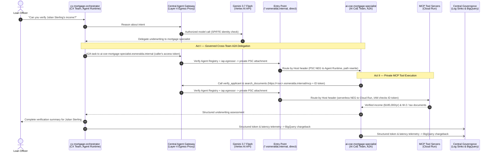
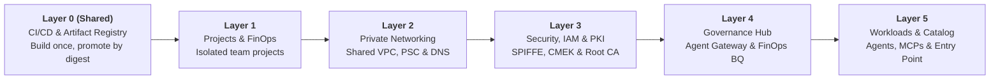

# Prologue: The Esmeralda Architecture Book


Welcome to **Esmeralda**—an opinionated, commercial-grade reference blueprint for taking autonomous AI agents and Model Context Protocol (MCP) tool servers from a developer's laptop into zero-trust enterprise production on **Google Cloud**.

This documentation is written to be read like a cohesive book, from **Page 1 to Page N**. Whether you are a **business or engineering leader** evaluating how to organize multi-team AI delivery, or a **hands-on architect, AI engineer, or platform operator** deploying workloads, every chapter explains *what* each component does, *why* we designed it this way, and *how* to operate it in practice.

---

## 1. The Story & Why It Matters: Why 90% of Enterprise Agents Stall

In almost every enterprise today, building a compelling AI agent demo takes a single afternoon. A developer wires an LLM prompt to a few Python helper functions on a laptop, runs a sample query, and the prototype works.

Then the team tries to take that prototype to production—and hits a wall:

* **Security & Egress Risk:** How do we guarantee an autonomous agent can only call approved internal tools and partner APIs, without opening broad firewall holes or embedding static API keys?
* **Cross-Team Bottlenecks:** If the Customer Experience (CX) team wants to reuse an underwriting capability built by the AI Center of Excellence (AI CoE), how do they call it across GCP project boundaries without sharing databases or service accounts?
* **Coupled Release Cycles:** If a backend team updates a payroll or document-management connector, why does the AI team have to re-evaluate and redeploy their entire reasoning engine?
* **Cost & Audit Blindness:** When ten departments share foundation models and tools, how does FinOps attribute token spend and latency back to the exact business unit that triggered a request?

Most prototypes stall because teams try to solve application reasoning, tool integration, private networking, identity, and governance inside a single monolithic codebase or a single cloud project.

### A Decoupled Layered Architecture for Multi-Track Parallelism

Esmeralda breaks this logjam by organizing the enterprise AI stack into **six decoupled infrastructure layers (`L0`–`L5`)** joined by **four explicit contracts**:

1. **Private DNS (`*.esmeralda.internal`)** — Stable, human-readable hostnames that never change even if the underlying runtime or gateway adapter changes.
2. **Central `Agent Registry`** — A deny-by-default catalog of every allowed MCP tool server (`TOOL_SPEC`) and A2A specialist agent (`A2A_AGENT_CARD`).
3. **Declarative Service Catalog (`catalog` in `env.yaml`)** — A single source of truth declaring every internal service, its routing backend, its health probe, and which callers are authorized to invoke it.
4. **Portable Agent Manifest (`agent.yaml`)** — A clean contract between Python agent code (`apps/`) and Cloud infrastructure (`infrastructure/`).

Because these boundaries are strict and stable, **seven independent tracks and teams can build, test, and deploy in parallel without blocking one another**:

| Parallel Track | Team | What They Own & Evolve Independently | What They Never Have to Touch |
| :--- | :--- | :--- | :--- |
| **Track 1: Customer Experience** | **CX Product Team** | User-facing **orchestrator** agents (`cx-mortgage-orchestrator` on Google ADK) in `esm-<env>-cx-agents-<sfx>`. | Backend SQL/API code, VPC routing, or specialist agent internals. |
| **Track 2: Reusable Domain AI** | **AI CoE Team** | Domain **specialist** agents (`ai-coe-mortgage-specialist`) exposed over the **A2A** protocol in `esm-<env>-ai-coe-agents-<sfx>`. | Customer UI channels, firewall rules, or load balancer certificates. |
| **Track 3: Enterprise Tools** | **Backend / MCP Teams** | Standalone **FastMCP** microservices (`legacy-dms`, `income-verification`, `corporate-email`) on Cloud Run in `esm-<env>-mcps-<sfx>`. | LLM prompts, model upgrades, or agent orchestration graphs. |
| **Track 4: Ingress & API Mediation** | **Gateway / Partner Team** | The private **entry point** (`*.esmeralda.internal`) using built-in `direct` routing or optional **Envoy / Apigee** adapters in `esm-<env>-gateway-<sfx>`. | Python agent code or MCP business logic. |
| **Track 5: Governance & FinOps** | **Governance / FinOps Team** | Outbound policy (**Central Agent Gateway**), **Model Armor** templates, and **BigQuery chargeback views** in `esm-<env>-governance-<sfx>`. | Individual service deployments or container Dockerfiles. |
| **Track 6: Zero-Trust Security** | **SecOps & Identity Team** | Cryptographic **SPIFFE Agent Identity**, Cloud KMS CMEK keys, Secret Manager, and the **internal Root CA** (`layer-3-security`). | Application release schedules or route maps. |
| **Track 7: Cloud Foundations** | **Networking & Platform Team** | Shared VPC, Private Service Connect (PSC), DNS zones, and immutable CI/CD promotion pipelines (`layer-0` to `layer-2`). | Agent prompts, tool schemas, or A2A task stores. |

---

## 2. The 60-Second Tour: Julian Sterling's Mortgage Application

To make every architectural concept concrete, this book follows a single real-world thread from start to finish: a loan officer asks Esmeralda,

> ***"Can you verify Julian Sterling's income?"***

Here is what happens across the platform in the seconds after that question is asked:



1. **The Orchestrator Reasons (`cx-mortgage-orchestrator`):** Running as a Bring-Your-Own-Container (BYOC) workload on Vertex AI Agent Runtime in the CX team's project, the orchestrator consults Gemini and decides to delegate income verification to the AI CoE's mortgage specialist.
2. **The Trust Boundary Inspects (`Central Agent Gateway`):** The orchestrator cannot reach the network directly. Every outbound packet passes through the Google-managed **Central Agent Gateway** (`AGENT_TO_ANYWHERE`), which verifies the orchestrator's **SPIFFE Agent Identity**, checks that `ai-coe-mortgage-specialist.esmeralda.internal` is registered in the **Agent Registry**, and confirms the caller holds `roles/iap.egressor`.
3. **The Private Front Door Routes (`Entry Point`):** The gateway forwards the request over Private Service Connect to the **entry point**—an internal HTTPS load balancer presenting a certificate signed by Esmeralda's internal Root CA. Using the built-in **`direct`** backend, the load balancer rewrites the path and routes the request straight to the specialist's Agent Runtime engine with zero intermediate proxy VMs.
4. **The Specialist Calls MCP Tools (`ai-coe-mortgage-specialist` → `Cloud Run`):** The specialist invokes `income-verification`, `legacy-dms`, and `corporate-email` over the Model Context Protocol (`https://<svc>.esmeralda.internal/mcp`). Each tool call traverses the same Central Agent Gateway and entry point, arriving at private Cloud Run microservices with the caller's own Google ID token intact.
5. **FinOps Closes the Loop (`BigQuery & Cloud Monitoring`):** Structured telemetry from both agents flows via centralized log sinks into BigQuery (`vw_monthly_agent_chargeback`), attributing every input and output token to the exact project and agent.

---

## 3. Why We Designed It This Way: The 6 Layers & Key Decisions

Infrastructure is provisioned from the ground up in **six decoupled layers** using Terragrunt. Layer 0 is shared across environments; Layers 1 through 5 are instantiated identically per environment (`dev`, `prd`):



### Architectural Decisions at a Glance

| Architectural Decision | Why We Made It | What We Avoided |
| :--- | :--- | :--- |
| **Per-Team GCP Projects (`L1`)** (`cx-agents`, `ai-coe-agents`, `mcps`, `gateway`, `governance`) | Gives every engineering track its own IAM boundary, quota pool, and FinOps chargeback bucket. | A "mega-project" where experimental agents share service accounts and blast radius with production tools. |
| **Stable `*.esmeralda.internal` DNS + Internal Root CA (`L2`–`L3`)** | Decouples callers from dynamic Cloud Run URLs and Vertex AI engine resource IDs while maintaining full end-to-end TLS verification. | Hardcoding `run.app` or `aiplatform.googleapis.com` resource IDs inside agent code or disabling TLS verification (`verify=False`). |
| **Central Agent Gateway + Agent Registry (`L4`)** | Enforces a Google-managed, deny-by-default outbound allowlist for every agent based on cryptographic SPIFFE identity. | Custom egress squid proxies, unmanaged NAT gateways, or agents calling arbitrary external URLs. |
| **Built-In `direct` Entry Point with Optional Adapters (`L5`)** | Routes `*.esmeralda.internal` traffic natively via Google Cloud Load Balancing NEGs by default (zero proxy compute cost, end-to-end caller identity), while allowing teams to opt into Envoy or Apigee per host. | Mandatory reverse-proxy hops that hide caller identity and add operational overhead when simple routing suffices. |
| **Build Once, Promote by Digest (`L0`)** | Container images contain zero environment secrets or certificates; `prd` runs the exact SHA-256 image digest verified in `dev`. | Rebuilding containers per environment or baking certificates into Docker images. |

---

## 4. How to Read This Book & Quick Start

We have structured the documentation into **four parts** that follow Julian Sterling's request from the application surface down to the cloud foundation and developer tooling:

| Part | Focus | Chapters | Best For |
| :--- | :--- | :--- | :--- |
| **[Part I — The Cast: Agents, Tools & Gateways](./2-workloads-and-catalog/index.md)** | The runtime workloads in **Layer 5** and the declarative service catalog that connects them. | • [Ch 1: Two Teams, Two Agents (ADK & A2A)](./2-workloads-and-catalog/03-ai-agents-and-database.md)<br/>• [Ch 2: Wrapping Systems as MCP Tool Servers](./2-workloads-and-catalog/02-mcp-tool-servers.md)<br/>• [Ch 3: The Private Front Door & Gateways](./2-workloads-and-catalog/01-ingress-gateways.md) | AI Engineers, Application Architects, Product & Engineering Leaders |
| **[Part II — The Trust Boundary: Governance & Operations](./3-agentops-and-lifecycle/index.md)** | How **Layer 4** governs every outbound call, inspects content, tracks FinOps costs, and powers day-2 operations. | • [Ch 4: Central Agent Gateway & Private PKI](./3-agentops-and-lifecycle/01-central-agent-gateway.md)<br/>• [Ch 5: Capability-Based Governance](./3-agentops-and-lifecycle/04-capability-based-governance.md)<br/>• [Ch 6: Monitoring, Dashboards & FinOps](./3-agentops-and-lifecycle/03-centralized-monitoring-and-dashboards.md)<br/>• [Ch 7: Operating with Agents & CLI](./3-agentops-and-lifecycle/04-operating-with-agents.md) | SecOps, Governance Leads, FinOps, SRE / Platform Operators |
| **[Part III — The Stage: Platform Foundations](./1-platform-foundations/index.md)** | The zero-trust landing zone (**Layers 0–3**) that makes Parts I and II possible. | • [Ch 8: Projects & FinOps (Layer 1)](./1-platform-foundations/01-projects-and-finops.md)<br/>• [Ch 9: Private Networking & DNS (Layer 2)](./1-platform-foundations/02-private-networking.md)<br/>• [Ch 10: Security, IAM, CMEK & PKI (Layer 3)](./1-platform-foundations/03-security-iam-and-telemetry.md) | Cloud Architects, NetOps, Infrastructure Engineers |
| **[Part IV — The Developer Toolkit: Esmeralda Library & CLI](./4-esmeralda-library/index.md)** | The `esmeralda` Python runtime package, CLI, and read-only MCP server. | • [Ch 11: Developer Usage Guide](./4-esmeralda-library/guide.md)<br/>• [Ch 12: Package & CLI Reference](./4-esmeralda-library/reference.md) | All Developers & AI Coding Agents |

### Try It Now with the `esmeralda` CLI

Every operation in Esmeralda is available through the `esmeralda` CLI (`uv run esmeralda --help`):

```bash
# 1. Check local tools, credentials, and environment configuration
uv run esmeralda doctor --env dev
uv run esmeralda status --env dev

# 2. Run Julian Sterling's mortgage query locally (auto-starts local MCP servers)
uv run esmeralda query apps/agents/cx-mortgage-orchestrator \
  -q "Can you verify Julian Sterling's income?"

# 3. Verify a deployed environment end-to-end (all catalog probes + live orchestrator query)
uv run esmeralda verify --env dev
```

Ready to meet the cast of workloads that answer Julian Sterling's request? Turn the page to **[Part I — The Cast: Agents, Tools & Gateways](./2-workloads-and-catalog/index.md)**.
